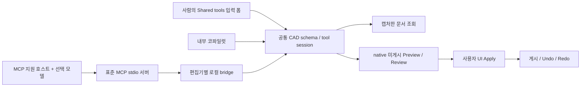

# CAD MCP 연결

2026-10-25: 기존 live 로프트의 연결 방식을 바꾸는 `solid.loft.update`를 추가했다. 현재 canonical 40개 / MCP 43개 / 사람 공통 폼 14종이며 속성 버튼·자연어·MCP가 같은 native 미리보기와 Apply를 사용한다. [인계·왕복 편집 검증](../implementation/LOFT-EDIT-HANDOFF-2026-10-25.md). 아래 날짜별 개수는 당시의 기록이다.

2026-10-24 곡선 인계 검증: 사람용 폼 12종이 동일한 39개 canonical 도구/42개 MCP 노출의 일부를 사용한다. fitted curve 읽기·한 점 수정·연관 도면 명시 재연결도 같은 선택과 Review를 공유한다. 닫힌 NURBS의 native 프로파일 전달은 내부에서 처리하며 외부 모델이 기하 실행기를 대신하지 않는다. [전시 키오스크 검증](../implementation/KIOSK-HANDOFF-2026-10-24.md).

2026-10-23. 공통 CAD 도구를 표준 MCP 클라이언트와 연결한다. [공통 도구 계약](CAD-TOOL-INTERFACE.md), [Copilot 사용법](../features/COPILOT.md), [구현·검증](../implementation/CAD-MCP-01-2026-10-23.md)을 함께 읽는다.

기존 gateway의 `{version:1, toolCalls}` JSON 계약 자체는 MCP가 아니었다. 지금은 공식 MCP TypeScript SDK 2.3.1의 **stdio 서버**를 별도로 제공하고, 그 서버가 켜진 편집기의 동일한 도구 세션과 Review에 요청을 전달한다. 내부 엔진은 네트워크를 왕복하지 않고 같은 도구 계약을 직접 사용한다. 모델 제공자별 기하 실행기를 만들지 않는다.



## 실행과 연결

1. 저장소 루트에서 `pnpm install`, 이어 `pnpm --filter @agent-webcad/web dev --host 127.0.0.1`로 앱을 실행한다. Vite `preview`에도 bridge plugin이 연결되어 있다. 정적 파일만 올린 호스팅에는 bridge 서버가 없으므로 이 연결은 동작하지 않는다.
2. 연결할 프로젝트의 **Copilot → CAD MCP → Enable CAD MCP**를 누른다. 기본 상태는 꺼짐이며 모델이나 서버를 자동 실행하지 않는다.
3. **MCP client configuration**을 펼쳐 JSON을 원하는 MCP 지원 호스트의 서버 설정에 복사한다. Node와 TS 실행기·서버의 절대 경로 및 현재 포트가 생성된다. 호스트가 이 stdio 서버 프로세스를 실행한다.
4. 연결한 호스트에서 `cad.context`를 호출하고 반환된 `contextId`로 도구를 조회한다. 앱에서 기존 대상을 선택해야 수정할 수 있다.
5. 쓰기 호출 결과는 `pending-review`다. 앱의 기존 Review에서 형상·치수·영향을 보고 **Apply**한다. `cad.proposal`로 게시 상태를 조회한다.
6. **Disconnect CAD MCP**는 토큰을 폐기하고 그 연결의 미게시 Review를 취소한다. 도면을 새로 열어 document ID가 바뀌어도 해제된다. UI 토큰은 CAD 파일·localStorage에 저장하지 않으며 서버 재시작/새로고침 후 다시 연결한다.

생성 JSON의 토큰은 켜 둔 편집기에 대한 일시적 권한이다. 레포나 공유 문서에 붙여넣지 않는다. 복사 기능은 사용자의 호스트 설정을 준비할 뿐, 해당 호스트나 모델을 자동 설치/변경하지 않는다.

## 도구 계약

현재 MCP는 **43개 도구**를 제공한다. 기존 공통 CAD 도구 **40개**와 아래 세 연결 도구다. 수동 CAD 기능 전체를 노출했다는 뜻은 아니다. 문/벽·곡선·스케치·솔리드 등의 지원 범위는 공통 카탈로그를 따른다.

| 도구 | 입력과 결과 |
| --- | --- |
| `cad.context` | `{}` → document version, UI selection, workPlane, layerId, mm 단위, `contextId`. 원본 도면/이미지를 통째로 전송하지 않음 |
| 기존 조회/모델링 도구 | 기존 inputSchema에 필수 `_context`만 추가. `_context`는 `cad.context`에서 받은 ID. 조회는 captured session, 쓰기는 검토 제안 |
| `cad.propose` | `{contextId,calls:[{id,name,arguments}]}`. 공통 모델링 호출 1–20개를 한 Review로 준비. 개별 arguments에는 `_context`를 넣지 않음. 조회와 쓰기 혼합 금지 |
| `cad.proposal` | `{proposalId}` → `pending-review`, `applied`, `cancelled`. 켜진 연결에서 최근 20개 유지. `applied`는 한 번 게시되었다는 영수증이며, 이후 Undo 뒤 현재 형상을 의미하지 않음 |

예시 순서:

```json
{"name":"cad.context","arguments":{}}
```

반환 `structuredContent.result.contextId`를 `CTX`라고 할 때:

```json
{"name":"cad.objects","arguments":{"_context":"CTX","search":"벽","limit":10}}
```

```json
{"name":"cad.propose","arguments":{"contextId":"CTX","calls":[{"id":"wall","name":"wall.create","arguments":{"id":"wallA","start":[0,0],"end":[6000,0],"height":3000,"thickness":200,"baseLevel":0,"openings":[]}}]}}
```

성공 결과는 `content`의 JSON 텍스트와 `structuredContent: {ok:true,result:...}`를 함께 반환한다. native 조회 결과는 기존 `{ok,version,result}`를 내부에 유지한다. native 실패/연결 실패는 `isError:true`와 짧은 진단을 반환한다. 미리보기 성공을 실제 게시 성공으로 응답하지 않는다. 잘못된 schema는 SDK와 공통 validator가 거절한다.

## 문맥·취소·연결 경계

- 문서 ID/revision/generation, 선택 순서, 작업면, 레이어를 캡처한다. 바뀌면 조회/계획을 거절하고 새 `cad.context`를 요구한다. 기존 개체를 읽었다고 편집 selection을 변경하지 않는다.
- 문맥은 2분, 최대 8개다. 서버는 편집기의 poll이 60초 이상 끊기면 연결을 만료시킨다. 활성 연결 최대 16개, 연결별 요청 최대 8개, 메시지 64KiB, 호출 deadline 60초다. 사용자 검토 대기 시간은 MCP 요청으로 붙잡지 않는다.
- 공식 SDK의 취소 신호를 HTTP 요청, bridge cancellation, native preview의 AbortSignal까지 전달한다. 미게시 결과를 강제로 게시하는 도구는 없다.
- 이미 다른 Review/스케치/설계 연구/기하 작업이 진행 중이면 새 MCP 제안을 거절한다. 다른 제안을 자동 교체하지 않는다. UI Apply와 그 native 검증/잠금/참조/Undo를 우회하지 않는다.
- 서버는 loopback 주소·Host·Origin을 검사한다. 브라우저 UI와 stdio 호스트의 토큰은 서로 다르며 연결 하나에 묶인다. 외부 웹 Origin, 다른 편집기의 응답, 무인증 접근을 거절한다.

## 모델과 배포 범위

MCP는 모델의 추론 능력을 제공하지 않는다. 외부 모델/로컬 모델은 **MCP 클라이언트 역할을 하는 호스트**가 연결한다. Ollama의 추론 API가 곧바로 MCP 호스트가 되는 것은 아니다. 현재 내부 엔진·Ollama gateway도 계속 사용할 수 있다. 이 단계에서는 임의 provider의 호스트 설정이나 인증을 자동 변경하지 않았다.

완료 범위는 로컬 stdio MCP와 dev/preview 앱 bridge다. 공개 원격 Streamable HTTP 서비스, OAuth, headless CAD 서버, 임의 script/command, remote Apply는 제공하지 않는다.

근거: [공식 SDK v2](https://ts.sdk.modelcontextprotocol.io/v2/), [기존 JSON Schema 등록](https://ts.sdk.modelcontextprotocol.io/v2/advanced/schema-libraries.html), [stdio 연결](https://ts.sdk.modelcontextprotocol.io/v2/clients/connect.html), [취소 전달](https://ts.sdk.modelcontextprotocol.io/v2/servers/logging-progress-cancellation.html).


## 주택 과제에서 사용한 조합 (2026-10-24)

`curve.polyline → slab.create → scene.objects`를 한 제안에 담아 닫힌 XY 외곽과 계단 구멍, 지하 레벨, 층 레이어와 재료를 함께 검토할 수 있다. `scene.layer`는 보이는 잠금 해제 레이어를 만들며 현재 작업 레이어를 바꾸지 않는다. `scene.objects`는 명시한 새 결과 또는 선택한 독립 개체의 이름·레이어·표시·솔리드 재료를 기존 native 명령으로 수정한다. geometry 호출 뒤에 두며 한 제안의 실패·Undo 경계를 공유한다.

실제 주택 과제는 [틈마당집](../../output/projects/lightwell-house/README.md)을 참고한다. 실제 SDK stdio 클라이언트로 제안하고 편집기 UI에서 Apply한 결과이며, 실행 기록에는 연결 토큰을 넣지 않는다. 이는 내부 엔진이 자유로운 주택 의도를 스스로 해석해 설계했다는 증거가 아니다. 설계자가 정한 치수와 배치를 공통 도구로 실행·수정·측정한 과제다.

## 사람과 에이전트의 작업 인계

Copilot → Shared tools에서 생성·치수·돌출·Boolean을 같은 canonical 도구로 입력한다. 선택, 스키마 검증, native Preview/Review/Apply와 Undo는 자연어·MCP와 공유한다. 명시 도구 입력은 선택 모델을 호출하지 않으며 gateway 설정과 자연어 초안을 유지한다. Review에는 입력 경로가 표시되고 준비되면 화면에 나타난다. [센서 브래킷 인계 과제](../implementation/SHARED-TOOL-HANDOFF-2026-10-24.md)로 실제 SDK와 물리 UI 입력을 함께 검증했다. 전체 수동 기능의 MCP 연결이나 전체 카탈로그의 폼 제공을 의미하지 않는다.

코파일럿의 **Choose tool targets**는 기존 편집기 `selectObjects` / `validSelection`을 사용한다. 검색은 읽기이고, 사람의 선택 버튼만 문맥을 변경한다. 같은 선택 재확인은 검토를 유지하며 실제 변경은 pending MCP receipt와 이전 context를 무효화한다. [외함/덮개 인계](../implementation/ENCLOSURE-HANDOFF-2026-10-24.md)에서 독립 부품 전환·Boolean 순서·치수 재로딩을 검증했다.

원/로프트 폼과 다중 선택 Up/Down도 같은 canonical 도구와 실제 편집기 선택을 사용한다. 같은 ID 집합이라도 순서가 바뀌면 MCP context가 무효화된다. 후보의 3D/2D 필터는 읽기이며 선택 권한을 늘리지 않는다. [편심 덕트 인계 과제](../implementation/DUCT-HANDOFF-2026-10-24.md).

회전/스윕/폴리라인 폼을 기존 canonical 명령에 연결했다. 스윕 역할 교환은 실제 선택 순서를 변경하며, 회전축은 native `WORK_PLANES`의 방향과 세계 원점을 설명한다. 정확한 ID 검색은 후보 표시만 정렬하고 원격 선택 권한을 추가하지 않는다. [손잡이·설치판 인계](../implementation/HANDLE-HANDOFF-2026-10-24.md).


## 오래 걸리는 native 검증

`cad.propose`에 `waitForReview:false`를 명시하면 같은 native Review를 비동기로 검증하고 즉시 `{proposalId,status:"validating"}`를 반환한다. `cad.proposal({proposalId})`를 조회하여 `pending-review`가 된 것을 확인한 뒤 사람이 CAD 화면에서 Apply한다. 이 비동기 검토 옵션은 기존 동기 호출의 기본값과 MCP 도구 목록을 유지한다. 개별 canonical 도구의 인자를 바꾸거나 별도 기하 실행기를 만들지 않는다.

`validating`은 접수 상태이며 게시 또는 검토 완료가 아니다. 같은 접수 번호로 `pending-review → applied`, 또는 `cancelled`/`rejected` 상태를 확인한다. 문맥이 바뀐 검증은 중단하고 연결 해제 시 진행 중인 native 검증을 취소한다. 명시적인 비동기 요청은 원래 짧은 RPC보다 오래 실행될 수 있지만 180초 검증 예산과 활성 편집기의 수명을 넘지 않는다. 접수·문맥은 임시이며 서버/편집기를 다시 열면 새로 연결한다. 검토 완료 후에도 원격 Apply는 제공하지 않는다.

`cad.context`의 `profile`은 현재 선택이 윤곽일 때 공통 돌출 폼과 같은 외곽/구멍 source IDs, 영역 수, 구멍 수, 순면적을 읽는다. 포함 관계를 사용하므로 선택 순서로 구멍의 역할을 추측하지 않는다. 입력이 열린 곡선이거나 교차하면 `profile.ok:false`와 실제 이유를 반환한다. 읽기는 선택·기하·잠금을 변경하지 않는다.


열린 spline 스윕도 같은 `solid.sweep`를 사용한다. 세계 좌표 NURBS 기반을 native 생성과 재생성에 전달한다. 기존 `curve.reshape`를 사람 접선 강도 폼과 명시적 내부 자연어에 연결했으며 `curve.adjust` 점 수정과 함께 live 스윕을 같은 트랜잭션으로 재생성한다. canonical 39 / MCP 42 유지, 사람 폼 13종. [S자 조명 인계](../implementation/LAMP-HANDOFF-2026-10-24.md).


기존 `curve.fitted` / `curve.reshape`는 선택적 `continuity:"C1"|"C2"`를 지원한다. C2에서는 strength 1로 연결된 접선을 계산하며 점 수정이 같은 모드를 유지한다. `cad.curve`와 사람 폼은 동일한 source XYZ의 도함수/곡률 차이와 stationary join 수를 읽는다. [라운지체어 과제와 저장 정책](../implementation/CHAIR-HANDOFF-2026-10-24.md).


공간 곡선은 `curve.fitted` / `curve.reshape`의 `space:"spatial"`로 명시하며 참조 plane과 full XYZ를 구분한다. `curve.adjust`는 같은 공간 정책과 C2를 유지한다. `solid.sweep.alignToPath`는 시작 접선에 단면을 정렬하며 기본 방향은 기존값을 유지한다. 사람 폼과 `cad.context.sweep`는 동일한 세계 시작점·접선·정확한 길이를 읽는다. 실제 volume/XYZ BRep bounds도 같은 native Review와 MCP 영수증에 담는다. [파빌리온 인계](../implementation/PAVILION-HANDOFF-2026-10-25.md).
