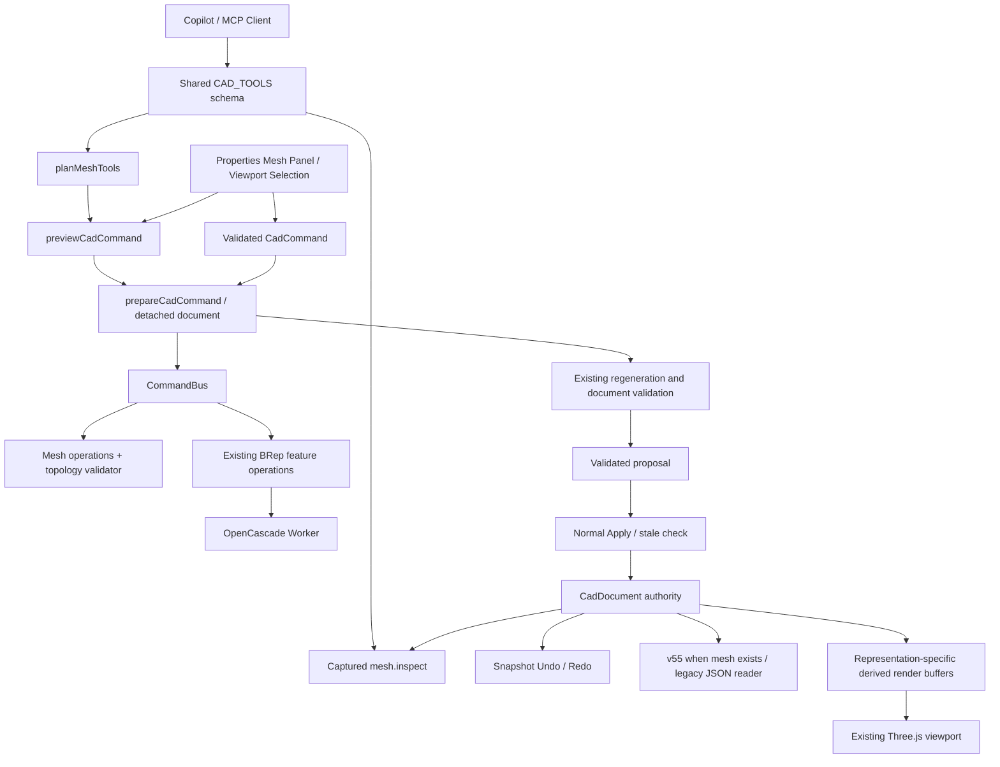

# AI-native Hybrid CAD — Phase 1

조사·구현 기준: 2026-10-25, 현재 작업 트리. 기존에 수정 중이던 파일들의 변경을 유지한 상태에서 통합했다. 이 문서에서 **구현**과 **후속 설계**는 구분한다. Phase 1은 Blender 기능 전체의 구현이 아니라 편집 가능한 삼각형 메시의 첫 수직 통합이다.

> 이후 Polygon v2와 Modifier 구현 범위는 [Phase 2](HYBRID-GEOMETRY-PHASE-2.md)를 참조한다. 이 문서는 Phase 1 기준선을 보존한다.

## 1. 기존 자산과 통합 지점

| 계층 | 실제 기존 구현 | 이번 통합 |
|---|---|---|
| 문서 | `packages/cad-document/src/CadDocument.ts`: 객체·피처·스케치·변수·레이어·도면 상태. `CadObject.ts`: 객체 ID, geometryId, 배치. `Feature.ts`: 입력 객체 ID와 output, live/snapshot | 피처 종류 `mesh` 추가. `params.mesh`가 편집 메시의 유일한 원본 |
| 정밀 커널 | `packages/cad-kernel`, `apps/web/src/cad/kernelGeometryService.ts`, `kernel.worker.ts`: OpenCascade.js BRep 생성·Boolean·측정·삼각화 | 기존 BRep 커널 유지. 메시 편집은 OpenCascade에 BRep으로 전달하지 않음 |
| 화면 | `CadViewport.tsx`: Three.js 장면, 객체별 렌더 캐시, 배치·가시성·레이캐스트. React 속성 패널 | `editableMeshRenderer.ts`: 삼각형·wire·선택 강조. `MeshPanel.tsx`: 편집 UI |
| 명령 | `cad-commands/CommandBus.ts`, `validator.ts`, `state/commandBus.ts` | 기존 검증기와 트랜잭션에 네 가지 메시 명령 등록 |
| Preview/Apply | `dispatchCadCommand.ts`: 문서 복제, 실행·검증 후 원자적 publish. `documentPlans.ts`: 실제 평가된 제안 저장, stale 검사, once-only Apply | 메시도 동일 경로. Preview에 메시 표면적 표시. Phase 1 패널에는 형상 ghost 미리보기 없음 |
| Undo/Redo | `cad-history/HistoryStack.ts`, `state/history.ts`: 문서 스냅샷 이력 | 메시·선택·위상 변경 매핑이 스냅샷에 함께 포함됨. 별도 메시 Undo 스택 없음 |
| 의존성 | `dependencyGraph.ts::buildDependencyGraph`, `featureRegeneration.ts::regenerateDependentFeatures`: live 입력 그래프와 변경된 소스의 후속 피처 재생성 | 메시 피처는 입력 없는 독립 snapshot 노드. 메시 modifier/노드 평가기는 아직 없음 |
| 파일 | `cad-document/serialization.ts`, `state/documentFile.ts`: 버전별 JSON 검사, 복원, 프로젝트 복구 저장 | 메시가 있을 때만 v55. v1–54 읽기와 기존 버전 선택 유지. 메시가 구버전을 가장하면 거부 |
| AI/MCP | `cadToolContract.ts`의 공유 도구 스키마, `cadToolSession.ts`, `cadModelingTools.ts`, `cadMcpRuntime.ts`, `server/cadMcpServer.ts` | `mesh.inspect/create/transform/extrude` 추가. 원격 Apply는 계속 제공하지 않음 |

기존 렌더링 MeshData는 BRep에서 유도한 positions/indices/법선/face key 캐시다. 이를 편집 원본으로 바꾸지 않았다. 기존 `packages/cad-geometry/src/TopologyMap.ts`는 구현 없는 클래스이므로 재사용 가능한 토폴로지 커널로 간주하지 않았다.

프론트엔드는 TypeScript/React 19/Three.js 0.180/Vite 7, 정밀 연산은 OpenCascade WASM과 Worker를 사용한다. 로컬 Node 서버의 Copilot/MCP 브리지는 기하 상태의 권위자가 아니다. 모델 학습이나 외부 LLM 없이 새 메시 명령이 전부 실행된다.

## 2. 실제 실행 구조



메시 선택 명령도 문서 트랜잭션을 거친다. 선택 변경 자체가 Undo 기록을 하나 사용한다. 현재 일반 객체 선택은 기존 UI 상태이며, 메시의 element edit mode/IDs만 문서에 저장된다. 전역 `TopologySelectionRef`를 무리하게 BRep와 공유하지 않고 메시 피처의 타입 있는 선택으로 통합했다. 선택 API 전체의 통일은 후속 작업이다.

## 3. 구현한 데이터 모델과 불변 조건

`EditableMesh.ts`:

```ts
type EditableMesh = {
  version: 1;
  vertices: { id: string; position: [number, number, number] }[];
  faces: { id: string; vertices: [string, string, string] }[];
  edit: { enabled: boolean; mode: "vertex" | "edge" | "face"; ids: string[] };
  lastTopologyChange?: {
    operation: "extrude-face";
    sourceFaceId: string;
    capFaceId: string;
    vertexMap: { from: string; to: string }[];
    generatedFaceIds: string[];
  };
};
```

- 좌표는 **객체 로컬 mm**, 배치는 기존 CadObject transform. UI Scale의 pivot은 로컬 원점, 공개 도구는 명시적 pivot도 지원한다.
- Face는 삼각형이다. quad/ngon, UV, 재질 슬롯, crease, 느슨한 vertex/edge는 저장하지 않는다. Cube의 12개 삼각형과 18개 edge에는 면 대각선도 포함된다.
- Edge ID는 정렬한 두 Vertex ID의 JSON 배열이다. 좌표 변경과 face 배열 순서에 의존하지 않는다. 인접 face는 source에서 유도한다.
- 같은 객체 안에서 Vertex/Face ID는 각 종류별 고유하며, Move/Scale은 이를 보존한다. Extrude는 기존 면을 제거하고 새 cap+6개 side triangle을 만들며, 원본 3개 vertex와 새 vertex의 대응을 남긴다. 원래 vertex는 side에서 계속 사용되므로 이 매핑은 복제 계보이지 참조를 일괄 대체하라는 뜻이 아니다.
- validator는 유한 좌표, 개수 상한(10,000 vertex/20,000 face), ID 중복, 잘못된 참조, 퇴화 삼각형, 중복 면, edge당 최대 두 면·방향 일관성, 연결된 vertex link, 선택 ID 유효성을 검사한다.
- 열린 경계를 허용하는 manifold surface다. 자기 교차, 닫힌 solid 판정, 내부/외부, manufacturing 적합성은 보장하지 않는다. `measureEditableMesh`는 면적·bounds만 반환하고 BRep 정밀도나 유효 solid 체적을 주장하지 않는다.
- Face Extrude는 한 번에 한 삼각형만 지원한다. Vertex/Edge Extrude, 여러 면 region extrusion은 미구현이다. UI가 이를 제한하고 명령 스키마도 한 face만 받는다.
- 문서 저장 시 mesh edit state까지 검증한다. 파일에 위조된 mesh topology를 넣어도 deserialize 단계에서 거부한다.

## 4. BRep / Mesh / SubD 소유권

`GeometryRegistry.ts`의 현재 registry는 정적 capability/ownership 표다. 동적 플러그인 로더나 연산 dispatch 프레임워크가 아니다.

| 표현 | 권위 있는 원본 | 파생 캐시 | Phase 1 상태 |
|---|---|---|---|
| BRep | 기존 피처 파라미터·live 입력 | 커널 shape, 렌더 삼각형 | 유지 |
| Editable mesh | mesh 피처의 vertices/faces/edit | edge adjacency, normals, GPU buffers | 구현 |
| SubD | 향후 control cage·crease·scheme/version | 평가된 subdivision surface와 표시 mesh | 설계만 |
| Analytic curve / planar region | 기존 스케치·경계 참조 | 커브 표시·평가된 영역 | 유지 |

하나의 피처에 BRep와 Mesh를 동시에 수정 가능한 원본으로 두지 않는다. 변환은 새로운 output 객체/피처를 만드는 명시적 트랜잭션으로 설계한다. 원본 삭제나 기존 피처를 묵시적으로 바꾸는 변환은 금지한다. Phase 1의 `geometryConversionSupport`는 변환이 미구현임을 반환하는 capability probe이며 실제 변환 서비스가 아니다.

후속 `GeometryConversionService` 계약:

1. 입력: source object/version/representation, target, tolerance, live 또는 snapshot 정책.
2. 출력: 새 표현의 source payload, 검증 결과, source-to-target topology mapping, loss report, 알고리즘/커널 버전.
3. BRep→Mesh: chordal/angular tolerance 및 샘플링 측정 편차를 구별한다. BRep face→triangle 집합, seam weld 정책을 기록. 정밀 곡면·파라미터 의미 손실을 명시.
4. Mesh→BRep: faceted shell 생성과 곡면 reconstruction을 서로 다른 연산으로 분리. sewing tolerance, fit error, gaps, 실패 면을 기록. 성공했다는 이유로 원본 설계 이력이 복원됐다고 하지 않는다.
5. SubD→Mesh: 평가 레벨·boundary/crease 규칙·source cage 대응 기록. 역변환이 무손실이라고 표시하지 않는다.
6. 지원되지 않는 참조는 `unresolved`로 남기고 사용자가 재연결하기 전 해당 후속 연산을 거부한다. 숫자 index나 최근접 면으로 자동 덮어쓰기 하지 않는다.

## 5. 편집, 검증, 실패 처리

`meshCommands.ts::registerMeshCommands`가 UI/AI 모두의 구현이다. `create-mesh`, `select-mesh-elements`, `transform-mesh-elements`, `extrude-mesh-face`는 유효한 payload와 visible/unlocked layer를 요구한다. 일반 CAD 명령에서 mesh target을 받는 지원되지 않는 연산은 representation guard가 거부한다.

`prepareCadCommand`는 복제 문서에 실행한다. handler 또는 최종 feature 검증 실패 시 live document/history는 그대로다. batch 도중 실패도 전체 롤백된다. Preview는 결과 geometry와 UUID를 이미 계산한다. Apply는 원본 문서 버전·내용을 다시 비교하고 같은 결과를 한 번 publish하므로 재평가 때 topology ID가 바뀌지 않는다.

기존 파라메트릭 BRep의 부분 재생성은 유지한다. Phase 1 메시 편집은 해당 메시 데이터 전체와 렌더 buffer를 다시 계산한다. 메시의 이웃 영역만 갱신하는 GPU/CPU incremental update는 없다. 문서 전체 스냅샷 history의 비용도 그대로다. 상한은 성능 보장의 측정값이 아니라 방어적 제한이다.

메시 상태가 자체 설계 의도를 충분히 표현하는 것은 아니다. 현재 직접 편집 결과와 직전 Extrude 계보를 저장하며, 모든 편집의 영구 event log나 재실행 가능한 mesh modifier history는 저장하지 않는다. 기존 feature graph와 snapshot undo를 학습용 complete action trace로 혼동하면 안 된다.

## 6. 선택·뷰포트·AI 경로

`createEditableMeshSceneObject`는 source triangle 순서를 faceIndex와 대응시킨다. 화면 선택은 frontmost surface hit의 face, 또는 그 face의 vertex/edge를 screen-pixel 거리로 고른다. Shift/Ctrl을 이용해 다중 선택한다. 속성 패널에서 정확한 ID 목록 선택도 가능하다. 선택 강조 mesh는 raycast에서 제외하여 표시가 선택 대상을 가로채지 않게 했다.

`mesh.inspect`는 vertex/edge/face 중 하나의 페이지(최대 100개), 현재 edit selection의 제한된 부분, 직전 topology change, 검증 범위를 반환한다. 전체 원본 문서나 BRep 렌더 메시를 무제한 노출하지 않는다.

예: MCP `mesh.extrude(objectId, faceId, distance)` → 공유 schema → 캡처된 context와 selection 검사 → `planMeshTools` → `extrude-mesh-face` → 실제 `previewCadCommand` → pending-review → 기존 사용자 Apply → CommandBus와 publish → history 및 viewport 갱신. 조회만 한 객체에는 편집 권한이 생기지 않는다. 수정 후에는 새 context로 다시 inspect/measure할 수 있다. 임의 JS/Python 실행은 노출하지 않았다.

## 7. Non-destructive modifier / Geometry Nodes 후속 설계

다음 구조는 **설계이며 실행 코드로 구현하지 않았다**.

- Modifier feature는 immutable source cage를 참조하며 `modifierType/version/enabled/params`와 ordered stack을 보유한다. 결과는 평가 캐시이며 원본을 덮어쓰지 않는다. Apply modifier는 명시적 bake command로 새 snapshot 또는 새 source를 만들고 loss/lineage를 남긴다.
- Geometry Nodes는 feature dependency graph의 단일 evaluated feature로 연결한다. 외부 object 참조는 기존 live-input edge가 되고, 내부 node graph는 별도 evaluator가 처리한다.
- node socket 타입: GeometrySet, Scalar, Vector, Boolean, SelectionField. Vertex/Edge/Face/Instance field domain과 broadcasting 규칙을 명시한다. 한 object source의 representation은 명확히 태그한다.
- Phase 2 evaluator는 side-effect 없는 DAG로 제한한다. 순환 검출, stable node ID, 명시적 random seed, 입력 hash+node version+params+representation 버전 기반 캐시, dirty node 이후만 재평가한다.
- Worker 실행에 취소·시간·메모리·element budget을 넣는다. CAD feature regeneration이 기다릴 수 있는 typed result/error를 반환하며 결과 commit은 기존 트랜잭션이 수행한다.
- Geometry Nodes field evaluation을 현재 constraint solver의 반복 풀이와 합치지 않는다. 미래 simulation/time feedback은 명시적 state node 및 별도 semantics 없이는 허용하지 않는다.
- 오류가 나면 마지막 검증된 committed geometry를 유지하고 preview에 오류를 표시한다. 평가 캐시는 파일의 권위 있는 상태로 저장하지 않는다.

## 8. MVP 사용법 및 범위

1. 기존 편집기 속성 패널의 **Mesh editing**을 연다.
2. Cube size 입력 → **Review new mesh cube** → **Apply mesh edit**.
3. **Viewport element picking**을 켜고 Vertex/Edge/Face 선택. 화면 또는 ID 목록에서 요소 선택.
4. Move/Scale 값 입력 → **Review mesh transform** → Apply. Scale은 로컬 원점 기준.
5. Face 한 개 선택 → extrusion distance → **Review face extrusion** → Apply.
6. 기존 Undo/Redo, CAD 파일 저장·열기를 사용한다. Mesh 문서는 v55이므로 새 버전을 모르는 구버전 앱에는 열기 지원이 없다.

파일 저장 형식은 자체 CAD JSON이다. Mesh용 OBJ/PLY/glTF/STL import/export, BRep/Mesh 변환, SubD 및 모든 후속 기능이 구현됐다는 뜻이 아니다. 기존 BRep export는 기존 대상·검증 범위를 유지한다.

검증 결과와 후속 순서는 [로드맵](HYBRID-GEOMETRY-ROADMAP.md), 데이터셋 계획은 [데이터셋 조사](../research/CAD-DATASETS-PHASE-1.md)를 참고한다.
