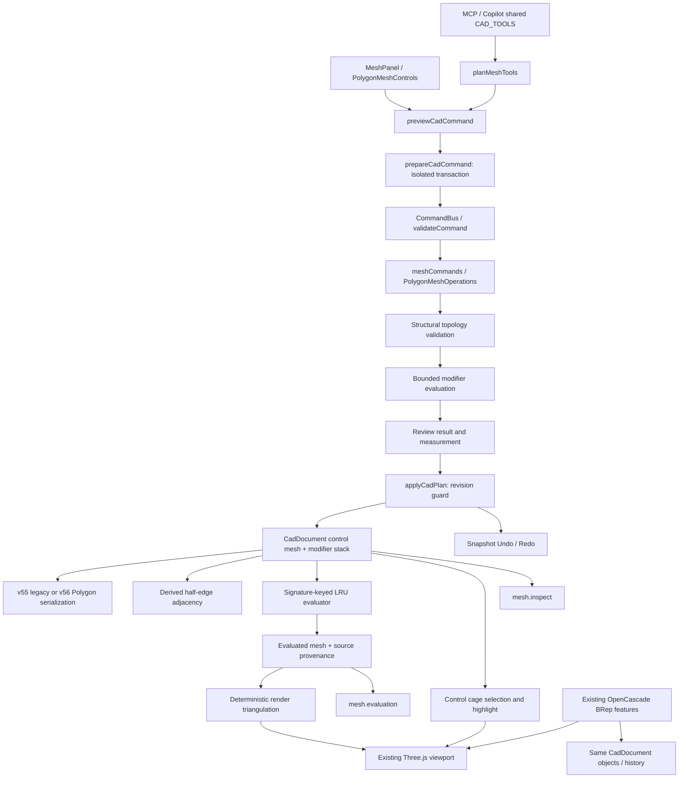

# Hybrid Geometry Phase 2 — Polygon topology and modifier foundation

작성일: 2026-10-25. 이 문서는 실제 구현 범위와 의도적인 거부 조건을 기록한다. Phase 1 문서는 당시의 v55 삼각형 MVP 기준선이다. Blender 전체 기능과 동등하다는 의미가 아니다.

> 이후 누적 provenance, Worker, Geometry Nodes의 실제 구현은 [Phase 3](HYBRID-GEOMETRY-PHASE-3.md)를 참조한다. 이 문서는 Phase 2 기준선을 보존한다.

## 1. 기존 구조와 통합 결정

- `packages/cad-document/src/EditableMesh.ts`의 v1 삼각형 형상과 기존 명령을 유지하고, v2 Polygon 제어 메시를 추가했다.
- `CadDocument.features[featureId].params.mesh`가 권위 있는 원본이다. 기존 `CadObject.geometryId`, object transform, layer, snapshot mesh feature 계약을 사용한다.
- 원본은 vertex ID/좌표 + face ID/ordered vertex loop다. 간선 ID는 정렬한 두 정점 ID의 JSON 문자열이다. 공유 간선을 중복 저장하지 않는다.
- Half-edge를 권위 있는 직렬화 상태로 추가하지 않았다. `MeshTopology.buildMeshTopology`가 twin/next/previous, vertex-face incidence, boundary를 파생한다. Half-edge의 face/index ID는 순회용이고 외부 영속 참조로 사용하지 않는다.
- `MeshTopology.meshTriangles`가 별도로 렌더링용 삼각형을 생성한다. 렌더 대각선은 편집 간선이 아니다. 각 삼각형에 원본 face ID가 붙는다.
- OpenCascade BRep, 기존 DependencyGraph/Feature Regeneration, 일반 명령/Undo 구현을 교체하지 않았다. Polygon은 독립 snapshot feature이며 BRep의 하위 위상을 가장하지 않는다.
- 새 라이브러리나 데이터셋 다운로드, 기존 문서 일괄 마이그레이션은 없다.

## 2. 주요 통합 파일

| 계층 | 코드 / 역할 |
|---|---|
| 저장 모델 | `packages/cad-document/src/EditableMesh.ts`: v1/v2, modifiers, topologyChange, structural validator |
| 위상 | `packages/cad-document/src/MeshTopology.ts`: derived half-edge, boundary loops, winding/link checks, ear clipping |
| 편집 | `packages/cad-document/src/PolygonMeshOperations.ts`: typed, bounded, pure clone-to-result operations |
| 평가 | `packages/cad-document/src/MeshModifiers.ts`: Catmull–Clark, sparse provenance, detached cache |
| 계약 / 파일 | `FeatureContract.ts`, `serialization.ts`: reject invalid evaluation, explicit v56 |
| 트랜잭션 | `packages/cad-commands/src/{commands,validator}.ts`, `apps/web/src/state/{meshCommands,commandBus}.ts` |
| UI | `apps/web/src/properties/{MeshPanel,PolygonMeshControls}.tsx`: all geometry edits use Review/Apply |
| 뷰포트 / 측정 | `apps/web/src/viewport/editableMeshRenderer.ts`, `apps/web/src/precision/meshGeometry.ts`: evaluated display/measurement, control-cage picking |
| AI | `apps/web/src/copilot/{cadToolContract,meshTools,cadToolSession}.ts`: shared schemas, command compilation, bounded reads |

## 3. 검증과 저장 범위

- V/F ID uniqueness, missing refs, duplicate face, repeated corner, loose vertex, zero length, degenerate polygon/triangle를 거부한다.
- 한 edge의 face incidence가 2를 초과하거나 공유 edge 방향이 같으면 거부한다. 정점 주변 face link의 단절과 boundary spoke 수가 0/2가 아닌 경우를 거부한다.
- Face loop는 hole 없는 단일 simple polygon이다. 투영 boundary의 교차/접촉을 거부한다. 오목 N-gon은 ear clipping으로 삼각화한다.
- 일반 제어 면은 비평면일 수 있다. Newell normal 평면으로 투영하여 삼각화한다. 이 결과는 정밀 곡면이 아니다. Inset/Extrude/Dissolve/Bevel의 해당 면에는 추가 평면성 조건이 적용된다.
- 전체 면 간 자기 교차, shell 외향 방향, solid volume 또는 BRep 정밀도를 보장하지 않는다. 변형된 면의 위상 검증과 물리적으로 충돌 없는 입체 인증은 별개의 문제다.
- v1 삼각형 렌더링은 기존 삼각형을 그대로 사용한다. v2 ear-clipping 허용오차를 v55에 소급 적용하지 않는다.
- 제어 메시와 평가 결과 각각 10,000 vertices / 20,000 faces, v2 face당 3–64 corners / 총 80,000 corners 제한. Subdivision 각 단계 provenance stencil은 총 200,000 weights로 제한된다.
- 실패는 임시 계산에서 발생하고 문서와 히스토리는 변경되지 않는다. 실패한 modifier 결과를 원본으로 대체해 성공으로 보고하지 않는다. 기존 유효한 문서가 유지된다.

### 파일 호환성

1. 기존 v55 파일의 mesh.version=1은 그대로 로드한다. Move/Scale/단일 triangle Extrude 동작도 유지한다.
2. `upgrade-mesh`는 Review/Apply를 거치는 명시적인 v1→v2 전환이다. V/F IDs 및 삼각형 연결성을 유지하며 자동 Quad 병합을 하지 않는다. 기존 마지막 삼각형 Extrude lineage는 전환 후 일반 lineage 형식으로 보존하지 않는다. 이전 snapshot은 Undo에 있다.
3. Polygon v2가 하나라도 있으면 파일 version=56. v1만 있으면 기존 v55를 기록한다. v55로 위장한 v2 문서는 로드 시 거부한다.
4. 원본, 선택 상태, modifier 순서/파라미터, 마지막 topologyChange를 저장한다. half-edge, 렌더 버퍼, 평가 메시, 캐시, 전체 Undo 타임라인은 저장하지 않는다. 파일을 다시 열면 평가를 재구축한다.
5. v56을 모르는 이전 앱으로의 역호환은 제공하지 않는다. 파괴적 하향 변환은 없다.

## 4. 실제 편집 연산 범위

모든 행은 `edit-polygon-mesh`로 실행하고 UI/MCP가 같은 검증·Preview/Apply·Undo 경로를 사용한다. ID 불일치, 제한 초과, 지원되지 않는 입력은 거부한다.

| 연산 | 구현된 의미론 | 미지원 / 거부 |
|---|---|---|
| Multiple Face Extrude | 연결된 공면·동일 방향 face region의 정점을 공유 복사, cap과 외곽 wall 생성. 내부 공유 edge에는 wall을 만들지 않음. signed normal mm | 비공면 region, 분리된 region, boundary 없는 region. 충돌 검사 없음 |
| Inset Faces | 선택된 각 strictly convex planar face를 개별적으로 일정 edge 거리만큼 안쪽 offset; inner polygon + quad rims | region inset, concave inset, 붕괴/과도한 offset |
| Bevel Edges | 단일 convex internal edge, 양 끝 closed valence=3. 이웃 edge를 따라 지정 거리로 절단하고 planar bevel quad 생성 | 다중 edge, segments/miter/round bevel, 비평면 strip, 고차 valence, concave. 폭은 수직 offset이 아니라 이웃 edge상의 거리 |
| Bridge Edge Loops | 정점 수가 같은 두 완전한 disjoint boundary loops; 명시적 offset으로 역방향 대응, quad strip | 불완전/분기 loop, unequal counts, 자동 최적 대응, 교차 검사 |
| Loop Cut | 연속 all-quad ring의 opposite edges를 따라 한 번 분할; 시작 edge의 정렬된 ID 기준 factor 전파 | triangle/ngon에 닿는 ring, 여러 cut, sliding tool |
| Merge | 인접 정점 정확히 2개를 midpoint로 collapse; 첫 번째 ID 유지 | 임의 다중 정점 용접, distance merge, 비다양체 결과 |
| Dissolve | 하나의 internal edge 양옆 공면 face를 단일 simple polygon으로 합침 | vertex/face dissolve, nonplanar/hole/복수 edge region |
| Delete | face 삭제 또는 선택 vertex/edge에 접한 face 삭제 후 unused vertices 제거 | loose edge/vertex만 남기는 모드, 전체 surface 삭제(객체 삭제 사용) |

### 참조 유지와 손실

- Move/Scale은 V/F IDs와 edge endpoint IDs를 보존한다.
- 마지막 topologyChange의 `generated`, `deleted` 및 `vertices/edges/faces` maps를 기록한다. 없는 map 항목은 surviving element의 identity 대응, 빈 배열은 명시적 참조 손실이다. 일대다 대응은 자동으로 하나를 선택하지 않는다.
- Region Extrude는 old face→cap, old vertex→surviving source/copy; Inset은 old face→inner/rims, Loop Cut은 old face/edge→두 결과, Bevel은 endpoint/selected edge→두 결과를 기록한다.
- Merge는 removed vertex→survivor. Dissolve는 두 face→한 face, removed edge→빈 배열. Delete의 제거 요소는 빈 배열이다.
- 보존 가능한 topology 참조만 modifier crease에 재연결한다. 삭제된 crease의 대응이 비어 있으면 연산을 거부한다. 먼저 crease 제거/재설정이 필요하다.
- 문서 외부 참조 서비스나 BRep↔mesh naming resolver는 구현하지 않았다. lineage는 마지막 편집과 Undo snapshots에 한정되며 누적 전체 provenance event log가 아니다. 평가 ID는 해당 평가 signature의 파생 ID이므로 영속 편집 대상으로 쓰지 않는다.

## 5. Non-destructive Modifier Foundation

- `MeshModifier[]`의 순서, 고유 ID, enabled, type, integer level, boundary, creaseEdges를 검증한다. 현재 type은 `catmull-clark`만 지원하고 최대 4개다.
- 각 stack entry를 앞 결과에 순서대로 평가한다. level 0은 no-op, 1–3은 반복 refinement. Geometry Nodes의 실행 의미론으로 재사용하지 않는다.
- Face point=corner 평균. Smooth interior edge point=양 끝점과 양 face point의 평균. Interior vertex는 Catmull–Clark `(F + 2R + (n−3)P) / n`을 사용한다.
- Boundary edge와 infinitely sharp crease edge는 midpoint. Sharp edge 2개 정점은 `3/4 P + 1/8 N1 + 1/8 N2`; 3개 이상은 고정. Boundary `fixed`는 기존 경계 정점을 고정하고 edge midpoint를 추가한다. `smooth`는 위 경계 cubic rule이다. 단일 sharp edge의 endpoint는 smooth vertex rule이다.
- Crease는 control edge ID로 지정하며 평가 edge lineage를 통해 여러 level에 전파한다. 뒤 modifier는 자신의 creaseEdges/boundary 조건을 적용한다. 앞 modifier의 crease 파라미터를 암묵 상속하지 않는다.
- 결과는 finite refined polygon mesh다. limit surface, limit normals, adaptive tessellation, semi-sharp weights, UV/material interpolation, face-varying attributes는 없다.
- Cache key는 version+control vertices/faces+ordered modifiers 전체 signature다. selection/lineage metadata는 제외한다. source/parameter/order 변경은 새 signature를 평가한다. 선택만 변경하면 hit 가능. LRU 2개, 반환값은 deep clone, 실패 결과는 cache에 넣지 않는다.
- 변경된 region만 부분 재평가하지 않는다. CPU/main-thread의 bounded 전체 평가다. 큰 입력에서는 예측 budget 초과로 거부하며 실시간 대규모 sculpt 성능을 주장하지 않는다.
- 평가 face→control face, edge→control edge 또는 null, vertex→원본 vertex의 sparse weighted stencil을 제공한다. 이것은 one-to-one naming이 아닌 provenance다.
- 렌더러는 evaluated mesh를 표시하며 편집 모드에서는 control cage의 별도 투명 picking surface와 control edge/vertex overlay를 사용한다. 선택된 control face의 highlight도 원본 삼각화에 따른다. 측정과 bounds는 evaluated surface 기준이다.

## 6. MCP / Copilot

`mesh.createPolygon`, `mesh.upgrade`, `mesh.extrudeRegion`, `mesh.inset`, `mesh.bevel`, `mesh.bridge`, `mesh.loopCut`, `mesh.merge`, `mesh.dissolve`, `mesh.delete`, `mesh.modifiers`를 기존 CAD_TOOLS에 등록했다. `mesh.inspect`는 제어 topology/선택/마지막 대응/stack을 페이지 조회하며 `mesh.evaluation`은 파생 geometry/provenance를 조회한다. 큰 provenance는 응답 budget 제한에 따라 작은 page가 필요하다.

기존 선택된 visible/unlocked object 편집 권한, context revision, pending-review receipt 및 사용자 Apply 경로를 유지한다. Read는 edit grant가 아니다. 서버에 임의 문서 쓰기 API를 추가하지 않았다. UI와 공식 MCP SDK 테스트 모두 동일 명령의 geometry 결과를 비교한다.

## 7. 검증

상세 실행 결과는 `docs/verification/HYBRID-GEOMETRY-PHASE-2.md`에 기록한다. 테스트 파일:

- `apps/web/tests/polygonMesh.test.ts`: topology, 삼각/Quad/N-gon, 연산/실패, 수치적 Catmull–Clark, boundary/crease/cache, rollback, v55/v56, history.
- `apps/web/tests/polygonMeshMcp.test.ts`: official MCP SDK/InMemoryTransport, 각 연산의 UI transaction과 동등성, reviewed Apply, bounded read, invalid input.
- `apps/web/tests/polygonEditing.browser.{tsx,html}`: 실제 React/Three.js/Edge, native mouse/keyboard, 모든 operation UI, cage picking, source/evaluation 분리, 실패, history, 파일/브라우저 재로드, BRep 공존.
- Phase 1 `editableMesh.test.ts`, `meshMcp.test.ts`, `meshEditing.browser.tsx`도 유지한다.

## 8. Phase 3 진입 조건

현재 구현은 제한된 Polygon 편집과 비파괴 refinement의 기반이다. 다음 작업은 별도 범위다.

1. Bevel/Inset/Bridge의 일반 입력과 복합 region 지원 전, corner/miter 정책·참조 분기 정책·교차/충돌 정책을 명세하고 adversarial fixture를 추가한다.
2. Worker 기반 evaluation, cancellation, byte 단위 cache budget, 큰 mesh 성능 측정 후 현재 geometry/stencil 제한의 완화 여부를 결정한다.
3. Geometry Nodes는 typed ports, domain/attribute semantics, deterministic scheduling, cycle detection, dependency invalidation, per-node provenance를 별도 evaluator로 구현한다. CAD DependencyGraph는 외부 feature input/output invalidation을 연결하고, node field evaluation을 feature regeneration과 혼합하지 않는다.
4. 누적 provenance/변경 이벤트, 외부 참조 소비자, stable naming의 모호성/손실 처리 계약을 먼저 확장한다. evaluated element를 편집 command 대상으로 허용하지 않는다.
5. Subdivision limit/UV/normal/세미 sharp, proportional editing, sculpt/remesh, NURBS/freeform, Mesh-to-BRep는 미구현이다. 정밀 BRep 커널을 유지하면서 각 representation의 소유권과 변환 오차를 기록하는 서비스가 필요하다.
6. 새 Node/Modifier type은 실패 시 원본 유지, UI/MCP 동등성, Undo/file roundtrip, BRep 회귀를 모두 통과해야 등록한다. 전체 브라우저 제품 회귀는 출시 전 별도 gate다.
