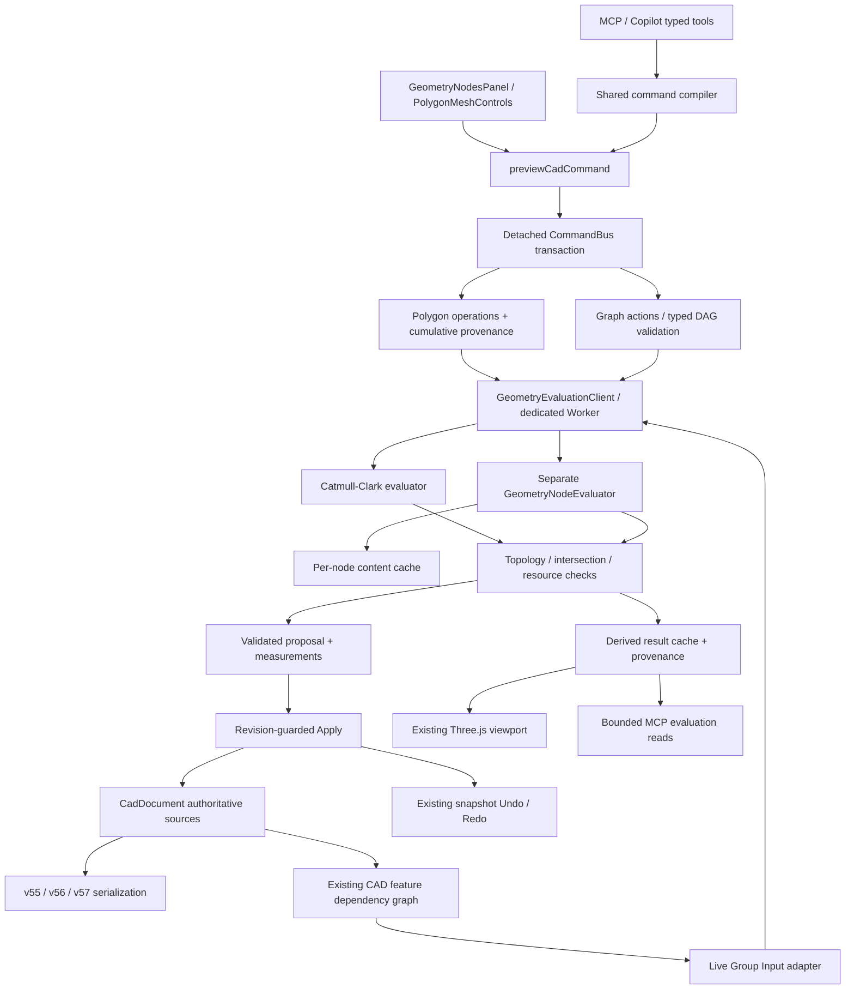

# Hybrid CAD Phase 3 — 실제 Geometry Nodes와 평가 실행 기반

2026-10-25. Phase 2의 BRep/Polygon/Modifier 계약을 확장한 구현 기록이다. 완료 기능과 제한을 구분한다. 검증 수치와 미실행 범위는 [실행 보고](../verification/HYBRID-GEOMETRY-PHASE-3.md)를 참조한다.

## 1. 아키텍처와 소유권

기존 `mesh` 피처의 원본은 `params.mesh`, 새 `geometry-nodes` 피처의 원본은 `params.graph`다. Geometry Nodes의 평가 결과를 편집 가능한 원본으로 저장하지 않는다. 기존 OpenCascade BRep 피처와 커널은 유지된다.

Feature dependency graph는 객체 간 live input과 재생성 순서만 담당한다. Geometry Nodes 실행은 별도의 typed dataflow DAG, typed sockets, per-node cache를 사용한다. 이를 기존 피처 그래프에 동일한 실행 의미론으로 끼워 넣지 않았다.

## 2. 주요 코드와 통합 지점

| 역할 | 파일 / 함수 |
|---|---|
| 누적 위상 이력 | `packages/cad-document/src/MeshProvenance.ts`: appendMeshProvenance, resolveTopologyReference, validMeshProvenance |
| 교차 검사 | `packages/cad-document/src/MeshIntersection.ts`: validateMeshIntersections |
| 기존 편집 확장 | `PolygonMeshOperations.ts`: inset-region, bevel-edges, Bridge resample |
| 그래프 모델·검증 | `GeometryNodes.ts`: GEOMETRY_NODE_TYPES, validateGeometryGraph, applyGeometryGraphActions |
| 실제 기하 실행 | `GeometryNodeEvaluation.ts`: GeometryNodeEvaluator, transform, join, sweep, realization |
| 문서 입력·결과 캐시 | `GeometryDocumentEvaluation.ts`: graphDocumentInputs, evaluateDocumentGeometryGraph |
| Worker | `apps/web/src/cad/geometryEvaluation{Protocol,Client}.ts`, `geometryEvaluation.worker.ts` |
| 명령 | `apps/web/src/state/geometryNodeCommands.ts`, meshCommands.ts, commandBus.ts, cad-commands의 commands.ts/validator.ts |
| 의존 재생성·Preview | `featureRegeneration.ts`, `documentPlans.ts`: live input propagation, dependent measurement changes |
| 뷰포트·측정 | `CadViewport.tsx`, `meshGeometry.ts`, `worldBounds.ts`, `documentQuery.ts` |
| UI | `GeometryNodesPanel.tsx`, `PolygonMeshControls.tsx`, PropertiesPanel.tsx |
| MCP | `geometryNodeTools.ts`, cadToolContract.ts, cadToolSession.ts, cadModelingTools.ts, meshTools.ts |
| 저장 계약 | Feature.ts, FeatureContract.ts, serialization.ts, GeometryRegistry.ts |

## 3. 누적 Topology Provenance

Polygon 편집 시 최초 기준 inventory와 순서 있는 event들을 저장한다. 각 event에는 revision, operation, 생성/삭제된 V/E/F, old→new 대응이 있다. 좌표만 바뀌는 v2 Move/Scale은 identity topology event를 기록한다. 복합 region inset과 multi-bevel은 내부 원자 단계의 event들을 누적하며 사용자의 Undo는 명령 하나다.

- 참조는 **domain + element ID + 생성/관찰 revision**으로 해석한다. resolver는 이후 event들의 identity, split, merge, delete를 합성한다.
- 반환 상태는 `resolved`, `split`, `deleted`, `unknown`, `history-unavailable`다. 여러 결과를 하나로 임의 선택하지 않는다.
- Vertex/Face ID는 기록된 과거와 충돌하는 재사용을 거부한다.
- Edge ID는 Phase 2와 동일한 정렬된 endpoint pair다. 삭제 후 같은 두 정점을 다시 연결하면 같은 문자열이 재등장할 수 있다. revision 0의 삭제된 edge 참조는 계속 `deleted`이며, 재생성 revision에서 얻은 참조만 새 edge를 가리킨다. **ID 문자열만으로 전역 영속성을 주장하지 않는다.**
- 로드 시 event revision 연속성, 생성/삭제 집합, mapping source/target과 현재 inventory 일치를 검사한다.
- 최대 200 events, 직렬화 문자열 8,000,000 문자로 제한한다. 초과 시 원본을 유지하며 편집을 거부하고, 과거를 조용히 버리지 않는다. history compaction/rebase UI는 미구현이다.
- v55/v56에서 기록되기 전의 이력은 복원하거나 발명하지 않는다. 첫 새 편집 직전이 baseline revision 0이다.

## 4. 위상·교차 검증과 편집 범위 확장

기존 manifold edge/vertex-link, winding, 퇴화, face boundary 검증을 유지했다. 새 Polygon 편집/변형/Modifier 변경은 Worker에서 control과 evaluated surface의 bounded triangle intersection 검사를 추가한다. 그래프 출력도 검사한다.

검사는 X축 sweep broad phase, AABB, segment–triangle 교차, coplanar triangle clipping을 사용한다. 같은 위상의 공유 vertex/edge 접촉은 허용하고 비위상 접촉/면 내부 중첩을 거부한다. coplanar overlap 판정은 local-origin 면적과 길이 단위 허용오차를 사용한다. 최소 길이 허용오차는 `1e-7 mm`, 큰 좌표에서는 `32 * machine epsilon * coordinate magnitude`로 증가한다. 검사 결과에 실제 tolerance와 pair 수를 반환한다.

이는 부동소수점 허용오차가 있는 검사이며 exact predicates나 OpenCascade solid validity 인증이 아니다. tolerance 아래 접촉/중첩, 내부 shell 포함 관계, 전체 외향 방향과 solid volume은 보장하지 않는다. 시간/pair budget이 부족하면 valid로 반환하지 않고 거부한다. 기존 v55/v56 로드 자체에 새로운 교차 검사를 소급 적용하지 않는다. 새 편집 또는 평가 시에는 새로운 검사로 거부될 수 있다.

| 확장 | 실제 구현 | 남은 제한 |
|---|---|---|
| Region Inset | 연결된 공면 영역을 내부 dissolve로 합친 뒤 convex polygon offset, 내부 단계 전체 provenance | union boundary가 단순·볼록이어야 함. hole/concave region 불가 |
| Multi Bevel | 끝점이 겹치지 않는 최대 16개 edge를 순차 처리, 전체 실패 원자 롤백 | 기존 convex/trivalent/planar strip 조건 유지. edge-chain miter, round segments 불가 |
| Unequal Bridge | 명시적 resample 옵션으로 두 loop를 정점 수의 LCM까지 edge subdivision 후 bridge; split mapping | LCM ≤64, 두 완전한 disjoint loops, 자동 시작점/방향 최적화·자가교차 회피 없음 |

## 5. Worker 평가와 자원 예산

Browser transaction 및 viewport 경로는 `geometryEvaluation.worker.ts`를 사용한다. 원본 복제 → 평가 → 검증 → main-thread cache 전달 → revision 확인 → Apply 순서다. UI 선택·파일 원본은 Worker에 넘긴 객체를 공유하지 않는다.

- persistent Worker 1개와 queue 최대 16개. 정상 작업 사이에는 node cache를 재사용한다.
- Abort/동일 scope의 새 요청/5초 deadline에서 active Worker를 terminate하고 다음 작업을 새 Worker로 실행한다. 취소된 작업의 cache는 사라진다.
- request ID, Worker 인스턴스 identity, 호출자의 `isCurrent`, AbortSignal 및 기존 Apply baseline 검사를 사용한다. 과거 Worker의 늦은 message/error도 새 작업을 완료하거나 중단할 수 없다.
- 평가 실패/취소는 detached transaction을 폐기하며 기존 문서·히스토리를 유지한다. 뷰포트는 새 버퍼가 준비되기 전 기존 버퍼를 제거하지 않는다.

| 예산 | 구현 값 |
|---|---:|
| Graph | 64 nodes / 128 links |
| Graph 전체 평가 | 4,000 ms soft check |
| Node 계산 / intersection pass | 1,500 ms soft check |
| Active Worker | 5,000 ms hard termination |
| Geometry | 10,000 vertices / 20,000 faces; 기존 80,000 corners |
| Instances / curve samples | 최대 128 |
| Triangle broad-phase pairs | 최대 2,000,000 |
| 요청·결과 / active graph values | 16,000,000 bytes estimate |
| Node cache | 16,000,000 bytes estimate |
| Main graph-result cache | 8 entries / 32,000,000 bytes estimate |
| Subdivision/Join provenance | 총 200,000 weights |

Byte 예산은 serialized UTF-16 길이 기반 추정이다. 브라우저 실제 heap/RSS의 엄격한 상한이 아니며, structured clone과 렌더 버퍼의 추가 비용이 있다. soft check는 연산 경계에서 검사하고 hard timeout은 browser Worker에 적용된다.

**완전한 Worker 전환은 아니다.** Worker가 없는 Node 테스트 환경은 같은 evaluator의 동기 fallback을 쓴다. 파일 deserialization 검증, cold synchronous bounds/measurement, 외부 Group Input의 cold cache 준비와 일부 기존 Modifier 동기 API는 main-thread에서 평가할 수 있다. 동기 fallback은 실행 도중 timer로 강제 선점할 수 없다. 이 부분을 전체 비동기로 바꾸는 것은 후속 과제다.

## 6. Geometry Nodes MVP의 노드 의미론

모든 node는 고유 ID, 고정 type, exact parameter object를 가진다. 링크는 source node의 단일 output과 destination의 named input이다. socket type은 mesh/curve/instances다. 중복 input 연결, 잘못된 type, cycle, 미지원 type/field를 거부한다.

| Node | Input → Output | 실제 동작 / 제한 |
|---|---|---|
| Mesh Primitive | → mesh | Quad cube / regular planar N-gon, size와 sides |
| Transform Geometry | mesh → mesh | translation mm, Euler XYZ degrees, positive XYZ scale |
| Join Geometry | mesh a,b → mesh | disjoint topology concatenation, ID remap와 origin 보존. Boolean union 아님 |
| Subdivision Surface | mesh → mesh | 실제 Catmull–Clark level 0–3, smooth/fixed boundary. node-local crease 파라미터는 아직 없음 |
| Curve Primitive | → curve | sampled XY circle 또는 3D polyline, open/closed. NURBS 아님 |
| Resample Curve | curve → curve | piecewise-linear arc-length uniform samples 2–128; closed는 최소 3 |
| Curve to Mesh | path,profile curves → mesh | 열린 3D 경로 + 닫힌 CCW XY profile(3–64점), parallel-transport frame Sweep, 선택 caps |
| Instance on Points | mesh,curve → instances | curve samples에 translation과 positive scale을 가진 lightweight instances |
| Realize Instances | instances → mesh | 실제 정점·면 복제, origin과 instance point source 기록 |
| Group Input | external object → mesh | 기존 editable Mesh 또는 Geometry Nodes 객체의 live 입력. BRep 입력은 명시 거부 |
| Group Output | mesh → mesh | 그래프당 하나의 필수 최종 출력 |

Group Input은 source object placement를 graph-local coordinates에 적용한다. output object의 placement는 그 이후 viewport에 적용한다. 자동 역변환이나 world-space placement 보정은 하지 않는다.

원본 primitive face/vertex, 외부 object source, subdivision sparse weighted stencil, instance point, sweep path/profile provenance를 결과에 보존한다. 변환 이후 weight는 원본 기여 이력이며 좌표가 transform 전 root vertex의 단순 가중합이라는 뜻은 아니다. 파생 ID는 signature 내 로컬 ID이고 직접 mesh 편집 명령에 사용할 수 없다.

연결되지 않은 node는 명시적인 inactive draft로 저장할 수 있다. 전체 stored graph의 type/cycle은 검사하고, active output closure의 required inputs는 모두 연결되어야 한다. draft node가 실행된 것으로 보고하지 않는다. active input을 끊어 output을 불완전하게 만드는 단일 명령은 거부한다. `nodes.edit`의 atomic actions로 연결을 한 번에 교체한다. 모든 Group Input은 inactive라도 실제 source 객체에 바인딩되어야 한다.

UI는 실제 graph를 편집하는 **node/parameter/connection inspector**다. 시각적인 drag-and-drop node canvas는 추가하지 않았다. 파라미터는 exact JSON object로 편집하고, 모든 변경은 Review/Apply를 거친다. 미지원 node를 성공으로 반환하는 placeholder는 없다.

## 7. 부분 재평가와 CAD dependency 연결

각 active node의 key는 node definition, incoming typed values, 외부 input 값이다. 동일 입력은 cache hit이며 변경 node와 결과가 달라지는 downstream을 재계산한다. unrelated curve branch는 mesh primitive 변경 때 재사용된다. 최종 output의 intersection validation은 cache hit이어도 다시 수행한다. 따라서 warm 실행 비용이 0은 아니다.

새 feature의 `inputs`는 Group Input object IDs이며 `dependencyMode=live`다. 기존 `liveFeatureInputs`/`regenerateDependentFeatures`가 CAD cycle/missing source/locked dependent를 처리하고, 계산은 새 Worker evaluator에 위임한다. source 변경은 graph chain 아래로 전파하며, Preview는 params가 동일한 procedural dependent의 측정 변화도 표시한다. Mesh edit selection과 lineage metadata만 바뀌는 경우 geometry dependency를 dirty로 만들지 않는다.

## 8. MCP 계약

- `nodes.catalog`: type, typed sockets, exact default parameters.
- `nodes.inspect`, `nodes.validate`, `nodes.evaluate`: 구조/diagnostics와 실제 평가 결과·provenance·cache metrics의 bounded read.
- `nodes.create`, `nodes.add`, `nodes.remove`, `nodes.connect`, `nodes.disconnect`, `nodes.parameters`, `nodes.edit`: typed CommandBus actions와 pending Review receipt.
- `mesh.provenance`: revision-aware 누적 참조 조회.
- `mesh.insetRegion`, `mesh.bevelEdges`, `mesh.bridge(resample=true)`: 새 제한된 topology 연산.

수정 대상은 selected visible unlocked object여야 한다. 새 Group Input source도 명시적으로 selected visible unlocked여야 한다. 읽기는 수정 권한을 부여하지 않는다. JSON parameters/actions는 알려진 node/command schema로 검증하며 arbitrary document write/JavaScript evaluation 기능이 아니다.

## 9. 파일 호환성

- v55 triangle source는 그대로 로드·편집한다.
- 기존 v56 Polygon + modifier 문서는 그대로 읽고, 누적 history가 없고 graph도 없으면 v56으로 저장한다.
- 최초 누적 event 또는 Geometry Nodes feature가 있으면 v57으로 저장한다. v55/v56으로 위장한 새 구조는 거부한다.
- 별도 batch migration은 없다. 원본 graph/control mesh/history/selection/stack만 저장하고 node cache, Worker state, evaluated mesh, 렌더 버퍼는 저장하지 않는다.
- 기존 v56의 마지막 topologyChange보다 앞선 기록은 소급 복원하지 않는다. v57을 모르는 이전 앱으로의 하향 저장은 제공하지 않는다.

## 10. 미구현 및 Phase 4 진입 조건

미구현: 일반 miter/round bevel, concave/hole inset, 자동 loop correspondence, exact intersection/solid certification, provenance compaction/rebase, BRep 입력 변환, NURBS, closed-path Sweep/branching curves, tangent-aligned instances, attribute/UV/material domains, fields, nested node groups, simulation/time nodes, visual node canvas, Sculpt/Remesh.

Phase 4 Sculpting/Remeshing에 앞서 다음 조건을 충족해야 한다.

1. Worker와 GPU buffer 전송 비용, 여러 객체/큰 메시의 memory peaks, long-session cache/취소 동작을 실제 장면에서 측정한다. 현재 10k/20k 제한을 근거 없이 올리지 않는다.
2. Stroke 하나를 취소 가능한 하나의 transaction으로 정의하고 BVH/spatial index, 부분 normals/bounds 갱신, brush falloff/pressure oracle을 구축한다.
3. Remesh의 many-to-many provenance와 참조 손실/모호성을 실제 소비자가 처리할 수 있어야 한다. 현재 revision-aware ledger는 기록 기반이며 remesh 표면 correspondence solver가 아니다.
4. 200-event 제한의 명시적 compaction/rebase·외부 참조 갱신 계약을 마련한다.
5. Exact/approximate validity policy와 watertight/volume 검증을 분리하고, adversarial geometry corpus를 늘린다.
6. cold load/measure 경로의 비동기화와 전체 제품 browser regression을 완료한 뒤 대형 자유형상 기능을 확장한다.
