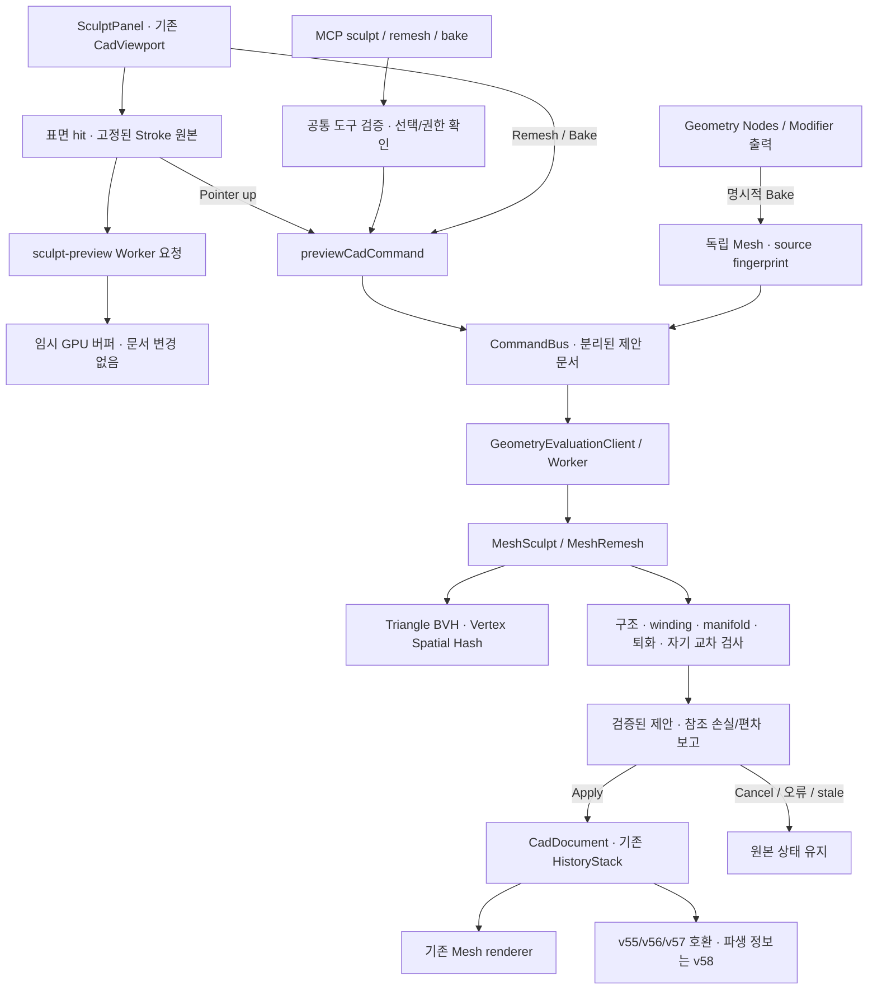

# Hybrid CAD Phase 4 — Sculpting & Remeshing

기준일: 2026-10-26 (Asia/Seoul). 실제 구현 범위와 제한을 기록한다. 전체 검증 결과는 [Phase 4 검증 보고](../verification/HYBRID-GEOMETRY-PHASE-4.md), 측정 원자료는 `output/verification/sculpt-phase-4/`에 있다.

## 실행 구조

`CadDocument`가 계속 설계 상태의 원본이다. Sculpt 중 전역 세션은 UI 설정/임시 결과만 보유하며 문서를 쓰지 않는다. 커밋과 MCP 편집에는 임의 정점 배열 삽입 명령이 없다. 기존 BRep 커널이나 Geometry Nodes 실행 의미론은 대체하지 않는다.

| 계층 | 구현 위치 | 역할 |
|---|---|---|
| 기하 | `packages/cad-document/src/MeshSculpt.ts` | 여섯 Brush, frozen-source Stroke, 공통 입력 검증 |
| 기하 | `MeshSpatialIndex.ts` | 삼각형 BVH raycast/nearest/inside, 정점 공간 해시 |
| 기하 | `MeshRemesh.ts` | Surface refinement, voxel occupancy boundary, 편차/품질/손실 보고 |
| 검증 | `MeshIntersection.ts` | 기존 좁은 단계 검사를 유지하면서 3축 BVH 후보 탐색 |
| 명령 | `packages/cad-commands/src/{commands,validator}.ts` | `sculpt-stroke`, `remesh-mesh`, `bake-mesh` |
| 트랜잭션 | `apps/web/src/state/sculptCommands.ts` | visible/unlocked 확인, Worker 검증 후 문서 갱신 |
| Worker | `apps/web/src/cad/geometryEvaluation{Protocol,Client}.ts` | Stroke/Remesh/파일 검증, 취소·기한·stale 방어 |
| UI | `properties/SculptPanel.tsx`, `viewport/sculptInteraction.ts` | Inspector 설정, 실제 캔버스 제스처, 별도 Preview |
| MCP | `copilot/sculptTools.ts`, `cadToolContract.ts` | 조회·평가·preview receipt·동일 명령 계획 |

## Sculpt 의미론

- Grab: 첫 표면 hit 주변 정점을 마지막 local delta × strength × falloff로 이동한다. delta는 최대 radius의 두 배다.
- Draw: hit 삼각형 법선으로 radius × 0.1 × strength × falloff 만큼 이동한다.
- Smooth: 원본 삼각형 adjacency 평균으로 이동한다. 한 표본의 계수는 `abs(strength × falloff) × 0.5`다. 체적 보존 Smooth는 아니다.
- Inflate: 원본 면적 가중 정점 법선으로 변형한다.
- Crease: hit 중심으로 접선 방향을 당기고 법선 방향으로 눌러 홈을 만든다. Blender 브러시 구현과 동일함을 주장하지 않는다.
- Flatten: hit 위치/법선의 평면으로 정점을 당긴다.

Radius는 object-local mm, Strength는 0을 제외한 [-1,1], falloff는 linear/smooth/sharp, spacing은 radius에 대한 [0.02,1] 비율이다. Smooth/Flatten은 strength의 절댓값을 사용한다. X 대칭은 **객체 로컬 X=0** 기준이며 겹치는 대칭 영향은 최대 가중치 한 번만 적용한다. X=0 정점은 X 방향으로 움직이지 않는다.

Stroke는 최대 128개의 ray sample을 받는다. 시작 시 복제한 제어 메시, 법선, 이웃과 hit surface를 고정한다. Drag 도중 표면을 계속 재해석하는 Dyntopo 방식은 아니다. 가까운 표본은 spacing으로 건너뛰며 긴 마우스 점프의 보간이나 압력/시간 기반 Airbrush는 지원하지 않는다. 화면 ray는 실제 Perspective/Orthographic camera와 객체 matrix inverse로 로컬 좌표로 변환한다. Grab delta는 최초 hit를 지나는 카메라 평면에서 구한다. 다른 보이는 객체에 가려진 표면은 선택하지 않는다.

드래그 중 `sculpt-preview`는 문서와 History를 변경하지 않으며 자기 교차 인증 전 임시 형상을 보여준다. 요청은 한 번에 하나 실행하고 최신 입력을 합쳐 재평가한다. 놓으면 `sculpt-stroke`의 **전체 검증**을 다시 수행하고 단일 CommandBus 트랜잭션으로 확정한다. 문서 ID/revision/generation 전체를 비교하며, 같은 revision의 문서 교체도 Stroke를 무효화한다. 시작 시 렌더 객체의 제어 메시 참조·문서 ID·placement가 현재 문서와 일치하는지 확인한다. Pointer capture 실패도 취소한다. Escape, pointercancel, 문서/선택 변경, Worker 실패 시 임시 형상을 버린다. 검증에 실패한 임시 형상은 커밋할 수 없다.

임시 렌더 버퍼는 동일 topology에서 재사용하고 변경된 position 범위만 GPU에 알린다. 그러나 현재 normals와 bounds는 전체 재계산이며, BVH/정점 해시도 요청마다 다시 만든다. 지속 Worker 세션의 증분 BVH refit이나 완전한 영역별 normals 갱신을 구현했다고 보지 않는다.

## Surface / Voxel Remesh

### Surface

원본 polygon을 기존 triangulation으로 변환하고 공유 edge midpoint를 사용해 각 삼각형을 네 개로 분할한다. 1–3회 반복 가능하다. 선택적 relaxation(0–0.5)은 이웃 평균을 원본 표면의 최근접점에 투영하며 boundary 정점은 고정한다.

실제 밀도 변경과 제한된 품질 개선을 수행한다. 일반적 isotropic remesh, 목표 edge length, collapse/flip, curvature-adaptive sampling, feature-edge 보존은 아직 없다. 균일 분할만으로 skinny triangle의 품질이 개선된다는 보장은 없으며 평균 삼각형 품질을 전후 함께 보고한다. 원본 삼각형 표면에 정점이 놓여도 연결된 새 삼각형은 원본의 crease를 가로지를 수 있으므로 편차가 0이라고 가정하지 않는다.

### Voxel

닫힌 manifold 입력만 받는다. 가장 긴 bounding-box 축을 resolution(4–24)으로 나누고 각 셀 중심의 ray parity로 내부를 판정한다. 점유 셀의 외부 면을 공유 정점 삼각형 경계로 구성한다. 실제 체적 기반 재구성이며 원본 triangle soup를 그대로 돌려주는 구현이 아니다.

출력은 **계단 형태의 voxel boundary**다. Marching Cubes, signed-distance field smoothing, dual contouring, adaptive octree는 구현하지 않았다. 얇은 부분/작은 구멍은 소실될 수 있다. 대각 접촉으로 non-manifold가 생기거나 예산/검증을 넘으면 명확히 거부한다. resolution 상한은 모든 입력에서 성공한다는 보장이 아니다.

### 공통 검사와 참조 정책

원본과 결과의 자기 교차, 출력의 winding/vertex-link manifold/퇴화/ID/선택 무결성을 확인한다. 검사는 부동소수점·허용오차·시간 제한 기반이다. 정확한 BRep solid certification, 내부 shell의 체적 포함 관계 보증, 수치 허용오차 이하의 교차 검출을 주장하지 않는다.

Remesh는 **새 객체**를 생성한다. 원본 객체와 입력 feature는 그대로 남기며 결과 feature는 `dependencyMode: snapshot`, `inputs: []`다. 출력에 새 UUID 기반 vertex/face ID를 부여한다. 원본 vertex/edge/face는 결과 provenance에서 모두 `[]`로 대응시켜 삭제/참조 손실로 표시한다. 근접한 정점에 임의의 안정 ID를 붙이지 않는다. 원본 객체를 가리키던 기존 치수/의존성은 원본에 남는다.

전후 vertex와 triangle centroid를 방향별 최대 512개 샘플링하고 상대 표면 BVH 최근접 거리를 측정한다. `sampledMaxDistance`, `sampledRmsDistance`, 샘플 수, 평균 삼각형 품질, 손실 수, 처리 시간을 저장한다. 이는 연속 표면의 인증된 Hausdorff 상한이 아니다. 추가로 전후 Euler 특성(V−E+F), boundary edge 수를 보고한다. 닫힌 입력/출력에는 절댓값 대수적 삼각형 부피와 절대·상대 차이를 추가한다. 열린 메시에는 부피를 보고하지 않는다. Euler 특성만으로 component/genus/구멍의 모든 변경을 식별할 수 없고, 다중 shell/cavity 포함관계에 대한 체적 인증은 아니다. 이 필드들은 선택적 v58 보고 필드이며 기존 파일을 강제 변환하지 않는다.

## Geometry Nodes / Modifier Bake

`bake-mesh`는 현재 평가된 Mesh/Geometry Nodes 결과를 새 editable Polygon Mesh로 복제한다. 원본 feature/graph/Modifier는 보존한다. 새 객체는 원본 placement를 복사하지만 이후 독립적이다. 활성 Modifier가 있는 제어 메시나 procedural 출력에 직접 Sculpt/Remesh하려 하면 명시적 Bake를 요구한다.

결과의 `mesh.derivation`은 `kind`, `sourceObjectId`, `sourceRevision`, `sourceSignature`를 저장한다. fingerprint에는 원본 형상/Modifier/graph, 외부 graph 입력과 placement를 포함하며 selection 상태는 제외한다. 이는 변경 탐지용 비암호학적 지문이다. 원본 변경/삭제 시 Inspector와 `sculpt.inspect`가 stale source임을 표시한다. 자동 재평가·재부착·Stroke 재투영은 수행하지 않는다.

Bake 이전 평가 ID는 editable reference가 아니다. Bake 이후 새 객체 내부의 IDs가 editable reference가 된다. graph node의 face/vertex provenance를 영구적인 원본 편집 참조로 승격하지 않는다. Bake의 계보는 source fingerprint 관계이며 개별 평가 정점을 원본 정점에 정확히 재연결한다는 약속은 없다.

## Worker와 예산

측정 후 Sculpt 범위를 5,000 vertices / 10,000 faces / 20,000 render triangles로 줄였다. 기존 다른 CAD 연산의 10,000 / 20,000 제한은 유지한다. 큰 입력을 성공으로 위장하지 않는다.

| 항목 | 예산 |
|---|---|
| Sculpt | 5,000 vertices, 10,000 faces, 20,000 render triangles, Stroke 128 samples |
| Remesh 출력 | 기존 Mesh 10,000 vertices / 20,000 faces |
| Surface refinement | 1–3 iterations, relaxation 0–0.5 |
| Voxel grid | longest axis 4–24 cells |
| 내부 작업 시간 | Sculpt/Remesh 루프 3.5 s |
| 공통 결과 시간/용량 | 4 s, JSON UTF-16 추정 16 MB |
| 브라우저 강제 종료 | active Worker 5 s |
| 자기 교차 | 1.5 s / 최대 2,000,000 후보쌍 |
| Worker queue | 기존 최대 16개 |

요청/응답은 structured clone 객체이며 Transferable typed buffer는 아직 없다. 크기 검사는 JS heap 또는 RSS의 정확한 상한이 아니다. Node 환경 fallback은 같은 엔진을 쓰지만 동기 실행을 강제로 중단할 수 없다. 브라우저에서는 Worker terminate로 취소한다.

Graph의 외부 Mesh Modifier 및 중첩 Geometry Nodes 입력은 `evaluateGraphAsync`가 비동기로 순회/평가한다. 캐시 준비 후 입력 변환/계보 조립은 여전히 main thread에서 수행한다. 명시적 파일 열기에서는 4,000,000자 미만의 v55 이상 문서를 Worker에서 deserialize/검증한다. 큰 기존 파일, recovery 경로, 직접 호출하는 동기 패키지 API 및 일부 측정 경로는 기존 동기 경로가 남아 있다. 모든 cold 경로를 비동기화했다고 주장하지 않는다.

## Provenance와 Undo 저장 비용

Polygon Sculpt는 topology를 바꾸지 않으므로 `sculpt-<brush>`의 sparse identity 이벤트만 남긴다. 매 Stroke마다 전체 ID map을 반복 저장하지 않는다. 첫 이벤트의 base inventory는 메시 크기에 비례한다. 기존 provenance의 200 events / 8,000,000 characters 상한을 유지하고 넘으면 거부한다. 참조 revision을 보존하지 않는 자동 삭제/병합은 없다.

Cube의 identity 이력 200개는 측정 시 UTF-8 약 37 KB, gzip 약 1 KB 수준이었다. 압축 측정은 설계 자료이며 `.webcad.json`에 새 압축 코덱을 적용한 것은 아니다. 차후 archive container 압축, revision 범위 보존 identity-run encoding, topology checkpoint와 remesh 손실 tombstone의 분리 저장이 필요하다.

기존 `HistoryStack`은 기본 최대 100개의 **문서 snapshot**을 유지한다. 정점 patch 기반 Undo로 바꾸지 않았으므로 대형 문서에서 메모리 비용은 provenance뿐 아니라 Undo snapshot이 지배할 수 있다. provenance 압축률을 Undo 전체 메모리 절감률로 해석하면 안 된다.

## MCP 계약

| 도구 | 동작 |
|---|---|
| `sculpt.inspect` | 지원 Brush, editable 여부, 로컬 좌표/예산, Bake 상태 |
| `sculpt.stroke` | Stroke JSON → 검증 가능한 기존 native Review |
| `sculpt.preview` | 읽기 전용 실제 평가 → 원본/문서 버전에 묶인 120초 receipt |
| `sculpt.apply` | receipt를 검증하고 같은 Stroke의 native Review 준비 |
| `mesh.remesh` | Options JSON → 원본 보존 새 결과의 native Review |
| `mesh.remesh.inspect` | 저장된 편차·품질·참조 손실, 원본 존재 여부 |
| `mesh.bake` | Mesh Modifier 또는 Geometry Nodes 결과의 명시적 Bake |

기존 MCP의 **편집기 Apply로만 발행**하는 정책을 유지한다. 따라서 `sculpt.apply`도 원격 무검토 발행 API가 아니다. 모든 변경 도구는 selected / visible / unlocked source, captured context, strict schema, 동일 CommandBus/Worker 경로를 거친다. 임의 원본 정점 삽입이나 script 실행은 제공하지 않는다. 공식 MCP SDK 테스트는 이 동작을 명시적으로 확인한다.

## 저장 포맷

- v55 triangle, v56 polygon, v57 graph/provenance 로딩 유지.
- triangle mesh의 직접 Sculpt는 기존 v1 topology/파일 정책을 유지한다. v1은 누적 topology 이력이 없으므로 이력 계보가 필요하면 명시적으로 Polygon upgrade/Bake한다.
- Polygon Sculpt는 topology identity 이벤트를 기록하므로 v57로 저장 가능하다.
- Bake/Remesh의 `mesh.derivation`이 있으면 v58. 이를 v57 이하로 위장한 파일은 거부한다.
- Worker, 임시 GPU 결과, preview receipt, 평가 cache는 직렬화하지 않는다.
- 파괴적 마이그레이션, BRep 엔진 교체, 데이터셋 다운로드 없음.

## 미구현 및 Phase 5 진입 조건

1. 전체 제품 브라우저 회귀의 실패를 분류하고 관련 기능의 baseline을 다시 확정한다. Phase 4 전용 E2E 통과를 전체 제품 통과로 확대하지 않는다.
2. Worker에 control mesh를 상주시켜 Stroke delta/Transferable buffer로 주고받고 BVH refit과 영역별 normals를 구현한다. 대형 Undo를 patch 또는 공유 immutable 저장으로 전환하기 전 메모리 스트레스 테스트가 필요하다.
3. CPU/Worker/GPU 및 전체 tab heap을 분리 측정한다. 현재 5,000 정점 상한에서도 응답 시간은 입력과 장비에 따라 달라진다. 60 fps나 Blender 규모를 보장하지 않는다.
4. Remesh의 feature preservation, topology 변경량/구멍 손실 지표, 연속 표면 편차 bound, isotropic split/collapse/flip, SDF 기반 매끄러운 voxel 결과를 추가한다.
5. 200-event provenance 한계를 revision 의미론을 유지하며 압축/체크포인트화하고 remesh 전후 correspondence의 불확실성을 명시한다.
6. Dyntopo, Multires, 마스크, pressure/texture brush, UV/material corner attributes, 자동 rebake/Stroke reproject, BRep reconstruction은 아직 없다.

## 최종 안정화: 검증 비용과 증분 검증 검토

`validateMeshIntersections`는 요청 시 preparation/BVH build/candidate search/narrow phase와 후보 수를 계측한다. Narrow phase 시간에는 반복문 및 허용 접촉 판정 비용도 포함된다. 공유 간선의 두 삼각형은 비공면이거나, 공면이며 간선의 서로 반대편에 있으면 내부 교차가 불가능하므로 clipping을 생략한다. 같은 쪽 공면 겹침은 계속 거부한다. 후보 순서는 입력 배열과 deterministic BVH sort로 결정되고 2,000,000 pair 제한을 유지한다.

1.5초 경과는 **미인증 거부**이며 기하학적으로 유효/무효라는 판정이 아니다. 동일 입력의 기하 판정과 후보 수가 같더라도 JIT, GC, 운영체제 스케줄링, 다른 브라우저/테스트 부하에 따라 기한 내 완료 여부는 달라질 수 있다. 측정만으로 각 원인의 기여율을 분리하지 않았다. 진단 스크립트의 15초 경로는 비용·반복성 관찰용이며 제품 예산을 완화하지 않는다.

증분 검사에서는 변형 정점에 인접한 **모든** 삼각형을 바뀐 집합으로 잡고, 그 삼각형들의 새 AABB를 refit하여 changed↔all 쌍을 검사해야 한다. 이동 전 위치/기존 인접 면만 검사하면 멀리 떨어진 면으로 진입한 교차를 놓친다. 원본 전체 검증 인증이 동일 좌표·topology·tolerance에 묶여 있고 immutable source로 유지될 때에만 unchanged↔unchanged 검사를 생략할 수 있다. 현재 원본에 재사용 가능한 전체 자기 교차 인증이나 refit 가능한 영속 Worker BVH가 없으므로 **제품은 여전히 전체 검증**이다. 이번 단계에서 증분 경로를 검증된 것으로 배포하지 않는다.

전체 검증은 최초 load/import/Bake/Remesh, topology 또는 triangulation 변경, 원본 인증 없음/만료, tolerance·좌표계/정밀도 정책 변경, 알 수 없는 외부 변경, Worker 재시작/캐시 손실, 비유한 좌표·degeneracy·winding 변경에서 필요하다. 동일 topology의 위치 변경에서도 기본 정책은 전체 검증이며 영역별 생략은 차후 독립적인 differential test로 검증해야 한다.
