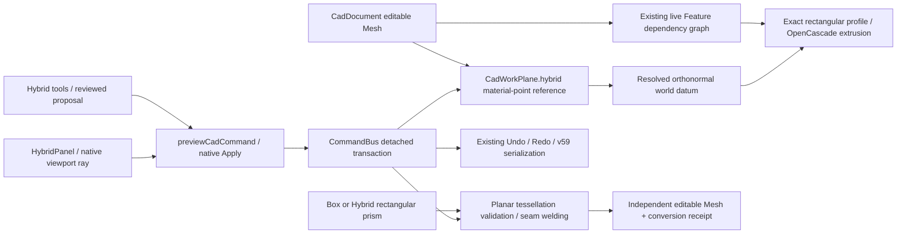

# Hybrid Geometry Phase 5A — BRep / Mesh reference vertical slice

Date: 2026-10-27. Scope: a control-mesh material point → datum → exact rectangular BRep extrusion, plus a bounded planar BRep → independent editable Mesh conversion. OpenCascade remains the exact kernel. This is not the complete Phase 5 feature set.

## Integration and ownership

- `packages/cad-document/src/HybridReference.ts`: persisted reference and Hybrid feature/receipt validation.
- `packages/cad-document/src/WorkPlane.ts`: optional `hybrid` reference on the existing work-plane record. It is mutually exclusive with an existing BRep face source. No second document store or new rollback mechanism.
- `apps/web/src/state/hybridReferences.ts`: ray capture, exact triangle/barycentric resolution, world frame, derived status and downstream validity guard.
- `apps/web/src/state/hybridCommands.ts`: reference/reselection, datum + rectangular prism, planar conversion. Existing kernel Worker/builders and transaction paths are reused.
- `apps/web/src/state/featureRegeneration.ts`: Hybrid Extrude has a live input from the source Mesh; source dirtiness or a changed datum regenerates it in the same transaction.
- `apps/web/src/state/attachedWorkPlane.ts`: resolves an enabled Hybrid plane through the same work-plane interface as existing face sketches. The shipped UI vertical slice uses a dimensioned rectangular extrusion, not a newly implemented sketch constraint system or Hole tool.
- `apps/web/src/properties/HybridPanel.tsx`, `apps/web/src/viewport/hybridInteraction.ts`: native perspective/orthographic picking, datum axes and solid preview, Apply/Discard.
- `apps/web/src/copilot/hybridTools.ts`: structural reads and proposal compilation. The existing MCP tool catalog exposes the same tools. Writes never bypass native Review/Apply.

`CadDocument` remains authoritative. A reference is captured first (`datumEnabled=false`); the datum command enables it and creates an exact 4-line profile/prism with width, depth and height in **world millimetres**. It does not fabricate a BRep face for the Mesh itself. Source and output remain separate objects. A Mesh surface datum is a construction frame, not an analytic smooth-surface fit.

## Reference contract and failures

The record stores document ID, capture-session ID, object ID, geometry ID, representation, source fingerprint, topology fingerprint, provenance prefix fingerprint/revision, derivation fingerprint, polygon face ID, ordered triangle vertex IDs, barycentric coordinates, and captured local point/normal. The session ID records capture provenance; a fresh session can reopen the same document. Pending reviews use the existing document revision/generation guard.

Resolution is computed from current authoritative geometry; a saved status is not trusted:

| Situation | Result |
| --- | --- |
| Same source geometry and topology | `valid` |
| Vertex deformation or source placement change, with same triangulation and compatible provenance prefix | `updated`; material point and world normal recomputed, linked prism regenerated |
| Document or geometry identity replaced | `invalid` |
| Source missing, evaluated modifier active, topology/triangle order/derivation changed, provenance prefix lost | `unresolved`; explicit surface reselection required |
| Referenced triangle degenerates | `invalid` |

No nearest-face fallback, synthetic ID correspondence, or split/merge guessing is used. Even a change elsewhere in the mesh topology conservatively invalidates the reference. Preserving a polygon ID alone is insufficient if its triangulation changes. Nonuniform source scale is supported by transforming the triangle vertices and recomputing an orthonormal frame; prism dimensions are not scaled with the source.

On unresolved reference the last valid solid stays visible, while its Hybrid metadata becomes unresolved. Export and further geometry use are blocked by a dynamic reference guard (including upstream Hybrid inputs). Explicitly picking the intended surface with the same reference ID rebinds and regenerates dependents through Review. Direct transforms, generic dimension updates, and duplication of the owned Hybrid prism are rejected to avoid diverging from its datum; create another reviewed prism or convert an independent Mesh. Source deletion while a live dependent exists follows the existing dependency rejection policy.

Remesh creates a **different object**. The original reference continues to refer to the unchanged original; changing just the source ID to the Remesh result is invalid. Geometry Nodes and evaluated modifiers must use the existing explicit Bake path. A reference to a baked mesh is a reference to that independent snapshot, not a claim that it tracks subsequent graph edits. The existing Sculpt/Bake panel reports changed or missing upstream fingerprints.

## BRep → editable Mesh

Supported: OpenCascade boxes and this phase's exact rectangular prisms. Generic extrusions, cylinders, spheres, Boolean results, imported arbitrary solids and general curved tessellation are explicitly refused.

1. Preserve the original BRep and placement.
2. Use the existing kernel tessellator (`shapeToMesh.ts`): absolute linear deflection 0.1 mm, angular deflection 0.5 rad, non-relative, non-parallel.
3. Require unique BRep face keys and complete, nonoverlapping triangle ranges.
4. Weld only coincident seam vertices within 1e-7 mm; reject ambiguous welding.
5. Validate editable topology, closed two-face edge incidence, winding/degeneracy and self intersections. A validation budget exception remains a failure.
6. Create a separate Polygon Mesh with triangle faces. Record source object/document/revision/fingerprint, fixed tessellation parameters, welding tolerance/measured displacement, face-key → triangle-ID receipt, result topology fingerprint and losses.

The planar subset has zero **analytic curvature chord error**. Floating-point/weld displacement is measured, not a certified Hausdorff bound. No accuracy claim is extended to curved surfaces. The receipt is historical, not a live ownership link; editing the result does not change the original BRep or transfer its parametric history. `hybrid.inspect` exposes whether the recorded correspondence still matches current result topology.

Budgets: raw conversion ≤10,000 vertices / 20,000 triangles; welding narrowed further to ≤256 render vertices and ≤128 unique face ranges for the supported subset. All allocations/validation complete before document publication. Existing Sculpt limits remain 5,000 vertices / 10,000 faces / 20,000 render triangles / 128 samples. Surface capture uses at most 5,000 vertices / 10,000 faces and at most 64 Hybrid references. Large-source asynchronous reference resolution is not claimed.

## MCP and persistence

| Tool | Behaviour |
| --- | --- |
| `hybrid.inspect` | Support, source coordinate convention/fingerprint, references and conversion receipt |
| `hybrid.reference.create` | Propose capture or explicit reselection using an object-local ray; optional expected fingerprint |
| `hybrid.reference.validate` | Recompute reference validity without mutation |
| `hybrid.datum.create` | Propose enabling the datum and an exact width/depth/height rectangular extrusion |
| `hybrid.brep.toMesh` | Propose the supported planar conversion |

Writes require the visible, unlocked selected source, schema validation, the existing CommandBus, and native reviewed Apply. Read tools do not expose arbitrary document mutation. UI and MCP both compile to `hybrid-reference`, `hybrid-datum`, and `hybrid-to-mesh`.

Files containing Hybrid references or receipts use **v59**. Existing v55 triangle, v56 Polygon, v57 Nodes/provenance, and v58 Bake/Remesh files keep their existing format unless Hybrid data is added. Hybrid data disguised as v58 is rejected. No destructive migration. Work-plane/feature snapshots already participate in save/load, preview cancellation and Undo/Redo.

## Mesh → BRep feasibility (experiment, not product feature)

`apps/web/scripts/hybridBrepProbe.ts` runs a bounded installed-kernel experiment; evidence is `output/verification/hybrid-phase-5a/brep-feasibility.json`. No document command or UI inverse-conversion service is registered.

| Approach | Actual evidence / accuracy | Topology and closure | Cost / remaining work |
| --- | --- | --- | --- |
| Triangle faceted BRep | 10 mm cube's 12 triangles → planar faces → sewing → solid; BRep validity valid, volume 1000.0000000000003 mm³, area 600 mm² | Zero free/multiple sewn edges; open cube rejected before sewing | One measured warm construction 49.52 ms; not a large-mesh benchmark. Face count follows triangle count. Does not reconstruct analytic curved surfaces or design intent. |
| Known planar regions | Same cube's six known quad regions → 6 faces → valid solid, same volume/area | Closed consistently wound input needed | 14.21 ms in one experiment. No automatic coplanar segmentation, hole-loop recognition or tolerance inference was implemented. |
| Cylinder / other analytic fitting | Installed runtime exposes cylinder construction and B-spline surface fitting APIs; no fitting experiment executed | Fitted patches still need trimming, intersections, shared-edge matching and closed shell verification | Residual bounds, model selection and robust fitting are unimplemented. A cylindrical constructor is not a mesh-to-cylinder recognizer. |
| Precise solid reconstruction | Existing `BRepCheck_Analyzer`, analytic measurements, sewing and solid constructors can validate candidates | Candidate must close, have consistent orientation and pass kernel checks; mesh manifold status alone is insufficient | Generic reconstruction, certified input/output deviation, feature/constraint recovery and performance remain unimplemented/unmeasured. |

WASM cold initialization was 2187.85 ms in this one Node experiment. These are fixture observations, not throughput targets. Faceted BRep reproduces a piecewise planar boundary; a parametric reconstruction attempts to recover surfaces, dimensions and intent. They are different capabilities.

## Phase 5B conditions

- Keep the existing 53 product-browser unresolved items in their separate stabilization backlog. This phase does not declare the entire product stable.
- Extend reference tracking only with explicit proof for triangle changes/splits/merges and evaluator provenance; preserve conservative unresolved behaviour otherwise.
- Curved BRep conversion needs certified or explicitly sampled deviation reporting, seam/orientation policies, Worker allocation/transfer budgets, and more kernel fixtures.
- General reverse conversion needs segmentation/fitting, shared-edge sewing/closure tests, explicit tolerance acceptance and no claim of recovered design history.
- Multi-reference regeneration, cancellation under larger source counts, and long-session memory require measurement before increasing budgets.
- Additional sketch profiles/Hole workflows and direct Hybrid dimension editing need their own reviewed ownership contract. Current MVP is the exact rectangular extrusion path.

Verification results and remaining failures are recorded separately in `docs/verification/HYBRID-GEOMETRY-PHASE-5A.md`.
