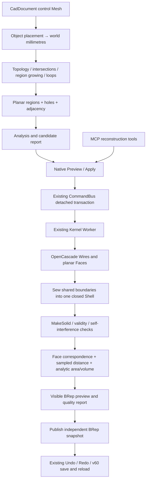

# Hybrid Geometry Phase 5B — bounded planar Mesh-to-BRep reconstruction

Date: 2026-10-28. This phase recognizes coplanar Mesh regions and constructs checked OpenCascade planar faces, a sewn shell, and a closed solid. The original Mesh is retained. Cylinder fitting and general NURBS reconstruction are not implemented.

## Architecture and integration

Core files:

- `packages/cad-document/src/PlanarReconstruction.ts`: bounded analyzer, tolerance policy, deterministic region growing, loop extraction, adjacency, persisted definition/receipt validation.
- `packages/cad-kernel/src/operations/planarReconstruction.ts`: real OpenCascade wire/face/sewing/shell/solid construction and native validation. Every native temporary is released; returned solid ownership belongs to the caller.
- `apps/web/src/state/reconstructionCommands.ts`: source placement, quality evaluation, correspondence, snapshot state, source-preserving command publication.
- `apps/web/src/cad/kernelRuntime.ts`: dispatches the new `planar-reconstruction` shape kind through the existing Worker and retained-shape paths, including measurement, rendering and nested solid operands.
- `apps/web/src/properties/ReconstructionPanel.tsx`: analyze, candidate summary, tolerances, Preview, quality, Apply/Discard and historical-quality status.
- `apps/web/src/copilot/reconstructionTools.ts`: common command compiler and read-only analysis/quality/result tools.

The existing `primitive` feature envelope carries the static BRep subtype `params.kind="planar-reconstruction"`. Its geometry is defined by validated region loops, not Box parameters. The inspector suppresses generic Box dimensions for this subtype. `dependencyMode="snapshot"` and empty live inputs explicitly mean no automatic source regeneration. This avoids inventing a sketch/parametric history from a triangle mesh. Actual OpenCascade geometry is rebuilt from the definition; render buffers are not stored as the authoritative BRep.

The source ID, document/geometry identity, revision and fingerprint are retained in the receipt. Source Mesh, existing Phase 5A references, Geometry Nodes graphs and Sculpt geometry are not overwritten. Procedural/modifier output must use the existing explicit Bake path first.

## Analyzer and deterministic plane grouping

1. Validate editable topology, degenerate elements, manifold incidence and consistent winding. Validate source triangle self-intersections with the existing bounded checker; budget exhaustion is a rejection.
2. Transform vertices to world coordinates before tolerance calculations. Connected components and boundaries are computed independently of the solid-candidate decision.
3. Compute triangle area, normal, centroid and altitude, and report each original face's area-weighted normal and plane residual.
4. Process largest-area triangle seeds first, using stable face/vertex IDs as tie breakers. Traverse sorted adjacency against a **fixed seed plane**. Tolerance is not accumulated by repeatedly moving the plane through adjacent patches.
5. A candidate must have positively aligned normal and all vertices within plane-distance tolerance. Normal deviation must be within the requested angle, or its altitude-scaled deviation must be at most `4 × distance tolerance`. This permits bounded small-face normal noise without allowing large surfaces to turn freely.
6. Refit the accepted group with area-weighted normal/centroid and recheck every member. A failed refit rejects the analysis; it does not silently enlarge tolerance.
7. Remove internal region edges. Extract directed boundary cycles with exactly one incoming and outgoing boundary edge at each loop vertex. Reject ambiguous/pinched or unclosed boundaries.
8. Sort projected loops by signed area: one positively oriented exterior and contained negatively oriented holes. Multiple outer loops/nested islands are not guessed. Construct region adjacency from shared source triangle edges.

Region IDs are local to one analyzed snapshot. They are not a new cross-revision topological naming promise. Source face IDs may appear in multiple region records when a nonplanar polygon is split by its triangulation. The result correspondence explicitly records recognized regions and their source face IDs.

## Tolerances, support and budgets

Units are mm, mm² and mm³. Defaults:

| Parameter | Default | Accepted range / rule |
| --- | --- | --- |
| Absolute plane distance | 1e-5 mm | 1e-7–1 mm |
| Relative plane distance | 1e-8 × model diagonal | 1e-10–1e-3 |
| Normal angle | 1 degree | 0.001–5 degrees; small-face rule above |
| Effective plane tolerance | max(absolute, relative × diagonal, 1e-7 mm) | Must not exceed 0.1% of model diagonal |
| Kernel sewing tolerance | 2 × effective tolerance | Fixed per request; no retries with relaxed settings |
| Sampled surface acceptance | 4 × effective tolerance + 1e-7 mm | Exceeding it rejects the transaction |

Model diagonal: 0.001–1,000,000 mm. Input limits: 1,000 vertices, 2,000 triangles. At most 128 planar regions, 64 loops per region, and 4,096 loop edges in total. Quality tessellation is capped at 20,000 render vertices/triangles; each distance direction samples at most 512 points. Source intersection validation has a 2,000 ms / 2,000,000-candidate-pair budget. Exceeding any budget is not success. Existing Sculpt budgets are unchanged.

Analysis is bounded synchronous geometry work in the browser; OpenCascade work uses the existing asynchronous Kernel Worker. These limits are not a real-time performance guarantee. Cancellation is forwarded through both kernel meshing and measurement; checks before/after evaluation and the existing document-generation guards prevent stale publication. No large-mesh throughput or memory claim is made.

Implemented solid support is one connected, closed, outward-oriented manifold component. Open Mesh analysis reports boundaries and explicitly refuses solid publication. The kernel constructs a Shell as an intermediate, but this MVP does **not** publish open Shell objects. Multiple disconnected/nested shells, ambiguous boundaries, active evaluated modifiers, degenerate/intersecting meshes and invalid kernel results are refused. Holes in a planar face are supported and are not filled automatically.

## Real BRep construction and validation

For every region, its boundary vertices are projected onto the fitted plane. The outer wire becomes an OpenCascade planar face; hole wires retain their opposite orientation. Faces are sewn with `BRepBuilderAPI_Sewing`. Sewing must report no free/multiple edges, no degenerated shapes and no deleted faces. The result must cast to one closed shell; `BRepBuilderAPI_MakeSolid` then creates the solid.

Before returning geometry:

- Each face passes `BRepCheck_Analyzer`.
- Shell closure is checked explicitly.
- The solid passes `BRepCheck_Analyzer`, with positive signed analytic volume.
- Native face count equals the recognized region count.
- `BRepAlgoAPI_Check` tests small edges and self interference.
- The resulting triangulation must map uniquely back to the region planes, orientation and contained triangle sample. No nearest-face fallback is used.
- Bidirectional sampled error must satisfy the stated acceptance threshold.

Independent projections can produce incompatible face junctions even when each region individually fits its tolerance. A measured tiny-face noise fixture is rejected by the final kernel solid check. This is an explicit current limitation; the implementation does not repair it by silently welding at a larger tolerance. Joint plane/edge/vertex fitting is a Phase 5C prerequisite for broader approximate-planar support.

## Quality, correspondence and losses

The receipt records source identity/fingerprint, requested and effective tolerances, sewing tolerance, source triangle/face counts, generated BRep face count, closure/manifold/orientation/kernel statuses, analytic area and volume differences, maximum/RMS sampled distances in both directions, and region → BRep face-key → source face-ID correspondence.

Distance probes use vertices, triangle centroids and edge midpoints, deterministically subsampled to at most 512 per direction. The BRep target is its planar-face tessellation. This is a **sampled approximation**, not a certified Hausdorff distance. Numerical errors near 1e-15 mm in exact fixtures are floating-point observations, not physical accuracy guarantees.

Classification distinguishes `merged-planar` results from zero-merge `faceted` results. Both consist of analytic planes. Neither classification claims recovered cylinders, smooth surfaces, feature history, constraints or original design intent. A faceted approximation of a curved source may remain a collection of planes; region merging alone does not identify the original curved surface.

Original Mesh references remain on the original object. New BRep faces have independent kernel identities. The explicit correspondence is a reconstruction-time receipt, not an automatic transfer of Mesh vertex/edge references. Original per-triangle topology, modifier/edit history and unrecovered constraints/intent are listed as losses.

The result is an independent snapshot. `sourceMatches`, `resultPlacementMatches` and `qualityCurrent` distinguish the original measurement from a changed/missing source or moved/scaled result. Historical metrics remain available and are labeled as such; no automatic reconstruction is triggered.

## UI / MCP / persistence

The UI exposes Analyze Mesh regions, Review planar reconstruction, Apply reconstructed BRep and Discard/Cancel. A candidate analysis does not certify a solid. Review runs the same command and geometry validations used for Apply and displays the actual kernel preview and receipt.

| MCP tool | Behaviour |
| --- | --- |
| `reconstruction.analyze` | Read components, boundaries, face planarity, region/loop counts and adjacency |
| `reconstruction.preview` | Read-only actual kernel evaluation and quality report |
| `reconstruction.create` | Propose `reconstruct-planar-mesh` for the visible unlocked selected source; native Review/Apply required |
| `reconstruction.result` | Read persisted BRep receipt and current snapshot-match state |

No tool accepts raw unvalidated BRep payloads for publication. Existing CommandBus/history/plan cancellation is reused. The source and output are committed atomically only after validation.

Reconstruction definitions and receipts require **v60**. Existing v55–v59 data keeps its prior format when no reconstruction is present. Detection includes nested operand definitions and component-library geometry, so consuming a reconstructed solid in another BRep feature cannot accidentally downgrade the file. Reopening recomputes actual kernel geometry; validated metadata alone is not used as a substitute for building the solid. No destructive migration occurs.

## Phase 5C entry conditions

- Preserve the exact-planar Cube/prism/polyhedron/through-hole regressions and current rejection behaviour.
- Solve shared edge/vertex consistency across fitted planes before broadening approximate-planar support; retain the currently rejected noisy fixture as evidence.
- Add certified or explicitly bounded adaptive error assessment before making stronger accuracy claims.
- Define multi-shell/cavity semantics and explicit open-Shell ownership before publishing those outputs.
- Only then consider cylinder candidate segmentation, axis/radius fitting, residual thresholds, trim boundaries and plane/cylinder junction validation. Cylinder construction bindings alone are not a fitter.
- Measure larger input, cancellation latency and peak memory before increasing budgets.
- The existing 53 product-browser unresolved items remain a separate stabilization backlog. This phase does not claim product-wide stabilization.

Verification evidence and measured values: `docs/verification/HYBRID-GEOMETRY-PHASE-5B.md` and `output/verification/hybrid-phase-5b/quality.json`.
