# Phase 5C-1 — topology-aware planar healing

Date: 2026-10-29. This stabilizes the existing Mesh → planar BRep path. It adds no modeling command, surface family, cylinder fitting or NURBS feature.

## Failure diagnosis

The frozen Phase 5B definition is in `apps/web/tests/fixtures/phase5b-noisy-definition.json`. `apps/web/scripts/diagnosePlanarHealing.ts` reconstructs it without applying the new grouping/healing rules. Its six individual faces are valid, sewing reports zero free/multiple/deleted edges, its shell is flagged closed and its signed volume is positive, yet the aggregate OpenCascade solid check fails. Individual status/context queries did not isolate a more specific native error code; the report preserves this limitation.

The six-region count had hidden a classification error. Two thin top fan triangles (`noise0` and `noise3`) were admitted to perpendicular wall regions by the old altitude-based normal relaxation. This tilted the wall planes and gave one original boundary vertex different projected positions on incident regions. Recovering the exact source boundary IDs from source face membership gives a maximum inter-region gap of **1.0606600595e-5 mm**. An earlier corner-only estimate omitted the fan vertex and measured 3.5355343213e-6 mm; the final diagnostic uses exact IDs, not nearest-point assignment.

A controlled ablation with the corrected normal rule and legacy independent wires already produces a valid solid. Consequently, the primary demonstrated cause is incorrect small-face region absorption. Shared topology addresses the additional boundary-consistency weakness; it is not claimed as the sole cause of this fixture's recovery. No increase to modeling, sewing or quality tolerances was needed.

## Integration

```mermaid
flowchart LR
  Mesh[Unchanged source Mesh] --> Regions[Existing planar region growth]
  Regions --> IDs[Retain original boundary vertex IDs]
  IDs --> Solve[Incident plane constraints / rank-aware intersections]
  Solve --> Protect[Movement / clearance / loop direction guards]
  Protect --> Shared[One vertex and oriented edge per source identity]
  Shared --> Kernel[Reused TopoDS vertices / edges / wires]
  Kernel --> Checks[Existing Face / Shell / Solid / interference / error checks]
  Checks --> Review[Existing UI and MCP Preview / Apply]
  Review --> Store[Independent BRep / history / v61]
```

- `packages/cad-document/src/PlanarReconstruction.ts`: original analyzer and adjacency, now retaining loop vertex IDs and bounding the small-face relaxation to 45° in addition to the existing altitude/distance rules. The normal-angle user setting and distance tolerances are unchanged. Large-angle thin triangles cannot be absorbed merely because they are narrow.
- `packages/cad-document/src/PlanarHealing.ts`: shared incidence, rank-aware plane solving, movement/clearance checks, T-junction rejection and persisted-topology validation.
- `packages/cad-kernel/src/operations/planarReconstruction.ts`: one native vertex/edge per shared record, reversed edge occurrences for opposite face uses, and direct identity checks on the constructed faces.
- `apps/web/src/state/reconstructionCommands.ts`: existing receipt now includes healing details. The canonical command, source-preservation and quality pipeline are reused.
- `apps/web/src/properties/ReconstructionPanel.tsx`: existing preview displays healing status, corrected elements, maximum input movement, tolerance use and reason. Existing MCP analysis/preview/result tools expose the same receipt.

## Shared representation

The analyzer keeps the source `loopVertexIds` alongside existing numeric boundary loops. `PlanarDefinition.sharedTopology` stores:

- one solved and original position per source boundary vertex;
- one edge per existing `meshEdgeId` endpoint pair;
- two distinct incident regions with opposite traversal direction;
- a validated healing report.

Existing region adjacency and loop/hole structure are reused. This is not a second editable Mesh or replacement global dependency graph. Numeric loops are regenerated from the shared positions and must match them exactly during validation. Adjacency must agree with edge incidence. Split/merge naming across later revisions is not introduced; results remain independent reconstruction snapshots.

## Geometry and numerical policy

At a boundary point, incident fitted plane equations are solved relative to its original position. A rank-revealing orthogonal-row procedure chooses the closest point satisfying those equations. With two independent planes this yields a point on their intersection line; the edge endpoints define the common straight edge. Three independent planes determine the vertex. Additional constraints must agree within numerical precision.

Normals with residual rank below 1e-6 are treated as nearly dependent. Compatible constraints are redundant; incompatible offsets are rejected rather than divided by a small number. Large coordinate magnitudes are refused when floating-point precision would consume more than 5% of the requested tolerance. The solver works in local differences to limit cancellation.

Every incident source vertex is checked against its planes, including interior vertices removed by planar-region merging. **Maximum input movement must remain within the existing effective plane tolerance.** The report distinguishes movement of retained shared vertices from displacement of all input vertices to their fitted regions. It does not describe these internal points as edits to the original Mesh.

Protection checks:

- Exact geometric T-junctions are rejected before source intersection testing, without merging by modeling tolerance.
- Each shared boundary has exactly two opposite uses; open/non-manifold boundaries cannot be healed into a closed solid.
- Source boundary edge lengths and distances between nonincident boundary edges must exceed `4 × effective tolerance` plus numerical precision. This conservatively protects holes and thin walls; users can explicitly choose a smaller tolerance for narrower features.
- Solved edges must not collapse. Outer/hole loop orientation and counts are retained.
- Pairwise junction/clearance checks have deterministic 2,000,000-check budgets. Exceeding a budget is rejection.

The existing absolute/relative scale rule, 0.1%-of-diagonal cap, sewing tolerance of `2 × effective tolerance`, sampled acceptance of `4 × effective tolerance + 1e-7 mm`, and existing geometry budgets remain unchanged. Shared-topology solving can reject cases that independent projections previously allowed as candidates. This is an explicit safety constraint.

## Native topology and quality

`BRepBuilderAPI_MakeVertex` creates each source-boundary vertex once. `BRepBuilderAPI_MakeEdge_2` uses these vertices once per shared edge. Region wires add those edge objects, reversing orientation when needed. After creating each face, native edge enumeration must find the same edge identities via `IsSame`; otherwise construction fails. Result tests also verify that every unique native edge has exactly two face occurrences.

Legacy v60 definitions retain the independent-wire path. New definitions use shared edges. Both paths retain face validity, shell closure, positive signed volume, expected face count, `BRepAlgoAPI_Check` small-edge/self-interference checks and the existing bidirectional sampled distance/analytic area-volume checks. Healing does not replace kernel validation.

The noisy fixture now moves four retained boundary vertices by at most **3.3333333249e-7 mm**, changing eight incident edges. Maximum displacement among all input vertices is **6.6666666676e-7 mm**, using **6.6667%** of the unchanged 1e-5 mm tolerance. The maximum boundary plane residual is zero in this fixture. Its maximum sampled surface deviation is 6.6666666676e-7 mm and RMS is 1.4650642539e-7 mm. These are sampled/numerical observations, not certified Hausdorff bounds or physical-precision guarantees.

## Preview, rejection and persistence

The existing preview report includes `healing.applied`, corrected vertex/edge counts, maximum boundary/input movement, plane residual, pre-healing boundary gap, tolerance utilization, minimum feature clearance, retained holes and explanation. Corrected counts exclude displacement below numerical precision. Refused cases show the specific constraint or kernel error and publish no object. Source Mesh data remains unchanged through Preview, Cancel, Apply and history.

New shared topology requires **v61**, including definitions nested inside operands/component geometry. Existing v60 definitions are read and rebuilt through their legacy path; v55–v59 storage stays unchanged without reconstruction. v60 files falsely containing shared-topology semantics are rejected. No destructive migration or silent healing of stored legacy BReps occurs.

## Limits and Phase 5C-2

- The correction resolves this measured failure; the 45° small-face guard is a conservative policy, not a general optimum region classifier.
- Incompatible overdetermined intersections, nearly parallel offsets, insufficient coordinate precision, unsafe feature clearance and excess movement are explicitly rejected.
- Clearance is checked on retained boundary segments. Kernel interference/validity and sampled shape checks remain necessary; general certified surface-distance bounds are not implemented.
- Source analysis is still bounded synchronous work. No new large-Mesh, peak-memory, cancellation-latency or real-time guarantee is claimed.
- Open/multiple-shell publication, cylinder reconstruction and NURBS reconstruction remain outside this stabilization step.

Scoped Phase 5C-2 cylinder work can begin after preserving these regressions. It needs an explicit fitting/trim/junction contract and must not assume plane/plane healing automatically solves cylinder/plane or cylinder/cylinder constraints. The existing 53 unresolved product-browser cases remain a separate backlog.

Evidence: `docs/verification/HYBRID-GEOMETRY-PHASE-5C1.md` and `output/verification/hybrid-phase-5c1/`.
