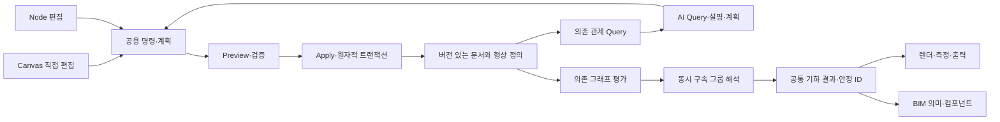

# 공통 기하·구속·작도 엔진의 요구사항과 다음 구현

2026-10-05 정리. 사용자가 제시한 Geometry Kernel, Constraint Solver, Dependency
Graph를 제품의 공통 기반으로 채택한다. 정밀함과 함께 필요한 기능을 편하게 연결해
작업을 끝내는 경험을 우선한다. 기본 CAD 공백 해소라는 목적은 유지한다.
수학 작도·파라메트릭 CAD·벡터 편집·3D·BIM을 별도 문서 엔진으로 만들지 않는다.
이 문서는 현재 코드와 요구사항의 대조이며 전체 기능의 구현 완료 선언은 아니다.

기하 영역의 묶음은 아래 SG1–SG5로 구분한다. 전체 제품의 G0–G6 실행 순서는 [최종 기획](../IMPLEMENTATION-READINESS-2026-10-05.md)을 따른다. 벡터·이미지·레이아웃은 같은 identity·명령·History·저장 계약을 쓰며, 이미지의 픽셀 계산이나 Frame 배치를 CAD solver에 강제하지 않는다.

## 현재 구현과 요구사항의 차이

| 영역 | 현재 확인한 기반 | 새로 갖춰야 할 것 |
| --- | --- | --- |
| Geometry Kernel | 일반/스케치 선분, 다중선, 사각형, 원, 호. 독립 Point/무한 Line/Ray와 해석적 중점·직선/원 교점. 해석적 길이·면적, bulge 호 윤곽, BRep 솔리드 Worker | Polygon의 명시적 의미, Ellipse, Bezier, Spline과 파생점 계산 API 확장. 현재 `line`은 **유한 선분**이다. `cad-geometry`의 Registry만으로 이 커널이 완성된 것은 아니다. |
| 수정 명령 | Move/Copy/Rotate/Scale/Mirror, live 2D 패턴, 열린/닫힌 곡선 Offset, 자유 끝부분 Trim/Extend와 닫힌/중간 구간 Trim·직선 재결합·치수/live 솔리드 재연결, 두 객체 직선 Fillet/Chamfer, Split/Join, 3D Boolean. 정점 구성·Lengthen·영역 Stretch와 결과 인계 작업대 | 원호가 참여하는 두 객체 코너, 소유 스케치/작도/패턴/블록 관계 어댑터. 2D 영역 Boolean은 3D Boolean과 별도로 필요 |
| Constraint | 기존 수치 구속과 전용 평행/수직, 동일 길이/반지름, 동심, 선–원/원–원 접선, 점의 선/원 위, 대칭의 동시 해석·DOF/충돌·캔버스 검토 | 호 접점 범위·호 위 점, 일반 곡선과 대규모 솔버 보강 |
| Snap | Grid/Endpoint/Midpoint/Center/Intersection/Tangent/Perpendicular/Nearest/Quadrant/Extension, 종류별 설정·격자 간격·픽셀 취득 반경과 커서 기호/원본 | 후보 전환·추적점 획득/해제·복수 추적 교점. 스냅된 좌표와 저장되는 작도/구속 관계를 구분 |
| Construction | 보조 형상 점선/프로파일 제외, 독립 보조점/무한선/반직선, 전체 숨김과 저장되는 중점·수직이등분선·직선/원 교점 관계. 원본 드래그의 연쇄 미리보기 | 원–원/일반 곡선 교점, 나침반/자 모드와 수학 연산 확장, 정의 입력 재지정 |
| Dependency Graph | 피처 입력, 스케치 소유권, 변수/식, 바인딩, live 패턴, 치수/해치 원본, 블록 참조와 타입 있는 작도 연산. 입력 ID·교점 분기 저장, 재생성·Query/Inspector·v4 문서 | 작도 연산 종류 확장과 정의 재편집 UI. 스냅 좌표만으로 작도 관계를 추정하지 않음 |
| Layer/Group/Component | 레이어 visible/locked/color/line type/width, 단순 블록 정의·삽입, live 패턴 | 레이어 opacity, 명시적 Group, 편집 가능한 Component 정의/매개변수/인스턴스와 중첩·격리 편집 |
| Dimension/Annotation | 일반 수평/수직/정렬·반지름/연속 치수, 문자/해치. 스케치 거리·각도·반지름·지름은 입력으로 작동 | 일반 지름/각도, 호 길이·면적·좌표·Leader, 공통 스타일/단위/정밀도. 측정 표시와 driving dimension의 역할을 명시 |
| 좌표/단위 | mm 중심 길이 단위 파싱, 절대/상대 `@` 좌표·극좌표, XY/XZ/YZ 작업면 | 모든 도구의 일관된 단위/정밀도 설정, 사용자 UCS와 원점/높이. 큰 좌표에서도 공차·변환 기준을 보존 |
| 수학 모드 | 기본 기하·변환·스냅 계산 일부 | Compass/Straightedge, 수선·각 이등분선, 접선, 외접원/내접원, Locus/함수/매개곡선/Vector 및 Euclidean 도구 제한 |
| 노드/파라메트릭 | 단위 변수/식과 피처·스케치 바인딩, 공용 Query/Preview/Apply | 노드 편집 UI, 타입 있는 포트, 같은 객체의 직접 편집 의미와 양방향 표시. 별도 Canvas/Node 기하 원본을 만들지 않음 |
| 3D/BIM | Extrude/Revolve/Sweep/Loft, BRep 합/차/교차와 일부 엣지 편집 | 면 위 스케치/연관 투영, Cut/Hole/Shell/Section Plane. 이후 Wall/Door/Window/Floor/Column/Beam/Stair/Room을 공통 형상+의미 데이터로 추가 |
| 웹 문서/교환/AI | 로컬 JSON 저장·복구와 Undo, 제한된 DXF 입출력·SVG/PDF 출력, 일부 STEP/STL 출력. Copilot은 rule 기반 | SVG/PNG/PDF 가져오기 의미·래스터 참조 구분, DXF bulge 왕복. URL 문서 저장소·접근 권한·협업/버전/댓글. DWG/STEP/IFC 변환 어댑터. 그래프를 읽는 AI 인터페이스 |

DXF/SVG/PDF 같은 교환 파일에 편집 관계까지 모두 보존되는 것은 아니다.
수학 작도와 구속의 원본은 버전 있는 WebCAD 문서에 보존하고, 각 어댑터가
보존/근사/제외한 항목을 보고해야 한다. PDF/PNG의 래스터를 가져오는 기능과
정확한 편집 가능한 기하를 복원하는 기능도 구분한다.

## 이번에 구현한 연결과 검수

1. `queryCadDocument().dependencyGraph`와 객체별 `dependencies`가 실제 저장된
   피처·식·스케치·블록 관계를 읽는다. live 입력, 독립 snapshot 출처와 주석
   참조를 구분하며 누락 원본을 진단한다. 구속은 방향이 있는 엣지로 꾸미지 않고
   정확한 식 정의와 자유도를 담은 **동시 해석 그룹**으로 반환한다.
2. 일반 객체, 스케치 편집 Inspector와 편집 밖 스케치 객체의 Dependencies에서
   원본·예상 연결 영향·동시 구속을 설명한다. 좌표가 같다는 이유로 존재하지 않는
   작도 관계를 추정하지 않는다. Query는 문서/이력을 바꾸지 않는 detached 결과다.
3. Direct → 점 핸들 드래그 → Intent **Let connected geometry follow**를 추가했다.
   기존 편집은 선택한 선의 반대 끝점까지 임시 고정해 연결 형상이 움직여 만족할
   수 있는 요청도 막았다. 새 의도는 요청 점만 목표로 삼고 나머지 자유점이
   저장된 관계를 만족하도록 함께 해석한다. 기존 반대 끝점 고정 의도도 유지한다.
4. `AB=50`, `BC=30`, `B의 일치`, `AB⊥BC`를 각각 걸고 A를 `(10,20)`으로
   이동하는 과제를 명령·실제 캔버스 드래그·수치 입력으로 검수했다. 두 녹색 선,
   길이/직각 유지 안내, 적용, 한 Undo/Redo가 일치한다. 저장된 고정점을 우회하지
   못하고 임시 목표 구속이 저장 파일이나 자유도에 남지 않는다.

새 연결 편집은 현재 선/다중선 정점에 적용한다. 사각형·원·호의 다른 편집
의도, 구속 자동 해제, 전체 스케치 Stretch 지원을 추가했다고 주장하지 않는다.
이후 SG1에서 `Midpoint M → Perpendicular Line → Intersection P`도 저장 가능한
연산으로 추가했다. 정의·분기·원본 드래그 검토·저장/재열기와 실패 정책은
[CONSTRUCTION-GEOMETRY-2026-10-04.md](../implementation/CONSTRUCTION-GEOMETRY-2026-10-04.md)에 기록한다.

## 하나의 원본과 계산 계약

- **정의와 결과:** 피처/작도 연산/구속·변수는 저장되는 정의다. 해석된 기하는
  그 정의의 계산 결과이며 렌더링 삼각망/곡선 샘플은 표시 캐시다. 미래 노드
  시스템이 같은 값을 별도의 문서로 저장하지 않는다. 현재 drawing params와
  Sketch의 투영 경로는 타입 있는 어댑터로 점진적으로 연결한다.
- **타입과 단위:** Point와 Vector, Segment/Line/Ray, 곡선/닫힌 영역, 주석과
  BRep/mesh를 명시적으로 구분한다. 작업면/배치 좌표 변환과 mm·rad의 계산
  단위를 통일한다. 무한선을 매우 긴 선분으로 저장하거나 타원을 원으로 처리하지 않는다.
- **파생 연산:** 기존 피처의 inputs와 트랜잭션을 확장한 타입 있는 연산 정의를
  사용한다. 출력 ID와 점/선분 참조, 연산 이름·입력·매개변수·교점 분기 선택을
  저장한다. 조회용 그래프를 두 번째 권위 있는 저장 그래프로 만들지 않는다.
- **구속과 DAG:** 치수·관계는 여러 미지수의 동시 방정식이다. 그래프에서는
  solve group을 계산 단위로 취급한다. `A→B`처럼 임의로 방향을 정하지 않는다.
  파생점이 다시 자기 원본 구속을 구동하는 순환은 명시적으로 진단하거나,
  지원하는 동시 해석 그룹으로 정의해야 한다. 지금은 임의 순환을 허용하지 않는다.
- **직접 편집 의미:** 독립 점은 좌표를, driving dimension은 값을/식을,
  파생점은 생성 매개변수를 편집한다. 자유점 따라 이동·드라이버 수정·관계 해제·
  파생 관계 분리는 별도 의도다. 생성식이 있는 점을 드래그했다고 독립점으로 바꾸지 않는다.
- **실패와 참조:** 입력 삭제, 평행선, 접점 합류, 해 없음/여러 해, 과잉 구속,
  downstream 재생성 실패와 stale preview를 구분한다. 교점 후보 배열의 순서만
  참조로 사용하지 않는다. 모호한 분기를 다른 점에 자동 연결하지 않으며 마지막
  유효 결과를 현재 유효 결과처럼 표시하지 않는다. 적용 실패는 한 트랜잭션 전체를 복원한다.
- **AI:** Query에서 출처·자유도·막는 관계를 읽고 일반 명령 계획을 만든다.
  기하 연산·솔버가 수치를 계산하고 Preview/Apply가 검증한다. AI가 별도 엔진으로
  문서 좌표를 직접 덮어쓰거나 모델이 지어낸 작도식을 저장하지 않는다.

## 기하 영역의 기능 묶음과 통과 기준

### SG1. 독립 객체와 저장되는 작도 관계 — 구현·검수 완료

첫 범위를 Point / Segment / infinite Line / Ray와 기존 Circle로 제한한다.
기존 유한 `line`은 Segment로 명시적으로 매핑하고 버전/마이그레이션 계약을
정한다. 기존 파일의 선분을 무한직선으로 오해하지 않게 한다. 모든 객체에
stable ID, work plane, Construction 목적과 정확한 정의를 둔다.

첫 작업은 `A,B → AB → Midpoint M → 수직이등분선 → Circle 교점 P`다.
중점·수직이등분선·선/원 교점을 **명령→저장→평가→렌더→Query 설명**까지
연결한다. 독립 점을 움직이면 P까지 갱신되고, 선택하면 실제 연산·입력·선택한
분기가 보인다. Construction 👁 OFF는 정의/구속/프로파일을 바꾸지 않으며
숨긴 형상의 스냅/선택 정책을 명확히 한다. 무한선의 Fit/클리핑도 정의한다.

완료 기준: 캔버스 작성·정밀 수정·저장/재열기·한 Undo/Redo 이후 동일한
교점 분기와 출처가 유지된다. 0/1/2교점, 점의 합류, 원본 삭제와 순환을
검수한다. 정17각형은 이 연산 기반을 검수한 후 별도 실제 작도 과제로 구현한다.

위 첫 범위를 구현했다. 추가 Node 13개와 실제 브라우저 25개 검사에서 작성,
무한선/반직선 도메인, 점 드래그의 전체 연쇄 미리보기, 한 Apply/Undo/Redo,
v4 저장·재열기 후 재계산과 전역 보조 형상 숨김을 검수했다. 교점 소실/원본
삭제/붕괴는 원자적으로 거절하며 파생 좌표를 독립적으로 덮어쓰지 않는다.
원–원/일반 곡선 작도, 스케치 솔버 엔티티 확장과 정의 입력 재지정은 후속 범위다.

### SG2. 기본 관계·스냅과 곡선 수정 작업 완결

구속·스냅 첫 묶음 완료: 관계 10종, 전용 평행/수직과 점·축 영구 참조, 선–원/원–원 서명 있는 접선, 원형 드래그, 동일 검토 결과의 한 Apply/Undo를 구현했다. Quadrant/Extension과 브라우저에 저장되는 스냅 종류·격자 간격·취득 반경도 추가했다. 상세 경계는 [EXTENDED-SKETCH-AND-SNAPS-2026-10-04.md](../implementation/EXTENDED-SKETCH-AND-SNAPS-2026-10-04.md)를 따른다. 호 접점 범위·스냅 추적은 남아 있다. 곡선 편집의 최신 상태는 아래를 따른다.

첫 곡선 수정 묶음도 구현했다. [CURVE-WORKFLOW-2026-10-04.md](../implementation/CURVE-WORKFLOW-2026-10-04.md)의
정확한 Offset·자유 끝부분 Trim/Extend·두 객체 직선 코너와 결과 인계/기존 편집기 연결을 따른다.
닫힌·중간 구간 Trim과 치수/live 솔리드 재연결은 [후속 구현](../implementation/CONTOUR-TRIM-REFERENCES-2026-10-04.md)으로 제공한다. 원호 모서리·소유 관계 어댑터는 남아 있다.

평행/직교 전용 구속 → 접선·동심·동일 → 점이 선/원 위·대칭을 구현했다.
연결 점 이동과 driving dimension 수정, 자유도/충돌·불가능 방향 안내를 같은
미리보기에서 검수한다. Quadrant/Extension과 스냅 설정·추적을 공통 기하 계산에
연결한다. 스냅 종류와 `어느 객체의 어느 참조인가`를 표시한다.

곡선 다중선 전체 Offset → 자유 끝부분 Trim/Extend → 두 객체 직선 Fillet/Chamfer를
같은 해석적 곡선·참조 계약으로 연결했다. 닫힌 구간 Trim도 이 계약으로 연결했으며, 원호 모서리와 소유 관계 어댑터를 후속 확장한다.
이것은 기본 CAD 실무 공백이며
노드·BIM 확장 때문에 뒤로 계속 미루지 않는다. 다음 Ellipse/Bezier/Spline은
정확한 측정·투영·교점의 지원 범위를 먼저 정하고 추가한다.

### SG3. 치수·재사용·파일 왕복

일반 도면 지름/각도와 스타일·단위·정밀도, 호 길이/면적/좌표·Leader를 추가한다.
Group은 선택 묶음, Component는 별도 정의와 참조 인스턴스로 둔다.
문 30개 배치→원본 폭 변경→전체 갱신→한 Undo를 완료 기준으로 삼는다.
인스턴스 변환과 허용 override, 중첩/참조 순환·분리 의미를 명시한다.
DXF bulge·단위·블록 왕복과 출력 축척을 검수하고 전문 포맷은 어댑터로 확장한다.

### SG4. 수학·노드 UI → 3D 기준 보강 → 의미 계층

외접원/내접원·각 이등분선 등의 수학 연산을 SG1의 저장 연산으로 추가한다.
Euclidean 모드는 같은 문서에서 사용 가능한 도구/연산을 제한한다. Locus와
함수/매개곡선의 샘플 근사·공차를 명시한다. 노드는 기존 형상/변수/연산을
편집하며 Canvas에 그린 원도 같은 Circle 노드 정의를 보여야 한다.

2D 계약이 통과한 뒤 기존 3D 피처의 면 참조/작업면·Cut/Hole/Shell/Section을
보강한다. 이후 공통 geometry reference와 thickness/height/material 등의 타입
있는 속성으로 BIM 의미를 붙인다. Wall/Room 등의 호스트·공간 관계와 수량은
별도 의미 계약으로 검수한다. mesh는 기존 표현 계약에 따른 별도 편집 표현이다.

### SG5. URL 문서·협업과 AI 생산성

URL은 서버의 document ID·권한·버전을 가리키도록 한다. 로컬 포트 미리보기나
URL에 파일을 넣는 기능만으로 지속 공유/공동 편집이 완성됐다고 보지 않는다.
서버 저장·권한·검증 가능한 변경 기록·동시 편집 충돌 정책·버전/댓글 참조를
먼저 갖춘다. Undo history와 협업의 영구 버전 기록을 구분한다.

AI 인터페이스는 지금 마련한 Query/Plan 경로를 확장한다. 외접원 생성, 벽 두께
200mm 변경, 보조선 숨김, 움직이지 않는 점 설명을 각각 검증 가능한 명령/조회
과제로 만든다. 직접 편집과 AI 결과가 동일해야 하고 기존 큰 문서 지연 측정과
실무자 관찰을 계속 적용한다. AI 연결만으로 생산성 향상을 선언하지 않는다.

## 검수 기록

이번 변경의 Node 회귀는 `tests/dependencyGraph.test.ts` 6개, 실제 브라우저
`dependencyWorkflow` 9개다. Graph Query·연결 점 편집 단계의 전체 **Node 448개 / 49 suites**, **브라우저
16과제 / 318개 UI·Worker 검사**와 production 빌드가 통과했다. 이후 확장한 최신 전체 결과는
[PROJECT-STATE.md](../../PROJECT-STATE.md)를 따른다.
격리된 Edge/SwiftShader UI 검수는 실제 GPU 성능이나 전문가 사용성 연구를 대신하지 않는다.
로그: `tmp/dependency-graph-node.log`, `tmp/dependency-workflow-browser.log`.
캔버스: [cad-connected-constraints.png](../../output/images/cad-connected-constraints.png).
