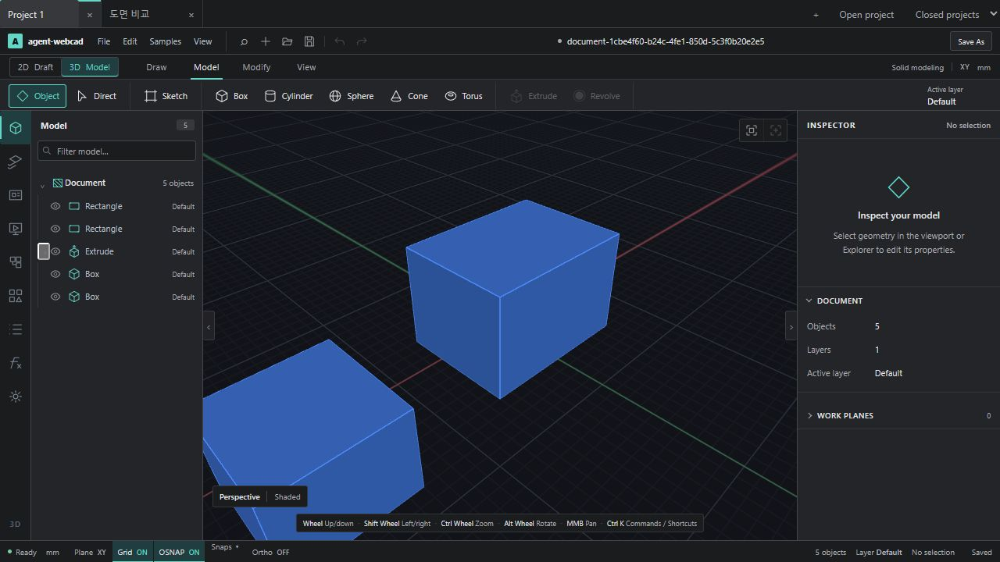

# 프로젝트 탭 — UI-P1

> **현재 기능 설명:** [프로젝트와 저장](../features/PROJECTS.md). 이 문서는 날짜별 구현·설계 기록이며, 아래 사용법·제한·수치는 당시 범위다. 후속 지원은 대표 가이드를 따른다.

2026-10-14. 한 탭은 독립 WebCAD 문서/프로젝트다. 여러 도면 뷰가 들어 있는 한 프로젝트와 별개의 프로젝트 탭을 구분한다.

## 사용

- 상단 `＋`는 빈 프로젝트를 새 탭에 연다. 편집기의 New document / Ctrl+N도 같은 동작이다.
- `Open project` 또는 편집기 Open document로 파일을 열면 기존 프로젝트를 유지하고 새 탭을 만든다. 파일명이 초기 탭 이름이 된다.
- 탭 클릭으로 전환한다. 탭에 키보드 포커스가 있으면 좌우/Home/End로 전환할 수 있다.
- 탭 이름을 더블클릭해 이름을 변경한다. 이름은 workspace의 표시 이름이며 원본 CAD document ID나 파일 자체를 변경하지 않는다.
- 변경된 탭은 점으로 표시한다. 기존 Save는 로컬 복구본 저장, Save As는 휴대 가능한 `.webcad.json` 다운로드다.
- `×`는 먼저 해당 편집기에 체크포인트 저장을 요청한다. 문서 명령 실행 중이거나 저장 실패이면 닫지 않는다.
- `Closed projects`에서 닫은 프로젝트를 다시 연다. 저장된 도면은 복구하고 Undo는 새로 시작한다. 닫기는 복구본 삭제가 아니다.

## 상태 경계

현재 CAD의 singleton document/history/plan registry/Worker를 그대로 공유하는 다중 React root는 안전하지 않다. 동일 origin의 독립 iframe 편집 세션을 프로젝트마다 두었다. 부모는 탭 목록·표시 이름·활성 탭을 관리하고, 각 자식은 기존 CAD App 전체를 소유한다.

열린 탭 전환은 편집기를 unmount하지 않는다. 각 탭의 Undo/Redo, 선택, 2D/3D, 카메라·도구 상태는 해당 편집 세션에 남는다. 닫기/새로고침은 세션을 새로 시작하므로 Undo·선택·카메라·진행 중인 미리보기는 복구 대상이 아니다. 도면 데이터와 탭 목록/활성 프로젝트는 복구한다.

체크포인트·이전 백업·래스터 asset의 모든 storage get/set/remove에 프로젝트 namespace를 적용했다. 파일의 내부 document ID가 같아도 workspace session UUID가 달라 두 탭이 섞이지 않는다. 초기 `legacy` 탭은 기존 단일 문서 복구 키를 그대로 읽어 이전 작업을 연결한다.

부모/자식 메시지는 channel + origin + 등록된 iframe의 contentWindow + session ID를 함께 검사한다. 다른 창이 동일한 ID를 적어 보내도 허용하지 않는다. 부모는 파일을 검증하고 복구본 저장이 성공한 뒤 탭을 등록한다. 손상 파일은 기존 문서를 교체하지 않는다.

## 검증

- 실제 Chromium 프로젝트 workflow **19 checks**: 빈 탭, 새 문서→새 탭, 독립 저장, A/B Undo·Redo 격리, 탭별 2D/3D, 닫기 저장, 재열기, 동일 내부 document ID 파일 복제, 잘못된 파일 거부, 미등록 message source 거부, 전체 페이지 새로고침 후 탭 목록·활성 문서·geometry 복구.
- 파일 chooser 입력 fixture는 테스트 File로 공급하고, 프로젝트 전환·CAD 명령·닫기·재열기는 실제 포인터 입력과 hit-test를 사용했다.
- 프로젝트 storage + 기존 recovery **Node 6 checks 통과**. namespace별 백업 fallback과 asset key 삭제 격리를 포함한다.
- `tsc -b`, architecture **545 modules**, production build **401 modules** 통과. 기존 큰 JS chunk 경고는 남는다.
- 직접 브라우저에서 한글 이름 변경과 탭 전환을 확인했다.

## 지원 경계와 다음

이 단계는 한 화면에서 여러 프로젝트를 전환하는 기능이다. 한 프로젝트의 여러 파일을 묶는 폴더/workspace 모델, 좌우 분할 동시 보기, 프로젝트 간 복사/참조, 탭 드래그 순서 변경은 별도 작업이다.

재열 때는 활성 탭만 로드하고 다른 탭은 처음 선택할 때 로드한다. 방문한 열린 탭은 편집 세션 보존을 위해 계속 유지되므로 각 프로젝트의 WebGL/Worker 메모리를 사용한다. 여러 대형 건축 프로젝트를 동시에 열었을 때의 메모리 예산·비활성 렌더 중지·세션 suspend/resume는 후속 성능 작업이며 이번 검증에서 대형 다중 프로젝트 성능을 주장하지 않는다. workspace 목록은 열린/닫힌 프로젝트를 합쳐 200개까지 지원한다.

마감 보충: 같은 dirty 상태의 반복 목록 쓰기를 생략하고, 백그라운드 상태 갱신이 오류 안내를 지우지 않도록 했다. 비활성 탭을 닫을 때 다른 미방문 편집기를 불필요하게 로드하지 않는다.

후속 **UI-P1-H1 저장·복구와 H2 프로젝트 관리 보강을 완료**했다. 목록 백업/복원·실패 재시도·로컬/파일 저장 상태, Projects 검색/export/삭제·용량·삭제 중단 복구를 연결했다. [H1 경계](UI-P1-H1-PROJECT-RECOVERY-2026-10-14.md), [H2 경계](UI-P1-H2-PROJECT-MANAGER-2026-10-14.md)를 따른다. 후속 UI-P2는 S/C까지 지원 범위로 완료했으며, 현재 전체 큐의 다음은 **WF-Q1**이다. UI-P3 좌우 비교는 후속 후보로 유지한다. **UI-C2 선택 문맥 도구 / C3 속성 패널**은 별도 소유 파일로 병행한다. [현재 큐](../../NEXT-STEPS.md#현재-실행-큐), [하위 에이전트 작업 카드](../product/WORKSPACE-UX-AGENT-PLAN-2026-10-14.md)를 따른다.

