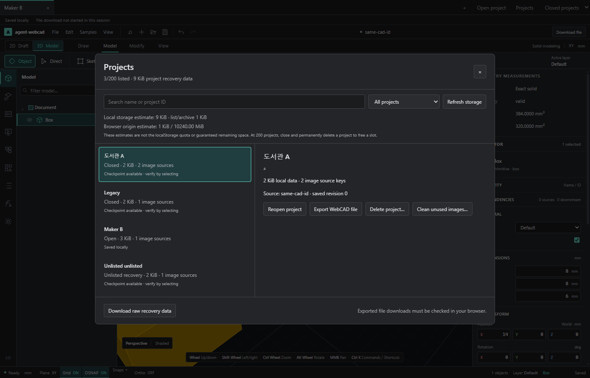

# UI-P1-H2 — 프로젝트 검색·내보내기·삭제·용량 관리

> **현재 기능 설명:** [프로젝트와 저장](../features/PROJECTS.md). 이 문서는 날짜별 구현·설계 기록이며, 아래 사용법·제한·수치는 당시 범위다. 후속 지원은 대표 가이드를 따른다.

2026-10-14. [NEXT-STEPS](../../NEXT-STEPS.md)의 H2를 구현했다. H1의 목록 복구, 편집기별 generation/request/deadline, 로컬 저장과 파일 다운로드 구분을 유지한다.

## 사용

상단 **Projects**에서 프로젝트 관리 화면을 연다. 이름/프로젝트 ID 검색, 열린 탭·닫은 프로젝트·미등록 복구본 필터를 제공한다. 마지막으로 연 시각이 있는 프로젝트는 최근 순으로 표시하고, 시각이 없는 기존 항목은 이름 순으로 표시한다. 선택하면 저장된 원본 ID/revision, 로컬 데이터 크기, 이미지 원본 수, 검증 실패 이유를 확인할 수 있다.

- **Show / Reopen project:** 열린 세션으로 이동하거나 닫은 프로젝트를 다시 연다. 닫은 프로젝트의 Undo는 새 세션으로 시작한다.
- **Export WebCAD file:** 닫은 프로젝트는 검증된 현재 checkpoint, 현재 것이 손상되면 이전의 유효한 checkpoint를 사용한다. 이미지 원본까지 포함한 휴대 가능한 `.webcad.json`을 다운로드한다. 열린 편집기는 현재의 독립 snapshot을 직접 내보내므로 로컬 저장 용량 오류가 있어도 파일을 받을 수 있다. pending 문서 명령이면 내보내지 않는다. 다운로드 시작과 실제 디스크 기록 완료를 구분한다.
- **Close project first:** 닫기 전에 H1 checkpoint 계약으로 최신 내용을 저장한다. 실패하면 열린 편집기를 유지하고 이유를 표시한다.
- **Delete project…:** 닫힌 프로젝트나 미등록 namespace만 삭제한다. 대상 이름, 현재/이전 복구본과 이미지 원본 삭제 범위를 표시하고 사용자가 확인 체크 후 **Delete permanently**를 누른다. 취소는 데이터를 변경하지 않는다. 영구 삭제는 모델 Undo의 대상이 아니다. 다운로드 여부를 강제하지 않는다.
- **Clean unused images…:** 현재·이전 복구본을 모두 검증한 뒤 어느 쪽에서도 참조되지 않는 이미지 원본 키만 정리한다. 하나라도 읽을 수 없으면 정리를 중지한다. 각 복구본에서 참조하는 이미지와 다른 프로젝트의 같은 asset ID는 유지한다.
- **Add recovered project:** 실패한 New/Open 등으로 목록에 등록되지 않은 유효한 checkpoint를 목록에 추가한다. 원본 namespace를 재사용하고 closed 상태로 등록하므로 원본을 복제/덮어쓰지 않는다. source가 없는 미등록 이미지 키는 별도 검토 후 삭제할 수 있다.
- **Refresh storage:** 저장 키와 목록을 다시 읽는다. 다른 창에서 목록을 수정한 경우 오래된 검토로 삭제하지 않는다. 실제 열린 세션을 다른 창이 닫거나 목록에서 제거했다면 자동 unmount하지 않고 라이브 파일 내보내기 후 재열기 경로를 안내한다.

200개 제한에 도달해 새 프로젝트를 만들면 관리 화면을 바로 연다. 닫힌 **등록 프로젝트**를 삭제하면 슬롯이 줄고 새 문서를 만들 수 있다. 미등록 복구본 삭제는 로컬 공간만 줄이며 슬롯 수는 바꾸지 않는다.

## 용량과 데이터 소유권

화면의 localStorage 크기는 UTF-16 key/value 길이로 추정한다. 프로젝트별 namespace, legacy 문서/backup/asset, 목록/손상 archive를 구분한다. `navigator.storage.estimate()`의 origin 사용량/상한은 별도로 표시한다. 어느 숫자도 localStorage의 정확한 quota나 보장된 잔여 공간으로 표현하지 않는다.

삭제 키는 workspace session ID로 소유권을 판별한다. 내부 CAD document ID나 이미지 hash가 같아도 다른 namespace는 건드리지 않는다. `legacy`는 예전 문서 current/backup와 recovery asset 키만 소유하며 unrelated key나 다른 namespace를 포함하지 않는다. 현재 목록과 유효한 목록 backup에서 대상 항목을 제거해 일반 목록 복원이 삭제된 프로젝트를 다시 등록하지 않도록 한다. 다른 항목과 source는 유지한다.

미등록 checkpoint 전체는 자동 삭제하지 않는다. 화면에서 확인하고 명시적으로 등록/삭제한다. 자동 source 정리는 실행하지 않으며 이미지 정리도 선택 프로젝트와 양쪽 검증본에 근거한다. 현재 checkpoint가 손상돼 기존 backup을 유지하는 저장 경로의 참조 집합도 실제 저장된 backup에서 계산하도록 보충했다. 이로써 이전 이미지 원본이 잘못 정리되지 않는다.

## 삭제 실패와 중단 복구

문서 저장 위치는 기존 localStorage를 유지한다. 새 `projectStorageTransactions.ts`의 native IndexedDB adapter는 **삭제/정리 전 원본과 변경 계획을 보관하는 journal** 용도다. 문서 전체를 IndexedDB로 이관하거나 Dexie를 설치한 것은 아니다.

1. 원본 목록/current/backup/asset와 변경할 키를 캡처해 별도 journal에 먼저 저장한다.
2. 비동기 준비 중 목록·대상 source/키 집합이 바뀌지 않았는지 다시 검사한다.
3. 목록과 해당 키만 변경하고 완료 marker를 저장한다. 성공한 journal은 정리한다.
4. 쓰기·부분 삭제·완료 marker 실패이면 원래 키를 복원한다. 로컬 복구본을 같은 저장 영역에 복제하지 않으므로 localStorage가 찬 상황에서도 작은 목록 교체와 삭제를 진행할 수 있다.
5. 앱 재열기 시 편집기를 mount하기 전에 미완료 journal을 복원한다. 이미 완료한 삭제는 되돌리지 않는다. 복원 자체가 중단된 경우도 rollingBack 상태로 이어 복구한다.

journal이 저장되지 않으면 삭제를 시작하지 않는다. 복구가 실패하면 원본은 journal에 남고 편집/추가 삭제를 멈춘다. 기존 라이브 편집기는 유지한다. raw recovery 다운로드에는 미완료 operation 자료도 포함한다. journal의 프로젝트/키/값 형식을 검증하고, 작업 전후 어느 값과도 다른 외부 변경은 자동으로 덮어쓰지 않는다. 일반 다중 창 공동편집/충돌 병합은 별도 UI-P4 과제다.

## 구현 위치

| 파일 | 역할 |
| --- | --- |
| `apps/web/src/app/ProjectManager.tsx`, `projects.css` | 관리 dialog·검색/필터·선택 요약·용량·삭제/정리 확인·실패 |
| `apps/web/src/app/projectManagerStore.ts` | namespace inventory, portable export, closed delete, 양쪽 checkpoint 기반 asset 정리 |
| `apps/web/src/app/projectStorageTransactions.ts` | IndexedDB journal, source/소유권 검증, 실패/중단 rollback |
| `apps/web/src/app/ProjectWorkspace.tsx`, `projectWorkspaceStore.ts` | 상단 진입·목록/최근 시각·200개 제한·라이브 세션 보존·초기 복구 |
| `apps/web/src/App.tsx`, `state/documentFile.ts`, `app/projectSession.ts` | 라이브 export snapshot와 request/generation/deadline, 성공한 다운로드 시작 통지 |
| `apps/web/src/state/documentRecovery.ts` | 현재/실제 backup asset 참조 보존 및 양쪽 검증 |

## 검증과 증거

대상 Node **29 checks**, native browser **4 workflows / 89 checks**(관리30 / 탭19 / 복구24 / 이미지 원본16), 타입·architecture **554 modules**·production build **405 modules** 통과. 기존 큰 JS chunk 경고는 남는다. 최종 명령·범위는 [검증 기록](../verification/UI-P1-H2-2026-10-14.json)을 따른다. 전체 CAD suite를 실행한 것으로 확대하지 않는다.

Node는 같은 CAD/asset ID의 두 namespace, legacy 보존, 부분 삭제/목록 쓰기 실패, journal 준비/완료 실패, 두 번째 rollback 중단, 외부 변경/잘못된 소유권, 양쪽 이미지 참조, 200개·모의 quota 한계에서 슬롯 해제를 검증한다.

실제 UI는 한글 검색·필터·삭제 확인/취소, self-contained 파일 다운로드/재열기, unused asset 정리, 부분 삭제 실패와 quota 한계에서 재시도, 다른 탭 Undo/Redo 유지, 미등록 source 등록, 열린 source의 로컬 저장 실패 중 직접 파일 내보내기, 닫기 저장, 200개 관리 화면→삭제→새 문서, IndexedDB에 미완료 삭제를 기록한 뒤 실제 전체 페이지 reload 복구를 검증한다. 파일 chooser만 테스트 File fixture를 공급하고 사용자 동작은 CDP pointer/hit-test를 사용한다. journal 중단과 quota 실패는 실제 브라우저 저장 영역에 적용한 fault fixture다.

[실제 native 검증 보고](../../output/verification/project-manager-native-report.json), [내보낸 self-contained 프로젝트](../../output/projects/workspace-management/exported-project.webcad.json).

## 다음과 지원 경계

다음은 **UI-P2 비활성 탭 렌더/Worker·메모리 비용**이다. 여러 대형 건축 문서를 동시에 연 성능, 탭 suspend/Undo 직렬화, layout 분할은 이번 기능의 완료 범위가 아니다. 전체 document/asset backend의 IndexedDB 이관, raw archive/journal import UI, 목록 archive 수명 정책과 실제 다중 창 충돌 병합은 후속으로 남는다. 브라우저가 IndexedDB를 차단하거나 외부 변경 때문에 원본을 안전하게 복원할 수 없으면 recovery 다운로드/재시도를 제공하고 자동 덮어쓰기를 중지한다.
