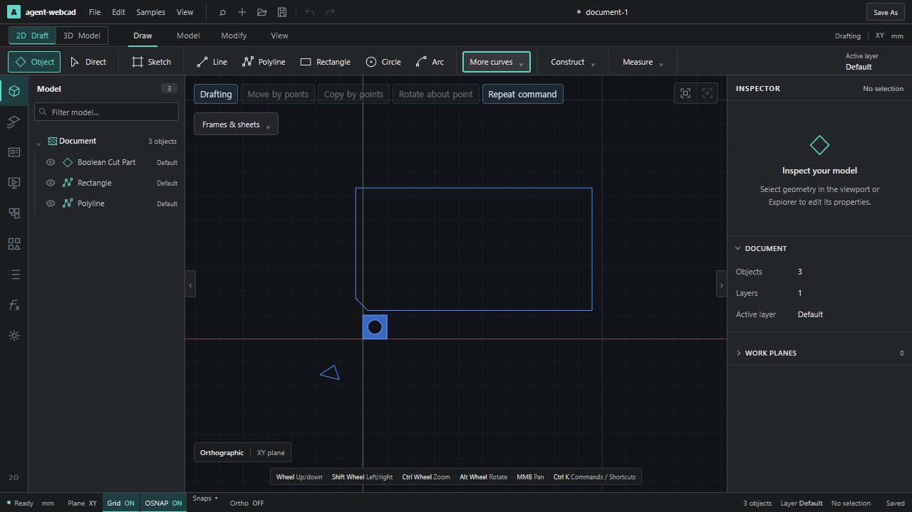
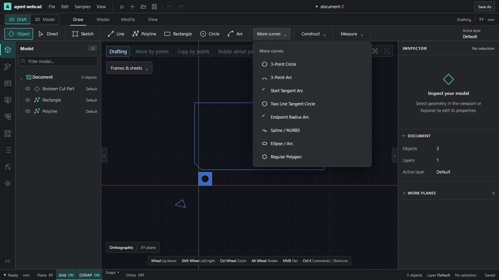
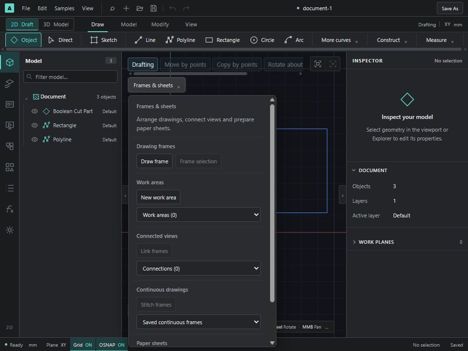

# Photoshot UI 검토와 CAD 첫 적용

검토일: 2026-10-14. 참고: [SLOHERO Photoshot editor](https://slohero.com/photoshot/editor/).
실제 브라우저에서 시작 화면, 빈 캔버스 생성, Move/Text 도구, 속성·레이어 패널을 관찰했다. 서버 내부 구현, 전체 기능의 정확성·성능, 원본 코드의 배포 라이선스까지 검증한 분석은 아니다. 외부 코드·브랜드·이미지를 가져오지 않고, 관찰한 구성 방식을 기존 React UI에 독립 구현했다.

## 무엇이 깔끔하게 느껴지는가

| 관찰한 구성 | CAD에 적용할 의미 | 이번 상태 |
|---|---|---|
| 얇은 메뉴와 도구 옵션 행 | 작업 내용에 세로 공간을 돌려준다 | 리본 94 → 72px, 아이콘+명칭 한 줄 배치 |
| 중립적인 어두운 패널과 적은 강조색 | UI와 도면의 선·면·선택 색을 구분한다 | 공통 배경·경계·텍스트 토큰 정리, 선택·축 의미색 유지 |
| 작은 도구 모음과 기능별 패널 | 기능 증가가 상시 버튼 증가로 이어지지 않게 한다 | More curves / Construct / Measure, 편집·패턴·방향·표시 메뉴 |
| 한 영역에 모인 속성과 레이어 | 화면 위에 여러 작은 조작창이 흩어지지 않게 한다 | 프레임·작업 영역·연결·이어붙이기·시트 조작을 Frames & sheets에 통합 |
| 시작 화면에 명확한 두 가지 행동 | 처음 CAD를 여는 사용자가 빈 화면에서 시작할 수 있게 한다 | 후보: 새 도면 / 열기 / 최근 프로젝트. 이번에는 추가하지 않음 |
| 선택 대상과 도구에 따른 옵션 | 필요한 수치 입력을 찾는 비용을 줄인다 | 후속: 선택 문맥 도구 모음과 Inspector 요약 |

Photoshot은 픽셀·레이어 기반 편집기다. CAD에서는 모델 트리와 연관 도면, 단위·작업 평면·스냅 상태가 작업 결과에 영향을 준다. 이 정보의 가시성을 유지하는 것을 적용 기준으로 삼았다. 사진 필터·블렌드·래스터 캔버스 모델을 CAD에 이식하는 작업은 이 UI 개선의 범위가 아니다.

## 확인한 기존 문제와 수정

- Draw에는 고급 곡선까지 한 행에 나열되어 가로 스크롤이 길었다. 기본 선/폴리선/사각형/원/호는 계속 노출하고 고급 작성은 이름이 보이는 메뉴에서 연다.
- 프레임 관련 다섯 모듈의 버튼이 캔버스 위에 절대 좌표로 쌓여 있었다. 실행 버튼만 하나의 메뉴로 옮겼다. 프레임 SVG, 선택·드래그, 미리보기, 편집기 생명주기는 원래 모듈에 남는다.
- 뷰 종류 표시와 Drafting/이동 버튼이 겹쳤다. 뷰 종류는 캔버스 하단으로 옮겼다. 좁은 화면에서 이동 버튼은 줄바꿈 대신 가로 스크롤하며 Fit 영역을 확보한다.
- 팝업은 브라우저 top layer를 사용해 리본의 overflow에 잘리지 않는다. 바깥 클릭/Escape 닫기, 실행 후 닫기, 화면 크기 변경 시 닫기, 화면 높이 이내 스크롤을 적용했다.
- 프레임 도구와 SVG에 같은 접근성 이름이 붙는 충돌을 검사 중 발견해 도구 영역 이름에 `tools`를 붙였다.

주요 파일: `apps/web/src/ribbon/Ribbon.tsx`, `apps/web/src/ui/ToolDisclosure.tsx`, `apps/web/src/viewport/FrameToolDock.tsx`, 다섯 프레임 UI 모듈, `ui/tokens.css`, `ui/commands.css`.

## 검증

| 검사 | 결과 |
|---|---|
| 실제 브라우저 drawingFrames | 26 checks 통과: 새 메뉴 열기, 선택 프레임, 드래그, Review/Apply, Undo/Redo, SVG/DXF, 재열기 |
| 실제 브라우저 frameStitches | 25 checks 통과: 이어붙이기, 소스·시트 연동, 출력·재열기 |
| 실제 브라우저 spline | 19 checks 통과: 메뉴를 통한 원본 생성·편집, 실제 Worker 단면/HLR, 출력·재열기 |
| 실제 브라우저 keyboardActivation | 21 checks 통과: Enter/Space와 CAD 키보드 라우팅 |
| 직접 화면 검증 | More curves → Spline, Frames & sheets → 작업 영역 → 취소, Escape, 960×720 팝업 경계 |
| 타입·구조·빌드 | tsc 통과, architecture 541 modules 통과, Vite 398 modules 빌드 통과 |

합계는 대상 4 workflows / 91 checks다. 이번 UI 변경에서 전체 CAD Node 회귀나 전체 브라우저 모음을 다시 실행했다는 의미는 아니다. 기존 큰 번들 경고는 남는다.

물리 입력 검사 helper는 숨겨진 명령을 강제 클릭하지 않는다. 먼저 연결된 펼침 버튼을 실제 포인터로 클릭하고, 팝업이 열린 뒤 대상의 hit-test를 확인한다.

## 후속 순서

1. **UI-C2 선택 문맥 도구 모음:** 선택 없음/일반 도형/스케치/연관 도면 상태에 맞춰 현재 작업과 사용 가능한 수치 조작을 요약한다. 비활성 사유와 고급 기능 진입점을 제공하고, 기존 단축키·Review/Undo 경로를 유지한다.
2. **UI-C3 Inspector 요약:** 위치·크기·스타일·연관 상태의 우선순위를 정리하고 상세 항목을 단계적으로 펼친다. stale/locked/출력 손실 정보는 숨기지 않는다.
3. **UI-C4 시작 화면:** 새 2D/3D 작업, 열기, 검증용 예제와 최근 문서를 연결한다. 다중 문서 탭·패널 분리·도킹은 문서 수명과 상태 저장 설계가 선행되어야 하므로 별도 작업이다.

## 결과 화면

