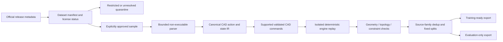

# CAD 데이터셋 통합·학습 계획

조사일: 2026-10-25. 공식 논문·저자 저장소·배포 카드의 공개 정보만 확인했다. 데이터 아카이브, 모델 weight, 대규모 이미지, STEP 묶음은 다운로드하지 않았다. 표의 건수·용량은 게시값이며 실제 다운로드 무결성·변환 성공률을 검증한 값이 아니다. 코드 라이선스와 원본 CAD 데이터 권리는 분리한다.

## 1. 출처·구조·용량·권리

| 자료 | 출처와 구조 | 게시 규모 / 다운로드 단위 | 라이선스 및 격리 판단 |
|---|---|---|---|
| Fusion 360 Gallery | [Autodesk 공식 저장소](https://github.com/AutodeskAILab/Fusion360GalleryDataset). reconstruction은 sketch/extrude timeline JSON, SMT/STEP, face group이 있는 OBJ. segmentation과 assembly는 별도 subset | reconstruction 8,625 sequences / 2.0 GB; segmentation 35,680 parts / 3.1 GB; joint 32,148 joints / 2.8 GB. 전체 assembly는 별도 다운로드 절차 | [데이터 라이선스](https://github.com/AutodeskAILab/Fusion360GalleryDataset/blob/master/LICENSE.md)는 비상업 연구 전용, 전체 재배포 제한, 수정 subset도 조건 승계. **research-noncommercial 격리** |
| SketchGraphs | [PrincetonLIPS 공식 저장소](https://github.com/PrincetonLIPS/SketchGraphs). 기하 entity node와 constraint edge, 원본 Onshape JSON 및 압축 sequence 표현 | 약 1,500만 sketch. raw 128개 zstd tar 합계 약 43 GB; 전체 sequence 단일 파일 약 15 GB; filtered train/validation/test 별도 | 코드는 MIT. [README의 데이터 권리 안내](https://raw.githubusercontent.com/PrincetonLIPS/SketchGraphs/master/README.md)는 원 제작자 저작권과 Onshape 약관을 참조. MIT가 모든 CAD 원본에 적용된다고 판단하지 않음. **license-unresolved 격리** |
| DeepCAD | [저자 저장소](https://github.com/rundiwu/DeepCAD), [공식 프로젝트](https://www.cs.columbia.edu/cg/deepcad/). cad_json construction sequence, cad_vec vectorized sequence, OpenCascade/pythonocc replay | 논문 178,238 models. 공식 data.tar/Drive backup 제공. 원본 아카이브의 신뢰할 수 있는 byte 크기는 **확인 불가** | 저장소 MIT. Onshape 원본에서 추출한 모델 전체의 권리 범위는 저장소 코드 라이선스만으로 확정하지 않음. **license-unresolved 격리** |
| CAD-Steps | [제작자 페이지](https://www.amypretzel.com/software/cad-steps)에서 연결한 [생성 코드](https://github.com/amywork777/cad-steps-dataset)와 [배포 카드](https://huggingface.co/datasets/amzyst1/cad-steps). DeepCAD replay의 state_N.step.gz + operations/constraints metadata.json | 카드: 215,096 source model / 약 750,000 STEP / 약 16 GB compressed. 실제 HF 표시 총 파일 크기 13.5 GB. 원본 DeepCAD 논문 건수와 다르므로 subset·중복·release provenance 확인 필요 | 카드 CC-BY-4.0, source DeepCAD를 MIT라고 기술. 상위 원본 권리와 모델 수 차이 검토 전 **provenance-review 격리** |
| Text2CAD | [저자 저장소](https://github.com/SadilKhan/Text2CAD), [공식 HF](https://huggingface.co/datasets/SadilKhan/Text2CAD), [논문](https://arxiv.org/abs/2409.17106). DeepCAD UID에 다단계 자연어·CAD vector·중간/최종 이미지 결합 | 논문 약 170k model / 660k annotation. 카드: 전체 605 GB; cad_seq.zip 579 MB, v1.0 CSV 1.1 GB, v1.1 CSV 1.3 GB. 이미지 포함 전체와 텍스트 subset 용량을 구별 | [저자 LICENSE](https://github.com/SadilKhan/Text2CAD/blob/main/LICENSE)와 gated 배포 조건 CC BY-NC-SA 4.0. **research-noncommercial 격리** |
| Text2CAD-Bench | [저자 논문](https://arxiv.org/html/2605.18430v1), [AICAD 공개 카드](https://huggingface.co/datasets/AICAD/Text2CAD-Bench). Geo/Sequence dual prompts, 난도 및 실사용 범주 | 논문/카드 600 examples. 카드상 공개분은 30% prompt preview, STEP ground truth 비공개. [파일 목록](https://huggingface.co/datasets/AICAD/Text2CAD-Bench/tree/main) 총 211 kB; README·release.csv 등이 실제 공개됨 | 카드 CC BY 4.0. 설치 URL/연락처에 placeholder가 남아 있어 전체 평가 코드·정답 배포 및 저자 release 연결을 추가 확인해야 함. **evaluation-only / provenance-review**, 학습 split에 넣지 않음 |
| CADTalk | [저자 프로젝트](https://enigma-li.github.io/CADTalk/), [공식 코드](https://github.com/YYYYYHC/CADTalk), [논문](https://arxiv.org/html/2311.16703v2). OpenSCAD 프로그램 block과 semantic part label, multi-view 및 pixel-block 대응. V1/V2 abstraction-level 자료와 labeling tool | Drive 배포 링크는 있으나 공개 페이지에서 검증 가능한 총 byte 크기는 **확인 불가**. 논문의 dataset 구성과 실제 배포 manifest를 샘플 단계에서 대조해야 함 | 코드 MIT. README만으로 Drive의 모든 프로그램·이미지·label 권리를 확정할 수 없음. **license-unresolved 격리** |

Fusion의 [reconstruction 명세](https://raw.githubusercontent.com/AutodeskAILab/Fusion360GalleryDataset/master/docs/reconstruction.md)는 cm/radian 단위와 face별로 분리한 비-manifold OBJ를 명시한다. 현재 MVP의 manifold mesh validator에 그대로 넣을 수 없다. source face ID와 seam welding의 정확한 정책을 가진 변환기가 필요하다.

Text2CAD는 저자 코드/데이터 조건을 확인했으며 이름이 같은 다른 text-to-CAD 서비스나 저장소와 혼동하지 않았다. Text2CAD-Bench의 공개 카드 내용과 실제 파일 목록도 구분했다. 카드에 그려진 evaluation 폴더 트리를 실제 배포 파일이라고 간주하지 않는다.

## 2. 용도별 적합성

아래는 기술적 적합성이다. `적합`이 해당 자료의 사용 권리 승인이나 실제 변환 완료를 뜻하지 않는다.

| 데이터셋 | 모델 학습 | 평가 | 기하 엔진 테스트 | 설계 명령 재실행 | 의미·의도 추론 |
|---|---|---|---|---|---|
| Fusion Gallery | 연구용 sequence/topology | 공식 split 유지 | STEP 및 작업별 결과 oracle | sketch/extrude subset 적합, Fusion API semantics adapter 필요 | face→operation, assembly 관계 |
| SketchGraphs | 구속 graph / auto-constraint | constraint satisfaction·재현성 | 2D solver 중심, 3D BRep 자료 아님 | 지원 entity/constraint만 translate | 명시적 구속이 강한 감독 신호 |
| DeepCAD | sketch/extrude sequence | held-out replay·shape metrics | valid/invalid feature 생성 corpus | vocab·좌표계·정규화 adapter 필요 | 순서·operation 의미, 자연어는 없음 |
| CAD-Steps | next-step / state transition | 중간 상태와 replay 비교 | 단계별 STEP validity·volume·surface | metadata가 충분한 subset만 | 연산에 따른 기하 변화 |
| Text2CAD | text→validated commands, 연구 조건 | annotation별 success·geometry metrics | 원본 DeepCAD 기반이라 독립 corpus가 아님 | vector를 구조화된 intermediate representation으로 변환 | 다단계 자연어. 합성 annotation 오류 확인 필요 |
| Text2CAD-Bench | 사용하지 않음 | 우선 사용 목적, 정답 접근 필요 | 정답 확보 시에만 가능 | prompt 자체를 정답 sequence로 간주하지 않음 | 초심자 표현과 절차형 표현의 차이 |
| CADTalk | semantic program labeling, 권리 확인 후 | block-label 대응 | OpenSCAD subset replay 가능성만 | 별도 restricted interpreter 필요 | part name·program block 관계에 적합 |

이들 자료는 대부분 BRep/sketch/CSG 이력이다. Blender식 sculpt stroke, quad cage 편집, Catmull–Clark crease 변경의 충분한 감독 데이터를 제공한다고 볼 근거가 없다. 그러한 task에는 별도 자체 생성·허가된 데이터와 평가셋이 필요하다.

## 3. 통합 파이프라인 설계 — 아직 미구현

Manifest 필수 항목: source URL/release/commit, checksum, compressed/unpacked byte budget, dataset/code/model 각 license URL 및 검토 상태, original document/model UID, parent dataset UID, source unit/normalization, conversion code/kernel version, split, permitted uses, attribution, download approval 기록. 불명확·NC 자료는 제품 학습 manifest에 포함되지 않게 기본 거부한다. 현재는 정책·계획만 작성했고 다운로드 자동화나 실제 격리 저장소를 만들지 않았다.

Canonical IR은 geometry representations, object/topology IDs, typed constraint, ordered operation, dependency, before/after state hash, exact/approximate measurement, conversion loss, failure diagnostics를 별도 필드로 둔다. 원본 설계 의도가 없는 데이터에서 구속조건이나 명령 이력을 추정해 정답인 것처럼 채우지 않는다.

변환 순서:

1. 승인 후 데이터셋별 10–100개 샘플과 manifest만 확보한다. 용량을 모르는 archive는 HEAD/manifest로 byte budget을 먼저 확인하고 다시 승인한다.
2. JSON/CSV/STEP는 크기·중첩·entity 수를 제한해 파싱한다. pickle/custom binary는 격리된 변환 환경에서 취급하며, SCAD/Python/FeatureScript를 주 앱이나 LLM tool로 임의 실행하지 않는다.
3. 원본 단위가 명시된 경우만 mm로 바꾼다. normalized DeepCAD 계열에는 normalization transform을 기록하며 물리 치수를 임의로 만들어내지 않는다.
4. 지원 가능한 line/arc/circle/profile/extrude/Boolean subset부터 기존 CadCommand로 compile한다. unsupported op는 `unsupported`로 남기며 렌더 삼각형으로 조용히 대체하지 않는다.
5. 각 단계마다 기존 native validation, dependency cycle/reference checks, finite bounds, topology, BRep validity 및 필요한 constraint residual을 기록한다. 실패는 original state와 함께 보존하고 다음 샘플로 격리한다.
6. 중간 STEP/shape가 있으면 체적·면적·boundary·cross-section과 표면 거리로 비교한다. tessellation 기반 Chamfer distance만으로 정밀 CAD의 동등성을 판정하지 않는다.
7. Fusion/DeepCAD/Text2CAD/CAD-Steps 간 공통 원본 UID와 기하 fingerprint로 leakage를 차단한다. 동일 원본의 중간 상태와 재문장화 prompt가 train/test에 나뉘지 않도록 한다.
8. 학습 export는 state graph + action + next state + validation outcome + provenance. 실패 사례도 invalid action label로 분리한다. benchmark는 training loader에서 허용하지 않는다.

## 4. 모델 연결 원칙과 평가

현재 Copilot/MCP의 structured read와 command proposal 계약을 모델 어댑터의 경계로 유지한다. 향후 자체 모델은 이 인터페이스로 상태를 읽고 검증 가능한 명령만 제안한다. 기하 커널과 solver를 대체하는 신경망을 필수 의존성으로 두지 않는다. 자체 학습·GNN/sequence model·훈련 파이프라인·GPU 배포는 Phase 1에서 구현하지 않았다.

비교 baseline은 (a) 결정론적 명령 replay, (b) 현재 Copilot, (c) 자체 모델이다. 지표: command-schema validity, replay success, constraint residual, dependency/reference integrity, shape error와 precision loss, 설계 요구 충족률, invalid proposal의 rollback 성공률, latency/memory. `Preview 성공`과 `Apply 성공`, `MCP receipt`와 `현재 geometry`를 구분해 기록한다.

상업 이용이 가능한 전체 학습 corpus는 이번 조사만으로 확정하지 않았다. Fusion/Text2CAD의 NC 조건, SketchGraphs·DeepCAD·CADTalk 원본 권리, CAD-Steps upstream provenance, Text2CAD-Bench 정답 접근·release 출처 확인을 각기 해소한 뒤 용도별 승인을 진행한다.
