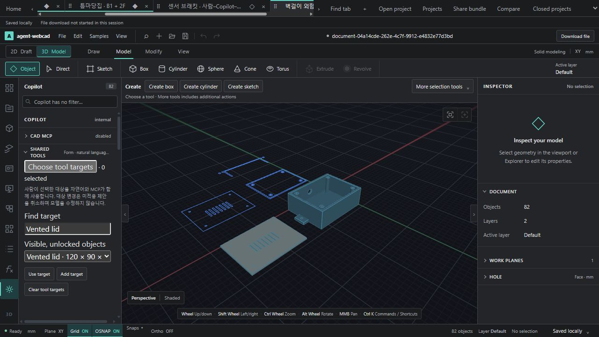

# WebCAD 개발 체크포인트 — 2026-11-07

현재 작업을 보존하는 개발 체크포인트다. 완성 제품·전체 회귀 통과·물리 해석 인증을 뜻하지 않는다. 이전 체크포인트 `7f6e26a` 이후의 코드·테스트·문서와 대표 증거를 함께 보존한다.

## 코드와 기능

- CAD-LAYER-01: 임시 레이어 격리와 복원.
- CAD-STYLE-01: 기존 2D 벡터 표시 속성 복사.
- CAD-ORDER-01: 지원되는 2D 벡터/해치 표시 순서와 출력 연결.
- CAD-DIMSTYLE-01: 문서 내 치수 표시 프리셋의 저장/복사 적용.
- CAD-COMPONENT-01: 기존 2D 블록 정의의 제한된 내부 편집.
- ONTOLOGY-RELATION-01: 기존 문서 근거의 Profile ↔ Extrude 양방향 읽기 전용 조회.
- Auto Ontology: 합성 SQLite 격리 실험·SQL 진단과 등록된 합성 스냅샷의 Inspector 파일럿. 사용자 도면 상시 외부 전송은 미검증이며 기본 비활성이다.
- CAD-EVAL-01/02/03 및 CAD-AI-ROUTING-01: 격리된 Native 실행·의도 검사·오류 기록과 제한적 재계획, 선택한 live Loft의 도구 범위와 컨텍스트 정리.

각 카드의 실제 지원 범위와 과거 감사 판정은 [기능 온톨로지](../architecture/WEBCAD-CAPABILITY-ONTOLOGY.md), [기계 판독 인벤토리](WEBCAD-CAPABILITY-INVENTORY.json), 개별 검증 보고서에서 구분한다. 기능 설명 개수는 제품 완성률이 아니다.

## 대표 결과물

120×90×40 mm 외함과 별도 덮개, 케이블 포트·기둥·벽걸이 귀·환기 슬롯을 기존 도구로 만든 과제 모델이다. 모델 API 호출 없이 준비한 CAD/MCP 작업이며, 로컬 LLM의 전체 자율 생성 성공으로 세지 않는다.

- [편집 원본](../../output/projects/instrument-enclosure/enclosure.webcad.json) · [STEP](../../output/projects/instrument-enclosure/enclosure.step)
- [형상·작업 검증](../../output/projects/instrument-enclosure/verification.json) · [범위와 제한](../../output/projects/instrument-enclosure/README.md)
- [실제 Auto Ontology 합성 Inspector 화면](../../output/verification/auto-ontology-pilot-01/autoOntologyPilotLive/verified-inspector.png) · [파일럿 검증](AUTO-ONTOLOGY-PILOT-01-2026-11-07.md)
- [실제 모델 장착판 수정 결과](../../output/verification/cad-eval-02/2026-11-07T06-22-46.325Z/preview.webcad.json) · [측정 보고서](CAD-EVAL-02-2026-11-07.md)
- [실제 모델 로프트 수정 결과](../../output/verification/cad-ai-routing-01/2026-11-07T07-47-25.375Z/preview.webcad.json) · [형상 투영](../../output/verification/cad-ai-routing-01/2026-11-07T07-47-25.375Z/model-preview-iso.svg)

SVG는 Native tessellation 투영이며 브라우저 스크린샷과 다르다. `control-preview`/`evaluator-control`은 평가자 대조안이며 실제 모델 결과가 아니다.

## 검증 상태

이미 실행한 기록을 재사용하며 이번 업로드를 위해 전체 suite나 모델링을 다시 실행하지 않았다.

- 최근 라우팅 카드: 48개 집중 회귀 통과 및 마지막 10개 검사 재통과. 중복을 제외하면 49종이다.
- 대표 `loftEdit` 브라우저 13개 검사 통과. 규칙 기반 자연어·UI·MCP 회귀이며 실제 LLM 브라우저 E2E로 세지 않는다.
- 실제 로컬 LLM: 장착판 수정과 로프트 수정 각각 2회 호출로 Native Preview 성공. 로프트는 이전 실패와 같은 입력 hash/요청으로 검증했다.
- 통풍 면적 과제의 실제 LLM 목표 달성 실패 및 이전 로프트 요청의 컨텍스트 차단 기록도 보존했다. 성공만 선별하지 않았다.
- 최근 web build, strict 타입 및 아키텍처 968 모듈 검사 통과. 번들 크기/Zod 주석 경고가 남아 있다.
- 전체 unit suite, 전체 브라우저 감사, 전체 workspace build, 일반적인 AI 설계 성공률·대형 모델 성능·물리 해석은 이번 체크포인트에서 미검증이다.

[라우팅 완료 보고서](CAD-AI-ROUTING-01-2026-11-07.md) · [AI 평가 1](CAD-EVAL-01-2026-11-07.md) · [AI 평가 3의 이전 실패](CAD-EVAL-03-2026-11-07.md)

## 산출물 선별 정책

약 440 MiB의 미추적 산출물을 일괄 게시하지 않는다. 소스·테스트·보고서, 소형 합성 입력과 재현 스크립트, 대표 JSON 결과·스크린샷·CAD/STEP 및 일부 등각 SVG를 우선했다.

외부 토목 원본 도면·변환 사본, 대형 scene/STEP/GLB/ZIP/뷰어, 반복 투영 SVG, 개발 로그·캐시·임시 파일·비밀값은 제외한다. 제외 파일은 로컬에 남기며 삭제하지 않는다. 보고서가 가리키는 전체 로컬 산출물이 모두 포함되는 것은 아니다. 수동 선택에 따른 일부 증거 링크/로컬 재현 입력은 별도 자료가 필요할 수 있다.

외부 NVIDIA 실험용 Compose/스크립트는 비공개 `.env`를 포함하지 않는다. 별도의 로컬 설정과 승인된 모델/배포 환경이 필요하다. 원본 라이선스와 실험 패치의 출처는 해당 격리 실험 디렉터리에 보존한다.

STEP은 binary Git 속성으로 원본 바이트를 보존한다. 실험 patch의 문맥 공백과 기존 배포 스크립트의 EOF 공백 안내는 형식만 고치기 위해 수정하지 않았다. 커밋 전 소스/문서 범위의 공백 검사를 별도로 확인한다.
