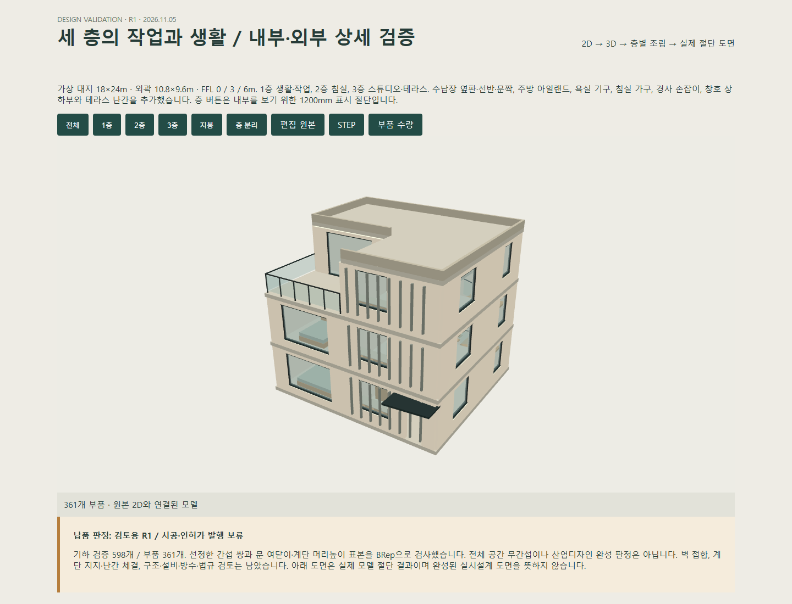
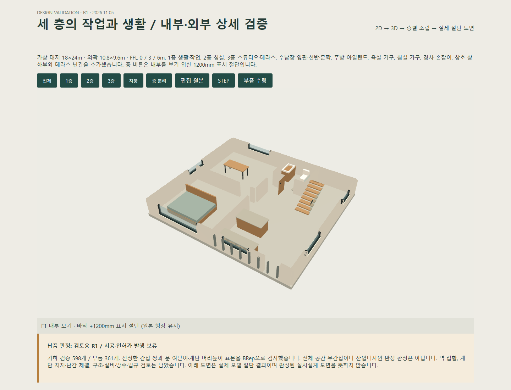
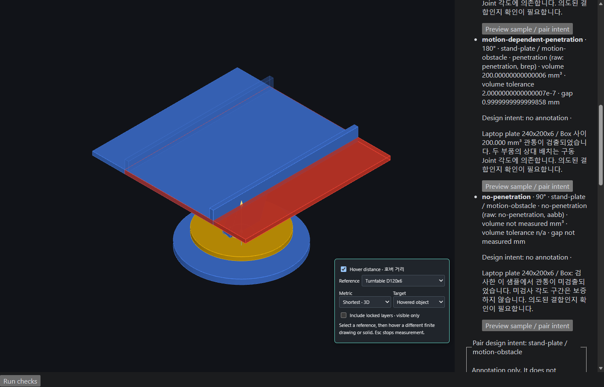

# WebCAD 대표 성과 — 2026-11-06 체크포인트

현재 작업을 보존하는 개발 체크포인트다. 아래 모델·스크린샷·수치는 기존 실행 산출물이며 이번에 모델링 또는 전체 검증을 다시 수행한 결과가 아니다. 원본 모델, 확인 가능한 화면, 기하 검증 근거를 우선 보존했다.

## 1. 2D 원본에서 3D 부품과 도면까지 — 3층 주택 R1

2026-11-05 실행 기록은 표시 부품 361개, native 검사 598개, 독립 STEP 재읽기에서 361개 유효 솔리드를 보고한다. 2D 원본·돌출·개구부·절단 도면을 연결한 과제 모델이다. 위 이미지는 별도의 검토 뷰어 캡처이며 모든 편집 UI의 E2E 성공을 나타내지 않는다.

- [편집 가능한 WebCAD 원본](../../output/projects/three-storey-house/r1/house.webcad.json)
- [정밀 형상 STEP](../../output/projects/three-storey-house/r1/house.step) · [표시용 GLB](../../output/projects/three-storey-house/r1/house.glb)
- [검토 뷰어 HTML](../../output/projects/three-storey-house/r1/review.html) — 관련 파일과 함께 내려받아 로컬에서 연다. GitHub의 HTML 파일 페이지 자체는 뷰어를 실행하지 않는다.
- [1층 도면 SVG](../../output/projects/three-storey-house/r1/A101.svg) · [DXF](../../output/projects/three-storey-house/r1/A101.dxf) · [부품별 총물량 CSV](../../output/projects/three-storey-house/r1/quantities.csv)
- [검사 결과](../../output/projects/three-storey-house/r1/verification.json) · [STEP 재읽기](../../output/projects/three-storey-house/r1/step-inspection.json) · [상세 작업 기록](../implementation/THREE-STOREY-HOUSE-R1-2026-11-05.md)

검토용 모델이다. 선정된 부품쌍과 표본을 검사했으며 전체 무간섭·구조 안전·시공/인허가 적합성을 보증하지 않는다. 벽체 접합의 관통 등 알려진 미해결 사항은 상세 기록에 남아 있다.

## 2. 회전식 거치대 — Joint와 실제 BRep 간섭 검사

- [Joint·설계 의도 주석이 포함된 v63 문서](../../output/verification/assembly-b25/annotated-laptop.webcad.json)
- [0°](../../output/verification/assembly-b25/assembly-0.png) · [90°](../../output/verification/assembly-b25/assembly-90.png) · [180°](../../output/verification/assembly-b25/assembly-180.png)
- [간섭 분류·주석 UI](../../output/verification/assembly-b25/interference-triage.png)
- [기존 브라우저 보고서](../../output/verification/assembly-b25/browser-report.json) · [2026-10-30 검증 설명](ASSEMBLY-B25.md)

기록된 대표 브라우저 검사는 31/31이다. Fixed/Revolute 관계, 각도별 프리뷰, BRep Common 체적, 구조적으로 불변인 관통과 운동 의존 관통, 사용자 의도를 구분한다. 이산 각도 검사이며 연속 충돌 검사·베어링 접촉 해석·하중/마찰 시뮬레이션은 아니다. `output/projects/rotating-laptop-stand/laptop-stand.webcad.json`은 이전 수동 변환 fixture이므로 Joint 사례는 위 v63 문서를 사용한다.

## 3. Mesh·Geometry Nodes·평면 재구성의 근거

- [Geometry Nodes 기존 브라우저 결과](../../output/verification/geometry-nodes-phase-3/browser-report.json) · [벤치마크](../../output/verification/geometry-nodes-phase-3/benchmark.json)
- [Sculpt/Remesh 기능·제약](HYBRID-GEOMETRY-PHASE-4.md) · [기존 성능 측정](../../output/verification/sculpt-phase-4/benchmark.json)
- [평면 BRep 재구성 품질](../../output/verification/hybrid-phase-5b/quality.json)
- [Healing 이전 진단](../../output/verification/hybrid-phase-5c1/baseline-diagnosis.json) · [후속 품질 측정](../../output/verification/hybrid-phase-5c1/quality.json)
- [기능 감사](WEBCAD-FEATURE-AUDIT.md) · [감사 실행 요약](../../output/verification/webcad-feature-audit/audit-validation.json)
- [120개 AutoCAD 작업 대응표](AUTOCAD-SHORTCUT-COVERAGE-2026-11-05.md) · [기능·명령 온톨로지 MVP](../architecture/WEBCAD-CAPABILITY-ONTOLOGY.md)

성공 기록과 제한·실패 기록을 함께 보존한다. 온톨로지 MVP는 설명용 기능·명령 목록이며 NVIDIA Auto Ontology 연동 완료를 의미하지 않는다.

## 산출물 선별 정책

- 대표 R1 모델과 교환 파일, 실제 화면, 소형 검증 JSON을 포함한다.
- 테스트가 직접 읽는 기존 프로젝트·평가 JSON·단일 GLB fixture는 재현성을 위해 별도로 포함한다. 모든 fixture가 전시용 성과라는 뜻은 아니다.
- 기존 추적 파일은 유지한다. 신규 중복 모델, 대형 메시 덤프, 로그, 에이전트 `.omc` 상태 및 외부 원본 도면은 포함하지 않는다. 로컬 파일은 삭제하지 않는다.
- SimReady GLB fixture는 외부 자산이다. [출처·저작자·라이선스 링크·해시](../../output/verification/simready/source-provenance.json)와 [기존 검토 기록](../implementation/SIMREADY-GLB-MVP-2026-10-31.md)을 함께 보존한다. WebCAD 자체 제작 형상이나 물리 해석 성과로 표시하지 않는다.

## 새 checkout의 재현 범위

외부 도면을 공개하지 않으므로 다음 브라우저 시나리오는 별도 입력이 필요하다. 테스트를 삭제하거나 skip으로 바꾸지는 않았다.

| 시나리오 | 별도 확보해야 하는 로컬 자료 |
| --- | --- |
| externalCivil / externalCivilSpeed / externalCivilStyle | `output/external/civil-projects/converted.dxf` |
| residentialRestoration | `output/external/civil-projects/restoration-01/baseline.webcad.json` |

과거 문서에 링크된 모든 로그·산출물이 저장소에 포함되지는 않는다. 위에 직접 연결한 대표 자료와 테스트 입력을 우선 보존했다. 시나리오 생성 스크립트 일부는 로컬 중간 결과를 추가로 요구할 수 있다.

## 이번 체크포인트의 확인

- `pnpm --filter @agent-webcad/web build`: 통과. 500 kB 초과 번들 경고가 남아 있다.
- `pnpm --filter @agent-webcad/web check:architecture`: 통과, 933 modules.
- 전체 단위·통합 테스트 및 브라우저 감사: 이번에는 실행하지 않음.
- 성과 이미지 두 장을 직접 확인하고 대표 뷰어의 다운로드 대상 파일 존재를 확인했다. 이번에는 뷰어를 브라우저로 재실행하지 않았다.
