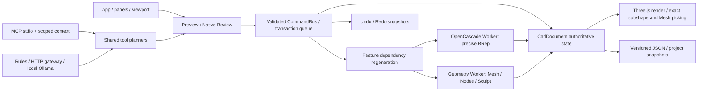

# WebCAD — Full Feature Inventory & Functional Audit

감사일: **2026-10-29 KST**. 실행 시작 2026-10-29 06:53:21 KST; 보고서 작성 2026-10-29 07:24:48 KST. 제품 코드 구현·수정·설치·대규모 빌드 없이 기존 검증을 재사용했다.

## 1. 판단 요약

WebCAD에는 실제 OpenCascade BRep/파라메트릭 모델링과 Polygon Mesh, 제한된 Subdivision/Geometry Nodes, 여섯 Sculpt 엔진, 두 Remesh 근사 방식, Hybrid Datum/정밀 직사각 피처, Planar Reconstruction/Healing이 연결되어 있다. 이번 대표 실행에서 이 핵심 수직 경로들은 작동했다. 범용 Blender 대체, 범용 BRep–Mesh 변환, 원통/NURBS 역설계, 전체 제품 안정화까지 완료된 상태로 보기는 어렵다.

**이번 결과:** 대표 browser **7페이지 통과 / 164 checks**, **1페이지 실패**; 실패 페이지의 앞선 3개 통과는 별도 부분 결과다. 선택한 단위·통합 **44 tests / 2 suites 통과**. 추가 격리 진단1회에서 두 호환 API 계약 결함을 재현했다. 이 진단의 정상 종료를 제품 기능 성공으로 계산하지 않았다. 전체 단위·통합, build, 전체 browser audit는 재실행하지 않았다.

감사 목록 **135항목에는 미구현10항목과 결함3항목도 포함**된다. 명령185종/스키마186변형, CAD 도구86개, MCP 노출89개, Geometry Node11종을 실제 선언에서 추출했다. 이 수치는 전부 개별 실행했다는 뜻이 아니다. JSON에는 모든 command schema, handler/UI 참조 후보, 도구 계약, test 제목 색인이 포함된다.

| 상태 | 의미 | 항목 수 |
|---|---|---|
| A | 실제 브라우저 작동 확인 | 94 |
| B | 단위·통합 테스트만 확인 | 17 |
| C | 코드 확인, 실행 검증 없음 | 0 |
| D | 부분 구현 | 11 |
| E | 미구현 | 10 |
| F | 결함 또는 회귀 확인 | 3 |

A94항목 중 **이번 browser 근거가 있는 항목53개(사용자 plane 생성의 부분3 checks 포함)**, **과거 browser 근거만 있는 항목41개**다. D항목의 일부도 지원 MVP 경로는 이번에 통과했지만 더 넓은 기능은 미지원이므로 D로 유지했다. A는 모든 파라미터·모든 UI 진입점의 보증이 아니다. F3항목은 browser 작업 흐름 실패1건과 확인된 호환 계약 결함2건이며, 미확인 타임아웃을 신규 제품 회귀로 단정하지 않았다.

기계 목록: [WEBCAD-FEATURE-AUDIT.json](../../docs/verification/WEBCAD-FEATURE-AUDIT.json).

## 2. 조사 범위와 증거 규칙

- 제품 TS/TSX/MJS557개, unit test 파일220개, browser source177개, command/tool/UI/architecture 문서를 대조했다. 선택된557개 제품 source는 시작·종료 SHA-256가 모두 동일했다. Git checkout에는 작업 전부터 변경/미추적 파일이 많아 reset·commit하지 않았다.
- 현재 browser runner에는192개 page entry /174개 고유 page가 있다.18개 중복 entry를 발견했고 기본 cases 생성에는 dedup이 없다. 별도의 editPerformance/featureRegeneration/kernelWorker browser source3개는 이 page 목록에 이름으로 등록되어 있지 않다. 파일 존재를 현재 실행 성공으로 세지 않는다.
- 실제 browser는 기존 isolated Edge/Chromium runner를 사용했다. Mesh/Nodes/Sculpt/Hybrid/Reconstruction은 제품 panel과 CadViewport를 넣은 fixture이며, full App 전체 탐색과 동일하지 않다. b5FaceSketch/WorkPlanes와 MCP fixture의 native UI 경로는 별도로 구분했다. API/direct dispatch setup을 모두 사용자 클릭으로 서술하지 않았다.
- 마지막 검증 시점은 JSON embedded date를 우선했다. 없는 과거 unit 로그는 파일 mtime을 대리 시점으로 표시한다. 과거 full suite에서 test 제목도 대조했지만 당시 source commit/hash가 없어 현재 source와의 완전 동일성은 확인 불가다.
- 이번 성공과 과거 성공은 verification.scope=current/historical로 구분했다. 미구현은 조사한 source/등록/진입점에서 실제 경로가 없는 경우이며, 다른 representation의 유사 기능을 구현 근거로 사용하지 않았다.

## 3. 실제 실행 경로



브라우저/서버 및 schema는 TypeScript, UI는 React19, renderer는 Three.js0.180, dev/build는 Vite7이다. BRep은 OpenCascade WASM, Mesh 연산은 별도 제어 topology와 typed node evaluator를 사용한다. 렌더 tessellation을 editable Mesh로 자동 승격하지 않는다. [package manifest](../../apps/web/package.json), [createDocumentCommandExecutor](../../apps/web/src/state/commandBus.ts#L71), [regeneration](../../apps/web/src/state/featureRegeneration.ts).

## 4. 이번 검증과 대표 시나리오

### Browser 실행 결과

| Page | 이번 결과 | 종료 시점 | 근거 |
|---|---|---|---|
| polygonEditing | 통과 27 checks | 2026-10-29 06:56:04 KST | [실행 로그](../../output/verification/webcad-feature-audit/browser-polygonEditing.log) |
| geometryNodes | 통과 27 checks | 2026-10-29 06:56:19 KST | [실행 로그](../../output/verification/webcad-feature-audit/browser-geometryNodes.log) |
| sculpt | 통과 37 checks | 2026-10-29 06:56:35 KST | [실행 로그](../../output/verification/webcad-feature-audit/browser-sculpt.log) |
| hybridGeometry | 통과 19 checks | 2026-10-29 06:56:43 KST | [실행 로그](../../output/verification/webcad-feature-audit/browser-hybridGeometry.log) |
| planarReconstruction | 통과 25 checks | 2026-10-29 06:56:56 KST | [실행 로그](../../output/verification/webcad-feature-audit/browser-planarReconstruction.log) |
| b5FaceSketch | 통과 5 checks | 2026-10-29 06:57:04 KST | [실행 로그](../../output/verification/webcad-feature-audit/browser-b5FaceSketch.log) |
| mcpBridge | 통과 24 checks | 2026-10-29 06:59:24 KST | [실행 로그](../../output/verification/webcad-feature-audit/browser-mcpBridge.log) |
| b5WorkPlanes | 실패; 앞선 3 checks 부분 통과 | 2026-10-29 06:59:14 KST | [실행 로그](../../output/verification/webcad-feature-audit/browser-b5WorkPlanes.log) |

각 페이지는 한 번 실행했고 실패를 재시도하지 않았다. WorkPlanes는 frame 생성·v18 직렬화·Undo3 checks 뒤 UI ready timeout이었다. 출력 화면에는 Datum이 복원돼 있었고 Direct face→Create plane 버튼을 기다리는 경로와 맞지만, 정확한 event/카메라/선택자 원인은 이번에 특정하지 못했다. 이 실패 때문에 attach backend나 전역 Undo/Redo 전체가 고장났다고 판단하지 않는다. 동일 감사의 b5FaceSketch와 다른 history 경로는 통과했다.

### 단위·통합 / 계약 진단

```text
pnpm exec tsx --test tests/parametricSketch.test.ts tests/featureRegeneration.test.ts tests/cadMcpDeferred.test.ts tests/cadMcpServer.test.ts
44 tests / 2 suites; fail=0, cancelled=0, skipped=0
```

[이번 단위·통합 로그](../../output/verification/webcad-feature-audit/unit-parametric-mcp.log). 별도 source 진단은 validator가 true인 boolean-cut을 실제 executor가 No handler registered로 거부하고 document는 불변인 것을 확인했다. exportStep/exportStl/exportIges는 null shape와 unused 경로에도 true, importStep은 null이었다. [격리 진단 결과](../../output/verification/webcad-feature-audit/diagnostic-command-io.log).

| 시나리오 | 판정 | 이번 근거 | 확인한 경로 | 미검증 / 미지원 |
|---|---|---|---|---|
| A Parametric CAD | 부분 검증 | b5FaceSketch 5 checks + parametricSketch / featureRegeneration 단위·통합 | native face sketch → numeric rectangle/driving width → exact face Extrude / source resize; backend profile→Extrude→cut→Fillet 또는 Chamfer→치수변경→Undo/Redo | 이 전 과정을 하나의 연속 native 브라우저 시나리오로 실행하지 않음; 임의 구속조건 UI 조합 미검증 |
| B Mesh Modeling | 대표 경로 통과 | polygonEditing 27 checks | polygon/quad/N-gon creation, face pick, V merge / E bevel·loop cut / F extrude·inset, SubD, Undo/Redo, reload | 모든 연산/입력 조합과 대형 모델은 아님; v55 legacy Mesh 전체 browser 재실행 없음 |
| C Geometry Nodes | 분할 대표 경로 통과 | geometryNodes 27 + sculpt/hybrid Bake checks | 그래프/노드 연결·파라미터·평가/cache/취소, 별도 페이지에서 Bake→독립 editable Mesh→Sculpt | 하나의 연속 full App node-editor-to-bake 작업은 미실행; graphical node canvas 없음 |
| D Sculpt / Remesh | 대표 경로 통과 | sculpt 37 checks | native Grab/Draw/Smooth, stroke Cancel/commit/history, transformed perspective picking, surface/voxel preview+apply and reload | Inflate/Crease/Flatten native gesture 미실행; large arbitrary closed meshes 미검증 |
| E Hybrid CAD | 지원 MVP 경로 통과 | hybridGeometry 19 checks | Bake/Sculpt mesh surface pick→reference→datum/precise rectangular prism→source edit/revalidate→conversion/remesh-loss→reload | 임의 피처/곡면 BRep↔Mesh, active modifier Mesh 직접 datum 참조 미지원 |
| F Planar Reconstruction / Healing | 지원 MVP 경로 통과 | planarReconstruction 25 checks | Cube/prism region analysis, real OCCT solid, exact error/validity receipts, noisy1e-6 fixture, cancel/history/v61 reload | quality five-fixture benchmark는 과거 기록 재사용; 원통/NURBS/open Shell 미구현 |
| G Persistence / MCP / stale | 대표 경로 통과 | 동일 browser fixtures + mcpBridge24 + focused MCP units | native save/reload, UI/tool plan parity, official SDK stdio bridge, native-only Apply, Undo/revision/context invalidation, Worker cancel/stale | 전체 형식 교환·project recovery·모든89tools 개별실행·live external LLM 미검증 |

## 5. 전체 기능 목록

기능별 직접 MCP 도구가 없다는 것은 CommandBus 구현이 없다는 뜻이 아니다. 예를 들어 임의 sketch constraint/치수 편집은 UI·명령에는 있지만 모든 것이 전용 MCP 도구로 노출된 것은 아니다. 표의 테스트 파일은 기존 source이고, 실행 성공 근거와 시점은 바로 뒤에 별도로 적었다.

### BRep / Parametric CAD

| 상태 / 기능 | 실제 구현 파일·함수 | UI 접근 / MCP | 기존 test / 마지막 검증 | 지원 범위 / 제한 |
|---|---|---|---|---|
| A · `brep-primitives`<br>Box / Cylinder / Sphere / Cone / Torus | [cad-kernel/src/operations/primitives.ts:27](../../packages/cad-kernel/src/operations/primitives.ts#L27) `createBox`<br>[web/state/commandBus.ts:546](../../apps/web/src/state/commandBus.ts#L546) `isValidPrimitiveParams`<br>[web/properties/PropertiesPanel.tsx:110](../../apps/web/src/properties/PropertiesPanel.tsx#L110) `PropertiesPanel` | Create/Modeling Ribbon → Solid primitive; 선택 → Inspector Dimensions<br>MCP: `solid.primitive`, `solid.parameter`, `cad.measure` | [geometryInspection.test.ts](../../apps/web/tests/geometryInspection.test.ts)<br>[precisionRegression.test.ts](../../apps/web/tests/precisionRegression.test.ts)<br>[filletSolid.test.ts](../../apps/web/tests/filletSolid.test.ts)<br>이번 browser: hybridGeometry<br>과거 unit 로그 동명 title 확인<br>최근: 이번 2026-10-29 06:56:43 KST (browser) | 5종 analytic BRep; mm 치수와 객체 배치<br>제한: 새 reconstruction subtype은 Box 치수 편집 대상이 아님 |
| A · `extrude`<br>닫힌 프로파일 Extrude | [cad-kernel/src/operations/extrude.ts:61](../../packages/cad-kernel/src/operations/extrude.ts#L61) `buildProfileWire`<br>[web/state/commandBus.ts:71](../../apps/web/src/state/commandBus.ts#L71) `createDocumentCommandExecutor`<br>[web/properties/PropertiesPanel.tsx:110](../../apps/web/src/properties/PropertiesPanel.tsx#L110) `PropertiesPanel` | 닫힌 선/스케치 선택 → Extrude → Review/Apply<br>MCP: `solid.extrude` | [parametricSketch.test.ts](../../apps/web/tests/parametricSketch.test.ts)<br>[featureRegeneration.test.ts](../../apps/web/tests/featureRegeneration.test.ts)<br>[profileRegions.test.ts](../../apps/web/tests/profileRegions.test.ts)<br>이번 browser: b5FaceSketch<br>이번 unit 2026-10-29 06:57:56 KST<br>최근: 이번 2026-10-29 06:57:56 KST (unit-integration) | 닫힌 선·원·지원 spline/holes; driving 치수 재생성<br>제한: 지원 프로파일/공차 밖 입력 거부 |
| A · `revolve`<br>Revolve | [cad-kernel/src/operations/revolve.ts:68](../../packages/cad-kernel/src/operations/revolve.ts#L68) `revolveProfile`<br>[web/state/commandBus.ts:71](../../apps/web/src/state/commandBus.ts#L71) `createDocumentCommandExecutor` | 프로파일 선택 → Revolve; Inspector angle<br>MCP: `solid.revolve` | [revolveSolid.test.ts](../../apps/web/tests/revolveSolid.test.ts)<br>[revolveGeometry.test.ts](../../apps/web/tests/revolveGeometry.test.ts)<br>과거 browser 2026-10-27 20:39:40 KST: extendedCadWorkflow<br>과거 unit 로그 동명 title 확인<br>최근: 과거 2026-10-29 01:23:23 KST (unit-integration) | 정확한 평면 프로파일 회전, 최대 360도<br>제한: 임의 자유곡면 역추론 없음 |
| B · `sweep`<br>Sweep | [cad-kernel/src/operations/sweep.ts:50](../../packages/cad-kernel/src/operations/sweep.ts#L50) `sweepProfile`<br>[web/precision/sweepPath.ts:4](../../apps/web/src/precision/sweepPath.ts#L4) `resolveSweepPath` | 프로파일·경로 선택 → Sweep<br>MCP: `solid.sweep` | [sweepLoft.test.ts](../../apps/web/tests/sweepLoft.test.ts)<br>[splineGeometry.test.ts](../../apps/web/tests/splineGeometry.test.ts)<br>과거 unit 로그 동명 title 확인<br>최근: 과거 2026-10-29 01:23:23 KST (unit-integration) | 지원 선/곡선/spline 경로와 배향 정책<br>제한: 임의 꼬인/자기 교차 경로 성공 보장 없음 |
| A · `loft`<br>Loft / Loft update | [cad-kernel/src/operations/loft.ts:9](../../packages/cad-kernel/src/operations/loft.ts#L9) `loftProfiles`<br>[web/state/commandBus.ts:71](../../apps/web/src/state/commandBus.ts#L71) `createDocumentCommandExecutor`<br>[web/copilot/cadModelingTools.ts:26](../../apps/web/src/copilot/cadModelingTools.ts#L26) `cadModelReferenceIssue` | 단면 선택 → Loft / Inspector Loft review<br>MCP: `solid.loft`, `solid.loft.update` | [loftEdit.test.ts](../../apps/web/tests/loftEdit.test.ts)<br>과거 browser 2026-10-27 20:39:40 KST: loftEdit<br>과거 unit 로그 동명 title 확인<br>최근: 과거 2026-10-29 01:23:23 KST (unit-integration) | 단면 기반 BRep, ruled 옵션 및 검토 수정<br>제한: 지원 단면 호환성 필요 |
| A · `shell`<br>BRep Shell / 제거 Face 재선택 | [cad-kernel/src/operations/shell.ts:5](../../packages/cad-kernel/src/operations/shell.ts#L5) `shellSolid`<br>[web/state/shellCommands.ts:10](../../apps/web/src/state/shellCommands.ts#L10) `shellFaceStatus`<br>[web/properties/ShellPanel.tsx:12](../../apps/web/src/properties/ShellPanel.tsx#L12) `ShellPanel` | BRep face 선택 → Shell Inspector<br>MCP: `solid.shell` | [b5Shell.test.ts](../../apps/web/tests/b5Shell.test.ts)<br>과거 browser 2026-10-27 20:39:40 KST: b5Shell<br>과거 unit 로그 동명 title 확인<br>최근: 과거 2026-10-29 01:23:23 KST (unit-integration) | 선택한 face 제거 + 두께, referenceStatus 검증<br>제한: 열린 임의 Mesh Shell 출력과 다른 기능 |
| A · `dependency`<br>Live feature dependency / 부분 재생성 | [web/state/featureRegeneration.ts:27](../../apps/web/src/state/featureRegeneration.ts#L27) `FeatureRegenerationError`<br>[web/state/dependencyGraph.ts:15](../../apps/web/src/state/dependencyGraph.ts#L15) `buildDependencyGraph` | 소스 geometry/치수 변경 → 종속 피처 갱신<br>MCP: `solid.parameter` | [featureRegeneration.test.ts](../../apps/web/tests/featureRegeneration.test.ts)<br>[dependencyGraph.test.ts](../../apps/web/tests/dependencyGraph.test.ts)<br>과거 browser 2026-10-27 20:39:40 KST: dependencyWorkflow<br>이번 unit 2026-10-29 06:57:56 KST<br>최근: 이번 2026-10-29 06:57:56 KST (unit-integration) | 영향받은 live features 소스 순서 재생성, 실패 원자 롤백<br>제한: legacy consumed operands는 snapshot; 모든 피처가 완전한 parametric tree인 것은 아님 |
| A · `variables`<br>변수·식·파라미터 바인딩 | [cad-document/src/Parameters.ts:13](../../packages/cad-document/src/Parameters.ts#L13) `validParameterTarget`<br>[web/properties/VariablesPanel.tsx:14](../../apps/web/src/properties/VariablesPanel.tsx#L14) `VariablesPanel`<br>[web/state/documentParameters.ts:10](../../apps/web/src/state/documentParameters.ts#L10) `registerParameterCommandHandlers` | Inspector Variables / 수치 입력의 변수식<br>MCP: 직접 도구 없음 | [documentParameters.test.ts](../../apps/web/tests/documentParameters.test.ts)<br>[expressions.test.ts](../../apps/web/tests/expressions.test.ts)<br>과거 browser 2026-10-27 20:39:40 KST: variablesWorkflow<br>과거 unit 로그 동명 title 확인<br>최근: 과거 2026-10-29 01:23:23 KST (unit-integration) | 변수 참조·단위식·바인딩을 통한 재계산<br>제한: 전용 공개 MCP set-variable 도구 없음 |
| A · `exact-measure`<br>해석적 부피·면적·Bounds | [cad-kernel/src/operations/measurements.ts:30](../../packages/cad-kernel/src/operations/measurements.ts#L30) `volume`<br>[web/state/documentQuery.ts:14](../../apps/web/src/state/documentQuery.ts#L14) `measureDocumentObject` | 선택 → Inspector measurement / Query<br>MCP: `cad.measure`, `cad.inspect` | [geometryInspection.test.ts](../../apps/web/tests/geometryInspection.test.ts)<br>이번 browser: hybridGeometry, planarReconstruction<br>과거 unit 로그 동명 title 확인<br>최근: 이번 2026-10-29 06:56:56 KST (browser) | 실제 BRep 속성, Mesh 측정과 basis 구분<br>제한: Mesh 값을 BRep 정밀 측정으로 표시하지 않음 |
| A · `brep-distance`<br>BRep 최단 거리 / 선택 요소 거리 | [cad-kernel/src/operations/distance.ts:7](../../packages/cad-kernel/src/operations/distance.ts#L7) `measureBrepDistance`<br>[cad-kernel/src/operations/selectedDistance.ts:10](../../packages/cad-kernel/src/operations/selectedDistance.ts#L10) `resolveDistanceElement`<br>[web/cad/kernelGeometryService.ts:19](../../apps/web/src/cad/kernelGeometryService.ts#L19) `viewTaskOptions` | 두 객체/요소 선택 → Measure distance<br>MCP: 직접 도구 없음 | [brepDistance.test.ts](../../apps/web/tests/brepDistance.test.ts)<br>[selectedDistance.test.ts](../../apps/web/tests/selectedDistance.test.ts)<br>과거 browser 2026-10-27 20:39:40 KST: brepDistance, selectedDistance<br>과거 unit 로그 동명 title 확인<br>최근: 과거 2026-10-29 01:23:23 KST (unit-integration) | 솔리드/선택된 topology 거리<br>제한: 현재 세션 미실행; hover/요소별 UI 근거는 과거 기록 |
| A · `face-cut`<br>Face sketch → precise cut | [web/state/faceSketchCommands.ts:8](../../apps/web/src/state/faceSketchCommands.ts#L8) `registerFaceSketchCommands`<br>[web/properties/WorkPlanePanel.tsx:21](../../apps/web/src/properties/WorkPlanePanel.tsx#L21) `WorkPlanePanel` | Direct select planar face → sketch/cut/hole<br>MCP: `solid.boolean` | [b5FaceSketch.test.ts](../../apps/web/tests/b5FaceSketch.test.ts)<br>과거 browser 2026-10-27 20:39:40 KST: b5FaceCut<br>과거 unit 로그 동명 title 확인<br>최근: 과거 2026-10-29 01:23:23 KST (unit-integration) | 원형/직사각형 Face 기준 피처 및 source 변경/재생성<br>제한: arbitrary surface attachment 아님 |
| A · `face-hole`<br>Planar BRep face → parameterized hole | [web/state/faceSketchCommands.ts:8](../../apps/web/src/state/faceSketchCommands.ts#L8) `registerFaceSketchCommands`<br>[web/properties/WorkPlanePanel.tsx:21](../../apps/web/src/properties/WorkPlanePanel.tsx#L21) `WorkPlanePanel` | Direct select planar face → sketch/cut/hole<br>MCP: `solid.hole` | [b5FaceSketch.test.ts](../../apps/web/tests/b5FaceSketch.test.ts)<br>과거 browser 2026-10-27 20:39:40 KST: b5FaceHole<br>과거 unit 로그 동명 title 확인<br>최근: 과거 2026-10-29 01:23:23 KST (unit-integration) | 원형/직사각형 Face 기준 피처 및 source 변경/재생성<br>제한: arbitrary surface attachment 아님 |
| E · `assembly-mates`<br>Mechanical assembly mates / kinematics | 실제 구현 없음; JSON의 absence_evidence 참조 | 없음<br>MCP: 직접 도구 없음 | 기존 전용 test 연결 없음<br>실행 성공 근거 없음<br>최근: 이번 2026-10-29 06:53:45 KST (static-only) | part registry/presentation만 존재<br>제한: constraint solved assembly 기능 없음 |
| F · `legacy-boolean-cut`<br>legacy boolean-cut 명령 계약 불일치 | [cad-commands/src/commands.ts:1](../../packages/cad-commands/src/commands.ts#L1)<br>[cad-commands/src/validator.ts:1](../../packages/cad-commands/src/validator.ts#L1)<br>[cad-commands/src/CommandBus.ts:1](../../packages/cad-commands/src/CommandBus.ts#L1)<br>[web/state/commandBus.ts:1](../../apps/web/src/state/commandBus.ts#L1) | 직접 UI 없음; 정상 UI는 boolean-operation(cut) 사용<br>MCP: 직접 도구 없음 | 기존 전용 test 연결 없음<br>이번 격리 진단에서 계약 결함 재현<br>최근: 이번 2026-10-29 07:13:47 KST (diagnostic) | validator는 허용하나 actual executor 등록 없음<br>제한: 진단에서 No handler registered 재현; document unchanged |

### Sketch / Constraints

| 상태 / 기능 | 실제 구현 파일·함수 | UI 접근 / MCP | 기존 test / 마지막 검증 | 지원 범위 / 제한 |
|---|---|---|---|---|
| A · `sketch-entities`<br>Sketch line/polyline/rectangle/circle/arc | [cad-document/src/Sketch.ts:2](../../packages/cad-document/src/Sketch.ts#L2) `SketchPoint`<br>[web/state/registerSketchCommandHandlers.ts:13](../../apps/web/src/state/registerSketchCommandHandlers.ts#L13) `registerSketchCommandHandlers`<br>[web/properties/SketchInspector.tsx:28](../../apps/web/src/properties/SketchInspector.tsx#L28) `SketchInspector` | Sketch 생성 → Draw / Sketch Inspector<br>MCP: `sketch.create`, `sketch.rectangle`, `sketch.circle`, `curve.polyline` | [parametricSketch.test.ts](../../apps/web/tests/parametricSketch.test.ts)<br>[automaticSketch.test.ts](../../apps/web/tests/automaticSketch.test.ts)<br>이번 browser: b5FaceSketch<br>이번 unit 2026-10-29 06:57:56 KST<br>최근: 이번 2026-10-29 06:57:56 KST (unit-integration) | 스케치의 로컬 좌표와 world projection<br>제한: MCP에서 모든 sketch entity/구속조건을 직접 추가하는 전용 도구는 없음 |
| A · `sketch-linear`<br>Coincident / Horizontal / Vertical / Distance / Fixed | [web/precision/sketchSolver.ts:234](../../apps/web/src/precision/sketchSolver.ts#L234) `solveSketch`<br>[cad-document/src/Sketch.ts:2](../../packages/cad-document/src/Sketch.ts#L2) `SketchPoint` | Sketch 요소 선택 → Constraints / Width·Height<br>MCP: `sketch.rectangle` | [parametricSketch.test.ts](../../apps/web/tests/parametricSketch.test.ts)<br>이번 browser: b5FaceSketch<br>이번 unit 2026-10-29 06:57:56 KST<br>최근: 이번 2026-10-29 06:57:56 KST (unit-integration) | 반복 수치 솔버와 driving 치수, conflicting IDs<br>제한: 해석적 완전 구속 해석/임의 대규모 solver 성능 보장 아님 |
| A · `sketch-relations`<br>Angle / Parallel / Perpendicular / Equal | [web/precision/sketchSolver.ts:234](../../apps/web/src/precision/sketchSolver.ts#L234) `solveSketch`<br>[web/precision/sketchRelations.ts:3](../../apps/web/src/precision/sketchRelations.ts#L3) `sketchSegments` | Sketch 관계 toolbar / Inspector<br>MCP: 직접 도구 없음 | [extendedSketchRelations.test.ts](../../apps/web/tests/extendedSketchRelations.test.ts)<br>[parametricSketch.test.ts](../../apps/web/tests/parametricSketch.test.ts)<br>과거 browser 2026-10-27 20:39:40 KST: extendedCadWorkflow<br>이번 unit 2026-10-29 06:57:56 KST<br>최근: 이번 2026-10-29 06:57:56 KST (unit-integration) | 선분 관계와 반경/직경 동등성<br>제한: 유효 geometry 참조 및 지원 관계만 |
| B · `sketch-tangent`<br>Tangency / Concentric / Point-on / Symmetric | [web/precision/sketchArcRelations.ts:9](../../apps/web/src/precision/sketchArcRelations.ts#L9) `arcIntervalError`<br>[cad-document/src/Sketch.ts:2](../../packages/cad-document/src/Sketch.ts#L2) `SketchPoint` | Sketch 관계 선택 / 제안된 관계 Review<br>MCP: 직접 도구 없음 | [b4ArcRelations.test.ts](../../apps/web/tests/b4ArcRelations.test.ts)<br>[extendedSketchRelations.test.ts](../../apps/web/tests/extendedSketchRelations.test.ts)<br>과거 unit 로그 동명 title 확인<br>최근: 과거 2026-10-29 01:23:23 KST (unit-integration) | 유한 arc·line/circle 접촉과 branch 정책<br>제한: 과거 Point on arc 버튼 workflow 실패는 기능 부재로 단정 불가 |
| A · `sketch-dimensions`<br>Driving dimension 수정 / 종속 Extrude | [web/state/registerSketchCommandHandlers.ts:13](../../apps/web/src/state/registerSketchCommandHandlers.ts#L13) `registerSketchCommandHandlers`<br>[web/precision/sketchSolver.ts:234](../../apps/web/src/precision/sketchSolver.ts#L234) `solveSketch` | Sketch Inspector dimension / Canvas dimension editor<br>MCP: 직접 도구 없음 | [parametricSketch.test.ts](../../apps/web/tests/parametricSketch.test.ts)<br>[canvasDimensionEdit.test.ts](../../apps/web/tests/canvasDimensionEdit.test.ts)<br>이번 browser: b5FaceSketch<br>이번 unit 2026-10-29 06:57:56 KST<br>최근: 이번 2026-10-29 06:57:56 KST (unit-integration) | 치수 변경·history·저장 재생성<br>제한: Canvas 경로는 과거 synthetic pointer-capture 테스트 실패 |
| B · `sketch-edit`<br>Sketch move/duplicate/offset/trim/extend | [web/state/registerSketchCommandHandlers.ts:13](../../apps/web/src/state/registerSketchCommandHandlers.ts#L13) `registerSketchCommandHandlers`<br>[web/precision/sketchEditing.ts:6](../../apps/web/src/precision/sketchEditing.ts#L6) `geometryPointIds` | Sketch Mode → Editing actions<br>MCP: 직접 도구 없음 | [sketchEditingWorkflow.test.ts](../../apps/web/tests/sketchEditingWorkflow.test.ts)<br>[drawing-editing/mixedSketchEditing.test.ts](../../apps/web/tests/drawing-editing/mixedSketchEditing.test.ts)<br>과거 unit 로그 동명 title 확인<br>최근: 과거 2026-10-29 01:23:23 KST (unit-integration) | 구속조건 및 topology 참조 정리와 원자 편집<br>제한: 모든 spline을 sketch solver entity로 취급하지 않음 |

### Work Planes

| 상태 / 기능 | 실제 구현 파일·함수 | UI 접근 / MCP | 기존 test / 마지막 검증 | 지원 범위 / 제한 |
|---|---|---|---|---|
| A · `plane-standard`<br>XY / XZ / YZ 좌표계 | [web/precision/workPlane.ts:14](../../apps/web/src/precision/workPlane.ts#L14) `intersectRayWithWorkPlane`<br>[web/properties/WorkPlanePanel.tsx:21](../../apps/web/src/properties/WorkPlanePanel.tsx#L21) `WorkPlanePanel` | Work plane selector / Inspector Work planes<br>MCP: `sketch.create` | [b5WorkPlanes.test.ts](../../apps/web/tests/b5WorkPlanes.test.ts)<br>[parametricSketch.test.ts](../../apps/web/tests/parametricSketch.test.ts)<br>이번 browser: b5FaceSketch<br>이번 unit 2026-10-29 06:57:56 KST<br>최근: 이번 2026-10-29 06:57:56 KST (unit-integration) | 기본 평면과 로컬 좌표투영<br>제한: 고정된 기본 평면 |
| A · `plane-custom`<br>사용자 기준 평면 생성·삭제 | [cad-document/src/WorkPlane.ts:12](../../packages/cad-document/src/WorkPlane.ts#L12) `validWorkPlaneFrame`<br>[web/state/workPlaneCommands.ts:14](../../apps/web/src/state/workPlaneCommands.ts#L14) `registerWorkPlaneCommands`<br>[web/properties/WorkPlanePanel.tsx:21](../../apps/web/src/properties/WorkPlanePanel.tsx#L21) `WorkPlanePanel` | 선택 → Inspector Work planes → origin/X/Y axes<br>MCP: 직접 도구 없음 | [b5WorkPlanes.test.ts](../../apps/web/tests/b5WorkPlanes.test.ts)<br>이번 browser 부분: 생성/저장/Undo3건; 전체페이지 실패<br>과거 unit 로그 동명 title 확인<br>최근: 이번 2026-10-29 06:59:14 KST (browser-partial) | 정규직교 frame, 저장 및 history<br>제한: 생성·직렬화·Undo까지 이번 3 checks 통과; face attachment를 포함한 페이지 전체는 실패 |
| D · `plane-attached`<br>BRep Face 부착 평면 / Rebind | [web/state/attachedWorkPlane.ts:9](../../apps/web/src/state/attachedWorkPlane.ts#L9) `exactFaceRange`<br>[web/state/workPlaneCommands.ts:14](../../apps/web/src/state/workPlaneCommands.ts#L14) `registerWorkPlaneCommands` | BRep Face 선택 → Create plane from selected face / Rebind<br>MCP: 직접 도구 없음 | [b5WorkPlanes.test.ts](../../apps/web/tests/b5WorkPlanes.test.ts)<br>[b5FaceSketch.test.ts](../../apps/web/tests/b5FaceSketch.test.ts)<br>이번 browser: b5FaceSketch<br>과거 unit 로그 동명 title 확인<br>최근: 이번 2026-10-29 06:57:04 KST (browser) | 정확한 face key 해석, missing/ambiguous 시 명시 재선택<br>제한: nearest-face 자동 대체 없음; command/backend 검증과 native face→plane UI 실패를 구분 |
| A · `face-sketch`<br>Face sketch → 정밀 Extrude / Cut / Hole | [web/state/faceSketchCommands.ts:8](../../apps/web/src/state/faceSketchCommands.ts#L8) `registerFaceSketchCommands`<br>[web/state/faceCutCommands.ts:15](../../apps/web/src/state/faceCutCommands.ts#L15) `sourceMesh`<br>[web/state/faceHoleCommands.ts:60](../../apps/web/src/state/faceHoleCommands.ts#L60) `faceHoleParams`<br>[web/properties/FaceHolePanel.tsx:10](../../apps/web/src/properties/FaceHolePanel.tsx#L10) `FaceHolePanel` | 부착 평면 → Sketch on work plane / Face sketch Extrude·Cut / Hole<br>MCP: `solid.hole` | [b5FaceSketch.test.ts](../../apps/web/tests/b5FaceSketch.test.ts)<br>[b5FaceCut.test.ts](../../apps/web/tests/b5FaceCut.test.ts)<br>[b5FaceHole.test.ts](../../apps/web/tests/b5FaceHole.test.ts)<br>이번 browser: b5FaceSketch<br>과거 unit 로그 동명 title 확인<br>최근: 이번 2026-10-29 06:57:04 KST (browser) | BRep face 기준 프로파일 피처와 참조 상태 재평가<br>제한: Hybrid Mesh는 기존 BRep face Hole target으로 간주하지 않음 |
| A · `ucs`<br>UCS drawing / Move in UCS / explicit basis | [web/precision/workPlane.ts:14](../../apps/web/src/precision/workPlane.ts#L14) `intersectRayWithWorkPlane`<br>[web/state/precisionTransformCommands.ts:10](../../apps/web/src/state/precisionTransformCommands.ts#L10) `planPrecisionTransform` | UCS numeric input / plane selectors<br>MCP: 직접 도구 없음 | [b5WorkPlanes.test.ts](../../apps/web/tests/b5WorkPlanes.test.ts)<br>과거 browser 2026-10-27 20:39:40 KST: numericPilot<br>과거 unit 로그 동명 title 확인<br>최근: 과거 2026-10-29 01:23:23 KST (unit-integration) | normalized basis and world/local conversion<br>제한: generic feature workplane binding은 기능별 차이 |
| F · `face-plane-ui`<br>Direct face selection → Create plane / Rebind 전체 UI 흐름 | [web/properties/WorkPlanePanel.tsx:21](../../apps/web/src/properties/WorkPlanePanel.tsx#L21) `WorkPlanePanel`<br>[web/viewport/directSelection.ts:28](../../apps/web/src/viewport/directSelection.ts#L28) `directSelectionHits` | Direct → face pick → Create plane from selected face<br>MCP: 직접 도구 없음 | [b5WorkPlanes.test.ts](../../apps/web/tests/b5WorkPlanes.test.ts)<br>과거 unit 로그 동명 title 확인<br>이번 browser 실패 / 원인미확인<br>최근: 이번 2026-10-29 06:59:14 KST (browser-failure) | underlying attach/rebind command와 face-sketch는 존재<br>제한: 이번 b5WorkPlanes 3 checks 후 UI ready timeout; 제품/테스트 원인 미확정 |

### Boolean / Fillet / Chamfer

| 상태 / 기능 | 실제 구현 파일·함수 | UI 접근 / MCP | 기존 test / 마지막 검증 | 지원 범위 / 제한 |
|---|---|---|---|---|
| A · `boolean-union`<br>BRep Boolean union | [cad-kernel/src/operations/booleans.ts:37](../../packages/cad-kernel/src/operations/booleans.ts#L37) `fuse`<br>[web/state/commandBus.ts:71](../../apps/web/src/state/commandBus.ts#L71) `createDocumentCommandExecutor` | 두 BRep 선택 → Boolean union<br>MCP: `solid.boolean` | [featureRegeneration.test.ts](../../apps/web/tests/featureRegeneration.test.ts)<br>[precisionRegression.test.ts](../../apps/web/tests/precisionRegression.test.ts)<br>과거 browser 2026-10-27 20:39:40 KST: cadTools<br>이번 unit 2026-10-29 06:57:56 KST<br>최근: 이번 2026-10-29 06:57:56 KST (unit-integration) | OpenCascade union; 원본 의존성과 consumed visibility<br>제한: Editable Mesh 직접 Boolean은 미지원 |
| A · `boolean-cut`<br>BRep Boolean cut | [cad-kernel/src/operations/booleans.ts:37](../../packages/cad-kernel/src/operations/booleans.ts#L37) `fuse`<br>[web/state/commandBus.ts:71](../../apps/web/src/state/commandBus.ts#L71) `createDocumentCommandExecutor` | 두 BRep 선택 → Boolean cut<br>MCP: `solid.boolean` | [featureRegeneration.test.ts](../../apps/web/tests/featureRegeneration.test.ts)<br>[precisionRegression.test.ts](../../apps/web/tests/precisionRegression.test.ts)<br>과거 browser 2026-10-27 20:39:40 KST: cadTools<br>이번 unit 2026-10-29 06:57:56 KST<br>최근: 이번 2026-10-29 06:57:56 KST (unit-integration) | OpenCascade cut; 원본 의존성과 consumed visibility<br>제한: Editable Mesh 직접 Boolean은 미지원 |
| A · `boolean-intersect`<br>BRep Boolean intersect | [cad-kernel/src/operations/booleans.ts:37](../../packages/cad-kernel/src/operations/booleans.ts#L37) `fuse`<br>[web/state/commandBus.ts:71](../../apps/web/src/state/commandBus.ts#L71) `createDocumentCommandExecutor` | 두 BRep 선택 → Boolean intersect<br>MCP: `solid.boolean` | [featureRegeneration.test.ts](../../apps/web/tests/featureRegeneration.test.ts)<br>[precisionRegression.test.ts](../../apps/web/tests/precisionRegression.test.ts)<br>과거 browser 2026-10-27 20:39:40 KST: cadTools<br>이번 unit 2026-10-29 06:57:56 KST<br>최근: 이번 2026-10-29 06:57:56 KST (unit-integration) | OpenCascade intersect; 원본 의존성과 consumed visibility<br>제한: Editable Mesh 직접 Boolean은 미지원 |
| B · `solid-fillet`<br>BRep Fillet | [cad-kernel/src/operations/fillet.ts:24](../../packages/cad-kernel/src/operations/fillet.ts#L24) `filletEdges`<br>[web/state/commandBus.ts:71](../../apps/web/src/state/commandBus.ts#L71) `createDocumentCommandExecutor` | BRep edge 선택 → Fillet / radius<br>MCP: `solid.fillet` | [filletSolid.test.ts](../../apps/web/tests/filletSolid.test.ts)<br>[featureRegeneration.test.ts](../../apps/web/tests/featureRegeneration.test.ts)<br>이번 unit 2026-10-29 06:57:56 KST<br>최근: 이번 2026-10-29 06:57:56 KST (unit-integration) | 정확한 edge-key 기반 fillet와 live 재계산<br>제한: 바뀐 edge key를 임의 재접속하지 않고 edit 롤백 |
| B · `solid-chamfer`<br>BRep Chamfer | [cad-kernel/src/operations/chamfer.ts:31](../../packages/cad-kernel/src/operations/chamfer.ts#L31) `chamferEdges`<br>[web/state/commandBus.ts:71](../../apps/web/src/state/commandBus.ts#L71) `createDocumentCommandExecutor` | BRep edge 선택 → Chamfer / distance<br>MCP: `solid.chamfer` | [chamferSolid.test.ts](../../apps/web/tests/chamferSolid.test.ts)<br>[featureRegeneration.test.ts](../../apps/web/tests/featureRegeneration.test.ts)<br>이번 unit 2026-10-29 06:57:56 KST<br>최근: 이번 2026-10-29 06:57:56 KST (unit-integration) | 지원 거리/edge-key의 BRep chamfer<br>제한: 모든 복잡한 edge neighborhood 지원 보장 없음 |

### Polygon Mesh Editing

| 상태 / 기능 | 실제 구현 파일·함수 | UI 접근 / MCP | 기존 test / 마지막 검증 | 지원 범위 / 제한 |
|---|---|---|---|---|
| A · `mesh-create`<br>Editable triangle / Quad / N-gon 생성 | [cad-document/src/EditableMesh.ts:21](../../packages/cad-document/src/EditableMesh.ts#L21) `validMeshModifiers`<br>[cad-document/src/PolygonMeshOperations.ts:42](../../packages/cad-document/src/PolygonMeshOperations.ts#L42) `applyPolygonMeshOperation`<br>[web/properties/MeshPanel.tsx:11](../../apps/web/src/properties/MeshPanel.tsx#L11) `MeshPanel` | Inspector Mesh → Review new mesh cube / polygon cube / hexagon<br>MCP: `mesh.create`, `mesh.createPolygon`, `mesh.upgrade` | [editableMesh.test.ts](../../apps/web/tests/editableMesh.test.ts)<br>[polygonMesh.test.ts](../../apps/web/tests/polygonMesh.test.ts)<br>이번 browser: polygonEditing<br>과거 unit 로그 동명 title 확인<br>최근: 이번 2026-10-29 06:56:04 KST (browser) | v1 triangle와 v2 Polygon 제어 메시, 명시 업그레이드<br>제한: 렌더 triangle 버퍼와 editable topology 분리 |
| A · `mesh-select`<br>Vertex / Edge / Face 선택 | [web/viewport/editableMeshRenderer.ts:5](../../apps/web/src/viewport/editableMeshRenderer.ts#L5) `createEditableMeshSceneObject`<br>[web/properties/MeshPanel.tsx:11](../../apps/web/src/properties/MeshPanel.tsx#L11) `MeshPanel`<br>[cad-document/src/MeshTopology.ts:12](../../packages/cad-document/src/MeshTopology.ts#L12) `unit` | Mesh edit mode → selection domain → 캔버스/ID 목록<br>MCP: `mesh.inspect` | [editableMesh.test.ts](../../apps/web/tests/editableMesh.test.ts)<br>[polygonMesh.test.ts](../../apps/web/tests/polygonMesh.test.ts)<br>이번 browser: polygonEditing<br>과거 unit 로그 동명 title 확인<br>최근: 이번 2026-10-29 06:56:04 KST (browser) | control cage 선택, rendered face→polygon 대응<br>제한: 평가된 SubD 요소 ID를 영구 제어 ID로 쓰지 않음 |
| A · `mesh-transform`<br>요소 Move / Scale | [cad-document/src/EditableMesh.ts:21](../../packages/cad-document/src/EditableMesh.ts#L21) `validMeshModifiers`<br>[web/state/meshCommands.ts:11](../../apps/web/src/state/meshCommands.ts#L11) `registerMeshCommands`<br>[web/properties/MeshPanel.tsx:11](../../apps/web/src/properties/MeshPanel.tsx#L11) `MeshPanel` | Mesh 선택 요소 → move/scale Review<br>MCP: `mesh.transform` | [editableMesh.test.ts](../../apps/web/tests/editableMesh.test.ts)<br>[meshMcp.test.ts](../../apps/web/tests/meshMcp.test.ts)<br>이번 browser: polygonEditing<br>과거 unit 로그 동명 title 확인<br>최근: 이번 2026-10-29 06:56:04 KST (browser) | 선택 V/E/F 위치 변경과 검증<br>제한: 도메인·ID·유효 topology 검증 필요 |
| A · `mesh-extrude`<br>Multiple Face Extrude | [cad-document/src/PolygonMeshOperations.ts:42](../../packages/cad-document/src/PolygonMeshOperations.ts#L42) `applyPolygonMeshOperation`<br>[web/state/meshCommands.ts:11](../../apps/web/src/state/meshCommands.ts#L11) `registerMeshCommands`<br>[web/properties/MeshPanel.tsx:11](../../apps/web/src/properties/MeshPanel.tsx#L11) `MeshPanel` | Inspector Mesh → operation → Review/Apply<br>MCP: `mesh.extrudeRegion` | [polygonMesh.test.ts](../../apps/web/tests/polygonMesh.test.ts)<br>[polygonMeshMcp.test.ts](../../apps/web/tests/polygonMeshMcp.test.ts)<br>이번 browser: polygonEditing<br>과거 unit 로그 동명 title 확인<br>최근: 이번 2026-10-29 06:56:04 KST (browser) | 선택 face region extrude; 내부 간선 처리<br>제한: 지원하지 않는 복잡한 입력은 명시 거부 |
| A · `mesh-inset`<br>Inset Faces / Region Inset | [cad-document/src/PolygonMeshOperations.ts:42](../../packages/cad-document/src/PolygonMeshOperations.ts#L42) `applyPolygonMeshOperation`<br>[web/state/meshCommands.ts:11](../../apps/web/src/state/meshCommands.ts#L11) `registerMeshCommands`<br>[web/properties/MeshPanel.tsx:11](../../apps/web/src/properties/MeshPanel.tsx#L11) `MeshPanel` | Inspector Mesh → operation → Review/Apply<br>MCP: `mesh.inset`, `mesh.insetRegion` | [polygonMesh.test.ts](../../apps/web/tests/polygonMesh.test.ts)<br>[polygonMeshMcp.test.ts](../../apps/web/tests/polygonMeshMcp.test.ts)<br>이번 browser: polygonEditing<br>과거 unit 로그 동명 title 확인<br>최근: 이번 2026-10-29 06:56:04 KST (browser) | Single inset 및 하나의 strictly convex coplanar boundary region, no holes<br>제한: 지원하지 않는 복잡한 입력은 명시 거부 |
| A · `mesh-bevel`<br>Bevel Edge / Edge chain | [cad-document/src/PolygonMeshOperations.ts:42](../../packages/cad-document/src/PolygonMeshOperations.ts#L42) `applyPolygonMeshOperation`<br>[web/state/meshCommands.ts:11](../../apps/web/src/state/meshCommands.ts#L11) `registerMeshCommands`<br>[web/properties/MeshPanel.tsx:11](../../apps/web/src/properties/MeshPanel.tsx#L11) `MeshPanel` | Inspector Mesh → operation → Review/Apply<br>MCP: `mesh.bevel`, `mesh.bevelEdges` | [polygonMesh.test.ts](../../apps/web/tests/polygonMesh.test.ts)<br>[polygonMeshMcp.test.ts](../../apps/web/tests/polygonMeshMcp.test.ts)<br>이번 browser: polygonEditing<br>과거 unit 로그 동명 title 확인<br>최근: 이번 2026-10-29 06:56:04 KST (browser) | Convex internal edge / closed trivalent endpoints; multi-edge는 끝점이 서로 겹치지 않는 최대 16개<br>제한: 지원하지 않는 복잡한 입력은 명시 거부 |
| A · `mesh-bridge`<br>Bridge Edge Loops | [cad-document/src/PolygonMeshOperations.ts:42](../../packages/cad-document/src/PolygonMeshOperations.ts#L42) `applyPolygonMeshOperation`<br>[web/state/meshCommands.ts:11](../../apps/web/src/state/meshCommands.ts#L11) `registerMeshCommands`<br>[web/properties/MeshPanel.tsx:11](../../apps/web/src/properties/MeshPanel.tsx#L11) `MeshPanel` | Inspector Mesh → operation → Review/Apply<br>MCP: `mesh.bridge` | [polygonMesh.test.ts](../../apps/web/tests/polygonMesh.test.ts)<br>[polygonMeshMcp.test.ts](../../apps/web/tests/polygonMeshMcp.test.ts)<br>이번 browser: polygonEditing<br>과거 unit 로그 동명 title 확인<br>최근: 이번 2026-10-29 06:56:04 KST (browser) | 두 disjoint boundary loops + offset; unequal loops는 resample:true일 때 LCM≤64로 분할<br>제한: 일반 곡면 patch/smoothing 아님; 불완전·중첩 loop 및 예산 초과 명시 거부. resample은 이번 native UI 미검증, 기존 unit 근거 |
| A · `mesh-loop-cut`<br>Loop Cut | [cad-document/src/PolygonMeshOperations.ts:42](../../packages/cad-document/src/PolygonMeshOperations.ts#L42) `applyPolygonMeshOperation`<br>[web/state/meshCommands.ts:11](../../apps/web/src/state/meshCommands.ts#L11) `registerMeshCommands`<br>[web/properties/MeshPanel.tsx:11](../../apps/web/src/properties/MeshPanel.tsx#L11) `MeshPanel` | Inspector Mesh → operation → Review/Apply<br>MCP: `mesh.loopCut` | [polygonMesh.test.ts](../../apps/web/tests/polygonMesh.test.ts)<br>[polygonMeshMcp.test.ts](../../apps/web/tests/polygonMeshMcp.test.ts)<br>이번 browser: polygonEditing<br>과거 unit 로그 동명 title 확인<br>최근: 이번 2026-10-29 06:56:04 KST (browser) | quad ring 경로<br>제한: 지원하지 않는 복잡한 입력은 명시 거부 |
| A · `mesh-merge`<br>Merge vertices | [cad-document/src/PolygonMeshOperations.ts:42](../../packages/cad-document/src/PolygonMeshOperations.ts#L42) `applyPolygonMeshOperation`<br>[web/state/meshCommands.ts:11](../../apps/web/src/state/meshCommands.ts#L11) `registerMeshCommands`<br>[web/properties/MeshPanel.tsx:11](../../apps/web/src/properties/MeshPanel.tsx#L11) `MeshPanel` | Inspector Mesh → operation → Review/Apply<br>MCP: `mesh.merge` | [polygonMesh.test.ts](../../apps/web/tests/polygonMesh.test.ts)<br>[polygonMeshMcp.test.ts](../../apps/web/tests/polygonMeshMcp.test.ts)<br>이번 browser: polygonEditing<br>과거 unit 로그 동명 title 확인<br>최근: 이번 2026-10-29 06:56:04 KST (browser) | 유효 연결 정점과 survivor ID<br>제한: 지원하지 않는 복잡한 입력은 명시 거부 |
| A · `mesh-dissolve`<br>Dissolve elements | [cad-document/src/PolygonMeshOperations.ts:42](../../packages/cad-document/src/PolygonMeshOperations.ts#L42) `applyPolygonMeshOperation`<br>[web/state/meshCommands.ts:11](../../apps/web/src/state/meshCommands.ts#L11) `registerMeshCommands`<br>[web/properties/MeshPanel.tsx:11](../../apps/web/src/properties/MeshPanel.tsx#L11) `MeshPanel` | Inspector Mesh → operation → Review/Apply<br>MCP: `mesh.dissolve` | [polygonMesh.test.ts](../../apps/web/tests/polygonMesh.test.ts)<br>[polygonMeshMcp.test.ts](../../apps/web/tests/polygonMeshMcp.test.ts)<br>이번 browser: polygonEditing<br>과거 unit 로그 동명 title 확인<br>최근: 이번 2026-10-29 06:56:04 KST (browser) | 구현된 planar/valence 조건<br>제한: 지원하지 않는 복잡한 입력은 명시 거부 |
| A · `mesh-delete`<br>Delete elements | [cad-document/src/PolygonMeshOperations.ts:42](../../packages/cad-document/src/PolygonMeshOperations.ts#L42) `applyPolygonMeshOperation`<br>[web/state/meshCommands.ts:11](../../apps/web/src/state/meshCommands.ts#L11) `registerMeshCommands`<br>[web/properties/MeshPanel.tsx:11](../../apps/web/src/properties/MeshPanel.tsx#L11) `MeshPanel` | Inspector Mesh → operation → Review/Apply<br>MCP: `mesh.delete` | [polygonMesh.test.ts](../../apps/web/tests/polygonMesh.test.ts)<br>[polygonMeshMcp.test.ts](../../apps/web/tests/polygonMeshMcp.test.ts)<br>이번 browser: polygonEditing<br>과거 unit 로그 동명 title 확인<br>최근: 이번 2026-10-29 06:56:04 KST (browser) | 삭제 후 manifold/참조 검증<br>제한: 지원하지 않는 복잡한 입력은 명시 거부 |
| A · `mesh-provenance`<br>안정 ID / 누적 topology provenance | [cad-document/src/MeshTopology.ts:12](../../packages/cad-document/src/MeshTopology.ts#L12) `unit`<br>[cad-document/src/MeshProvenance.ts:8](../../packages/cad-document/src/MeshProvenance.ts#L8) `topologyInventory` | Mesh element inspect / MCP provenance<br>MCP: `mesh.provenance` | [geometryNodes.test.ts](../../apps/web/tests/geometryNodes.test.ts)<br>[polygonMesh.test.ts](../../apps/web/tests/polygonMesh.test.ts)<br>이번 browser: polygonEditing<br>과거 unit 로그 동명 title 확인<br>최근: 이번 2026-10-29 06:56:04 KST (browser) | 생성·삭제·분할 mapping과 revision 기반 해석<br>제한: 최대 200 edit events 및 저장량 예산; 완전한 cross-remesh naming 아님 |
| E · `geometry-boolean-mesh`<br>General Mesh Boolean / sculpt dynamic topology | 실제 구현 없음; JSON의 absence_evidence 참조 | 없음<br>MCP: 직접 도구 없음 | 기존 전용 test 연결 없음<br>실행 성공 근거 없음<br>최근: 이번 2026-10-29 06:53:45 KST (static-only) | BRep Boolean과 bounded Mesh edits만 구현<br>제한: mesh CSG/dyntopo는 없음 |
| A · `mesh-legacy-extrude`<br>v55 triangle face extrusion | [cad-document/src/EditableMesh.ts:1](../../packages/cad-document/src/EditableMesh.ts#L1)<br>[web/state/meshCommands.ts:11](../../apps/web/src/state/meshCommands.ts#L11) `registerMeshCommands`<br>[web/properties/MeshPanel.tsx:1](../../apps/web/src/properties/MeshPanel.tsx#L1) | Mesh Inspector → Review face extrusion<br>MCP: `mesh.extrude` | [editableMesh.test.ts](../../apps/web/tests/editableMesh.test.ts)<br>[meshMcp.test.ts](../../apps/web/tests/meshMcp.test.ts)<br>과거 browser 2026-10-27 20:39:40 KST: meshEditing<br>최근: 과거 2026-10-27 20:39:40 KST (browser) | one triangle → cap + 6 wall triangles + topology mapping<br>제한: legacy path는 자기교차 인증 없음; polygon region extrusion과 구분 |

### Subdivision / Modifiers

| 상태 / 기능 | 실제 구현 파일·함수 | UI 접근 / MCP | 기존 test / 마지막 검증 | 지원 범위 / 제한 |
|---|---|---|---|---|
| A · `subdivision`<br>Catmull–Clark subdivision | [cad-document/src/MeshModifiers.ts:7](../../packages/cad-document/src/MeshModifiers.ts#L7) `meshEvaluationStats`<br>[web/properties/MeshPanel.tsx:11](../../apps/web/src/properties/MeshPanel.tsx#L11) `MeshPanel` | Mesh Inspector → Modifier level<br>MCP: `mesh.modifiers`, `mesh.evaluation` | [polygonMesh.test.ts](../../apps/web/tests/polygonMesh.test.ts)<br>이번 browser: polygonEditing<br>과거 unit 로그 동명 title 확인<br>최근: 이번 2026-10-29 06:56:04 KST (browser) | level 0–3, control/evaluated 분리<br>제한: 평가 V/F/corner·stencil 예산 |
| D · `subd-boundary`<br>Boundary smooth/fixed / Crease edges | [cad-document/src/MeshModifiers.ts:7](../../packages/cad-document/src/MeshModifiers.ts#L7) `meshEvaluationStats`<br>[cad-document/src/EditableMesh.ts:21](../../packages/cad-document/src/EditableMesh.ts#L21) `validMeshModifiers` | Modifier boundary 및 crease edge IDs<br>MCP: `mesh.modifiers` | [polygonMesh.test.ts](../../apps/web/tests/polygonMesh.test.ts)<br>이번 browser: polygonEditing<br>과거 unit 로그 동명 title 확인<br>최근: 이번 2026-10-29 06:56:04 KST (browser) | 명시 sharp edge 및 boundary stencil<br>제한: 임의 fractional crease weight·Blender 전체 modifier 종류는 미지원 |
| D · `modifier-stack`<br>비파괴 stack / cache / 원본 대응 | [cad-document/src/MeshModifiers.ts:7](../../packages/cad-document/src/MeshModifiers.ts#L7) `meshEvaluationStats`<br>[web/cad/geometryEvaluationClient.ts:8](../../apps/web/src/cad/geometryEvaluationClient.ts#L8) `GeometryEvaluationClient` | Mesh Inspector Modifier stack<br>MCP: `mesh.modifiers`, `mesh.evaluation` | [polygonMesh.test.ts](../../apps/web/tests/polygonMesh.test.ts)<br>[geometryNodes.test.ts](../../apps/web/tests/geometryNodes.test.ts)<br>이번 browser: polygonEditing<br>과거 unit 로그 동명 title 확인<br>최근: 이번 2026-10-29 06:56:04 KST (browser) | 순서·파라미터·무효화·provenance stencils<br>제한: 현재 modifier 유형은 Catmull–Clark 중심 |

### Geometry Nodes

| 상태 / 기능 | 실제 구현 파일·함수 | UI 접근 / MCP | 기존 test / 마지막 검증 | 지원 범위 / 제한 |
|---|---|---|---|---|
| A · `nodes-graph`<br>타입 그래프 생성·연결·편집·직렬화 | [cad-document/src/GeometryNodes.ts:17](../../packages/cad-document/src/GeometryNodes.ts#L17) `validGeometryNode`<br>[web/properties/GeometryNodesPanel.tsx:9](../../apps/web/src/properties/GeometryNodesPanel.tsx#L9) `GeometryNodesPanel`<br>[web/state/geometryNodeCommands.ts:5](../../apps/web/src/state/geometryNodeCommands.ts#L5) `registerGeometryNodeCommands` | Inspector Geometry Nodes → template / Add node / Connect / parameter JSON<br>MCP: `nodes.create`, `nodes.add`, `nodes.remove`, `nodes.connect`, `nodes.disconnect`, `nodes.parameters`, `nodes.edit`, `nodes.inspect` | [geometryNodes.test.ts](../../apps/web/tests/geometryNodes.test.ts)<br>[geometryNodesMcp.test.ts](../../apps/web/tests/geometryNodesMcp.test.ts)<br>이번 browser: geometryNodes<br>과거 unit 로그 동명 title 확인<br>최근: 이번 2026-10-29 06:56:19 KST (browser) | mesh/curve/instances socket 검사와 cycle 거부<br>제한: Blender식 그래픽 node canvas는 없고 ID/JSON 기반 Inspector |
| A · `node-mesh-primitive`<br>Mesh Primitive | [cad-document/src/GeometryNodes.ts:17](../../packages/cad-document/src/GeometryNodes.ts#L17) `validGeometryNode`<br>[cad-document/src/GeometryNodeEvaluation.ts:15](../../packages/cad-document/src/GeometryNodeEvaluation.ts#L15) `GeometryNodeEvaluator` | Geometry Nodes Inspector → Add node / ID 연결<br>MCP: `nodes.catalog`, `nodes.add`, `nodes.connect`, `nodes.parameters`, `nodes.evaluate` | [geometryNodes.test.ts](../../apps/web/tests/geometryNodes.test.ts)<br>이번 browser: geometryNodes<br>과거 unit 로그 동명 title 확인<br>최근: 이번 2026-10-29 06:56:19 KST (browser) | cube/ngon primitives<br>제한: MVP 타입·파라미터·평가 예산; 임의 필드/노드 스크립트 없음 |
| A · `node-transform`<br>Transform Geometry | [cad-document/src/GeometryNodes.ts:17](../../packages/cad-document/src/GeometryNodes.ts#L17) `validGeometryNode`<br>[cad-document/src/GeometryNodeEvaluation.ts:15](../../packages/cad-document/src/GeometryNodeEvaluation.ts#L15) `GeometryNodeEvaluator` | Geometry Nodes Inspector → Add node / ID 연결<br>MCP: `nodes.catalog`, `nodes.add`, `nodes.connect`, `nodes.parameters`, `nodes.evaluate` | [geometryNodes.test.ts](../../apps/web/tests/geometryNodes.test.ts)<br>이번 browser: geometryNodes<br>과거 unit 로그 동명 title 확인<br>최근: 이번 2026-10-29 06:56:19 KST (browser) | translation/rotation/positive scale<br>제한: MVP 타입·파라미터·평가 예산; 임의 필드/노드 스크립트 없음 |
| B · `node-join`<br>Join Geometry | [cad-document/src/GeometryNodes.ts:17](../../packages/cad-document/src/GeometryNodes.ts#L17) `validGeometryNode`<br>[cad-document/src/GeometryNodeEvaluation.ts:15](../../packages/cad-document/src/GeometryNodeEvaluation.ts#L15) `GeometryNodeEvaluator` | Geometry Nodes Inspector → Add node / ID 연결<br>MCP: `nodes.catalog`, `nodes.add`, `nodes.connect`, `nodes.parameters`, `nodes.evaluate` | [geometryNodes.test.ts](../../apps/web/tests/geometryNodes.test.ts)<br>과거 unit 로그 동명 title 확인<br>최근: 과거 2026-10-29 01:23:23 KST (unit-integration) | 두 Mesh input 합치기<br>제한: MVP 타입·파라미터·평가 예산; 임의 필드/노드 스크립트 없음 |
| A · `node-subdivision`<br>Subdivision Surface | [cad-document/src/GeometryNodes.ts:17](../../packages/cad-document/src/GeometryNodes.ts#L17) `validGeometryNode`<br>[cad-document/src/GeometryNodeEvaluation.ts:15](../../packages/cad-document/src/GeometryNodeEvaluation.ts#L15) `GeometryNodeEvaluator` | Geometry Nodes Inspector → Add node / ID 연결<br>MCP: `nodes.catalog`, `nodes.add`, `nodes.connect`, `nodes.parameters`, `nodes.evaluate` | [geometryNodes.test.ts](../../apps/web/tests/geometryNodes.test.ts)<br>이번 browser: geometryNodes<br>과거 unit 로그 동명 title 확인<br>최근: 이번 2026-10-29 06:56:19 KST (browser) | Catmull–Clark level0–3<br>제한: MVP 타입·파라미터·평가 예산; 임의 필드/노드 스크립트 없음 |
| A · `node-curve-primitive`<br>Curve Primitive | [cad-document/src/GeometryNodes.ts:17](../../packages/cad-document/src/GeometryNodes.ts#L17) `validGeometryNode`<br>[cad-document/src/GeometryNodeEvaluation.ts:15](../../packages/cad-document/src/GeometryNodeEvaluation.ts#L15) `GeometryNodeEvaluator` | Geometry Nodes Inspector → Add node / ID 연결<br>MCP: `nodes.catalog`, `nodes.add`, `nodes.connect`, `nodes.parameters`, `nodes.evaluate` | [geometryNodes.test.ts](../../apps/web/tests/geometryNodes.test.ts)<br>이번 browser: geometryNodes<br>과거 unit 로그 동명 title 확인<br>최근: 이번 2026-10-29 06:56:19 KST (browser) | circle/polyline 샘플 곡선<br>제한: MVP 타입·파라미터·평가 예산; 임의 필드/노드 스크립트 없음 |
| A · `node-resample-curve`<br>Resample Curve | [cad-document/src/GeometryNodes.ts:17](../../packages/cad-document/src/GeometryNodes.ts#L17) `validGeometryNode`<br>[cad-document/src/GeometryNodeEvaluation.ts:15](../../packages/cad-document/src/GeometryNodeEvaluation.ts#L15) `GeometryNodeEvaluator` | Geometry Nodes Inspector → Add node / ID 연결<br>MCP: `nodes.catalog`, `nodes.add`, `nodes.connect`, `nodes.parameters`, `nodes.evaluate` | [geometryNodes.test.ts](../../apps/web/tests/geometryNodes.test.ts)<br>이번 browser: geometryNodes<br>과거 unit 로그 동명 title 확인<br>최근: 이번 2026-10-29 06:56:19 KST (browser) | 2–128 samples<br>제한: MVP 타입·파라미터·평가 예산; 임의 필드/노드 스크립트 없음 |
| A · `node-curve-to-mesh`<br>Curve to Mesh / Sweep | [cad-document/src/GeometryNodes.ts:17](../../packages/cad-document/src/GeometryNodes.ts#L17) `validGeometryNode`<br>[cad-document/src/GeometryNodeEvaluation.ts:15](../../packages/cad-document/src/GeometryNodeEvaluation.ts#L15) `GeometryNodeEvaluator` | Geometry Nodes Inspector → Add node / ID 연결<br>MCP: `nodes.catalog`, `nodes.add`, `nodes.connect`, `nodes.parameters`, `nodes.evaluate` | [geometryNodes.test.ts](../../apps/web/tests/geometryNodes.test.ts)<br>이번 browser: geometryNodes<br>과거 unit 로그 동명 title 확인<br>최근: 이번 2026-10-29 06:56:19 KST (browser) | path+profile 및 caps<br>제한: MVP 타입·파라미터·평가 예산; 임의 필드/노드 스크립트 없음 |
| A · `node-instance-on-points`<br>Instance on Points | [cad-document/src/GeometryNodes.ts:17](../../packages/cad-document/src/GeometryNodes.ts#L17) `validGeometryNode`<br>[cad-document/src/GeometryNodeEvaluation.ts:15](../../packages/cad-document/src/GeometryNodeEvaluation.ts#L15) `GeometryNodeEvaluator` | Geometry Nodes Inspector → Add node / ID 연결<br>MCP: `nodes.catalog`, `nodes.add`, `nodes.connect`, `nodes.parameters`, `nodes.evaluate` | [geometryNodes.test.ts](../../apps/web/tests/geometryNodes.test.ts)<br>이번 browser: geometryNodes<br>과거 unit 로그 동명 title 확인<br>최근: 이번 2026-10-29 06:56:19 KST (browser) | curve points에서 Mesh instances<br>제한: MVP 타입·파라미터·평가 예산; 임의 필드/노드 스크립트 없음 |
| A · `node-realize-instances`<br>Realize Instances | [cad-document/src/GeometryNodes.ts:17](../../packages/cad-document/src/GeometryNodes.ts#L17) `validGeometryNode`<br>[cad-document/src/GeometryNodeEvaluation.ts:15](../../packages/cad-document/src/GeometryNodeEvaluation.ts#L15) `GeometryNodeEvaluator` | Geometry Nodes Inspector → Add node / ID 연결<br>MCP: `nodes.catalog`, `nodes.add`, `nodes.connect`, `nodes.parameters`, `nodes.evaluate` | [geometryNodes.test.ts](../../apps/web/tests/geometryNodes.test.ts)<br>이번 browser: geometryNodes<br>과거 unit 로그 동명 title 확인<br>최근: 이번 2026-10-29 06:56:19 KST (browser) | instances를 실제 Mesh로<br>제한: MVP 타입·파라미터·평가 예산; 임의 필드/노드 스크립트 없음 |
| A · `node-group-input`<br>Group Input | [cad-document/src/GeometryNodes.ts:17](../../packages/cad-document/src/GeometryNodes.ts#L17) `validGeometryNode`<br>[cad-document/src/GeometryNodeEvaluation.ts:15](../../packages/cad-document/src/GeometryNodeEvaluation.ts#L15) `GeometryNodeEvaluator` | Geometry Nodes Inspector → Add node / ID 연결<br>MCP: `nodes.catalog`, `nodes.add`, `nodes.connect`, `nodes.parameters`, `nodes.evaluate` | [geometryNodes.test.ts](../../apps/web/tests/geometryNodes.test.ts)<br>이번 browser: geometryNodes<br>과거 unit 로그 동명 title 확인<br>최근: 이번 2026-10-29 06:56:19 KST (browser) | live 외부 Mesh binding<br>제한: MVP 타입·파라미터·평가 예산; 임의 필드/노드 스크립트 없음 |
| A · `node-group-output`<br>Group Output | [cad-document/src/GeometryNodes.ts:17](../../packages/cad-document/src/GeometryNodes.ts#L17) `validGeometryNode`<br>[cad-document/src/GeometryNodeEvaluation.ts:15](../../packages/cad-document/src/GeometryNodeEvaluation.ts#L15) `GeometryNodeEvaluator` | Geometry Nodes Inspector → Add node / ID 연결<br>MCP: `nodes.catalog`, `nodes.add`, `nodes.connect`, `nodes.parameters`, `nodes.evaluate` | [geometryNodes.test.ts](../../apps/web/tests/geometryNodes.test.ts)<br>이번 browser: geometryNodes<br>과거 unit 로그 동명 title 확인<br>최근: 이번 2026-10-29 06:56:19 KST (browser) | Mesh 출력<br>제한: MVP 타입·파라미터·평가 예산; 임의 필드/노드 스크립트 없음 |
| A · `nodes-evaluation`<br>Worker / 부분 node cache / stale·취소 | [cad-document/src/GeometryNodeEvaluation.ts:15](../../packages/cad-document/src/GeometryNodeEvaluation.ts#L15) `GeometryNodeEvaluator`<br>[web/cad/geometryEvaluationClient.ts:8](../../apps/web/src/cad/geometryEvaluationClient.ts#L8) `GeometryEvaluationClient` | Geometry Nodes Inspector evaluation metrics<br>MCP: `nodes.evaluate`, `nodes.validate` | [geometryNodes.test.ts](../../apps/web/tests/geometryNodes.test.ts)<br>[kernelWorkerClient.test.ts](../../apps/web/tests/kernelWorkerClient.test.ts)<br>이번 browser: geometryNodes<br>과거 unit 로그 동명 title 확인<br>최근: 이번 2026-10-29 06:56:19 KST (browser) | 노드별 signature/cache와 downstream 변경 재평가<br>제한: 일부 cold 준비/분석 경로 동기식; 예산 초과 거부 |
| A · `nodes-bake`<br>Nodes / Modifier → 독립 editable Bake | [web/state/sculptCommands.ts:5](../../apps/web/src/state/sculptCommands.ts#L5) `sculptSourceSignature`<br>[web/properties/SculptPanel.tsx:10](../../apps/web/src/properties/SculptPanel.tsx#L10) `SculptPanel` | Sculpt & Remesh → Review Bake for Sculpt<br>MCP: `mesh.bake` | [sculpt.test.ts](../../apps/web/tests/sculpt.test.ts)<br>이번 browser: sculpt, hybridGeometry<br>과거 unit 로그 동명 title 확인<br>최근: 이번 2026-10-29 06:56:43 KST (browser) | 원본 graph/mesh 보존, source signature와 derivation<br>제한: 원본 변경 후 자동 재기반 아님; snapshot stale 표시 |

### Sculpting / Remeshing

| 상태 / 기능 | 실제 구현 파일·함수 | UI 접근 / MCP | 기존 test / 마지막 검증 | 지원 범위 / 제한 |
|---|---|---|---|---|
| A · `sculpt-grab`<br>Sculpt grab | [cad-document/src/MeshSculpt.ts:10](../../packages/cad-document/src/MeshSculpt.ts#L10) `sculptMesh`<br>[web/viewport/sculptInteraction.ts:10](../../apps/web/src/viewport/sculptInteraction.ts#L10) `attachSculptInteraction`<br>[web/properties/SculptPanel.tsx:10](../../apps/web/src/properties/SculptPanel.tsx#L10) `SculptPanel` | Sculpt & Remesh → Brush grab → Start Sculpt → canvas drag<br>MCP: `sculpt.stroke`, `sculpt.preview`, `sculpt.apply` | [sculpt.test.ts](../../apps/web/tests/sculpt.test.ts)<br>[sculptMcp.test.ts](../../apps/web/tests/sculptMcp.test.ts)<br>이번 browser: sculpt<br>과거 unit 로그 동명 title 확인<br>최근: 이번 2026-10-29 06:56:35 KST (browser) | 실제 정점 위치 변형; radius/strength/falloff<br>제한: 5,000 V / 10,000 F / 20,000 render triangles / 128 samples |
| A · `sculpt-draw`<br>Sculpt draw | [cad-document/src/MeshSculpt.ts:10](../../packages/cad-document/src/MeshSculpt.ts#L10) `sculptMesh`<br>[web/viewport/sculptInteraction.ts:10](../../apps/web/src/viewport/sculptInteraction.ts#L10) `attachSculptInteraction`<br>[web/properties/SculptPanel.tsx:10](../../apps/web/src/properties/SculptPanel.tsx#L10) `SculptPanel` | Sculpt & Remesh → Brush draw → Start Sculpt → canvas drag<br>MCP: `sculpt.stroke`, `sculpt.preview`, `sculpt.apply` | [sculpt.test.ts](../../apps/web/tests/sculpt.test.ts)<br>[sculptMcp.test.ts](../../apps/web/tests/sculptMcp.test.ts)<br>이번 browser: sculpt<br>과거 unit 로그 동명 title 확인<br>최근: 이번 2026-10-29 06:56:35 KST (browser) | 실제 정점 위치 변형; radius/strength/falloff<br>제한: 5,000 V / 10,000 F / 20,000 render triangles / 128 samples |
| A · `sculpt-smooth`<br>Sculpt smooth | [cad-document/src/MeshSculpt.ts:10](../../packages/cad-document/src/MeshSculpt.ts#L10) `sculptMesh`<br>[web/viewport/sculptInteraction.ts:10](../../apps/web/src/viewport/sculptInteraction.ts#L10) `attachSculptInteraction`<br>[web/properties/SculptPanel.tsx:10](../../apps/web/src/properties/SculptPanel.tsx#L10) `SculptPanel` | Sculpt & Remesh → Brush smooth → Start Sculpt → canvas drag<br>MCP: `sculpt.stroke`, `sculpt.preview`, `sculpt.apply` | [sculpt.test.ts](../../apps/web/tests/sculpt.test.ts)<br>[sculptMcp.test.ts](../../apps/web/tests/sculptMcp.test.ts)<br>이번 browser: sculpt<br>과거 unit 로그 동명 title 확인<br>최근: 이번 2026-10-29 06:56:35 KST (browser) | 실제 정점 위치 변형; radius/strength/falloff<br>제한: 5,000 V / 10,000 F / 20,000 render triangles / 128 samples |
| B · `sculpt-inflate`<br>Sculpt inflate | [cad-document/src/MeshSculpt.ts:10](../../packages/cad-document/src/MeshSculpt.ts#L10) `sculptMesh`<br>[web/viewport/sculptInteraction.ts:10](../../apps/web/src/viewport/sculptInteraction.ts#L10) `attachSculptInteraction`<br>[web/properties/SculptPanel.tsx:10](../../apps/web/src/properties/SculptPanel.tsx#L10) `SculptPanel` | Sculpt & Remesh → Brush inflate → Start Sculpt → canvas drag<br>MCP: `sculpt.stroke`, `sculpt.preview`, `sculpt.apply` | [sculpt.test.ts](../../apps/web/tests/sculpt.test.ts)<br>[sculptMcp.test.ts](../../apps/web/tests/sculptMcp.test.ts)<br>과거 unit 로그 동명 title 확인<br>최근: 과거 2026-10-29 01:23:23 KST (unit-integration) | 실제 정점 위치 변형; radius/strength/falloff<br>제한: 5,000 V / 10,000 F / 20,000 render triangles / 128 samples |
| B · `sculpt-crease`<br>Sculpt crease | [cad-document/src/MeshSculpt.ts:10](../../packages/cad-document/src/MeshSculpt.ts#L10) `sculptMesh`<br>[web/viewport/sculptInteraction.ts:10](../../apps/web/src/viewport/sculptInteraction.ts#L10) `attachSculptInteraction`<br>[web/properties/SculptPanel.tsx:10](../../apps/web/src/properties/SculptPanel.tsx#L10) `SculptPanel` | Sculpt & Remesh → Brush crease → Start Sculpt → canvas drag<br>MCP: `sculpt.stroke`, `sculpt.preview`, `sculpt.apply` | [sculpt.test.ts](../../apps/web/tests/sculpt.test.ts)<br>[sculptMcp.test.ts](../../apps/web/tests/sculptMcp.test.ts)<br>과거 unit 로그 동명 title 확인<br>최근: 과거 2026-10-29 01:23:23 KST (unit-integration) | 실제 정점 위치 변형; radius/strength/falloff<br>제한: 5,000 V / 10,000 F / 20,000 render triangles / 128 samples |
| B · `sculpt-flatten`<br>Sculpt flatten | [cad-document/src/MeshSculpt.ts:10](../../packages/cad-document/src/MeshSculpt.ts#L10) `sculptMesh`<br>[web/viewport/sculptInteraction.ts:10](../../apps/web/src/viewport/sculptInteraction.ts#L10) `attachSculptInteraction`<br>[web/properties/SculptPanel.tsx:10](../../apps/web/src/properties/SculptPanel.tsx#L10) `SculptPanel` | Sculpt & Remesh → Brush flatten → Start Sculpt → canvas drag<br>MCP: `sculpt.stroke`, `sculpt.preview`, `sculpt.apply` | [sculpt.test.ts](../../apps/web/tests/sculpt.test.ts)<br>[sculptMcp.test.ts](../../apps/web/tests/sculptMcp.test.ts)<br>과거 unit 로그 동명 title 확인<br>최근: 과거 2026-10-29 01:23:23 KST (unit-integration) | 실제 정점 위치 변형; radius/strength/falloff<br>제한: 5,000 V / 10,000 F / 20,000 render triangles / 128 samples |
| A · `sculpt-strokes`<br>Stroke spacing / X symmetry / Cancel / one Undo | [cad-document/src/MeshSculpt.ts:10](../../packages/cad-document/src/MeshSculpt.ts#L10) `sculptMesh`<br>[web/viewport/sculptInteraction.ts:10](../../apps/web/src/viewport/sculptInteraction.ts#L10) `attachSculptInteraction` | Sculpt settings / drag / Escape<br>MCP: `sculpt.inspect`, `sculpt.stroke` | [sculpt.test.ts](../../apps/web/tests/sculpt.test.ts)<br>이번 browser: sculpt<br>과거 unit 로그 동명 title 확인<br>최근: 이번 2026-10-29 06:56:35 KST (browser) | 임시 preview와 frozen-source hit; 완료 시 검증 후 commit<br>제한: X축 대칭은 object-local; 동적 topology/sculpt layers 없음 |
| A · `sculpt-picking`<br>BVH surface hit / spatial hash influence | [cad-document/src/MeshSpatialIndex.ts:13](../../packages/cad-document/src/MeshSpatialIndex.ts#L13) `MeshSurfaceIndex`<br>[web/viewport/sculptInteraction.ts:10](../../apps/web/src/viewport/sculptInteraction.ts#L10) `attachSculptInteraction` | 선택 Mesh 표면 native drag<br>MCP: `sculpt.inspect` | [sculpt.test.ts](../../apps/web/tests/sculpt.test.ts)<br>이번 browser: sculpt<br>과거 unit 로그 동명 title 확인<br>최근: 이번 2026-10-29 06:56:35 KST (browser) | 카메라·렌더 동기 검사, 반경 내 정점만 영향<br>제한: 큰 Mesh 실시간 처리 보장 없음 |
| D · `surface-remesh`<br>Surface Remesh | [cad-document/src/MeshRemesh.ts:16](../../packages/cad-document/src/MeshRemesh.ts#L16) `remeshMesh`<br>[web/state/sculptCommands.ts:5](../../apps/web/src/state/sculptCommands.ts#L5) `sculptSourceSignature` | Sculpt & Remesh → Surface refinement → Review<br>MCP: `mesh.remesh` | [sculpt.test.ts](../../apps/web/tests/sculpt.test.ts)<br>이번 browser: sculpt<br>과거 unit 로그 동명 title 확인<br>최근: 이번 2026-10-29 06:56:35 KST (browser) | 삼각형 분할 + 원본 표면 투영/relax, separate result<br>제한: 일반 등방성 최적화/엣지 collapse 기반 remesher 아님 |
| D · `voxel-remesh`<br>Voxel Remesh | [cad-document/src/MeshRemesh.ts:16](../../packages/cad-document/src/MeshRemesh.ts#L16) `remeshMesh`<br>[web/state/sculptCommands.ts:5](../../apps/web/src/state/sculptCommands.ts#L5) `sculptSourceSignature` | Remesh method → Voxel boundary<br>MCP: `mesh.remesh` | [sculpt.test.ts](../../apps/web/tests/sculpt.test.ts)<br>이번 browser: sculpt<br>과거 unit 로그 동명 title 확인<br>최근: 이번 2026-10-29 06:56:35 KST (browser) | 폐곡면 occupied cells boundary 재구성, resolution4–24<br>제한: 계단형 표면, 얇은 feature 소실 가능; marching-cubes 품질 아님 |
| A · `remesh-report`<br>Remesh 오차·부피·참조 손실 보고 | [cad-document/src/MeshRemesh.ts:16](../../packages/cad-document/src/MeshRemesh.ts#L16) `remeshMesh`<br>[cad-document/src/MeshProvenance.ts:8](../../packages/cad-document/src/MeshProvenance.ts#L8) `topologyInventory`<br>[web/copilot/sculptTools.ts:14](../../apps/web/src/copilot/sculptTools.ts#L14) `planSculptTools` | Preview report / MCP inspect<br>MCP: `mesh.remesh.inspect` | [sculpt.test.ts](../../apps/web/tests/sculpt.test.ts)<br>이번 browser: sculpt<br>과거 unit 로그 동명 title 확인<br>최근: 이번 2026-10-29 06:56:35 KST (browser) | 양방향 샘플 거리·Euler·부피·old→empty mapping<br>제한: 인증 Hausdorff·정밀 솔리드 보증 아님 |

### Hybrid BRep–Mesh

| 상태 / 기능 | 실제 구현 파일·함수 | UI 접근 / MCP | 기존 test / 마지막 검증 | 지원 범위 / 제한 |
|---|---|---|---|---|
| A · `hybrid-reference`<br>Mesh surface material-point reference | [web/state/hybridReferences.ts:8](../../apps/web/src/state/hybridReferences.ts#L8) `hybridSource`<br>[cad-document/src/HybridReference.ts:11](../../packages/cad-document/src/HybridReference.ts#L11) `validHybridReference`<br>[web/viewport/hybridInteraction.ts:7](../../apps/web/src/viewport/hybridInteraction.ts#L7) `attachHybridInteraction` | Hybrid BRep / Mesh → Pick Mesh surface<br>MCP: `hybrid.reference.create`, `hybrid.reference.validate`, `hybrid.inspect` | [hybridGeometry.test.ts](../../apps/web/tests/hybridGeometry.test.ts)<br>이번 browser: hybridGeometry<br>과거 unit 로그 동명 title 확인<br>최근: 이번 2026-10-29 06:56:43 KST (browser) | source identity/fingerprint, exact triangle+barycentric 좌표<br>제한: control Mesh만; active modifier/Nodes는 먼저 Bake |
| D · `hybrid-datum`<br>Mesh Datum → 정밀 직사각 BRep prism | [web/state/hybridCommands.ts:14](../../apps/web/src/state/hybridCommands.ts#L14) `rebuildHybridDatum`<br>[web/properties/HybridPanel.tsx:12](../../apps/web/src/properties/HybridPanel.tsx#L12) `HybridPanel` | Hybrid → width/depth/height → Review datum + precise prism<br>MCP: `hybrid.datum.create` | [hybridGeometry.test.ts](../../apps/web/tests/hybridGeometry.test.ts)<br>이번 browser: hybridGeometry<br>과거 unit 로그 동명 title 확인<br>최근: 이번 2026-10-29 06:56:43 KST (browser) | world-mm 기준 4-line profile와 실제 OCCT extrude<br>제한: 범용 Mesh 위 sketch/Hole/임의 피처 배치는 미지원 |
| A · `hybrid-live`<br>원본 변형 갱신 / 위상 손실 재선택 | [web/state/hybridReferences.ts:8](../../apps/web/src/state/hybridReferences.ts#L8) `hybridSource`<br>[web/state/featureRegeneration.ts:27](../../apps/web/src/state/featureRegeneration.ts#L27) `FeatureRegenerationError` | source edit → reference status / 같은 ID 재선택<br>MCP: `hybrid.reference.validate`, `hybrid.reference.create` | [hybridGeometry.test.ts](../../apps/web/tests/hybridGeometry.test.ts)<br>이번 browser: hybridGeometry<br>과거 unit 로그 동명 title 확인<br>최근: 이번 2026-10-29 06:56:43 KST (browser) | 같은 삼각형·호환 provenance일 때 재생성; unresolved 유지<br>제한: topology/derivation 변경은 보수적으로 재선택; nearest 대체 없음 |
| D · `brep-to-mesh`<br>BRep → Editable Mesh | [web/state/hybridCommands.ts:14](../../apps/web/src/state/hybridCommands.ts#L14) `rebuildHybridDatum`<br>[web/properties/HybridPanel.tsx:12](../../apps/web/src/properties/HybridPanel.tsx#L12) `HybridPanel` | 지원 BRep 선택 → Review BRep to Mesh<br>MCP: `hybrid.brep.toMesh` | [hybridGeometry.test.ts](../../apps/web/tests/hybridGeometry.test.ts)<br>이번 browser: hybridGeometry<br>과거 unit 로그 동명 title 확인<br>최근: 이번 2026-10-29 06:56:43 KST (browser) | Box/Hybrid rectangular prism만; 원본·face mapping·weld report<br>제한: 일반 곡면/Boolean/재구성 BRep 변환은 미지원 |

### Planar Reconstruction / Healing

| 상태 / 기능 | 실제 구현 파일·함수 | UI 접근 / MCP | 기존 test / 마지막 검증 | 지원 범위 / 제한 |
|---|---|---|---|---|
| A · `reconstruction-analysis`<br>Components / coplanar regions / holes / adjacency | [cad-document/src/PlanarReconstruction.ts:24](../../packages/cad-document/src/PlanarReconstruction.ts#L24) `analyzePlanarMesh`<br>[web/state/reconstructionCommands.ts:27](../../apps/web/src/state/reconstructionCommands.ts#L27) `evaluateReconstruction` | Mesh → planar BRep → Analyze Mesh regions<br>MCP: `reconstruction.analyze` | [planarReconstruction.test.ts](../../apps/web/tests/planarReconstruction.test.ts)<br>[reconstructionCommands.test.ts](../../apps/web/tests/reconstructionCommands.test.ts)<br>이번 browser: planarReconstruction<br>과거 unit 로그 동명 title 확인<br>최근: 이번 2026-10-29 06:56:56 KST (browser) | bounded planar analyzer; connected/manifold/winding/loops<br>제한: 1,000V / 2,000tri / 128 regions; 열린/다중 성분은 분석만 |
| D · `reconstruction-solid`<br>Planar Mesh → 실제 Face/Shell/Solid | [cad-kernel/src/operations/planarReconstruction.ts:6](../../packages/cad-kernel/src/operations/planarReconstruction.ts#L6) `reconstructPlanarSolid`<br>[web/state/reconstructionCommands.ts:27](../../apps/web/src/state/reconstructionCommands.ts#L27) `evaluateReconstruction` | Review planar reconstruction → Apply reconstructed BRep<br>MCP: `reconstruction.create`, `reconstruction.preview` | [planarReconstruction.test.ts](../../apps/web/tests/planarReconstruction.test.ts)<br>[reconstructionCommands.test.ts](../../apps/web/tests/reconstructionCommands.test.ts)<br>이번 browser: planarReconstruction<br>과거 unit 로그 동명 title 확인<br>최근: 이번 2026-10-29 06:56:56 KST (browser) | 유효한 단일 폐합 outward solid; holes 보존<br>제한: open Shell publication/범용 smooth reconstruction은 미지원 |
| A · `healing`<br>공유 topology / plane intersections / movement guard | [cad-document/src/PlanarHealing.ts:32](../../packages/cad-document/src/PlanarHealing.ts#L32) `healPlanarTopology`<br>[cad-kernel/src/operations/planarReconstruction.ts:6](../../packages/cad-kernel/src/operations/planarReconstruction.ts#L6) `reconstructPlanarSolid` | 기존 reconstruction preview의 Healing metrics<br>MCP: `reconstruction.preview`, `reconstruction.result` | [planarHealing.test.ts](../../apps/web/tests/planarHealing.test.ts)<br>[reconstructionCommands.test.ts](../../apps/web/tests/reconstructionCommands.test.ts)<br>이번 browser: planarReconstruction<br>과거 unit 로그 동명 title 확인<br>최근: 이번 2026-10-29 06:56:56 KST (browser) | shared vertices/native edges, max movement≤effective tol<br>제한: near-parallel/incompatible planes, clearance≤4tol, precision 불충분 거부 |
| D · `reconstruction-quality`<br>양방향 오차·면적·부피·snapshot 상태 | [web/state/reconstructionCommands.ts:27](../../apps/web/src/state/reconstructionCommands.ts#L27) `evaluateReconstruction`<br>[web/properties/ReconstructionPanel.tsx:11](../../apps/web/src/properties/ReconstructionPanel.tsx#L11) `ReconstructionPanel` | Preview quality report / historical status<br>MCP: `reconstruction.result` | [reconstructionCommands.test.ts](../../apps/web/tests/reconstructionCommands.test.ts)<br>이번 browser: planarReconstruction<br>과거 unit 로그 동명 title 확인<br>최근: 이번 2026-10-29 06:56:56 KST (browser) | sample max/RMS + OCCT validity/interference + analytic area/volume<br>제한: certified Hausdorff 미구현; snapshot 자동 source 재구성 없음 |
| E · `cylinder-reconstruction`<br>Mesh 원통 피팅 / 재구성 | 실제 구현 없음; JSON의 absence_evidence 참조 | 없음<br>MCP: 직접 도구 없음 | 기존 전용 test 연결 없음<br>실행 성공 근거 없음<br>최근: 이번 2026-10-29 06:53:45 KST (static-only) | 현재 phase에 없음<br>제한: 원통 BRep 생성자 존재는 Mesh 원통 인식 구현 근거가 아님 |
| E · `nurbs-surface-reconstruction`<br>범용 NURBS / 자유곡면 재구성 | 실제 구현 없음; JSON의 absence_evidence 참조 | 없음<br>MCP: 직접 도구 없음 | 기존 전용 test 연결 없음<br>실행 성공 근거 없음<br>최근: 이번 2026-10-29 06:53:45 KST (static-only) | 현재 구현 없음<br>제한: 1D spline curve 지원과 2D surface reconstruction은 구분 |
| E · `open-shell-output`<br>열린 Mesh → Shell 문서 객체 | 실제 구현 없음; JSON의 absence_evidence 참조 | 없음<br>MCP: 직접 도구 없음 | [planarReconstruction.test.ts](../../apps/web/tests/planarReconstruction.test.ts)<br>과거 unit 로그 동명 title 확인<br>실행 성공 근거 없음<br>최근: 과거 2026-10-29 01:23:23 KST (unit-integration) | 분석에서 boundary를 보고하고 solid 생성 거부<br>제한: 열린 형상을 자동 cap 하지 않음 |

### Selection / Transform

| 상태 / 기능 | 실제 구현 파일·함수 | UI 접근 / MCP | 기존 test / 마지막 검증 | 지원 범위 / 제한 |
|---|---|---|---|---|
| A · `selection-object`<br>Object / Direct subshape / window selection | [web/viewport/directSelection.ts:28](../../apps/web/src/viewport/directSelection.ts#L28) `directSelectionHits`<br>[web/viewport/selectionWindow.ts:49](../../apps/web/src/viewport/selectionWindow.ts#L49) `matchesSelectionWindow`<br>[web/state/selection.ts:13](../../apps/web/src/state/selection.ts#L13) `reduceSelection` | Viewport Object / Direct / rectangle selection<br>MCP: `cad.objects`, `cad.inspect`, `cad.faces`, `cad.edges` | [directSelection.test.ts](../../apps/web/tests/directSelection.test.ts)<br>[selectionRouting.test.ts](../../apps/web/tests/selectionRouting.test.ts)<br>[selectionWindow.test.ts](../../apps/web/tests/selectionWindow.test.ts)<br>이번 browser: hybridGeometry, planarReconstruction<br>과거 unit 로그 동명 title 확인<br>최근: 이번 2026-10-29 06:56:56 KST (browser) | BRep exact face/edge, Mesh vertex/edge/face<br>제한: Face→Work Plane native flow 실패가 별도로 남음 |
| B · `transforms`<br>Move / Rotate / Scale / Mirror / Align | [web/state/precisionTransformCommands.ts:10](../../apps/web/src/state/precisionTransformCommands.ts#L10) `planPrecisionTransform`<br>[web/state/pointTransformCommands.ts:8](../../apps/web/src/state/pointTransformCommands.ts#L8) `planPointTransform`<br>[web/precision/objectTransform.ts:13](../../apps/web/src/precision/objectTransform.ts#L13) `getObjectTransform` | Modify / point-reference workflow / Inspector transform<br>MCP: `scene.objects` | [selectionCommands.test.ts](../../apps/web/tests/selectionCommands.test.ts)<br>[commandWorkflow.test.ts](../../apps/web/tests/commandWorkflow.test.ts)<br>과거 unit 로그 동명 title 확인<br>최근: 과거 2026-10-29 01:23:23 KST (unit-integration) | 명시 치수·pivot·여러 object transform<br>제한: MCP scene.objects는 일부 변환만; 모든 UI 동작 1:1 아님 |
| A · `snap`<br>OSNAP / grid / ortho / polar tracking | [web/precision/snapEngine.ts:53](../../apps/web/src/precision/snapEngine.ts#L53) `angleOnSweep`<br>[web/precision/trackingSnap.ts:8](../../apps/web/src/precision/trackingSnap.ts#L8) `trackingCandidates`<br>[web/status/SnapSettings.tsx:7](../../apps/web/src/status/SnapSettings.tsx#L7) `SnapSettings` | Status bar Snaps / Grid / Ortho / precision inputs<br>MCP: 직접 도구 없음 | [b3SnapPrecision.test.ts](../../apps/web/tests/b3SnapPrecision.test.ts)<br>[extendedSnap.test.ts](../../apps/web/tests/extendedSnap.test.ts)<br>과거 browser 2026-10-27 20:39:40 KST: precisionInput<br>과거 unit 로그 동명 title 확인<br>최근: 과거 2026-10-29 01:23:23 KST (unit-integration) | endpoint/midpoint/center/intersection/tangent 등 후보<br>제한: 2D plane/supported primitive 기반; 임의 BRep 전역 constraint snapping 아님 |
| A · `visibility`<br>Layers / lock / isolate / show hide / selection sets | [cad-document/src/Layer.ts:1](../../packages/cad-document/src/Layer.ts#L1) `CadLayer`<br>[web/explorer/views/LayersPanel.tsx:29](../../apps/web/src/explorer/views/LayersPanel.tsx#L29) `LayersPanel`<br>[web/state/selectionCommands.ts:40](../../apps/web/src/state/selectionCommands.ts#L40) `planBulkTransformEdit` | Explorer Layers / selection toolbar<br>MCP: `scene.layer`, `scene.objects` | [selectionState.test.ts](../../apps/web/tests/selectionState.test.ts)<br>[selectionCommands.test.ts](../../apps/web/tests/selectionCommands.test.ts)<br>과거 browser 2026-10-27 20:39:40 KST: draftingVisibility<br>과거 unit 로그 동명 title 확인<br>최근: 과거 2026-10-29 01:23:23 KST (unit-integration) | layer 가시성·lock·style과 복수 선택<br>제한: layer lock은 명령 검증에서 다시 검사 |
| A · `camera`<br>Orthographic/Perspective / named views / section box | [web/viewport/CadViewport.tsx:316](../../apps/web/src/viewport/CadViewport.tsx#L316) `CadViewport`<br>[web/commands/paletteCommands.ts:18](../../apps/web/src/commands/paletteCommands.ts#L18) `searchPaletteCommands` | View → Model views / projection / fit / section box<br>MCP: 직접 도구 없음 | [directSelection.test.ts](../../apps/web/tests/directSelection.test.ts)<br>과거 browser 2026-10-27 20:39:40 KST: modelViews<br>과거 unit 로그 동명 title 확인<br>최근: 과거 2026-10-29 01:23:23 KST (unit-integration) | Three.js navigation and render modes<br>제한: Sculpt transformed perspective는 이번 브라우저 포함; 전체 navigation은 과거 |

### Preview / Apply / History

| 상태 / 기능 | 실제 구현 파일·함수 | UI 접근 / MCP | 기존 test / 마지막 검증 | 지원 범위 / 제한 |
|---|---|---|---|---|
| A · `preview-apply`<br>Review Preview → Apply / Cancel / rollback | [web/state/commandBus.ts:71](../../apps/web/src/state/commandBus.ts#L71) `createDocumentCommandExecutor`<br>[web/state/commandInteraction.ts:16](../../apps/web/src/state/commandInteraction.ts#L16) `commandInteraction`<br>[cad-commands/src/CommandBus.ts:8](../../packages/cad-commands/src/CommandBus.ts#L8) `CommandBus` | 명령별 Review/Apply 및 tool preview<br>MCP: `cad.propose`, `cad.proposal` | [documentCommandQueue.test.ts](../../apps/web/tests/documentCommandQueue.test.ts)<br>[copilotApply.test.ts](../../apps/web/tests/copilotApply.test.ts)<br>이번 browser: sculpt, hybridGeometry, planarReconstruction, mcpBridge<br>과거 unit 로그 동명 title 확인<br>최근: 이번 2026-10-29 06:59:24 KST (browser) | 검증된 명령 transaction + change notification<br>제한: 매우 복잡한 command마다 validation 깊이는 다름; proposal만으로 commit 아님 |
| A · `undo-redo`<br>Undo / Redo / labeled history | [web/state/history.ts:28](../../apps/web/src/state/history.ts#L28) `restoreDocument`<br>[web/explorer/views/HistoryPanel.tsx:46](../../apps/web/src/explorer/views/HistoryPanel.tsx#L46) `historyOperationLabel` | Edit Undo/Redo / History panel<br>MCP: 직접 도구 없음 | [featureRegeneration.test.ts](../../apps/web/tests/featureRegeneration.test.ts)<br>[documentCommandQueue.test.ts](../../apps/web/tests/documentCommandQueue.test.ts)<br>이번 browser: polygonEditing, sculpt, hybridGeometry, planarReconstruction<br>이번 unit 2026-10-29 06:57:56 KST<br>최근: 이번 2026-10-29 06:57:56 KST (unit-integration) | one transaction per apply/stroke; object·feature·reference 복원<br>제한: history stack 자체의 영구 재개 여부는 아래 persistence와 구분 |
| A · `stale`<br>revision guard / late Worker result / stale proposal 거부 | [web/state/documentCommandQueue.ts:4](../../apps/web/src/state/documentCommandQueue.ts#L4) `isDocumentCommandPending`<br>[web/cad/geometryEvaluationClient.ts:8](../../apps/web/src/cad/geometryEvaluationClient.ts#L8) `GeometryEvaluationClient`<br>[web/copilot/cadToolSession.ts:27](../../apps/web/src/copilot/cadToolSession.ts#L27) `createCadToolSession` | stale Review 재검토 / cancel<br>MCP: `cad.proposal` | [documentCommandQueue.test.ts](../../apps/web/tests/documentCommandQueue.test.ts)<br>[cadMcpDeferred.test.ts](../../apps/web/tests/cadMcpDeferred.test.ts)<br>이번 browser: geometryNodes, mcpBridge<br>이번 unit 2026-10-29 06:57:56 KST<br>최근: 이번 2026-10-29 06:59:24 KST (browser) | document/revision/session fingerprint와 evaluation tokens<br>제한: 유효성 조건은 기능별; cache 만으로 document가 권위 바뀌지 않음 |

### Persistence / Export

| 상태 / 기능 | 실제 구현 파일·함수 | UI 접근 / MCP | 기존 test / 마지막 검증 | 지원 범위 / 제한 |
|---|---|---|---|---|
| A · `document-save`<br>v61 JSON 저장·재로드 / legacy migration | [cad-document/src/serialization.ts:59](../../packages/cad-document/src/serialization.ts#L59) `serializeDocument`<br>[web/app/projectSession.ts:3](../../apps/web/src/app/projectSession.ts#L3) `projectSessionGeneration` | File Save / Open / Download file<br>MCP: 직접 도구 없음 | [documentPersistence.test.ts](../../apps/web/tests/documentPersistence.test.ts)<br>이번 browser: polygonEditing, geometryNodes, sculpt, hybridGeometry, planarReconstruction<br>과거 unit 로그 동명 title 확인<br>최근: 이번 2026-10-29 06:56:56 KST (browser) | 내용별 최소 version1–61 선택; objects/features/sketches/mesh/provenance/references 직렬화, v55/v56/v60 legacy 수용<br>제한: 새 문서 로드 후 이전 세션 undo stack 영속성 보장 아님 |
| D · `project-storage`<br>Project library / tabs / autosave / recovery | [web/app/projectDatabase.ts:2](../../apps/web/src/app/projectDatabase.ts#L2) `projectDatabase`<br>[web/app/projectSession.ts:3](../../apps/web/src/app/projectSession.ts#L3) `projectSessionGeneration`<br>[web/app/projectWorkspaceStore.ts:13](../../apps/web/src/app/projectWorkspaceStore.ts#L13) `parseWorkspace` | File Projects / Home / project tabs<br>MCP: 직접 도구 없음 | [projectSession.test.ts](../../apps/web/tests/projectSession.test.ts)<br>[projectWorkspaceStore.test.ts](../../apps/web/tests/projectWorkspaceStore.test.ts)<br>[projectHome.test.ts](../../apps/web/tests/projectHome.test.ts)<br>과거 unit 로그 동명 title 확인<br>최근: 과거 2026-10-29 01:23:23 KST (unit-integration) | browser-local storage, bounded snapshots, recovery receipts<br>제한: 과거 project UI timeout/selector 실패; 이번 full project flow 미실행 |
| B · `project-bundle`<br>Project bundle / comparison / backup | [web/app/projectBundle.ts:16](../../apps/web/src/app/projectBundle.ts#L16) `compareProjectRevisions`<br>[web/app/projectComparison.ts:6](../../apps/web/src/app/projectComparison.ts#L6) `comparisonRatio` | Project manager → export/import bundle / compare<br>MCP: 직접 도구 없음 | [projectBundle.test.ts](../../apps/web/tests/projectBundle.test.ts)<br>[projectComparison.test.ts](../../apps/web/tests/projectComparison.test.ts)<br>과거 unit 로그 동명 title 확인<br>최근: 과거 2026-10-29 01:23:23 KST (unit-integration) | versioned bundle with assets and preview<br>제한: 전체 관련 browser 과거 timeout, 이번 미재실행 |
| A · `dxf`<br>DXF import / export / placement review | [web/interop/dxfParser.ts:64](../../apps/web/src/interop/dxfParser.ts#L64) `parseDxf`<br>[web/interop/dxfImport.ts:66](../../apps/web/src/interop/dxfImport.ts#L66) `planDxfImport`<br>[web/interop/dxfWriter.ts:23](../../apps/web/src/interop/dxfWriter.ts#L23) `encodeDxf` | File Import DXF / Export drawings; preparation / review<br>MCP: 직접 도구 없음 | [curveDxf.test.ts](../../apps/web/tests/curveDxf.test.ts)<br>[dxfPreparation.test.ts](../../apps/web/tests/dxfPreparation.test.ts)<br>[dxfPlacement.test.ts](../../apps/web/tests/dxfPlacement.test.ts)<br>과거 browser 2026-10-27 20:39:40 KST: dxfWorkflow, dxfOcs, dxfPreparation<br>과거 unit 로그 동명 title 확인<br>최근: 과거 2026-10-29 01:23:23 KST (unit-integration) | supported entities, units/OCS, annotations/spline/bulge<br>제한: 전체 DXF 규격 아님; 일부 hatch/blocks/fonts approximate/report |
| A · `svg`<br>SVG vector export | [web/export/svgWriter.ts:32](../../apps/web/src/export/svgWriter.ts#L32) `encodeSvg`<br>[web/export/exportModel.ts:44](../../apps/web/src/export/exportModel.ts#L44) `assertResolvedFaceSource` | File → Export active plane drawings (.svg)<br>MCP: 직접 도구 없음 | [exportModel.test.ts](../../apps/web/tests/exportModel.test.ts)<br>과거 browser 2026-10-27 20:39:40 KST: artboardAnnotations<br>과거 unit 로그 동명 title 확인<br>최근: 과거 2026-10-29 01:23:23 KST (unit-integration) | active plane geometry/text/hatch<br>제한: spatial spline plane mismatch는 명시 거부 |
| B · `stl`<br>STL export | [web/export/stlWriter.ts:19](../../apps/web/src/export/stlWriter.ts#L19) `meshToTriangles`<br>[web/export/exportModel.ts:44](../../apps/web/src/export/exportModel.ts#L44) `assertResolvedFaceSource` | File → Export visible solids (.stl)<br>MCP: 직접 도구 없음 | [exportModel.test.ts](../../apps/web/tests/exportModel.test.ts)<br>과거 unit 로그 동명 title 확인<br>최근: 과거 2026-10-29 01:23:23 KST (unit-integration) | world transform baked tessellated output<br>제한: BRep 정밀 geometry/history 소실; import 기능 아님; EXPORTABLE_SOLID_TYPES에서 editable Mesh / Geometry Nodes 직접 출력 제외 |
| B · `step-export`<br>실제 OpenCascade STEP export | [web/export/exportModel.ts:44](../../apps/web/src/export/exportModel.ts#L44) `assertResolvedFaceSource`<br>[web/cad/kernelRuntime.ts:40](../../apps/web/src/cad/kernelRuntime.ts#L40) `retainedShapeStatistics` | File → Export visible solids (.step)<br>MCP: 직접 도구 없음 | [exportModel.test.ts](../../apps/web/tests/exportModel.test.ts)<br>과거 unit 로그 동명 title 확인<br>최근: 과거 2026-10-29 01:23:23 KST (unit-integration) | worker에서 operands rebuild → OCCT STEP writer<br>제한: 독립 io/step.ts scaffold의 exportStep과 다른 실제 경로; EXPORTABLE_SOLID_TYPES에서 editable Mesh / Geometry Nodes 직접 출력 제외 |
| B · `glb-export`<br>GLB scene export | [web/export/glbExport.ts:7](../../apps/web/src/export/glbExport.ts#L7) `collectGlbParts`<br>[web/export/glbWriter.ts:7](../../apps/web/src/export/glbWriter.ts#L7) `encodeGlb` | File/output review의 GLB export<br>MCP: 직접 도구 없음 | [glbExport.test.ts](../../apps/web/tests/glbExport.test.ts)<br>과거 unit 로그 동명 title 확인<br>최근: 과거 2026-10-29 01:23:23 KST (unit-integration) | 지원 BRep solid의 tessellation/material/transform scene 출력<br>제한: render export; editable topology/parametric history 없음; EXPORTABLE_SOLID_TYPES에서 editable Mesh / Geometry Nodes 직접 출력 제외 |
| D · `artboard-export`<br>Artboard PNG / SVG / PDF / model sheets | [web/export/artboardPng.ts:18](../../apps/web/src/export/artboardPng.ts#L18) `planArtboardPng`<br>[web/export/artboardPdf.ts:30](../../apps/web/src/export/artboardPdf.ts#L30) `planArtboardPdf`<br>[web/export/artboardSvg.ts:24](../../apps/web/src/export/artboardSvg.ts#L24) `clipSvgPolylinesToArtboard`<br>[web/export/modelSheetExport.ts:8](../../apps/web/src/export/modelSheetExport.ts#L8) `modelSheetObjectIds` | Artboard activate → Export PNG/PDF/SVG / output preflight<br>MCP: 직접 도구 없음 | [exportModel.test.ts](../../apps/web/tests/exportModel.test.ts)<br>[modelSheetLayout.test.ts](../../apps/web/tests/modelSheetLayout.test.ts)<br>과거 browser 2026-10-27 20:39:40 KST: artboardPngWorkflow, artboardPdfWorkflow<br>과거 unit 로그 동명 title 확인<br>최근: 과거 2026-10-29 01:23:23 KST (unit-integration) | bounded raster/vector artboard and drawing sheets<br>제한: PDF/PNG 예산/폰트/모델 sheet 경로 과거 timeout·미확인 실패 존재 |
| A · `exchange-fixture`<br>Exchange fixture JSON adapter | [cad-document/src/ExchangeFixture.ts:29](../../packages/cad-document/src/ExchangeFixture.ts#L29) `validFixtureRectangle`<br>[web/state/exchangeCommands.ts:4](../../apps/web/src/state/exchangeCommands.ts#L4) `registerExchangeCommands` | File Import/Export exchange fixture (.json)<br>MCP: 직접 도구 없음 | [exchangeFixture.test.ts](../../apps/web/tests/exchangeFixture.test.ts)<br>과거 browser 2026-10-27 20:39:40 KST: exchangeFixture<br>과거 unit 로그 동명 title 확인<br>최근: 과거 2026-10-29 01:23:23 KST (unit-integration) | explicit offline adapter fixture<br>제한: STEP/IGES 등 범용 CAD import가 아님 |
| E · `step-import`<br>STEP import | 실제 구현 없음; JSON의 absence_evidence 참조 | 없음<br>MCP: 직접 도구 없음 | 기존 전용 test 연결 없음<br>실행 성공 근거 없음<br>최근: 이번 2026-10-29 06:53:45 KST (static-only) | kernel io/step.ts importStep returns null<br>제한: 실제 importer 없음; 주석만 있는 scaffold |
| E · `iges-io`<br>IGES import/export | 실제 구현 없음; JSON의 absence_evidence 참조 | 없음<br>MCP: 직접 도구 없음 | 기존 전용 test 연결 없음<br>실행 성공 근거 없음<br>최근: 이번 2026-10-29 06:53:45 KST (static-only) | kernel io/iges.ts import=null/export=true stub<br>제한: 실제 IGES writer/reader 연결 없음 |
| E · `mesh-import`<br>일반 STL/OBJ/GLB editable Mesh import | 실제 구현 없음; JSON의 absence_evidence 참조 | 없음<br>MCP: 직접 도구 없음 | 기존 전용 test 연결 없음<br>실행 성공 근거 없음<br>최근: 이번 2026-10-29 06:53:45 KST (static-only) | 현재 document/fixture 기반 Mesh load<br>제한: scene GLB export와 importer를 혼동하면 안 됨 |
| F · `kernel-io-stubs`<br>공개 kernel IO 호환 API의 성공 스텁 | [cad-kernel/src/io/step.ts:34](../../packages/cad-kernel/src/io/step.ts#L34) `export function exportStep`<br>[cad-kernel/src/io/stl.ts:34](../../packages/cad-kernel/src/io/stl.ts#L34) `export function exportStl`<br>[cad-kernel/src/io/iges.ts:34](../../packages/cad-kernel/src/io/iges.ts#L34) `export function exportIges`<br>[cad-kernel/src/index.ts:1](../../packages/cad-kernel/src/index.ts#L1) | 앱 File export에서는 사용하지 않는 별도 패키지 API<br>MCP: 직접 도구 없음 | 기존 전용 test 연결 없음<br>이번 격리 진단에서 계약 결함 재현<br>최근: 이번 2026-10-29 07:13:47 KST (diagnostic) | import=null, export=true; 실제 파일 I/O 없음<br>제한: 정적 확인된 API 계약 결함. 앱의 실제 STEP/STL exporter와 분리 |
| E · `editable-mesh-export`<br>Editable Mesh / Nodes의 STL·GLB 직접 내보내기 | [web/export/exportModel.ts:42](../../apps/web/src/export/exportModel.ts#L42) `EXPORTABLE_SOLID_TYPES`<br>[web/export/glbExport.ts:7](../../apps/web/src/export/glbExport.ts#L7) `collectGlbParts` | File export는 있으나 Mesh/Nodes representation은 필터에서 제외<br>MCP: 직접 도구 없음 | [exportModel.test.ts](../../apps/web/tests/exportModel.test.ts)<br>[glbExport.test.ts](../../apps/web/tests/glbExport.test.ts)<br>실행 성공 근거 없음<br>최근: 이번 2026-10-29 07:23:57 KST (static-unsupported-filter) | 현재 STL/GLB/STEP 모두 지원 BRep solid type만 수집<br>제한: Mesh 저장·재로드는 가능하지만 일반 Mesh export가 구현됐다는 의미가 아님; 이번 exporter 실행 미검증 |

### MCP / Copilot

| 상태 / 기능 | 실제 구현 파일·함수 | UI 접근 / MCP | 기존 test / 마지막 검증 | 지원 범위 / 제한 |
|---|---|---|---|---|
| A · `mcp-tools`<br>86 CAD tools + context/propose/proposal bridge | [web/copilot/cadToolContract.ts:108](../../apps/web/src/copilot/cadToolContract.ts#L108) `cadToolCatalog`<br>[web/copilot/cadMcpRuntime.ts:12](../../apps/web/src/copilot/cadMcpRuntime.ts#L12) `createCadMcpRuntime`<br>[apps/web/server/cadMcpServer.ts:9](../../apps/web/server/cadMcpServer.ts#L9) `createCadMcpServer` | Copilot → MCP connect / tool review<br>MCP: `cad.context`, `cad.propose`, `cad.proposal` | [cadMcpServer.test.ts](../../apps/web/tests/cadMcpServer.test.ts)<br>[cadMcpDeferred.test.ts](../../apps/web/tests/cadMcpDeferred.test.ts)<br>이번 browser: mcpBridge<br>이번 unit 2026-10-29 06:57:56 KST<br>최근: 이번 2026-10-29 06:59:24 KST (browser) | loopback token, structure tools, detached Review<br>제한: write 도구는 review proposal; 원격 무검토 apply 금지 |
| A · `mcp-ui-parity`<br>UI/MCP plan engine 및 proposal parity | [web/copilot/cadToolSession.ts:27](../../apps/web/src/copilot/cadToolSession.ts#L27) `createCadToolSession`<br>[web/copilot/SharedCadToolForm.tsx:19](../../apps/web/src/copilot/SharedCadToolForm.tsx#L19) `SharedCadToolForm` | Copilot shared form / domain panels<br>MCP: `cad.propose`, `cad.proposal` | [cadMcpDeferred.test.ts](../../apps/web/tests/cadMcpDeferred.test.ts)<br>[cadMcpServer.test.ts](../../apps/web/tests/cadMcpServer.test.ts)<br>이번 browser: sculpt, hybridGeometry, planarReconstruction, mcpBridge<br>이번 unit 2026-10-29 06:57:56 KST<br>최근: 이번 2026-10-29 06:59:24 KST (browser) | 동일 command validation/planner와 native Review<br>제한: in-app parity와 실제 external LLM 연동은 별도 검증 |
| A · `copilot-rules`<br>모델 없는 local recipe / 구조 query / design plan | [web/copilot/cadRecipes.ts:14](../../apps/web/src/copilot/cadRecipes.ts#L14) `recipeCatalog`<br>[web/copilot/copilotPlan.ts:365](../../apps/web/src/copilot/copilotPlan.ts#L365) `planCopilotCommand`<br>[web/copilot/internalDesignEngine.ts:17](../../apps/web/src/copilot/internalDesignEngine.ts#L17) `internalIntent` | Copilot Plan / Ask / design study<br>MCP: `cad.tools`, `cad.inspect`, `cad.measure` | [copilotPlan.test.ts](../../apps/web/tests/copilotPlan.test.ts)<br>[copilotQuery.test.ts](../../apps/web/tests/copilotQuery.test.ts)<br>[copilotPlanning.test.ts](../../apps/web/tests/copilotPlanning.test.ts)<br>과거 browser 2026-10-27 20:39:40 KST: copilotPlanning<br>과거 unit 로그 동명 title 확인<br>최근: 과거 2026-10-29 01:23:23 KST (unit-integration) | 제한 grammar/templates, read-tool budgets<br>제한: 자체 학습모델/범용 자율 CAD 추론 아님 |
| A · `copilot-gateway`<br>외부 HTTP gateway / structured tool loops | [web/copilot/copilotConnection.ts:29](../../apps/web/src/copilot/copilotConnection.ts#L29) `validateCopilotEndpoint`<br>[web/copilot/CopilotConnectionSettings.tsx:6](../../apps/web/src/copilot/CopilotConnectionSettings.tsx#L6) `CopilotConnectionSettings` | Copilot Settings → Gateway URL / model<br>MCP: `cad.tools` | [copilotConnection.test.ts](../../apps/web/tests/copilotConnection.test.ts)<br>[copilotContext.test.ts](../../apps/web/tests/copilotContext.test.ts)<br>과거 browser 2026-10-27 20:39:40 KST: copilotGateway<br>과거 unit 로그 동명 title 확인<br>최근: 과거 2026-10-29 01:23:23 KST (unit-integration) | HTTPS/local gateway, selection≤50, tools/recipes/context<br>제한: 이번 live external model 미실행; 과거 Failed to fetch가 있음 |
| B · `copilot-ollama`<br>Local Ollama model listing/chat/vision | [apps/web/server/localCopilot.ts:28](../../apps/web/server/localCopilot.ts#L28) `modelProposalIssue`<br>[web/copilot/CopilotConnectionSettings.tsx:6](../../apps/web/src/copilot/CopilotConnectionSettings.tsx#L6) `CopilotConnectionSettings` | Copilot local gateway model selector<br>MCP: 직접 도구 없음 | [localCopilot.test.ts](../../apps/web/tests/localCopilot.test.ts)<br>과거 unit 로그 동명 title 확인<br>최근: 과거 2026-10-29 01:23:23 KST (unit-integration) | local installed allowlist, structured repair, vision capability<br>제한: 실제 설치 모델 inference는 이번 미실행; remote cloud endpoint 차단 |
| A · `copilot-context`<br>구조 CAD 조회 / 선택·view evidence / 결과 검토 | [web/copilot/copilotContext.ts:20](../../apps/web/src/copilot/copilotContext.ts#L20) `captureCopilotContext`<br>[web/copilot/cadPreviewEvidence.ts:3](../../apps/web/src/copilot/cadPreviewEvidence.ts#L3) `cadPreviewEvidence`<br>[web/copilot/cadToolSession.ts:27](../../apps/web/src/copilot/cadToolSession.ts#L27) `createCadToolSession` | Ask context / Evidence / Review<br>MCP: `cad.context`, `cad.inspect`, `cad.faces`, `cad.edges`, `cad.parameters` | [copilotContext.test.ts](../../apps/web/tests/copilotContext.test.ts)<br>[copilotConnection.test.ts](../../apps/web/tests/copilotConnection.test.ts)<br>이번 browser: mcpBridge<br>과거 unit 로그 동명 title 확인<br>최근: 이번 2026-10-29 06:59:24 KST (browser) | 초기 selected metadata와 추가 read tools; optional vision payload<br>제한: 모든 BRep 내부 shape dump/전역solverstate 전송 아님 |
| E · `provider-adapters`<br>OpenAI/Anthropic/Gemini provider 직접 adapter | 실제 구현 없음; JSON의 absence_evidence 참조 | 직접 provider UI 없음<br>MCP: 직접 도구 없음 | 기존 전용 test 연결 없음<br>실행 성공 근거 없음<br>최근: 이번 2026-10-29 06:53:45 KST (static-only) | generic gateway interface만 존재<br>제한: gateway 밖 구현을 본 저장소 구현으로 세지 않음 |

### 2D Drafting

| 상태 / 기능 | 실제 구현 파일·함수 | UI 접근 / MCP | 기존 test / 마지막 검증 | 지원 범위 / 제한 |
|---|---|---|---|---|
| A · `draft-curves`<br>Line / Polyline / Arc / Circle / Ellipse / Spline | [cad-document/src/Spline.ts:3](../../packages/cad-document/src/Spline.ts#L3) `validSpline`<br>[web/precision/splineGeometry.ts:7](../../apps/web/src/precision/splineGeometry.ts#L7) `splinePoint`<br>[web/viewport/SplineTool.tsx:15](../../apps/web/src/viewport/SplineTool.tsx#L15) `SplineTool`<br>[web/state/commandBus.ts:71](../../apps/web/src/state/commandBus.ts#L71) `createDocumentCommandExecutor` | Draw → tools / More tools / numeric input<br>MCP: `curve.circle`, `curve.fitted`, `curve.polyline` | [splineGeometry.test.ts](../../apps/web/tests/splineGeometry.test.ts)<br>[splineSolidIntegration.test.ts](../../apps/web/tests/splineSolidIntegration.test.ts)<br>과거 browser 2026-10-27 20:39:40 KST: ellipse, spline<br>과거 unit 로그 동명 title 확인<br>최근: 과거 2026-10-29 01:23:23 KST (unit-integration) | conics, fit/NURBS curves, control points/handles<br>제한: 曲線지원은 NURBS surface/sculpt reconstruction과 별개 |
| A · `draft-primitives`<br>Regular polygon / 3-point curves / tangent arcs | [web/state/commandBus.ts:71](../../apps/web/src/state/commandBus.ts#L71) `createDocumentCommandExecutor`<br>[web/commands/interactionTools.ts:15](../../apps/web/src/commands/interactionTools.ts#L15) `interactionToolReason` | Draw More tools / precision workflows<br>MCP: `cad.curve` | [commandWorkflow.test.ts](../../apps/web/tests/commandWorkflow.test.ts)<br>과거 browser 2026-10-27 20:39:40 KST: x1ThreePoint, x1RegularPolygon, x1EndpointRadiusArc<br>과거 unit 로그 동명 title 확인<br>최근: 과거 2026-10-29 01:23:23 KST (unit-integration) | regular polygon, endpoint radius arc, start tangent arc, two-line tangent circle<br>제한: 각 명령의 geometric preconditions 적용 |
| A · `draft-edit`<br>Trim / Extend / Break / Join / Explode / Offset / Stretch | [web/features/drawing-editing/commands/registerDrawingCommandHandlers.ts:23](../../apps/web/src/features/drawing-editing/commands/registerDrawingCommandHandlers.ts#L23) `registerDrawingCommandHandlers`<br>[web/state/commandBus.ts:71](../../apps/web/src/state/commandBus.ts#L71) `createDocumentCommandExecutor` | Modify tools / drawing workflow / controls<br>MCP: `curve.reshape`, `curve.adjust` | [drawing-editing/contourEditing.test.ts](../../apps/web/tests/drawing-editing/contourEditing.test.ts)<br>[drawing-editing/contourTrim.test.ts](../../apps/web/tests/drawing-editing/contourTrim.test.ts)<br>과거 browser 2026-10-27 20:39:40 KST: breakReferences, explodeReferences, chainReconnection<br>과거 unit 로그 동명 title 확인<br>최근: 과거 2026-10-29 01:23:23 KST (unit-integration) | 지원 curve/contour의 geometry edit 및 references reconnect<br>제한: 기존 contour/curve UI obscured 실패 별도; 모든 조합 보장 아님 |
| A · `draft-corner`<br>2D Fillet / asymmetric Chamfer / arc corners | [web/state/commandBus.ts:71](../../apps/web/src/state/commandBus.ts#L71) `createDocumentCommandExecutor`<br>[web/features/drawing-editing/commands/registerDrawingCommandHandlers.ts:23](../../apps/web/src/features/drawing-editing/commands/registerDrawingCommandHandlers.ts#L23) `registerDrawingCommandHandlers` | Modify → Fillet/Chamfer / point controls<br>MCP: 직접 도구 없음 | [drawing-editing/contourEditing.test.ts](../../apps/web/tests/drawing-editing/contourEditing.test.ts)<br>과거 browser 2026-10-27 20:39:40 KST: asymmetricChamfer, lineArcFillet, arcCorners, openEndChamfer<br>과거 unit 로그 동명 title 확인<br>최근: 과거 2026-10-29 01:23:23 KST (unit-integration) | 거리/반경 입력 후 Review; line/arc 지원 범위<br>제한: BRep solid Fillet/Chamfer와 다른 2D 연산 |
| A · `draft-dimensions`<br>Linear / angular / diameter / radius / ordinate dimensions | [web/state/registerDimensionCommandHandlers.ts:8](../../apps/web/src/state/registerDimensionCommandHandlers.ts#L8) `registerDimensionCommandHandlers`<br>[web/viewport/CanvasDimensionEditor.tsx:17](../../apps/web/src/viewport/CanvasDimensionEditor.tsx#L17) `CanvasDimensionEditor` | Measure / Dimension tools / direct dimension edit<br>MCP: `draft.linearDimension` | [dimensionGeometry.test.ts](../../apps/web/tests/dimensionGeometry.test.ts)<br>[diameterDimension.test.ts](../../apps/web/tests/diameterDimension.test.ts)<br>[angularDimension.test.ts](../../apps/web/tests/angularDimension.test.ts)<br>과거 browser 2026-10-27 20:39:40 KST: diameterWorkflow, angularWorkflow<br>과거 unit 로그 동명 title 확인<br>최근: 과거 2026-10-29 01:23:23 KST (unit-integration) | sources/ref offsets/style 및 일부 driving edits<br>제한: 모든 annotation이 sketch solver driving constraint는 아님 |
| A · `draft-text-hatch`<br>Text / leaders / hatch / style | [web/state/registerDraftingCommandHandlers.ts:7](../../apps/web/src/state/registerDraftingCommandHandlers.ts#L7) `registerDraftingCommandHandlers`<br>[web/properties/DraftingPanel.tsx:12](../../apps/web/src/properties/DraftingPanel.tsx#L12) `DraftingPanel` | Drafting / annotations / styles<br>MCP: `draft.text` | [draftingBlockBatch.test.ts](../../apps/web/tests/draftingBlockBatch.test.ts)<br>[curveHatchIntegration.test.ts](../../apps/web/tests/curveHatchIntegration.test.ts)<br>과거 browser 2026-10-27 20:39:40 KST: draftingVisibility, hatchReconnection<br>과거 unit 로그 동명 title 확인<br>최근: 과거 2026-10-29 01:23:23 KST (unit-integration) | text/hatch loops/dimension visibility/style<br>제한: 과거 Drafting 탭 선택자 mismatch; 이번 native text/hatch 미실행 |
| A · `draft-blocks`<br>Block definitions / instances / override / explode | [web/state/registerDraftingCommandHandlers.ts:7](../../apps/web/src/state/registerDraftingCommandHandlers.ts#L7) `registerDraftingCommandHandlers` | Drafting blocks / Inspector block / Explode<br>MCP: 직접 도구 없음 | [draftingBlockBatch.test.ts](../../apps/web/tests/draftingBlockBatch.test.ts)<br>[drawing-editing/explodeBlock.test.ts](../../apps/web/tests/drawing-editing/explodeBlock.test.ts)<br>과거 browser 2026-10-27 20:39:40 KST: componentsWorkflow, explodeBlock, blockStretch<br>과거 unit 로그 동명 title 확인<br>최근: 과거 2026-10-29 01:23:23 KST (unit-integration) | definition reuse + per-instance override, atomic batch<br>제한: 표현 범위는 2D drafting block; generic BRep assembly mate 없음 |
| A · `construction`<br>Construction / tangent / reference guides | [cad-document/src/Construction.ts:12](../../packages/cad-document/src/Construction.ts#L12) `constructionInputs`<br>[web/state/constructionCommands.ts:6](../../apps/web/src/state/constructionCommands.ts#L6) `registerConstructionCommands`<br>[web/viewport/ConstructionTool.tsx:27](../../apps/web/src/viewport/ConstructionTool.tsx#L27) `ConstructionTool` | Draw construction / Inspector references<br>MCP: 직접 도구 없음 | [constructionGeometry.test.ts](../../apps/web/tests/constructionGeometry.test.ts)<br>[x3ConstructionReassign.test.ts](../../apps/web/tests/x3ConstructionReassign.test.ts)<br>과거 browser 2026-10-27 20:39:40 KST: constructionWorkflow, x3ConstructionReassign<br>과거 unit 로그 동명 title 확인<br>최근: 과거 2026-10-29 01:23:23 KST (unit-integration) | persistent referenced guides/reassignment<br>제한: arbitrary topology change 후 nearest 자동 대체하지 않음 |
| B · `patterns`<br>Linear / radial patterns and detach | [cad-document/src/Pattern.ts:9](../../packages/cad-document/src/Pattern.ts#L9) `patternSlots`<br>[web/state/patternCommands.ts:7](../../apps/web/src/state/patternCommands.ts#L7) `registerPatternCommandHandlers`<br>[web/viewport/PatternTool.tsx:18](../../apps/web/src/viewport/PatternTool.tsx#L18) `PatternTool` | Modify → Linear/Radial Array / pattern edit<br>MCP: 직접 도구 없음 | [patterns.test.ts](../../apps/web/tests/patterns.test.ts)<br>과거 unit 로그 동명 title 확인<br>최근: 과거 2026-10-29 01:23:23 KST (unit-integration) | linked generated pattern inputs; update/detach/delete<br>제한: 과거 Linear Array UI obscured; 이번 UI 미재실행 |
| A · `saved-measure`<br>Saved measurements / placement / batch layout | [web/state/savedMeasurementCommands.ts:5](../../apps/web/src/state/savedMeasurementCommands.ts#L5) `refreshSavedMeasurements`<br>[web/viewport/SavedMeasurements.tsx:16](../../apps/web/src/viewport/SavedMeasurements.tsx#L16) `SavedMeasurements` | Measure → pin/save / layout / placement<br>MCP: `cad.measure` | [measurementLayout.test.ts](../../apps/web/tests/measurementLayout.test.ts)<br>과거 browser 2026-10-27 20:39:40 KST: savedMeasurements, savedMeasurementPlacement, measurementLayout<br>과거 unit 로그 동명 title 확인<br>최근: 과거 2026-10-29 01:23:23 KST (unit-integration) | model/plane axes modes, persistent references<br>제한: 최단거리 metric과 표기 배치·rounding은 다른 계층 |

### Architecture / Drawing

| 상태 / 기능 | 실제 구현 파일·함수 | UI 접근 / MCP | 기존 test / 마지막 검증 | 지원 범위 / 제한 |
|---|---|---|---|---|
| A · `walls`<br>Semantic walls / openings / linked sections | [cad-document/src/ArchitectureWall.ts:6](../../packages/cad-document/src/ArchitectureWall.ts#L6) `validWallOpening`<br>[web/state/architectureWallCommands.ts:6](../../apps/web/src/state/architectureWallCommands.ts#L6) `architectureWallParams`<br>[web/interop/ArchitectureWallPanel.tsx:10](../../apps/web/src/interop/ArchitectureWallPanel.tsx#L10) `ArchitectureWallPanel` | Architecture wall Inspector / Copilot shared tool<br>MCP: `wall.create`, `wall.update`, `wall.opening`, `drawing.section`, `drawing.refresh` | [architectureWall.test.ts](../../apps/web/tests/architectureWall.test.ts)<br>[architectureTools.test.ts](../../apps/web/tests/architectureTools.test.ts)<br>이번 browser: mcpBridge<br>과거 unit 로그 동명 title 확인<br>최근: 이번 2026-10-29 06:59:24 KST (browser) | real BRep door/window cuts + live drawing sections<br>제한: full BIM/IFC model 아님; 재료·다층 벽 범위 제한 |
| A · `slabs`<br>Parametric slab / finish | [web/state/architectureContentCommands.ts:7](../../apps/web/src/state/architectureContentCommands.ts#L7) `rebuildContent`<br>[web/precision/architectureContent.ts:8](../../apps/web/src/precision/architectureContent.ts#L8) `contentPlacement` | Architecture content → slab / finish<br>MCP: `slab.create` | [architectureContent.test.ts](../../apps/web/tests/architectureContent.test.ts)<br>과거 browser 2026-10-27 20:39:40 KST: architectureContent<br>과거 unit 로그 동명 title 확인<br>최근: 과거 2026-10-29 01:23:23 KST (unit-integration) | bounded floor slab + semantic finish<br>제한: structural analysis/building-code compliance 없음 |
| A · `components`<br>Reusable architectural content / library placement | [cad-document/src/ArchitectureContent.ts:14](../../packages/cad-document/src/ArchitectureContent.ts#L14) `validContentSlot`<br>[web/state/architectureContentCommands.ts:7](../../apps/web/src/state/architectureContentCommands.ts#L7) `rebuildContent` | Content library / place / update / detach<br>MCP: 직접 도구 없음 | [architectureContent.test.ts](../../apps/web/tests/architectureContent.test.ts)<br>과거 browser 2026-10-27 20:39:40 KST: architectureContent, library<br>과거 unit 로그 동명 title 확인<br>최근: 과거 2026-10-29 01:23:23 KST (unit-integration) | definition and instance snapshots<br>제한: general assembly constraint solving과 다름 |
| A · `architecture-analysis`<br>Architecture scope / path clearance query | [web/copilot/architecturePath.ts:26](../../apps/web/src/copilot/architecturePath.ts#L26) `checkWallPath`<br>[web/copilot/architectureTools.ts:11](../../apps/web/src/copilot/architectureTools.ts#L11) `readArchitecture` | Copilot architectural context / Analyze<br>MCP: `cad.architecture`, `cad.pathClearance` | [architectureTools.test.ts](../../apps/web/tests/architectureTools.test.ts)<br>[architecturalCopilot.test.ts](../../apps/web/tests/architecturalCopilot.test.ts)<br>과거 browser 2026-10-27 20:39:40 KST: nativeArchitectureCopilot<br>과거 unit 로그 동명 title 확인<br>최근: 과거 2026-10-29 01:23:23 KST (unit-integration) | semantic supported elements, bounded 2D navigation<br>제한: 정밀 전역 collision / code certification 아님 |
| A · `model-drawings`<br>Model projections / sections / clipped views | [cad-document/src/ModelDrawing.ts:10](../../packages/cad-document/src/ModelDrawing.ts#L10) `validSectionPresentation`<br>[web/state/modelDrawingCommands.ts:11](../../apps/web/src/state/modelDrawingCommands.ts#L11) `refreshModelSections`<br>[web/viewport/ModelDrawingPanel.tsx:8](../../apps/web/src/viewport/ModelDrawingPanel.tsx#L8) `ModelDrawingPanel` | Assembly and drawings / Model views / section setup<br>MCP: `drawing.section`, `drawing.refresh` | [modelDrawing.test.ts](../../apps/web/tests/modelDrawing.test.ts)<br>과거 browser 2026-10-27 20:39:40 KST: modelPresentation, modelViews<br>과거 unit 로그 동명 title 확인<br>최근: 과거 2026-10-29 01:23:23 KST (unit-integration) | linked model sources, projection variants, section BRep<br>제한: 과거 modelDrawing inner-depth expectation 실패 미확인 |
| A · `model-parts`<br>Model part registry / exploded view presentation | [web/state/modelDrawingCommands.ts:11](../../apps/web/src/state/modelDrawingCommands.ts#L11) `refreshModelSections`<br>[cad-document/src/ModelDrawing.ts:10](../../packages/cad-document/src/ModelDrawing.ts#L10) `validSectionPresentation` | Assembly and drawings → parts/exploded view<br>MCP: 직접 도구 없음 | [modelDrawing.test.ts](../../apps/web/tests/modelDrawing.test.ts)<br>과거 browser 2026-10-27 20:39:40 KST: modelPresentation<br>과거 unit 로그 동명 title 확인<br>최근: 과거 2026-10-29 01:23:23 KST (unit-integration) | presentation transforms and part references<br>제한: kinematic/mechanical mate solver 없음 |
| A · `sheets-frames`<br>Model sheets / frames / stitches / links | [web/state/frameSheetCommands.ts:6](../../apps/web/src/state/frameSheetCommands.ts#L6) `registerFrameSheetCommands`<br>[web/state/modelDrawingCommands.ts:11](../../apps/web/src/state/modelDrawingCommands.ts#L11) `refreshModelSections`<br>[web/export/frameSheetScene.ts:5](../../apps/web/src/export/frameSheetScene.ts#L5) `collectFrameSheetItems` | Canvas Explorer → frames / sheets / output<br>MCP: 직접 도구 없음 | [modelSheetLayout.test.ts](../../apps/web/tests/modelSheetLayout.test.ts)<br>과거 browser 2026-10-27 20:39:40 KST: frameLinks, frameSheets, frameStitches<br>과거 unit 로그 동명 title 확인<br>최근: 과거 2026-10-29 01:23:23 KST (unit-integration) | multi-view layout, references, stitch composition<br>제한: 과거 modelSheetSet/layout timeout; fresh 전체 sheet export 미확인 |

### Workspace / Raster / Scenes

| 상태 / 기능 | 실제 구현 파일·함수 | UI 접근 / MCP | 기존 test / 마지막 검증 | 지원 범위 / 제한 |
|---|---|---|---|---|
| A · `artboards`<br>Artboard / nested canvas / flex / scale content | [web/state/artboardCommands.ts:5](../../apps/web/src/state/artboardCommands.ts#L5) `registerArtboardCommandHandlers`<br>[web/explorer/views/ArtboardsPanel.tsx:36](../../apps/web/src/explorer/views/ArtboardsPanel.tsx#L36) `ArtboardsPanel` | Explorer Canvases → create / organize / flex<br>MCP: 직접 도구 없음 | [artboardCanvas.test.ts](../../apps/web/tests/artboardCanvas.test.ts)<br>[artboards.test.ts](../../apps/web/tests/artboards.test.ts)<br>과거 browser 2026-10-27 20:39:40 KST: canvasScale, canvasFlex, canvasHierarchy<br>과거 unit 로그 동명 title 확인<br>최근: 과거 2026-10-29 01:23:23 KST (unit-integration) | local drawing frames, content scaling and flex layout<br>제한: large raster/PDF memory budgets |
| A · `raster`<br>Image import / TIFF / crop / replace / ordering | [web/state/imageCommands.ts:4](../../apps/web/src/state/imageCommands.ts#L4) `registerImageCommandHandlers`<br>[web/interop/rasterImport.ts:7](../../apps/web/src/interop/rasterImport.ts#L7) `importRasterFile`<br>[web/integrations/photopea/tiffImport.ts:11](../../apps/web/src/integrations/photopea/tiffImport.ts#L11) `isTiffBytes`<br>[web/properties/ImageInspector.tsx:20](../../apps/web/src/properties/ImageInspector.tsx#L20) `ImageInspector` | File Import image / Image Inspector / replace source<br>MCP: 직접 도구 없음 | [imageWorkflow.test.ts](../../apps/web/tests/imageWorkflow.test.ts)<br>[imageSourceReplacement.test.ts](../../apps/web/tests/imageSourceReplacement.test.ts)<br>과거 browser 2026-10-27 20:39:40 KST: imageWorkflow, tiffImportWorkflow, imageSourceWorkflow<br>과거 unit 로그 동명 title 확인<br>최근: 과거 2026-10-29 01:23:23 KST (unit-integration) | PNG/JPEG/TIFF raster nodes, placement/crop/order<br>제한: pixel editor 또는 Mesh texture painting 아님 |
| B · `scenes`<br>Presentation scenes / playback / standalone player | [cad-document/src/Scene.ts:17](../../packages/cad-document/src/Scene.ts#L17) `validScene`<br>[web/state/sceneCommands.ts:5](../../apps/web/src/state/sceneCommands.ts#L5) `newScene`<br>[web/scenes/ScenePlayer.tsx:8](../../apps/web/src/scenes/ScenePlayer.tsx#L8) `ScenePlayer`<br>[web/scenes/offlinePlayer.ts:6](../../apps/web/src/scenes/offlinePlayer.ts#L6) `encodeOfflineScenePlayer` | Scenes → keyframes / playback / offline export<br>MCP: 직접 도구 없음 | [scenes.test.ts](../../apps/web/tests/scenes.test.ts)<br>[sceneTools.test.ts](../../apps/web/tests/sceneTools.test.ts)<br>과거 unit 로그 동명 title 확인<br>최근: 과거 2026-10-29 01:23:23 KST (unit-integration) | visibility/camera/presentation transforms without source topology edits<br>제한: 과거 숨김 대상 state 버튼 disabled 실패, 이번 재실행 없음 |
| A · `workspace`<br>Explorer project tree / workspace sections / command palette | [web/commands/CommandPalette.tsx:7](../../apps/web/src/commands/CommandPalette.tsx#L7) `CommandPalette`<br>[web/app/projectTabs.ts:3](../../apps/web/src/app/projectTabs.ts#L3) `orderedOpenProjects`<br>[web/explorer/projectTree.ts:7](../../apps/web/src/explorer/projectTree.ts#L7) `projectTargets` | Ctrl+K / Explorer / workspace sections<br>MCP: 직접 도구 없음 | [projectTree.test.ts](../../apps/web/tests/projectTree.test.ts)<br>[projectTabNavigation.test.ts](../../apps/web/tests/projectTabNavigation.test.ts)<br>과거 browser 2026-10-27 20:39:40 KST: projectTree, workspaceSections, commandExperience<br>과거 unit 로그 동명 title 확인<br>최근: 과거 2026-10-29 01:23:23 KST (unit-integration) | search, tool discovery, project-local hierarchy<br>제한: 일부 project home/tab 과거 selector/timeout 실패 |

## 6. 과거 검증 기록과 미해결 목록

과거 Phase5C-1 기록은 **1,753 tests /54 suites 통과**, 집중35개, Reconstruction browser25/Hybrid19, workspace build 통과 및 architecture877 modules다. 이번44개 성공에 합산하지 않는다. 과거 사용자 언급1,717개보다 후속 기록의1,753개가 있으므로 실제 로그를 기준으로 적었다. [과거 전체 단위 로그](../../output/verification/hybrid-phase-5c1/all-tests.log), [과거 closeout](../../docs/verification/HYBRID-GEOMETRY-PHASE-5C1.md).

과거 전체 browser 감사는 2026-10-27 20:39:40 KST의 **119통과 /53실패 /pending0 /skip0**였다. 당시 분류는 timeout32, 미확인16, test code2, UI/selector2, 환경·통신1이다. 이번에 그53건 중 MCP bridge1건은 통과했고 WorkPlanes1건은 다시 실패했으며51건은 재실행하지 않았다. MCP 과거 timeout이 이번 통과했다고 원인이 영구 해결됐다고 선언하지 않는다. 172페이지 전체 결과를 이번 전체 통과로 바꾸지 않았다.

| 과거 실패 page | 당시 분류 | 당시 관찰 | 이번 상태 |
|---|---|---|---|
| draftingWorkflow | 테스트 코드 문제 | Uncaught browser error: Uncaught NotFoundError: Failed to execute 'setPointerCapture' on 'Element': No active pointer with the given id is found.\"}"}} | 이번 미실행 |
| sketchCanvas | 테스트 코드 문제 | Uncaught browser error: Uncaught NotFoundError: Failed to execute 'setPointerCapture' on 'Element': No active pointer with the given id is found. | 이번 미실행 |
| pointWorkflow | 기존 UI 변경·선택자 불일치 | Button missing: Rotate about point\"}"}} | 이번 미실행 |
| deliveryWorkflow | 기존 UI 변경·선택자 불일치 | Missing Drafting\"}"}} | 이번 미실행 |
| directEditExperience | 미확인 | Button obscured: Canvas Diameter diameter-3 by <p>B: 미지정</p>\"}"}} | 이번 미실행 |
| patternsWorkflow | 미확인 | Obscured control: <button type=\\\"button\\\" class=\\\"ribbon-command\\\" title=\\\"Repeat source curves in rows and columns\\\" aria-label=\\\"Linear Arr | 이번 미실행 |
| contourWorkflow | 미확인 | Error: Obscured control: <button type=\\\"button\\\" class=\\\"ribbon-command\\\" title=\\\"Separate polylines and rectangles into exact lines and arcs\\\" | 이번 미실행 |
| basicEditWorkflow | 미확인 | Error: Obscured control: <button type=\\\"button\\\" class=\\\"ribbon-command\\\" title=\\\"Set total, delta or percentage length, or a standalone arc's in | 이번 미실행 |
| curveWorkflow | 미확인 | Error: Obscured: <button type=\\\"button\\\" class=\\\"ribbon-command\\\" title=\\\"Connected Offset, Trim/Extend, Fillet/Chamfer and Join with exact previ | 이번 미실행 |
| contourTrimWorkflow | 미확인 | Error: Obscured: <button type=\\\"button\\\" class=\\\"ribbon-command\\\" title=\\\"Connected Offset, Trim/Extend, Fillet/Chamfer and Join with exact previ | 이번 미실행 |
| scenesWorkflow | 미확인 | Error: Disabled: Add state hiding object | 이번 미실행 |
| copilotContext | 환경·통신 오류 | TypeError: Failed to fetch | 이번 미실행 |
| copilotQuery | 미확인 | Error: Query is local in gateway mode and leaves full document/history unchanged | 이번 미실행 |
| sessionContinuity | 미확인 | Obscured control: <button type=\\\"button\\\" class=\\\"ribbon-command\\\" title=\\\"Repeat source curves in rows and columns\\\" aria-label=\\\"Linear Arr | 이번 미실행 |
| mcpBridge | 타임아웃 | Error: Request timed out | 이번 재검증 통과; 과거원인 해소 단정 안 함 |
| gardenHouse | 타임아웃 | Error: F1 native walls 1: Request timed out | 이번 미실행 |
| houseFacade | 타임아웃 | Error: Repair wall ends and junctions 4: Request timed out | 이번 미실행 |
| houseLayout | 타임아웃 | Error: Request timed out | 이번 미실행 |
| pavilionHandoff | 타임아웃 | Error: Basin UI did not become ready: est. All lengths default to mm. This is a limited local language grammar, not a connected language model. Additional  | 이번 미실행 |
| courtyardPavilion | 타임아웃 | Error: courtyardPavilion: browser checks timed out | 이번 미실행 |
| basinHandoff | 타임아웃 | Error: Basin UI did not become ready: nned context: document-04eafda8-2fe0-4c4b-b5c6-afe561a11528 · XY · Default · 2 selected (Circle, Basin outer boundary | 이번 미실행 |
| cadToolsAdvanced | 타임아웃 | Error: cadToolsAdvanced: browser checks timed out | 이번 미실행 |
| largeCafe | 타임아웃 | Error: Browser input timed out. | 이번 미실행 |
| largeCafe3d | 타임아웃 | Error: 3D UI did not become ready: ts above | 이번 미실행 |
| flowCourt | 타임아웃 | Error: Browser input timed out. | 이번 미실행 |
| sketchStretch | 타임아웃 | Error: sketchStretch: browser checks timed out | 이번 미실행 |
| modelDrawing | 미확인 | Error: Source inner depth edit: e source link | 이번 미실행 |
| modelSheetLayout | 타임아웃 | Error: Browser input timed out. | 이번 미실행 |
| modelSheetSet | 타임아웃 | Error: modelSheetSet: browser checks timed out | 이번 미실행 |
| externalCivilStyle | 타임아웃 | Error: Browser input timed out. | 이번 미실행 |
| externalCivil | 타임아웃 | Error: Browser input timed out. | 이번 미실행 |
| projectTabs | 미확인 | Error: Unavailable New project | 이번 미실행 |
| projectBundle | 타임아웃 | Error: UI did not become ready: Home | 이번 미실행 |
| projectHome | 타임아웃 | Error: projectHome: browser checks timed out | 이번 미실행 |
| accessibilityInput | 타임아웃 | Error: UI did not become ready: Home | 이번 미실행 |
| projectTabNavigation | 타임아웃 | Error: UI did not become ready: Home | 이번 미실행 |
| projectComparison | 타임아웃 | Error: UI did not become ready: Home | 이번 미실행 |
| projectRecovery | 타임아웃 | Error: UI did not become ready: Home | 이번 미실행 |
| projectManager | 타임아웃 | Error: UI did not become ready: Home | 이번 미실행 |
| drawingFrames | 타임아웃 | Error: UI did not become ready: A | 이번 미실행 |
| courtyardH1 | 미확인 | Error: Five A2 pages at96dpi receive an explicit aggregate budget diagnostic | 이번 미실행 |
| curveHatch | 타임아웃 | Error: Browser input timed out. | 이번 미실행 |
| sectionPresentation | 타임아웃 | Error: UI did not become ready: lls · hatch | 이번 미실행 |
| conicProjection | 타임아웃 | Error: UI did not become ready: ◉ | 이번 미실행 |
| residentialTask | 타임아웃 | Error: UI did not become ready: 4786-91b9-ec59ce0c2b88 · and 8 more | 이번 미실행 |
| residentialExtended | 미확인 | Error: mm override receipt unitMm={\\\"layerRoles\\\":{\\\"A-외곽벽\\\":\\\"wall\\\",\\\"B-내벽\\\":\\\"wall\\\",\\\"C-문창기준\\\":\\\"opening\\\",\\\"F-치수\\\":\\\ | 이번 미실행 |
| architectureWall | 타임아웃 | Error: UI did not become ready: eel Up/down · Shift Wheel Left/right · Ctrl Wheel Zoom · Alt Wheel Rotate · MMB Pan · Ctrl K Commands / Shortcuts | 이번 미실행 |
| floorTasks | 타임아웃 | Error: UI did not become ready: ete | 이번 미실행 |
| dxfPlacement | 타임아웃 | Error: UI did not become ready: A | 이번 미실행 |
| internalChamfer | 미확인 | Error: Corner grip is obscured | 이번 미실행 |
| wheelNavigation | 미확인 | Uncaught browser error: ResizeObserver loop completed with undelivered notifications.\"}"}} | 이번 미실행 |
| b4ArcWorkflow | 미확인 | Missing or disabled Point on arc\"}"}} | 이번 미실행 |
| b5WorkPlanes | 타임아웃 | Error: UI did not become ready: 요. | 이번 재실패; root cause 미확인 |

## 7. 성능·정확도·저장 한계

### 이번 Sculpt fixture 측정

| 정점 / 면 | 실제 평가 Worker 왕복3회 | 마지막 engine 시간 | echo 전송 왕복3회 | JSON serialize | 판정 |
|---|---|---|---|---|---|
| 1089 / 2048 | 291.2, 199.0, 160.5 ms | 150.5 ms | 6.2, 5.6, 3.8 ms | 0.2 ms | fixture 성공 |
| 4225 / 8192 | 736.3, 639.9, 601.8 ms | 567.2 ms | 29.1, 20.0, 20.3 ms | 0.9 ms | fixture 성공 |
| 9409 / 18432 | 평가 미실행 | — | 49.7, 45.1, 41.6 ms | 1.8 ms | 예산 초과로 명시 거부 |

4,225정점의 main-thread heap delta는 약39.6MiB였다. GC 영향을 받는 전후값이며 peak/RSS/Worker/GPU 총 메모리가 아니다. 별도256px WebGL probe의 normals/bounds 약1.3–1.5ms 및 positions0–0.3ms는 제품 전체 frame time이 아니다. [이번 raw metrics](../../output/verification/webcad-feature-audit/sculpt-phase-4-browser-report.json).

이전 benchmark의4,225정점 예산 초과 관측과 이번602–736ms 성공은 같은 결과가 아니다. source 버전·부하·캐시/실행 환경이 같다는 근거가 없으므로 과거 값과 단순 비교해 성능 향상을 확정하지 않는다. 실제 시간 deadline은 부하에 따라 성공/거부가 달라질 수 있다. 예산 초과는 성공이 아니며9,409정점은 현재5,000V/10,000F Sculpt 상한 밖이다. 전체 검증, structured clone, snapshot Undo, BVH 재구축 비용이 남아 있다. 증분 자기교차 인증·persistent BVH refit·Transferable buffer·정점 patch Undo는 완료 기능으로 세지 않았다.

### Reconstruction / Remesh 정확도

이번 Reconstruction browser25 checks는 실제 kernel validity, source 보존, noisy1e-6 fixture, Preview/Apply/reload를 통과했다. 세부5-fixture 품질 benchmark는 새로 실행하지 않고 [과거 quality.json](../../output/verification/hybrid-phase-5c1/quality.json)을 재사용했다.

| 과거 fixture | 샘플 최대 거리(mm) | RMS(mm) | 상태 |
|---|---|---|---|
| triangle cube 10 mm | 1.8841e-15 | 3.5975e-16 | 과거 통과 |
| rectangular prism 4 × 6 × 5 mm | 6.2804e-16 | 1.2719e-16 | 과거 통과 |
| sheared planar polyhedron | 3.6621e-15 | 1.3053e-15 | 과거 통과 |
| square tube with planar holes | 1.2561e-15 | 2.8824e-16 | 과거 통과 |
| tiny-face normal noise (1e-6 mm height) | 6.6667e-7 | 1.4651e-7 | 과거 통과 |

이는 양방향 샘플 오차이며 연속 표면의 인증 Hausdorff 또는 제조 정밀도 보증이 아니다. shared edge/vertex 및 native validity/interference 검사를 통과한 단일 outward closed solid만 생성한다. 기본 공차는 absolute1e-5mm / relative1e-8 / angle1°이며 모델 규모로 effective tolerance를 정한다. 임의 tolerance 확대·kernel 검사 우회는 지원으로 세지 않는다. 작은 hole/벽은 clearance guard가 있어 거부될 수 있다. Surface Remesh는 refinement/projection, Voxel은 occupied-cell boundary 근사여서 얇은 feature와 위상을 잃을 수 있고 기존 element는 lost로 기록한다.

### 상태·파일 범위

serializeDocument는 내용에 맞는 최소 version1–61을 선택한다. 모든 파일을v61로 일괄 변환하는 구조가 아니다. v55 triangle/v56 polygon/v57 graph/provenance/v58 derivation/v59 hybrid/v60 reconstruction/v61 shared-topology를 구분한다. 이번에는 실제 browser 저장/새로고침/로드를 확인했지만 모든 과거 파일·복구 경로를 재시험하지 않았다. Undo stack은 별도 snapshot history이며 JSON 문서 저장과 동일한 영구 작업 이력 시스템으로 보지 않는다.

## 8. 접근성·검증 부족·중복 후보

- **이번 실제 작동:** 제한된 Mesh 편집/SubD/Nodes, Grab·Draw·Smooth, 두 Remesh MVP, Nodes Bake, Mesh datum+정밀 prism, Planar Healing→실제 BRep, 저장/재로드, scoped MCP Review/Apply.
- **코드/UI가 있으나 접근이 어려움:** Nodes는 그래픽 wire editor가 아닌 node ID/socket/parameter JSON form이다. Mesh 고급 연산도 element ID 입력이 많다. Face→Work Plane native 연결은 이번 실패했다.
- **MCP 전용/중심:** cad.context/cad.propose/cad.proposal은 bridge protocol 전용이다. mesh.provenance/nodes.inspect 등 상세 구조 JSON 조회는 MCP 중심이고 UI에는 일부 요약만 있다. 별도의 MCP 전용 기하 엔진이 있다는 근거는 없다.
- **검증 부족:** 실제 외부/Ollama LLM inference, native Inflate/Crease/Flatten, 연속 ScenarioA 전체, 모든 교환형식 실제 round-trip, project recovery 전체, 모든 command185/tool89 조합, 큰 실제 모델.
- **중복 후보:** create-box/update-box와 general primitive-Box command facade; legacy triangle extrusion과 polygon extrusion; 오래된 boolean-cut 계약과 실제 boolean-operation(cut); kernel io scaffold와 실제 operations/step.ts·웹 STL writer. 모두 동작하는 중복 구현이라고 단정하지 않으며 UI/MCP 공유 planner 및 Worker/fallback은 의도된 재사용 경로다.
- **실제 확인한 중복 비용:** browser runner18중복등록은 기본 cases에서 다시 실행될 수 있다. [중복 push](../../apps/web/scripts/browserChecks.mjs#L52), [dedup 없는 cases](../../apps/web/scripts/browserChecks.mjs#L96).
- **핵심 미지원:** 범용 곡면 BRep→editable Mesh, 일반 STL/OBJ/GLB editable importer, Mesh cylinder/NURBS 복원·open Shell 발행, general Mesh Boolean/dyntopo, semi-sharp SubD/다양한 Modifier, mechanical assembly mates. BRep cylinder primitive나1D spline 지원을 이 기능들로 대체해 표기하지 않았다.

## 9. 우선 해결할 문제5개

확정된 제품 결함5개를 확보한 것은 아니다. 아래는 이번 실패/계약 결함, 현재 테스트 구조 문제, 과거 테스트 결함을 확실성과 함께 구분한 우선순위다.

| 순위 | 문제 | 확실성 / 재현 범위 | 다음 조사·수정 방향 / 근거 |
|---|---|---|---|
| 1 | Face → Work Plane native UI 흐름 실패 | 이번 브라우저 실패 확정; 제품/테스트 근본 원인은 미확인 | 카메라·Direct selection·viewport revision과 버튼 표시를 좁은 재현에서 추적; backend attach 기능 재구현 금지<br>[browser-b5WorkPlanes.log](../../output/verification/webcad-feature-audit/browser-b5WorkPlanes.log), [b5WorkPlanes.browser.tsx](../../apps/web/tests/b5WorkPlanes.browser.tsx) |
| 2 | validator가 수락하는 legacy boolean-cut에 handler 없음 | 이번 isolated 진단 재현; UI Boolean Cut 전체 결함으로 확대하지 않음 | 이전 command contract의 지원/명시 거부 정책을 정하고 기존 boolean-operation 경로와 정합<br>[diagnostic-command-io.log](../../output/verification/webcad-feature-audit/diagnostic-command-io.log), [CommandBus.ts](../../packages/cad-commands/src/CommandBus.ts) |
| 3 | 공개 STEP/STL/IGES io scaffold가 가짜 성공 반환 | 이번 null-shape/unused-path 진단에서 true 반환; 실제 앱 exporter는 다른 경로 | 스텁을 명시적 unsupported 또는 실제 경로로 정리하고 facade 계약 테스트<br>[diagnostic-command-io.log](../../output/verification/webcad-feature-audit/diagnostic-command-io.log), [index.ts](../../packages/cad-kernel/src/index.ts) |
| 4 | browser runner의 18개 중복 page 등록 | 현재 소스 정적 확인: 192 entries / 174 unique, 기본 cases 생성 시 dedup 없음; 전체 runner 재실행 안 함 | 동일 case 반복이 의도인지 확인하고 runner 등록을 단일화하여 불필요한 실행비용 방지<br>[browserChecks.mjs](../../apps/web/scripts/browserChecks.mjs) |
| 5 | synthetic pointer capture와 오래된 UI 계약의 테스트 신뢰성 | 과거 synthetic pointer2 / selector명칭2 확인 기록; 이번 4개 페이지 미재실행 | 현재 UI 동작과 assertion 의도를 유지하며 native input/semantic locator로 보정; 제품기능 제거/무조건skip 금지<br>[final-browser-audit.json](../../output/verification/sculpt-phase-4/final-browser-audit.json), [draftingWorkflow.browser.tsx](../../apps/web/tests/draftingWorkflow.browser.tsx), [sketchCanvas.browser.tsx](../../apps/web/tests/sketchCanvas.browser.tsx), [pointWorkflow.browser.tsx](../../apps/web/tests/pointWorkflow.browser.tsx), [deliveryWorkflow.browser.tsx](../../apps/web/tests/deliveryWorkflow.browser.tsx) |

**핵심 교환 공백:** 일반 editable Mesh와 Nodes 출력은 현재 STL/GLB/STEP export 수집 필터에서 제외된다. Mesh JSON 저장이 가능하다는 사실과 3D 교환 파일 출력 가능 여부는 다르다. 이는 이번 source 감사로 확인한 미지원 범위이며 새 exporter를 만들지 않았다.

그 밖의 과거51개 미재실행 실패는 별도 backlog다. timeout/Failed to fetch/가려진 버튼을 모두 환경 문제나 신규 기하 회귀로 재분류하지 않았다. 이번에는 제품 수정도 fixture 수정도 하지 않았다.

## 10. 다음 개발 우선순위와 종료 판단

1. 새 모델링 Phase 전에 Work Plane의 한정된 native 실패와 공개 command/IO 호환 계약을 정리한다.
2. 중복 browser entry, synthetic pointer와 오래된 선택자를 바로잡아 기존 검증 비용과 신뢰성을 개선한다. 기능 제거/skip으로 통과시키지 않는다.
3. 이후 필요한 범위에서만 ScenarioA 연속 native 경로, 나머지3 Sculpt brush, 실제 gateway 모델1개, STEP 실제 round-trip을 추가 검증한다. 이들은 이번에 완료한 것으로 표시하지 않는다.
4. 다음 실사용 기능 검토에서는 editable Mesh의 STL/GLB 교환 공백을 우선 평가한다. 이는 신규 개발 제안이며 이번 구현은 아니다.
5. 사용자 모델 크기 요구가 확인되면 persistent Worker/BVH와 메모리 계측을 먼저 평가한다. 범용 curved reconstruction 등 신규 범위는 별도 결정한다.

현재 기준선은 **지원 범위 내 대표 Hybrid CAD 경로가 실제 동작하는 상태**다. 전체 제품 완전 안정화 또는172페이지 전체 회귀 완료를 선언하지 않는다. 이번 감사는 목록/현재·과거 증거/미지원/실패 분리가 확보되어 종료한다.

## 부록A. 전체 명령 선언·등록 참조185종

186개 union schema가185개 type 문자열을 표현한다(create-dimension이 두 변형). 아래 handler 참조는 source 연결 후보이며 해당 명령의 모든 조건을 실행 인증한 표가 아니다. UI 후보와 전체 정의는 JSON command_manifest에 있다.

| Command type | 선언 | handler source 후보 | 기능 ID |
|---|---|---|---|
| `reconstruct-planar-mesh` | [schema:9](../../packages/cad-commands/src/commands.ts#L9) | [commandBus.ts:133](../../apps/web/src/state/commandBus.ts#L133), [reconstructionCommands.ts:38](../../apps/web/src/state/reconstructionCommands.ts#L38) | `reconstruction-solid` |
| `hybrid-reference` | [schema:10](../../packages/cad-commands/src/commands.ts#L10) | [commandBus.ts:133](../../apps/web/src/state/commandBus.ts#L133), [hybridCommands.ts:42](../../apps/web/src/state/hybridCommands.ts#L42) | `hybrid-reference` |
| `hybrid-datum` | [schema:11](../../packages/cad-commands/src/commands.ts#L11) | [hybridCommands.ts:52](../../apps/web/src/state/hybridCommands.ts#L52) | `hybrid-datum` |
| `hybrid-to-mesh` | [schema:12](../../packages/cad-commands/src/commands.ts#L12) | [hybridCommands.ts:64](../../apps/web/src/state/hybridCommands.ts#L64) | `brep-to-mesh` |
| `sculpt-stroke` | [schema:13](../../packages/cad-commands/src/commands.ts#L13) | [commandBus.ts:133](../../apps/web/src/state/commandBus.ts#L133), [sculptCommands.ts:10](../../apps/web/src/state/sculptCommands.ts#L10) | `sculpt-strokes` |
| `remesh-mesh` | [schema:14](../../packages/cad-commands/src/commands.ts#L14) | [commandBus.ts:133](../../apps/web/src/state/commandBus.ts#L133), [sculptCommands.ts:10](../../apps/web/src/state/sculptCommands.ts#L10) | `surface-remesh`, `voxel-remesh` |
| `bake-mesh` | [schema:15](../../packages/cad-commands/src/commands.ts#L15) | [commandBus.ts:133](../../apps/web/src/state/commandBus.ts#L133), [sculptCommands.ts:10](../../apps/web/src/state/sculptCommands.ts#L10) | `nodes-bake` |
| `create-geometry-graph` | [schema:16](../../packages/cad-commands/src/commands.ts#L16) | [geometryNodeCommands.ts:6](../../apps/web/src/state/geometryNodeCommands.ts#L6) | `nodes-graph` |
| `edit-geometry-graph` | [schema:17](../../packages/cad-commands/src/commands.ts#L17) | [commandBus.ts:134](../../apps/web/src/state/commandBus.ts#L134), [geometryNodeCommands.ts:13](../../apps/web/src/state/geometryNodeCommands.ts#L13) | `nodes-graph` |
| `create-polygon-mesh` | [schema:18](../../packages/cad-commands/src/commands.ts#L18) | [meshCommands.ts:19](../../apps/web/src/state/meshCommands.ts#L19) | `mesh-create` |
| `upgrade-mesh` | [schema:19](../../packages/cad-commands/src/commands.ts#L19) | [commandBus.ts:133](../../apps/web/src/state/commandBus.ts#L133), [meshCommands.ts:28](../../apps/web/src/state/meshCommands.ts#L28) | `mesh-create` |
| `edit-polygon-mesh` | [schema:20](../../packages/cad-commands/src/commands.ts#L20) | [commandBus.ts:133](../../apps/web/src/state/commandBus.ts#L133), [meshCommands.ts:28](../../apps/web/src/state/meshCommands.ts#L28) | `mesh-extrude`, `mesh-inset`, `mesh-bevel`, `mesh-bridge`, `mesh-loop-cut`, `mesh-merge`, `mesh-dissolve`, `mesh-delete` |
| `set-mesh-modifiers` | [schema:21](../../packages/cad-commands/src/commands.ts#L21) | [commandBus.ts:133](../../apps/web/src/state/commandBus.ts#L133), [meshCommands.ts:28](../../apps/web/src/state/meshCommands.ts#L28) | `modifier-stack` |
| `create-mesh` | [schema:22](../../packages/cad-commands/src/commands.ts#L22) | [meshCommands.ts:19](../../apps/web/src/state/meshCommands.ts#L19) | `mesh-create` |
| `select-mesh-elements` | [schema:23](../../packages/cad-commands/src/commands.ts#L23) | [commandBus.ts:133](../../apps/web/src/state/commandBus.ts#L133), [meshCommands.ts:35](../../apps/web/src/state/meshCommands.ts#L35) | `mesh-select` |
| `transform-mesh-elements` | [schema:24](../../packages/cad-commands/src/commands.ts#L24) | [commandBus.ts:133](../../apps/web/src/state/commandBus.ts#L133), [meshCommands.ts:42](../../apps/web/src/state/meshCommands.ts#L42) | `mesh-transform` |
| `extrude-mesh-face` | [schema:25](../../packages/cad-commands/src/commands.ts#L25) | [commandBus.ts:133](../../apps/web/src/state/commandBus.ts#L133), [meshCommands.ts:48](../../apps/web/src/state/meshCommands.ts#L48) | `mesh-legacy-extrude` |
| `layout-saved-measurements` | [schema:26](../../packages/cad-commands/src/commands.ts#L26) | [savedMeasurementCommands.ts:8](../../apps/web/src/state/savedMeasurementCommands.ts#L8) | `saved-measure` |
| `place-saved-measurement` | [schema:27](../../packages/cad-commands/src/commands.ts#L27) | [savedMeasurementCommands.ts:9](../../apps/web/src/state/savedMeasurementCommands.ts#L9) | `saved-measure` |
| `upsert-saved-measurement` | [schema:28](../../packages/cad-commands/src/commands.ts#L28) | [savedMeasurementCommands.ts:10](../../apps/web/src/state/savedMeasurementCommands.ts#L10) | `saved-measure` |
| `delete-saved-measurement` | [schema:29](../../packages/cad-commands/src/commands.ts#L29) | [savedMeasurementCommands.ts:11](../../apps/web/src/state/savedMeasurementCommands.ts#L11) | `saved-measure` |
| `refresh-saved-measurements` | [schema:30](../../packages/cad-commands/src/commands.ts#L30) | [savedMeasurementCommands.ts:12](../../apps/web/src/state/savedMeasurementCommands.ts#L12) | `saved-measure` |
| `define-component-content` | [schema:31](../../packages/cad-commands/src/commands.ts#L31) | [architectureContentCommands.ts:13](../../apps/web/src/state/architectureContentCommands.ts#L13), [commandBus.ts:137](../../apps/web/src/state/commandBus.ts#L137) | `components` |
| `delete-component-content` | [schema:32](../../packages/cad-commands/src/commands.ts#L32) | [architectureContentCommands.ts:25](../../apps/web/src/state/architectureContentCommands.ts#L25) | `components` |
| `place-component-content` | [schema:33](../../packages/cad-commands/src/commands.ts#L33) | [architectureContentCommands.ts:26](../../apps/web/src/state/architectureContentCommands.ts#L26) | `components` |
| `update-component-content` | [schema:34](../../packages/cad-commands/src/commands.ts#L34) | [architectureContentCommands.ts:27](../../apps/web/src/state/architectureContentCommands.ts#L27), [commandBus.ts:137](../../apps/web/src/state/commandBus.ts#L137) | `components` |
| `detach-component-content` | [schema:35](../../packages/cad-commands/src/commands.ts#L35) | [architectureContentCommands.ts:28](../../apps/web/src/state/architectureContentCommands.ts#L28), [commandBus.ts:137](../../apps/web/src/state/commandBus.ts#L137) | `components` |
| `create-architectural-slab` | [schema:36](../../packages/cad-commands/src/commands.ts#L36) | [architectureContentCommands.ts:29](../../apps/web/src/state/architectureContentCommands.ts#L29) | `slabs` |
| `update-architectural-slab` | [schema:37](../../packages/cad-commands/src/commands.ts#L37) | [architectureContentCommands.ts:30](../../apps/web/src/state/architectureContentCommands.ts#L30) | `slabs` |
| `set-solid-finish` | [schema:38](../../packages/cad-commands/src/commands.ts#L38) | [architectureContentCommands.ts:31](../../apps/web/src/state/architectureContentCommands.ts#L31), [commandBus.ts:137](../../apps/web/src/state/commandBus.ts#L137) | `slabs` |
| `create-wall` | [schema:39](../../packages/cad-commands/src/commands.ts#L39) | [architectureWallCommands.ts:21](../../apps/web/src/state/architectureWallCommands.ts#L21) | `walls` |
| `update-wall` | [schema:40](../../packages/cad-commands/src/commands.ts#L40) | [architectureWallCommands.ts:30](../../apps/web/src/state/architectureWallCommands.ts#L30) | `walls` |
| `upsert-wall-opening` | [schema:41](../../packages/cad-commands/src/commands.ts#L41) | [architectureWallCommands.ts:34](../../apps/web/src/state/architectureWallCommands.ts#L34) | `walls` |
| `delete-wall-opening` | [schema:42](../../packages/cad-commands/src/commands.ts#L42) | [architectureWallCommands.ts:38](../../apps/web/src/state/architectureWallCommands.ts#L38) | `walls` |
| `refresh-wall-drawings` | [schema:43](../../packages/cad-commands/src/commands.ts#L43) | [architectureWallCommands.ts:14](../../apps/web/src/state/architectureWallCommands.ts#L14) | `walls` |
| `purge-unused` | [schema:44](../../packages/cad-commands/src/commands.ts#L44) | [floorPlanCommands.ts:5](../../apps/web/src/state/floorPlanCommands.ts#L5) | `workspace` |
| `record-dxf-source` | [schema:45](../../packages/cad-commands/src/commands.ts#L45) | [floorPlanCommands.ts:13](../../apps/web/src/state/floorPlanCommands.ts#L13) | `dxf` |
| `upsert-frame-stitch` | [schema:46](../../packages/cad-commands/src/commands.ts#L46) | [frameStitchCommands.ts:9](../../apps/web/src/state/frameStitchCommands.ts#L9) | `sheets-frames` |
| `detach-frame-stitch` | [schema:47](../../packages/cad-commands/src/commands.ts#L47) | [frameStitchCommands.ts:16](../../apps/web/src/state/frameStitchCommands.ts#L16) | `sheets-frames` |
| `layout-frame-sheet-set` | [schema:48](../../packages/cad-commands/src/commands.ts#L48) | [frameSheetCommands.ts:7](../../apps/web/src/state/frameSheetCommands.ts#L7) | `sheets-frames` |
| `delete-frame-sheet-set` | [schema:49](../../packages/cad-commands/src/commands.ts#L49) | [frameSheetCommands.ts:11](../../apps/web/src/state/frameSheetCommands.ts#L11) | `sheets-frames` |
| `upsert-frame-link` | [schema:50](../../packages/cad-commands/src/commands.ts#L50) | [frameLinkCommands.ts:6](../../apps/web/src/state/frameLinkCommands.ts#L6) | `sheets-frames` |
| `delete-frame-link` | [schema:51](../../packages/cad-commands/src/commands.ts#L51) | [frameLinkCommands.ts:13](../../apps/web/src/state/frameLinkCommands.ts#L13) | `sheets-frames` |
| `layout-frame-links` | [schema:52](../../packages/cad-commands/src/commands.ts#L52) | [frameLinkCommands.ts:12](../../apps/web/src/state/frameLinkCommands.ts#L12) | `sheets-frames` |
| `scale-canvas-contents` | [schema:53](../../packages/cad-commands/src/commands.ts#L53) | [commandBus.ts:93](../../apps/web/src/state/commandBus.ts#L93) | `artboards` |
| `apply-canvas-flex` | [schema:54](../../packages/cad-commands/src/commands.ts#L54) | [commandBus.ts:100](../../apps/web/src/state/commandBus.ts#L100) | `artboards` |
| `upsert-canvas` | [schema:55](../../packages/cad-commands/src/commands.ts#L55) | [canvasCommands.ts:3](../../apps/web/src/state/canvasCommands.ts#L3) | `artboards` |
| `delete-canvas` | [schema:56](../../packages/cad-commands/src/commands.ts#L56) | [canvasCommands.ts:3](../../apps/web/src/state/canvasCommands.ts#L3) | `artboards` |
| `organize-canvases` | [schema:57](../../packages/cad-commands/src/commands.ts#L57) | [canvasCommands.ts:3](../../apps/web/src/state/canvasCommands.ts#L3) | `artboards` |
| `upsert-workspace-section` | [schema:58](../../packages/cad-commands/src/commands.ts#L58) | [workspaceSectionCommands.ts:4](../../apps/web/src/state/workspaceSectionCommands.ts#L4) | `workspace` |
| `delete-workspace-section` | [schema:59](../../packages/cad-commands/src/commands.ts#L59) | [workspaceSectionCommands.ts:18](../../apps/web/src/state/workspaceSectionCommands.ts#L18) | `workspace` |
| `update-spline` | [schema:60](../../packages/cad-commands/src/commands.ts#L60) | [registerDrawingCommandHandlers.ts:32](../../apps/web/src/features/drawing-editing/commands/registerDrawingCommandHandlers.ts#L32) | `draft-curves` |
| `update-ellipse` | [schema:61](../../packages/cad-commands/src/commands.ts#L61) | [registerDrawingCommandHandlers.ts:33](../../apps/web/src/features/drawing-editing/commands/registerDrawingCommandHandlers.ts#L33) | `draft-curves` |
| `record-exchange-import` | [schema:62](../../packages/cad-commands/src/commands.ts#L62) | [exchangeCommands.ts:5](../../apps/web/src/state/exchangeCommands.ts#L5) | `exchange-fixture` |
| `register-model-part` | [schema:63](../../packages/cad-commands/src/commands.ts#L63) | [commandBus.ts:137](../../apps/web/src/state/commandBus.ts#L137), [modelPresentationCommands.ts:31](../../apps/web/src/state/modelPresentationCommands.ts#L31) | `model-parts` |
| `place-model-part` | [schema:64](../../packages/cad-commands/src/commands.ts#L64) | [modelPresentationCommands.ts:32](../../apps/web/src/state/modelPresentationCommands.ts#L32) | `model-parts` |
| `remove-model-part` | [schema:65](../../packages/cad-commands/src/commands.ts#L65) | [modelPresentationCommands.ts:33](../../apps/web/src/state/modelPresentationCommands.ts#L33) | `model-parts` |
| `upsert-exploded-view` | [schema:66](../../packages/cad-commands/src/commands.ts#L66) | [modelPresentationCommands.ts:34](../../apps/web/src/state/modelPresentationCommands.ts#L34) | `model-parts` |
| `activate-exploded-view` | [schema:67](../../packages/cad-commands/src/commands.ts#L67) | [modelPresentationCommands.ts:35](../../apps/web/src/state/modelPresentationCommands.ts#L35) | `model-parts` |
| `delete-exploded-view` | [schema:68](../../packages/cad-commands/src/commands.ts#L68) | [modelPresentationCommands.ts:36](../../apps/web/src/state/modelPresentationCommands.ts#L36) | `model-parts` |
| `set-model-clipping` | [schema:69](../../packages/cad-commands/src/commands.ts#L69) | [modelDrawingCommands.ts:32](../../apps/web/src/state/modelDrawingCommands.ts#L32) | `model-drawings` |
| `upsert-model-section` | [schema:70](../../packages/cad-commands/src/commands.ts#L70) | [architectureWallCommands.ts:15](../../apps/web/src/state/architectureWallCommands.ts#L15), [modelDrawingCommands.ts:33](../../apps/web/src/state/modelDrawingCommands.ts#L33) | `model-drawings` |
| `delete-model-section` | [schema:71](../../packages/cad-commands/src/commands.ts#L71) | [modelDrawingCommands.ts:47](../../apps/web/src/state/modelDrawingCommands.ts#L47) | `model-drawings` |
| `layout-model-sheet-set` | [schema:72](../../packages/cad-commands/src/commands.ts#L72) | [modelSheetSetCommands.ts:8](../../apps/web/src/state/modelSheetSetCommands.ts#L8) | `sheets-frames` |
| `delete-model-sheet-set` | [schema:73](../../packages/cad-commands/src/commands.ts#L73) | [modelSheetSetCommands.ts:7](../../apps/web/src/state/modelSheetSetCommands.ts#L7) | `sheets-frames` |
| `auto-layout-model-sheet` | [schema:74](../../packages/cad-commands/src/commands.ts#L74) | [modelSheetCommands.ts:5](../../apps/web/src/state/modelSheetCommands.ts#L5) | `sheets-frames` |
| `upsert-model-sheet` | [schema:75](../../packages/cad-commands/src/commands.ts#L75) | [modelSheetCommands.ts:7](../../apps/web/src/state/modelSheetCommands.ts#L7), [modelSheetSetCommands.ts:12](../../apps/web/src/state/modelSheetSetCommands.ts#L12) | `sheets-frames` |
| `delete-model-sheet` | [schema:76](../../packages/cad-commands/src/commands.ts#L76) | [modelSheetCommands.ts:24](../../apps/web/src/state/modelSheetCommands.ts#L24) | `sheets-frames` |
| `upsert-model-dimension` | [schema:77](../../packages/cad-commands/src/commands.ts#L77) | [modelNoteCommands.ts:33](../../apps/web/src/state/modelNoteCommands.ts#L33) | `sheets-frames` |
| `upsert-model-note` | [schema:78](../../packages/cad-commands/src/commands.ts#L78) | [modelNoteCommands.ts:38](../../apps/web/src/state/modelNoteCommands.ts#L38) | `sheets-frames` |
| `upsert-model-projection` | [schema:79](../../packages/cad-commands/src/commands.ts#L79) | [architectureWallCommands.ts:16](../../apps/web/src/state/architectureWallCommands.ts#L16), [modelPresentationCommands.ts:37](../../apps/web/src/state/modelPresentationCommands.ts#L37) | `model-drawings` |
| `delete-model-projection` | [schema:80](../../packages/cad-commands/src/commands.ts#L80) | [modelPresentationCommands.ts:48](../../apps/web/src/state/modelPresentationCommands.ts#L48) | `model-drawings` |
| `upsert-model-view` | [schema:81](../../packages/cad-commands/src/commands.ts#L81) | [modelViewCommands.ts:5](../../apps/web/src/state/modelViewCommands.ts#L5) | `model-drawings` |
| `delete-model-view` | [schema:82](../../packages/cad-commands/src/commands.ts#L82) | [modelViewCommands.ts:5](../../apps/web/src/state/modelViewCommands.ts#L5) | `model-drawings` |
| `upsert-scene` | [schema:83](../../packages/cad-commands/src/commands.ts#L83) | [sceneCommands.ts:9](../../apps/web/src/state/sceneCommands.ts#L9) | `scenes` |
| `delete-scene` | [schema:84](../../packages/cad-commands/src/commands.ts#L84) | [sceneCommands.ts:17](../../apps/web/src/state/sceneCommands.ts#L17) | `scenes` |
| `create-artboard` | [schema:85](../../packages/cad-commands/src/commands.ts#L85) | [artboardCommands.ts:6](../../apps/web/src/state/artboardCommands.ts#L6), [modelSheetCommands.ts:18](../../apps/web/src/state/modelSheetCommands.ts#L18) | `artboards` |
| `update-artboard` | [schema:86](../../packages/cad-commands/src/commands.ts#L86) | [artboardCommands.ts:17](../../apps/web/src/state/artboardCommands.ts#L17), [commandBus.ts:97](../../apps/web/src/state/commandBus.ts#L97), [modelSheetCommands.ts:17](../../apps/web/src/state/modelSheetCommands.ts#L17) | `artboards` |
| `delete-artboard` | [schema:87](../../packages/cad-commands/src/commands.ts#L87) | [artboardCommands.ts:35](../../apps/web/src/state/artboardCommands.ts#L35), [modelSheetCommands.ts:24](../../apps/web/src/state/modelSheetCommands.ts#L24), [modelSheetSetCommands.ts:7](../../apps/web/src/state/modelSheetSetCommands.ts#L7) | `artboards` |
| `insert-image` | [schema:88](../../packages/cad-commands/src/commands.ts#L88) | [imageCommands.ts:42](../../apps/web/src/state/imageCommands.ts#L42) | `raster` |
| `replace-image-source` | [schema:89](../../packages/cad-commands/src/commands.ts#L89) | [imageCommands.ts:20](../../apps/web/src/state/imageCommands.ts#L20) | `raster` |
| `reorder-image` | [schema:90](../../packages/cad-commands/src/commands.ts#L90) | [imageCommands.ts:5](../../apps/web/src/state/imageCommands.ts#L5) | `raster` |
| `update-image` | [schema:91](../../packages/cad-commands/src/commands.ts#L91) | [imageCommands.ts:67](../../apps/web/src/state/imageCommands.ts#L67) | `raster` |
| `update-construction` | [schema:92](../../packages/cad-commands/src/commands.ts#L92) | [commandBus.ts:147](../../apps/web/src/state/commandBus.ts#L147), [constructionCommands.ts:7](../../apps/web/src/state/constructionCommands.ts#L7) | `construction` |
| `create-construction` | [schema:93](../../packages/cad-commands/src/commands.ts#L93) | [constructionCommands.ts:27](../../apps/web/src/state/constructionCommands.ts#L27) | `construction` |
| `edit-polyline` | [schema:94](../../packages/cad-commands/src/commands.ts#L94) | [basicDrawingCommands.ts:64](../../apps/web/src/features/drawing-editing/commands/basicDrawingCommands.ts#L64) | `draft-edit` |
| `lengthen-drawing` | [schema:95](../../packages/cad-commands/src/commands.ts#L95) | [basicDrawingCommands.ts:30](../../apps/web/src/features/drawing-editing/commands/basicDrawingCommands.ts#L30) | `draft-edit` |
| `stretch-drawings` | [schema:96](../../packages/cad-commands/src/commands.ts#L96) | [basicDrawingCommands.ts:94](../../apps/web/src/features/drawing-editing/commands/basicDrawingCommands.ts#L94) | `draft-edit` |
| `join-drawings` | [schema:97](../../packages/cad-commands/src/commands.ts#L97) | [contourCommands.ts:66](../../apps/web/src/features/drawing-editing/commands/contourCommands.ts#L66) | `draft-edit` |
| `trim-contour` | [schema:98](../../packages/cad-commands/src/commands.ts#L98) | [contourCommands.ts:73](../../apps/web/src/features/drawing-editing/commands/contourCommands.ts#L73) | `draft-edit` |
| `explode-drawings` | [schema:99](../../packages/cad-commands/src/commands.ts#L99) | [contourCommands.ts:84](../../apps/web/src/features/drawing-editing/commands/contourCommands.ts#L84) | `draft-edit` |
| `break-drawing` | [schema:100](../../packages/cad-commands/src/commands.ts#L100) | [contourCommands.ts:95](../../apps/web/src/features/drawing-editing/commands/contourCommands.ts#L95) | `draft-edit` |
| `convert-contour-edge` | [schema:101](../../packages/cad-commands/src/commands.ts#L101) | [contourCommands.ts:108](../../apps/web/src/features/drawing-editing/commands/contourCommands.ts#L108) | `draft-edit` |
| `create-pattern` | [schema:102](../../packages/cad-commands/src/commands.ts#L102) | [patternCommands.ts:43](../../apps/web/src/state/patternCommands.ts#L43) | `patterns` |
| `update-pattern` | [schema:103](../../packages/cad-commands/src/commands.ts#L103) | [patternCommands.ts:48](../../apps/web/src/state/patternCommands.ts#L48) | `patterns` |
| `detach-pattern` | [schema:104](../../packages/cad-commands/src/commands.ts#L104) | [patternCommands.ts:54](../../apps/web/src/state/patternCommands.ts#L54) | `patterns` |
| `delete-pattern` | [schema:104](../../packages/cad-commands/src/commands.ts#L104) | [patternCommands.ts:54](../../apps/web/src/state/patternCommands.ts#L54) | `patterns` |
| `set-variable` | [schema:105](../../packages/cad-commands/src/commands.ts#L105) | [commandBus.ts:201](../../apps/web/src/state/commandBus.ts#L201), [documentParameters.ts:11](../../apps/web/src/state/documentParameters.ts#L11) | `variables` |
| `remove-variable` | [schema:106](../../packages/cad-commands/src/commands.ts#L106) | [commandBus.ts:201](../../apps/web/src/state/commandBus.ts#L201), [documentParameters.ts:17](../../apps/web/src/state/documentParameters.ts#L17) | `variables` |
| `set-parameter-binding` | [schema:107](../../packages/cad-commands/src/commands.ts#L107) | [commandBus.ts:201](../../apps/web/src/state/commandBus.ts#L201), [documentParameters.ts:21](../../apps/web/src/state/documentParameters.ts#L21) | `variables` |
| `remove-parameter-binding` | [schema:108](../../packages/cad-commands/src/commands.ts#L108) | [commandBus.ts:201](../../apps/web/src/state/commandBus.ts#L201), [documentParameters.ts:32](../../apps/web/src/state/documentParameters.ts#L32) | `variables` |
| `set-layer-style` | [schema:109](../../packages/cad-commands/src/commands.ts#L109) | [registerDraftingCommandHandlers.ts:43](../../apps/web/src/state/registerDraftingCommandHandlers.ts#L43) | `visibility` |
| `set-vector-style` | [schema:110](../../packages/cad-commands/src/commands.ts#L110) | [vectorCommands.ts:5](../../apps/web/src/state/vectorCommands.ts#L5) | `visibility` |
| `create-drafting` | [schema:111](../../packages/cad-commands/src/commands.ts#L111) | [commandBus.ts:137](../../apps/web/src/state/commandBus.ts#L137), [modelNoteCommands.ts:39](../../apps/web/src/state/modelNoteCommands.ts#L39), [modelSheetCommands.ts:21](../../apps/web/src/state/modelSheetCommands.ts#L21), [modelSheetSetCommands.ts:13](../../apps/web/src/state/modelSheetSetCommands.ts#L13), [registerDraftingCommandHandlers.ts:48](../../apps/web/src/state/registerDraftingCommandHandlers.ts#L48) | `draft-text-hatch` |
| `update-drafting` | [schema:112](../../packages/cad-commands/src/commands.ts#L112) | [registerDraftingCommandHandlers.ts:52](../../apps/web/src/state/registerDraftingCommandHandlers.ts#L52) | `draft-text-hatch` |
| `define-block` | [schema:113](../../packages/cad-commands/src/commands.ts#L113) | [registerDraftingCommandHandlers.ts:60](../../apps/web/src/state/registerDraftingCommandHandlers.ts#L60) | `draft-blocks` |
| `update-block` | [schema:114](../../packages/cad-commands/src/commands.ts#L114) | [registerDraftingCommandHandlers.ts:65](../../apps/web/src/state/registerDraftingCommandHandlers.ts#L65) | `draft-blocks` |
| `set-block-override` | [schema:115](../../packages/cad-commands/src/commands.ts#L115) | [registerDraftingCommandHandlers.ts:80](../../apps/web/src/state/registerDraftingCommandHandlers.ts#L80) | `draft-blocks` |
| `insert-block` | [schema:116](../../packages/cad-commands/src/commands.ts#L116) | [registerDraftingCommandHandlers.ts:91](../../apps/web/src/state/registerDraftingCommandHandlers.ts#L91) | `draft-blocks` |
| `explode-block` | [schema:117](../../packages/cad-commands/src/commands.ts#L117) | [blockCommands.ts:10](../../apps/web/src/features/drawing-editing/commands/blockCommands.ts#L10) | `draft-blocks` |
| `batch` | [schema:118](../../packages/cad-commands/src/commands.ts#L118) | [cadPilotCommands.ts:61](../../apps/web/src/state/cadPilotCommands.ts#L61), [canvasCommands.ts:3](../../apps/web/src/state/canvasCommands.ts#L3), [commandBus.ts:155](../../apps/web/src/state/commandBus.ts#L155), [modelViewCommands.ts:6](../../apps/web/src/state/modelViewCommands.ts#L6), [savedMeasurementCommands.ts:15](../../apps/web/src/state/savedMeasurementCommands.ts#L15) | `preview-apply` |
| `create-sketch` | [schema:124](../../packages/cad-commands/src/commands.ts#L124) | [registerSketchCommandHandlers.ts:98](../../apps/web/src/state/registerSketchCommandHandlers.ts#L98) | `sketch-edit`, `sketch-entities` |
| `create-face-sketch` | [schema:125](../../packages/cad-commands/src/commands.ts#L125) | [registerSketchCommandHandlers.ts:113](../../apps/web/src/state/registerSketchCommandHandlers.ts#L113) | `face-sketch` |
| `create-face-extrude` | [schema:126](../../packages/cad-commands/src/commands.ts#L126) | [faceSketchCommands.ts:9](../../apps/web/src/state/faceSketchCommands.ts#L9) | `extrude` |
| `create-face-cut` | [schema:127](../../packages/cad-commands/src/commands.ts#L127) | [faceCutCommands.ts:52](../../apps/web/src/state/faceCutCommands.ts#L52) | `face-cut` |
| `create-shell` | [schema:128](../../packages/cad-commands/src/commands.ts#L128) | [shellCommands.ts:33](../../apps/web/src/state/shellCommands.ts#L33) | `shell` |
| `update-shell` | [schema:129](../../packages/cad-commands/src/commands.ts#L129) | [shellCommands.ts:33](../../apps/web/src/state/shellCommands.ts#L33) | `shell` |
| `create-face-hole` | [schema:130](../../packages/cad-commands/src/commands.ts#L130) | [faceHoleCommands.ts:80](../../apps/web/src/state/faceHoleCommands.ts#L80) | `face-hole` |
| `update-face-hole` | [schema:131](../../packages/cad-commands/src/commands.ts#L131) | [faceHoleCommands.ts:98](../../apps/web/src/state/faceHoleCommands.ts#L98) | `face-hole` |
| `upsert-work-plane` | [schema:132](../../packages/cad-commands/src/commands.ts#L132) | [workPlaneCommands.ts:15](../../apps/web/src/state/workPlaneCommands.ts#L15) | `plane-custom` |
| `attach-work-plane-face` | [schema:133](../../packages/cad-commands/src/commands.ts#L133) | [workPlaneCommands.ts:22](../../apps/web/src/state/workPlaneCommands.ts#L22) | `plane-attached` |
| `rebind-work-plane-face` | [schema:134](../../packages/cad-commands/src/commands.ts#L134) | [workPlaneCommands.ts:29](../../apps/web/src/state/workPlaneCommands.ts#L29) | `plane-attached` |
| `delete-work-plane` | [schema:135](../../packages/cad-commands/src/commands.ts#L135) | [workPlaneCommands.ts:37](../../apps/web/src/state/workPlaneCommands.ts#L37) | `plane-custom` |
| `add-sketch-geometry` | [schema:136](../../packages/cad-commands/src/commands.ts#L136) | [endpointRadiusArcCommands.ts:36](../../apps/web/src/state/endpointRadiusArcCommands.ts#L36), [registerSketchCommandHandlers.ts:125](../../apps/web/src/state/registerSketchCommandHandlers.ts#L125), [regularPolygonCommands.ts:22](../../apps/web/src/state/regularPolygonCommands.ts#L22), [threePointCurveCommands.ts:24](../../apps/web/src/state/threePointCurveCommands.ts#L24) | `sketch-edit`, `sketch-entities` |
| `set-sketch-construction` | [schema:137](../../packages/cad-commands/src/commands.ts#L137) | [registerSketchCommandHandlers.ts:138](../../apps/web/src/state/registerSketchCommandHandlers.ts#L138) | `construction` |
| `remove-sketch-geometry` | [schema:138](../../packages/cad-commands/src/commands.ts#L138) | [registerSketchCommandHandlers.ts:148](../../apps/web/src/state/registerSketchCommandHandlers.ts#L148) | `sketch-edit`, `sketch-entities` |
| `add-sketch-constraint` | [schema:139](../../packages/cad-commands/src/commands.ts#L139) | [registerSketchCommandHandlers.ts:159](../../apps/web/src/state/registerSketchCommandHandlers.ts#L159) | `sketch-linear`, `sketch-relations` |
| `remove-sketch-constraint` | [schema:140](../../packages/cad-commands/src/commands.ts#L140) | [commandBus.ts:201](../../apps/web/src/state/commandBus.ts#L201), [registerSketchCommandHandlers.ts:169](../../apps/web/src/state/registerSketchCommandHandlers.ts#L169) | `sketch-linear`, `sketch-relations` |
| `set-sketch-dimension` | [schema:141](../../packages/cad-commands/src/commands.ts#L141) | [commandBus.ts:201](../../apps/web/src/state/commandBus.ts#L201), [registerSketchCommandHandlers.ts:179](../../apps/web/src/state/registerSketchCommandHandlers.ts#L179) | `sketch-dimensions` |
| `move-sketch-point` | [schema:142](../../packages/cad-commands/src/commands.ts#L142) | [registerSketchCommandHandlers.ts:190](../../apps/web/src/state/registerSketchCommandHandlers.ts#L190) | `sketch-edit`, `sketch-entities` |
| `move-sketch-segment` | [schema:143](../../packages/cad-commands/src/commands.ts#L143) | [registerSketchCommandHandlers.ts:203](../../apps/web/src/state/registerSketchCommandHandlers.ts#L203) | `sketch-edit`, `sketch-entities` |
| `transform-sketch-geometry` | [schema:144](../../packages/cad-commands/src/commands.ts#L144) | [registerSketchCommandHandlers.ts:216](../../apps/web/src/state/registerSketchCommandHandlers.ts#L216) | `sketch-edit`, `sketch-entities` |
| `duplicate-sketch-geometry` | [schema:145](../../packages/cad-commands/src/commands.ts#L145) | [registerSketchCommandHandlers.ts:226](../../apps/web/src/state/registerSketchCommandHandlers.ts#L226) | `sketch-edit`, `sketch-entities` |
| `offset-sketch-geometry` | [schema:146](../../packages/cad-commands/src/commands.ts#L146) | [registerSketchCommandHandlers.ts:260](../../apps/web/src/state/registerSketchCommandHandlers.ts#L260) | `sketch-edit`, `sketch-entities` |
| `trim-sketch-geometry` | [schema:147](../../packages/cad-commands/src/commands.ts#L147) | [registerSketchCommandHandlers.ts:275](../../apps/web/src/state/registerSketchCommandHandlers.ts#L275) | `sketch-edit`, `sketch-entities` |
| `extend-sketch-geometry` | [schema:147](../../packages/cad-commands/src/commands.ts#L147) | [registerSketchCommandHandlers.ts:275](../../apps/web/src/state/registerSketchCommandHandlers.ts#L275) | `sketch-edit`, `sketch-entities` |
| `create-drawing` | [schema:148](../../packages/cad-commands/src/commands.ts#L148) | [registerDrawingCommandHandlers.ts:34](../../apps/web/src/features/drawing-editing/commands/registerDrawingCommandHandlers.ts#L34), [cadPilotCommands.ts:43](../../apps/web/src/state/cadPilotCommands.ts#L43), [endpointRadiusArcCommands.ts:37](../../apps/web/src/state/endpointRadiusArcCommands.ts#L37), [modelDrawingCommands.ts:40](../../apps/web/src/state/modelDrawingCommands.ts#L40), [modelPresentationCommands.ts:44](../../apps/web/src/state/modelPresentationCommands.ts#L44), [modelSheetSetCommands.ts:13](../../apps/web/src/state/modelSheetSetCommands.ts#L13), [regularPolygonCommands.ts:24](../../apps/web/src/state/regularPolygonCommands.ts#L24), [threePointCurveCommands.ts:26](../../apps/web/src/state/threePointCurveCommands.ts#L26) | `draft-curves` |
| `create-regular-polygon` | [schema:156](../../packages/cad-commands/src/commands.ts#L156) | [regularPolygonCommands.ts:9](../../apps/web/src/state/regularPolygonCommands.ts#L9) | `draft-primitives` |
| `create-start-tangent-arc` | [schema:157](../../packages/cad-commands/src/commands.ts#L157) | [endpointRadiusArcCommands.ts:9](../../apps/web/src/state/endpointRadiusArcCommands.ts#L9) | `draft-primitives` |
| `create-two-line-tangent-circle` | [schema:158](../../packages/cad-commands/src/commands.ts#L158) | [endpointRadiusArcCommands.ts:9](../../apps/web/src/state/endpointRadiusArcCommands.ts#L9) | `draft-primitives` |
| `paste-drawing-snapshot` | [schema:159](../../packages/cad-commands/src/commands.ts#L159) | [cadPilotCommands.ts:16](../../apps/web/src/state/cadPilotCommands.ts#L16) | `draft-curves` |
| `create-ucs-drawing` | [schema:160](../../packages/cad-commands/src/commands.ts#L160) | [cadPilotCommands.ts:49](../../apps/web/src/state/cadPilotCommands.ts#L49) | `ucs` |
| `move-in-ucs` | [schema:161](../../packages/cad-commands/src/commands.ts#L161) | [cadPilotCommands.ts:57](../../apps/web/src/state/cadPilotCommands.ts#L57) | `ucs` |
| `create-endpoint-radius-arc` | [schema:162](../../packages/cad-commands/src/commands.ts#L162) | [endpointRadiusArcCommands.ts:9](../../apps/web/src/state/endpointRadiusArcCommands.ts#L9) | `draft-primitives` |
| `create-three-point-curve` | [schema:163](../../packages/cad-commands/src/commands.ts#L163) | [threePointCurveCommands.ts:9](../../apps/web/src/state/threePointCurveCommands.ts#L9) | `draft-primitives` |
| `create-dimension` | [schema:164](../../packages/cad-commands/src/commands.ts#L164), [schema:204](../../packages/cad-commands/src/commands.ts#L204) | [commandBus.ts:137](../../apps/web/src/state/commandBus.ts#L137), [modelNoteCommands.ts:37](../../apps/web/src/state/modelNoteCommands.ts#L37), [registerDimensionCommandHandlers.ts:14](../../apps/web/src/state/registerDimensionCommandHandlers.ts#L14) | `draft-dimensions` |
| `update-dimension` | [schema:172](../../packages/cad-commands/src/commands.ts#L172) | [registerDimensionCommandHandlers.ts:49](../../apps/web/src/state/registerDimensionCommandHandlers.ts#L49) | `draft-dimensions` |
| `edit-drawing-control` | [schema:177](../../packages/cad-commands/src/commands.ts#L177) | [registerDrawingCommandHandlers.ts:67](../../apps/web/src/features/drawing-editing/commands/registerDrawingCommandHandlers.ts#L67), [commandBus.ts:206](../../apps/web/src/state/commandBus.ts#L206) | `draft-edit` |
| `edit-drawing-segment` | [schema:183](../../packages/cad-commands/src/commands.ts#L183) | [registerDrawingCommandHandlers.ts:79](../../apps/web/src/features/drawing-editing/commands/registerDrawingCommandHandlers.ts#L79) | `draft-edit` |
| `connect-drawings` | [schema:189](../../packages/cad-commands/src/commands.ts#L189) | [registerDrawingCommandHandlers.ts:91](../../apps/web/src/features/drawing-editing/commands/registerDrawingCommandHandlers.ts#L91) | `draft-edit` |
| `edit-drawing-corner` | [schema:205](../../packages/cad-commands/src/commands.ts#L205) | [registerDrawingCommandHandlers.ts:113](../../apps/web/src/features/drawing-editing/commands/registerDrawingCommandHandlers.ts#L113) | `draft-edit` |
| `close-drawing-profile` | [schema:217](../../packages/cad-commands/src/commands.ts#L217) | [registerDrawingCommandHandlers.ts:125](../../apps/web/src/features/drawing-editing/commands/registerDrawingCommandHandlers.ts#L125) | `draft-edit` |
| `create-extrude` | [schema:221](../../packages/cad-commands/src/commands.ts#L221) | [commandBus.ts:577](../../apps/web/src/state/commandBus.ts#L577) | `extrude` |
| `update-extrude` | [schema:229](../../packages/cad-commands/src/commands.ts#L229) | [commandBus.ts:135](../../apps/web/src/state/commandBus.ts#L135) | `extrude` |
| `create-revolve` | [schema:234](../../packages/cad-commands/src/commands.ts#L234) | [commandBus.ts:634](../../apps/web/src/state/commandBus.ts#L634) | `revolve` |
| `create-sweep` | [schema:244](../../packages/cad-commands/src/commands.ts#L244) | [commandBus.ts:685](../../apps/web/src/state/commandBus.ts#L685) | `sweep` |
| `create-loft` | [schema:254](../../packages/cad-commands/src/commands.ts#L254) | [commandBus.ts:723](../../apps/web/src/state/commandBus.ts#L723) | `loft` |
| `update-revolve` | [schema:263](../../packages/cad-commands/src/commands.ts#L263) | [commandBus.ts:786](../../apps/web/src/state/commandBus.ts#L786) | `revolve` |
| `update-loft` | [schema:268](../../packages/cad-commands/src/commands.ts#L268) | [commandBus.ts:774](../../apps/web/src/state/commandBus.ts#L774) | `loft` |
| `offset-drawing` | [schema:273](../../packages/cad-commands/src/commands.ts#L273) | [registerDrawingCommandHandlers.ts:173](../../apps/web/src/features/drawing-editing/commands/registerDrawingCommandHandlers.ts#L173) | `draft-edit` |
| `trim-drawing` | [schema:279](../../packages/cad-commands/src/commands.ts#L279) | [registerDrawingCommandHandlers.ts:137](../../apps/web/src/features/drawing-editing/commands/registerDrawingCommandHandlers.ts#L137) | `draft-edit` |
| `extend-drawing` | [schema:279](../../packages/cad-commands/src/commands.ts#L279) | [registerDrawingCommandHandlers.ts:137](../../apps/web/src/features/drawing-editing/commands/registerDrawingCommandHandlers.ts#L137) | `draft-edit` |
| `create-primitive` | [schema:285](../../packages/cad-commands/src/commands.ts#L285) | [commandBus.ts:559](../../apps/web/src/state/commandBus.ts#L559) | `brep-primitives` |
| `create-box` | [schema:293](../../packages/cad-commands/src/commands.ts#L293) | [commandBus.ts:946](../../apps/web/src/state/commandBus.ts#L946) | `brep-primitives` |
| `boolean-cut` | [schema:302](../../packages/cad-commands/src/commands.ts#L302) | 등록 미발견; 이번 No handler 진단 | `legacy-boolean-cut` |
| `boolean-operation` | [schema:307](../../packages/cad-commands/src/commands.ts#L307) | [commandBus.ts:1202](../../apps/web/src/state/commandBus.ts#L1202) | `boolean-union`, `boolean-cut`, `boolean-intersect` |
| `fillet` | [schema:315](../../packages/cad-commands/src/commands.ts#L315) | [registerDrawingCommandHandlers.ts:107](../../apps/web/src/features/drawing-editing/commands/registerDrawingCommandHandlers.ts#L107), [commandBus.ts:1214](../../apps/web/src/state/commandBus.ts#L1214), [faceCutCommands.ts:13](../../apps/web/src/state/faceCutCommands.ts#L13) | `solid-fillet` |
| `chamfer` | [schema:322](../../packages/cad-commands/src/commands.ts#L322) | [commandBus.ts:1214](../../apps/web/src/state/commandBus.ts#L1214), [faceCutCommands.ts:13](../../apps/web/src/state/faceCutCommands.ts#L13) | `solid-chamfer` |
| `create-layer` | [schema:332](../../packages/cad-commands/src/commands.ts#L332) | [commandBus.ts:234](../../apps/web/src/state/commandBus.ts#L234) | `visibility` |
| `rename-layer` | [schema:337](../../packages/cad-commands/src/commands.ts#L337) | [commandBus.ts:268](../../apps/web/src/state/commandBus.ts#L268) | `visibility` |
| `set-layer-visible` | [schema:342](../../packages/cad-commands/src/commands.ts#L342) | [commandBus.ts:294](../../apps/web/src/state/commandBus.ts#L294) | `visibility` |
| `set-layer-locked` | [schema:347](../../packages/cad-commands/src/commands.ts#L347) | [commandBus.ts:315](../../apps/web/src/state/commandBus.ts#L315) | `visibility` |
| `delete-layer` | [schema:352](../../packages/cad-commands/src/commands.ts#L352) | [commandBus.ts:859](../../apps/web/src/state/commandBus.ts#L859) | `visibility` |
| `move-object-to-layer` | [schema:356](../../packages/cad-commands/src/commands.ts#L356) | [commandBus.ts:130](../../apps/web/src/state/commandBus.ts#L130) | `visibility` |
| `set-object-visible` | [schema:361](../../packages/cad-commands/src/commands.ts#L361) | [commandBus.ts:130](../../apps/web/src/state/commandBus.ts#L130) | `visibility` |
| `isolate-object` | [schema:366](../../packages/cad-commands/src/commands.ts#L366) | [commandBus.ts:426](../../apps/web/src/state/commandBus.ts#L426) | `visibility` |
| `show-all-objects` | [schema:370](../../packages/cad-commands/src/commands.ts#L370) | [commandBus.ts:448](../../apps/web/src/state/commandBus.ts#L448) | `visibility` |
| `rename-object` | [schema:373](../../packages/cad-commands/src/commands.ts#L373) | [commandBus.ts:130](../../apps/web/src/state/commandBus.ts#L130) | `transforms` |
| `update-box` | [schema:378](../../packages/cad-commands/src/commands.ts#L378) | [commandBus.ts:488](../../apps/web/src/state/commandBus.ts#L488) | `brep-primitives` |
| `update-primitive` | [schema:385](../../packages/cad-commands/src/commands.ts#L385) | [commandBus.ts:206](../../apps/web/src/state/commandBus.ts#L206) | `brep-primitives` |
| `move-object` | [schema:390](../../packages/cad-commands/src/commands.ts#L390) | [cadPilotCommands.ts:60](../../apps/web/src/state/cadPilotCommands.ts#L60), [commandBus.ts:133](../../apps/web/src/state/commandBus.ts#L133), [modelPresentationCommands.ts:32](../../apps/web/src/state/modelPresentationCommands.ts#L32) | `transforms` |
| `rotate-object` | [schema:395](../../packages/cad-commands/src/commands.ts#L395) | [commandBus.ts:133](../../apps/web/src/state/commandBus.ts#L133), [modelPresentationCommands.ts:32](../../apps/web/src/state/modelPresentationCommands.ts#L32) | `transforms` |
| `scale-object` | [schema:400](../../packages/cad-commands/src/commands.ts#L400) | [commandBus.ts:133](../../apps/web/src/state/commandBus.ts#L133) | `transforms` |
| `delete-object` | [schema:405](../../packages/cad-commands/src/commands.ts#L405) | [commandBus.ts:130](../../apps/web/src/state/commandBus.ts#L130), [modelDrawingCommands.ts:44](../../apps/web/src/state/modelDrawingCommands.ts#L44), [modelPresentationCommands.ts:45](../../apps/web/src/state/modelPresentationCommands.ts#L45), [modelSheetCommands.ts:24](../../apps/web/src/state/modelSheetCommands.ts#L24), [modelSheetSetCommands.ts:6](../../apps/web/src/state/modelSheetSetCommands.ts#L6) | `transforms` |
| `duplicate-object` | [schema:409](../../packages/cad-commands/src/commands.ts#L409) | [commandBus.ts:133](../../apps/web/src/state/commandBus.ts#L133) | `transforms` |

## 부록B. CAD tool86개와 bridge3개

R은 read-only 계약, Review는 native 검토안을 만드는 write 계약이다. sculpt.apply도 remote commit이 아니다. [server 등록](../../apps/web/server/cadMcpServer.ts#L9).

| 영역 | 등록된 tool |
|---|---|
| reconstruction | [reconstruction.analyze](../../apps/web/src/copilot/cadToolContract.ts#L16) (R), [reconstruction.preview](../../apps/web/src/copilot/cadToolContract.ts#L17) (R), [reconstruction.create](../../apps/web/src/copilot/cadToolContract.ts#L18) (Review), [reconstruction.result](../../apps/web/src/copilot/cadToolContract.ts#L19) (R) |
| hybrid | [hybrid.inspect](../../apps/web/src/copilot/cadToolContract.ts#L20) (R), [hybrid.reference.validate](../../apps/web/src/copilot/cadToolContract.ts#L21) (R), [hybrid.reference.create](../../apps/web/src/copilot/cadToolContract.ts#L22) (Review), [hybrid.datum.create](../../apps/web/src/copilot/cadToolContract.ts#L23) (Review), [hybrid.brep.toMesh](../../apps/web/src/copilot/cadToolContract.ts#L24) (Review) |
| sculpt | [sculpt.inspect](../../apps/web/src/copilot/cadToolContract.ts#L25) (R), [sculpt.stroke](../../apps/web/src/copilot/cadToolContract.ts#L26) (Review), [sculpt.preview](../../apps/web/src/copilot/cadToolContract.ts#L27) (R), [sculpt.apply](../../apps/web/src/copilot/cadToolContract.ts#L28) (Review) |
| mesh | [mesh.bake](../../apps/web/src/copilot/cadToolContract.ts#L29) (Review), [mesh.remesh](../../apps/web/src/copilot/cadToolContract.ts#L30) (Review), [mesh.remesh.inspect](../../apps/web/src/copilot/cadToolContract.ts#L31) (R), [mesh.provenance](../../apps/web/src/copilot/cadToolContract.ts#L44) (R), [mesh.insetRegion](../../apps/web/src/copilot/cadToolContract.ts#L45) (Review), [mesh.bevelEdges](../../apps/web/src/copilot/cadToolContract.ts#L46) (Review), [mesh.createPolygon](../../apps/web/src/copilot/cadToolContract.ts#L47) (Review), [mesh.upgrade](../../apps/web/src/copilot/cadToolContract.ts#L48) (Review), [mesh.extrudeRegion](../../apps/web/src/copilot/cadToolContract.ts#L49) (Review), [mesh.inset](../../apps/web/src/copilot/cadToolContract.ts#L50) (Review), [mesh.bevel](../../apps/web/src/copilot/cadToolContract.ts#L51) (Review), [mesh.bridge](../../apps/web/src/copilot/cadToolContract.ts#L52) (Review), [mesh.loopCut](../../apps/web/src/copilot/cadToolContract.ts#L53) (Review), [mesh.merge](../../apps/web/src/copilot/cadToolContract.ts#L54) (Review), [mesh.dissolve](../../apps/web/src/copilot/cadToolContract.ts#L55) (Review), [mesh.delete](../../apps/web/src/copilot/cadToolContract.ts#L56) (Review), [mesh.modifiers](../../apps/web/src/copilot/cadToolContract.ts#L57) (Review), [mesh.evaluation](../../apps/web/src/copilot/cadToolContract.ts#L58) (R), [mesh.inspect](../../apps/web/src/copilot/cadToolContract.ts#L59) (R), [mesh.create](../../apps/web/src/copilot/cadToolContract.ts#L60) (Review), [mesh.transform](../../apps/web/src/copilot/cadToolContract.ts#L61) (Review), [mesh.extrude](../../apps/web/src/copilot/cadToolContract.ts#L62) (Review) |
| nodes | [nodes.catalog](../../apps/web/src/copilot/cadToolContract.ts#L33) (R), [nodes.create](../../apps/web/src/copilot/cadToolContract.ts#L34) (Review), [nodes.inspect](../../apps/web/src/copilot/cadToolContract.ts#L35) (R), [nodes.add](../../apps/web/src/copilot/cadToolContract.ts#L36) (Review), [nodes.remove](../../apps/web/src/copilot/cadToolContract.ts#L37) (Review), [nodes.connect](../../apps/web/src/copilot/cadToolContract.ts#L38) (Review), [nodes.disconnect](../../apps/web/src/copilot/cadToolContract.ts#L39) (Review), [nodes.parameters](../../apps/web/src/copilot/cadToolContract.ts#L40) (Review), [nodes.edit](../../apps/web/src/copilot/cadToolContract.ts#L41) (Review), [nodes.validate](../../apps/web/src/copilot/cadToolContract.ts#L42) (R), [nodes.evaluate](../../apps/web/src/copilot/cadToolContract.ts#L43) (R) |
| scene | [scene.layer](../../apps/web/src/copilot/cadToolContract.ts#L63) (Review), [scene.objects](../../apps/web/src/copilot/cadToolContract.ts#L64) (Review) |
| cad | [cad.pathClearance](../../apps/web/src/copilot/cadToolContract.ts#L65) (R), [cad.architecture](../../apps/web/src/copilot/cadToolContract.ts#L66) (R), [cad.tools](../../apps/web/src/copilot/cadToolContract.ts#L73) (R), [cad.objects](../../apps/web/src/copilot/cadToolContract.ts#L74) (R), [cad.inspect](../../apps/web/src/copilot/cadToolContract.ts#L75) (R), [cad.measure](../../apps/web/src/copilot/cadToolContract.ts#L76) (R), [cad.faces](../../apps/web/src/copilot/cadToolContract.ts#L77) (R), [cad.parameters](../../apps/web/src/copilot/cadToolContract.ts#L78) (R), [cad.curve](../../apps/web/src/copilot/cadToolContract.ts#L79) (R), [cad.edges](../../apps/web/src/copilot/cadToolContract.ts#L80) (R) |
| wall | [wall.create](../../apps/web/src/copilot/cadToolContract.ts#L67) (Review), [wall.opening](../../apps/web/src/copilot/cadToolContract.ts#L68) (Review), [wall.update](../../apps/web/src/copilot/cadToolContract.ts#L69) (Review) |
| slab | [slab.create](../../apps/web/src/copilot/cadToolContract.ts#L70) (Review) |
| drawing | [drawing.section](../../apps/web/src/copilot/cadToolContract.ts#L71) (Review), [drawing.refresh](../../apps/web/src/copilot/cadToolContract.ts#L72) (Review) |
| draft | [draft.text](../../apps/web/src/copilot/cadToolContract.ts#L81) (Review), [draft.linearDimension](../../apps/web/src/copilot/cadToolContract.ts#L82) (Review) |
| curve | [curve.circle](../../apps/web/src/copilot/cadToolContract.ts#L83) (Review), [curve.fitted](../../apps/web/src/copilot/cadToolContract.ts#L84) (Review), [curve.reshape](../../apps/web/src/copilot/cadToolContract.ts#L85) (Review), [curve.adjust](../../apps/web/src/copilot/cadToolContract.ts#L86) (Review), [curve.polyline](../../apps/web/src/copilot/cadToolContract.ts#L87) (Review) |
| solid | [solid.revolve](../../apps/web/src/copilot/cadToolContract.ts#L88) (Review), [solid.sweep](../../apps/web/src/copilot/cadToolContract.ts#L89) (Review), [solid.loft](../../apps/web/src/copilot/cadToolContract.ts#L90) (Review), [solid.loft.update](../../apps/web/src/copilot/cadToolContract.ts#L91) (Review), [solid.fillet](../../apps/web/src/copilot/cadToolContract.ts#L92) (Review), [solid.chamfer](../../apps/web/src/copilot/cadToolContract.ts#L93) (Review), [solid.shell](../../apps/web/src/copilot/cadToolContract.ts#L94) (Review), [solid.primitive](../../apps/web/src/copilot/cadToolContract.ts#L98) (Review), [solid.parameter](../../apps/web/src/copilot/cadToolContract.ts#L99) (Review), [solid.extrude](../../apps/web/src/copilot/cadToolContract.ts#L100) (Review), [solid.boolean](../../apps/web/src/copilot/cadToolContract.ts#L101) (Review), [solid.hole](../../apps/web/src/copilot/cadToolContract.ts#L102) (Review) |
| sketch | [sketch.create](../../apps/web/src/copilot/cadToolContract.ts#L95) (Review), [sketch.rectangle](../../apps/web/src/copilot/cadToolContract.ts#L96) (Review), [sketch.circle](../../apps/web/src/copilot/cadToolContract.ts#L97) (Review) |

추가 bridge: cad.context / cad.propose / cad.proposal. 공식 SDK browser fixture가89개 노출을 확인했다. tool별 feature 연결·계약·실행 범위는 JSON cad_tool_manifest에 있다.
